## Knowledge Graph

```mermaid
graph TB
    subgraph Registration["Registration & DI"]
        SF_DI["services.AddHybridCache()"]
        SerFac["SerializerFactory\n(IHybridCacheSerializerFactory)"]
        MC_DI["services.AddSingleton‹IMemoryCache›"]
        DC_DI["services.AddSingleton‹IDistributedCache›"]
        HCF["HybridCacheFactory\n(IHybridCacheFactory)"]
        ConfigDict["Dictionary‹string,string›\nconfigDict"]
        SettingsXml["Settings.xml\n(ServiceConfigSection)"]
    end

    subgraph Configuration["Configuration Model"]
        CS["CacheSettings"]
        MCS["MemoryCacheSettings"]
        FCS["FileCacheSettings"]
        BRS["BackgroundRefreshSettings"]
        CC["CacheConstants"]
        BECS["BufferedECEClientSettings"]
    end

    subgraph Serialization["Serialization"]
        SerFac
        ISerializer["IHybridCacheSerializer‹T›"]
    end

    subgraph Storage["Storage Layers"]
        MC["MemoryCache\n(IMemoryCache) — L1"]
        CFC["CsvFileCache\n(IDistributedCache) — L2"]
        HC["Microsoft HybridCache\n(L1+L2 orchestrator)"]
    end

    subgraph Runtime["Runtime / Application Layer"]
        DHC["DefaultHybridCache‹T›\n(IHybridCache‹T›)"]
        CKM["CacheKeyMapping\n(ICacheKeyMapping)"]
        CK["CacheKey struct"]
        DCK["DefaultCacheKey"]
        ICI["ICachedItem"]
        HCOE["HybridCacheOptionExtensions\n.WithTtl()"]
        ACE["AutoCacheECEResult‹T›"]
        BEC["BufferedECEClient"]
    end

    subgraph Resilience["Resilience & Background Refresh"]
        TBR["TriggerBackgroundRefresh"]
        TLBR["TriggerListBackgroundRefresh"]
        SBR["ShouldBackgroundRefresh"]
        CExc["CacheException"]
    end

    subgraph Concurrency["Concurrency"]
        CKeys["ConcurrentDictionary‹CacheKey,byte›\ncacheKeys"]
        CInstances["ConcurrentDictionary‹Type,IHybridCache›\ncacheInstances"]
    end

    subgraph Messaging["Messaging & Invalidation"]
        CInv["CacheInvalidator\n(ICacheInvalidator)"]
        EvtRefreshAP["OnRefreshActionPlanInstance"]
        EvtRefreshList["OnRefreshUpdateActionPlanInstances"]
        EvtMonitor["OnMonitorUpdateInstallationActionPlanInstance"]
        EvtRefreshCP["OnRefreshCloudParametersXml"]
    end

    subgraph Observability["Observability"]
        CEL["CacheEventLogger"]
        CStat["CacheStatistics"]
        CTier["CacheTier enum\n(Local | File)"]
    end

    subgraph Models["Domain Models"]
        API["ActionPlanInstance\n(ICachedItem)"]
        CPX["CloudParametersXml\n(ICachedItem)"]
    end

    subgraph Testing["Testing"]
        HCTests["HybridCacheTests"]
        HCNTests["HybridCacheNullTests"]
        HCFTests["HybridCacheFactoryTests"]
        APICTest["ActionPlanInstanceCacheTest"]
        MockHC["MockHybridCache\n(extends HybridCache)"]
        MockedHC_Int["MockedHybridCache\n(IntegrationTest)"]
        MockedHC_Unit["MockedHybridCache\n(UnitTest)"]
        Customer["Customer (test ICachedItem)"]
        Product["Product (test ICachedItem)"]
        TestFR["TestFabricResource\n(test ICachedItem)"]
    end

    %% Registration edges
    SettingsXml -->|reads-from| ConfigDict
    ConfigDict -->|populates| CS
    CS -->|configures| MCS
    CS -->|configures| FCS
    CS -->|configures| BRS
    CC -->|populates| ConfigDict
    SF_DI -->|resolves-from| HC
    MC_DI -->|resolves-from| MC
    DC_DI -->|resolves-from| CFC
    HCF -->|creates| DHC
    HCF -->|populates| ConfigDict
    CInstances -.->|"singleton-per-type registry"| HCF

    %% Factory wiring
    SerFac -->|serializes-with| ISerializer
    HC -->|resolves-from| SerFac
    HC -->|resolves-from| MC
    HC -->|resolves-from| CFC

    %% Core implementation edges
    DHC -->|calls| HC
    DHC -->|calls| CKM
    DHC -->|calls| HCOE
    DHC -->|locks| CKeys
    CKM -->|reads-from| CK
    DCK -->|creates| CK
    ICI -->|creates| CK

    %% Storage edges
    HC -->|persists-to| MC
    HC -->|persists-to| CFC
    ISerializer -->|serializes-with| CFC

    %% Consumer edges
    BEC -->|calls| DHC
    BEC -->|calls| ACE
    ACE -->|calls| DHC
    BEC -->|subscribes| CInv

    %% Messaging edges
    CInv -->|publishes| EvtRefreshAP
    CInv -->|publishes| EvtRefreshList
    CInv -->|publishes| EvtMonitor
    CInv -->|publishes| EvtRefreshCP
    BEC -->|subscribes| EvtRefreshAP
    BEC -->|subscribes| EvtRefreshList
    BEC -->|subscribes| EvtMonitor
    BEC -->|subscribes| EvtRefreshCP

    %% Resilience edges
    DHC -->|calls| TBR
    DHC -->|calls| TLBR
    DHC -->|calls| SBR
    SBR -->|reads-from| BRS
    TBR -->|retries| DHC
    TLBR -->|retries| DHC
    DHC -->|falls-back-to| CExc

    %% Observability edges
    DHC -->|observes| CEL
    DHC -->|observes| CStat
    CStat -->|reads-from| CTier
    MC -->|observes| CStat
    CFC -->|observes| CStat

    %% Model edges
    API -->|implements| ICI
    CPX -->|implements| ICI
    BEC -->|calls| API
    BEC -->|calls| CPX

    %% Config edges
    BECS -->|configures| BEC
    CS -->|configures| DHC

    %% Test edges
    HCTests -->|tests| DHC
    HCNTests -->|tests| DHC
    HCFTests -->|tests| HCF
    APICTest -->|tests| BEC
    MockHC -->|implements| HC
    MockedHC_Int -->|implements| DHC
    MockedHC_Unit -->|implements| DHC
    Customer -->|implements| ICI
    Product -->|implements| ICI
    TestFR -->|implements| ICI
```

### End-to-End Feature Lifecycle

The HybridCache feature begins at **application startup**, where Service Fabric's `Settings.xml` is parsed into a `Dictionary<string,string>` (`configDict`). Infrastructure services are registered in DI: a `MemoryCache` (L1) with size limits and statistics tracking, a `CsvFileCache` (L2) backed by on-disk CSV files, and a custom `SerializerFactory` that implements `IHybridCacheSerializerFactory`. Microsoft's `AddHybridCache()` wires these together into a single `HybridCache` orchestrator that manages the L1↔L2 boundary, invoking `SerializerFactory.TryCreateSerializer<T>()` whenever data crosses from in-memory objects to serialized bytes.

A `HybridCacheFactory` is constructed with the `HybridCache` singleton, both cache tiers, and the config dictionary. It maintains a `ConcurrentDictionary<Type, IHybridCache>` ensuring exactly one `DefaultHybridCache<T>` instance per cached type. When a consumer like `BufferedECEClient` starts, it calls `CreateCache<ActionPlanInstance>(ttl, timeout)`, which populates type-specific config keys (e.g., `MemoryCacheTimeToLive_ActionPlanInstance`) into `configDict`, resolves a `CacheSettings` object, validates it, and constructs a `DefaultHybridCache<T>`.

At **runtime**, read operations (`GetOrAddAsync`) first check L1 (memory), then L2 (file), and finally invoke the value factory on a full miss. The result is written through to both tiers. List operations decompose lists into individual items keyed with hash suffixes, tracked by a `CacheKeyMapping` that maintains bidirectional list↔item relationships. A `ShouldBackgroundRefresh` check compares item staleness against `BackgroundRefreshSettings.StalenessThreshold`; if stale, a fire-and-forget `Task.Run` re-fetches the value and calls `SetAsync` to update both tiers.

**Cache invalidation** is event-driven: `BufferedECEClient` subscribes to `ICacheInvalidator` events (`OnRefreshActionPlanInstance`, `OnRefreshUpdateActionPlanInstances`, etc.). When raised, the handler calls back into the cache to remove and re-fetch data. Full cache purges invoke `CsvFileCache.ClearAllFiles(forceDelete: true)` to clean orphaned files.

**Observability** is provided by `CacheEventLogger` (ETW/trace logging for hits, misses, errors) and `CacheStatistics` emitted every 5 minutes by reading `MemoryCache.GetCurrentStatistics()` and `CsvFileCache.GetStatistics()`. Settings can be exported/imported at runtime via XML file round-tripping, allowing live reconfiguration of TTLs and feature flags.

---