## 12. Knowledge Graph

```mermaid
graph TB
    subgraph Registration["Registration & DI"]
        UnityConfig["UnityConfig.RegisterCaching()"]
        ServiceCol["ServiceCollection"]
        ConfigDict["configDict<br/>(Dictionary&lt;string,string&gt;)"]
        SettingsXml["Settings.xml<br/>(Service Fabric)"]
    end

    subgraph Factories["Factories & Configuration"]
        HCF["HybridCacheFactory<br/>(IHybridCacheFactory)"]
        SF["SerializerFactory<br/>(IHybridCacheSerializerFactory)"]
        CS["CacheSettings"]
        BRS["BackgroundRefreshSettings"]
        CC["CacheConstants"]
    end

    subgraph Interfaces["Core Interfaces"]
        IHC["IHybridCache&lt;T&gt;"]
        ILHC["IListHybridCache&lt;T&gt;"]
        ICI["ICacheInvalidator"]
        ICItem["ICachedItem"]
        ICIS["ICachedItemSerializer&lt;T&gt;"]
    end

    subgraph CoreImpl["Core Implementation"]
        DHC["DefaultHybridCache&lt;T&gt;"]
        CKM["CacheKeyMapping"]
        CK["CacheKey (struct)"]
        DCK["DefaultCacheKey"]
        CE["CacheException"]
    end

    subgraph CacheLayers["Storage Layers"]
        HC["HybridCache<br/>(Microsoft.Extensions)"]
        MC["MemoryCache (L1)<br/>(IMemoryCache)"]
        FC["CsvFileCache (L2)<br/>(IDistributedCache)"]
        CSV["Cluster Shared Volume<br/>C:\\ClusterStorage\\..."]
    end

    subgraph Serializers["Serialization"]
        BinSer["DefaultBinarySerializer"]
        TxtSer["DefaultTextSerializer"]
        HJsonSer["HybridJsonSerializer"]
        HJsonTxtSer["HybridJsonTextSerializer"]
        XmlSer["DefaultXElementSerializer"]
        MsgSer["MsgPackSerializer"]
        KTB["KnownTypesBinder"]
        UJC["UpdateJsonConverter"]
        URJC["UpdateRunJsonConverter"]
        ULJC["UpdateLocationJsonConverter"]
        DDJC["DiscoveryDiagnosticInfoJsonConverter"]
    end

    subgraph Consumers["Runtime Consumers"]
        RR["ResourceResolver&lt;T&gt;"]
        BECE["BufferedECEClient"]
        ACER["AutoCacheECEResult&lt;T&gt;"]
        HCH["HealthCheckHandler"]
        IVS["InstalledVersionStore"]
        CCI["CacheControllerImplementation"]
        CINV["CacheInvalidator"]
    end

    subgraph Observability["Observability"]
        CEL["CacheEventLogger"]
        CES["CacheEventSource (ETW)"]
        CSTATS["CacheStatistics"]
        TEL["UpdateServiceTelemetryEmitter"]
    end

    subgraph DomainTypes["Domain Types (ICachedItem)"]
        Update["Update"]
        UpdateRun["UpdateRun"]
        UpdateLoc["UpdateLocation"]
        DDI["DiscoveryDiagnosticInfo"]
        API["ActionPlanInstance"]
        CPX["CloudParametersXml"]
    end

    subgraph Tests["Testing"]
        HCT["HybridCacheTests"]
        HCNT["HybridCacheNullTests"]
        HCFT["HybridCacheFactoryTests"]
        CST["CacheSynchronizationTests"]
        CCT["CacheConcurrencyTests"]
        CSTAM["CacheStampedeTests"]
        CEHT["CacheErrorHandlerTests"]
        CSFT["CsvFileCacheTests"]
        ST["SerializationTests"]
        BRT["BackgroundRefreshTests"]
        MHC["MockHybridCache(s)"]
    end

    %% Registration flow
    UnityConfig -->|"builds"| ServiceCol
    UnityConfig -->|"reads"| ConfigDict
    SettingsXml -->|"populates"| ConfigDict
    ConfigDict -->|"configures"| CS
    CS -->|"contains"| BRS
    CC -->|"defines keys for"| CS
    ServiceCol -->|"AddHybridCache()"| HC
    UnityConfig -->|"creates"| MC
    UnityConfig -->|"creates"| FC
    UnityConfig -->|"creates"| SF
    UnityConfig -->|"creates"| HCF

    %% Factory wiring
    HCF -->|"creates"| DHC
    HCF -->|"stores in<br/>ConcurrentDict&lt;Type,IHybridCache&gt;"| IHC
    SF -->|"resolves"| ICIS
    SF -->|"selects"| HJsonSer
    SF -->|"selects"| TxtSer
    SF -->|"selects"| BinSer
    SF -->|"selects"| XmlSer

    %% Converter registration
    UnityConfig -->|"RegisterConverter()"| UJC
    UnityConfig -->|"RegisterConverter()"| URJC
    UnityConfig -->|"RegisterConverter()"| ULJC
    UnityConfig -->|"RegisterConverter()"| DDJC
    UJC -->|"used by"| HJsonSer
    URJC -->|"used by"| HJsonSer
    ULJC -->|"used by"| HJsonSer
    DDJC -->|"used by"| HJsonSer

    %% Core implementation
    DHC -->|"implements"| IHC
    DHC -->|"implements"| ILHC
    DHC -->|"delegates to"| HC
    DHC -->|"uses"| CKM
    DHC -->|"uses"| CK
    DHC -->|"logs via"| CEL
    HC -->|"L1"| MC
    HC -->|"L2"| FC
    FC -->|"persists to"| CSV
    BinSer -->|"uses"| KTB

    %% Consumer flow
    RR -->|"calls"| IHC
    BECE -->|"creates via"| HCF
    BECE -->|"uses"| ACER
    ACER -->|"calls"| IHC
    HCH -->|"creates via"| HCF
    IVS -->|"uses directly"| HC
    CCI -->|"looks up via"| HCF
    CINV -->|"looks up via"| HCF
    CINV -->|"publishes events"| ICI

    %% Domain types
    Update -->|"implements"| ICItem
    UpdateRun -->|"implements"| ICItem
    UpdateLoc -->|"implements"| ICItem
    DDI -->|"implements"| ICItem
    API -->|"implements"| ICItem
    CPX -->|"implements"| ICItem

    %% Observability
    CEL -->|"writes to"| CES
    DHC -->|"reports"| CSTATS
    RR -->|"traces"| TEL

    %% Testing
    HCT -->|"tests"| DHC
    HCNT -->|"tests"| DHC
    HCFT -->|"tests"| HCF
    CST -->|"tests"| CKM
    CCT -->|"tests"| DHC
    CSTAM -->|"tests"| DHC
    CEHT -->|"tests"| DHC
    CSFT -->|"tests"| FC
    ST -->|"tests"| SF
    BRT -->|"tests"| DHC
    MHC -->|"mocks"| IHC
```

### Prose Summary

**End-to-End Lifecycle**: At service startup, `UnityConfig.RegisterCaching()` builds the entire cache infrastructure: a `ServiceCollection` with `AddHybridCache()` creates the .NET `HybridCache` singleton backed by an in-process `MemoryCache` (L1, 100MB limit) and a file-backed `CsvFileCache` (L2, cluster shared volume). A `SerializerFactory` is configured with 4 custom Newtonsoft.Json converters for the domain types and registered as `IHybridCacheSerializerFactory`. The `HybridCacheFactory` wraps these components and serves as the central factory for creating type-specific `DefaultHybridCache<T>` instances. Each resource handler (`UpdateResourceHandler`, `UpdateRunResourceHandler`, `UpdateLocationResourceHandler`, `DiscoveryDiagnosticInfoHandler`) registers its own `DefaultHybridCache<T>` singleton with per-type TTL and background refresh settings, then wraps it in a `ResourceResolver<T>` that adds timeout logic and telemetry.

**Non-Obvious Wiring**: (1) The `SerializerFactory.TryCreateSerializer<T>()` uses a priority chain — if a custom `JsonConverter<T>` was registered via `RegisterConverter<T>()`, it creates a `HybridJsonSerializer<T>` with those settings; otherwise it falls through to namespace-based or type-name-based selection. The 4 domain types hit this custom path. (2) Lists are never stored directly — `DefaultHybridCache<T>` stores individual items and uses an in-memory `CacheKeyMapping` (bidirectional `ConcurrentDictionary` pair) to track which items belong to which lists. This means list reads are N+1 individual cache lookups. (3) The `HybridCacheFactory.cacheInstances` `ConcurrentDictionary<Type, IHybridCache>` is populated both by explicit `RegisterHybridCache()` calls from resource handlers AND by lazy `CreateCache<T>()` from consumers like `BufferedECEClient`. (4) Background refresh fires a `Task.Run` with a `CancellationTokenSource(timeout)` — fire-and-forget, no queue, no limit on concurrent refreshes.

**Invariants**: (1) Every type stored in cache must implement `ICachedItem` with `GetCacheKey()`, `GetLastModifiedTime()`, and `GetStateLogMessage()`. (2) `CacheKey` hashes must be exactly 16 uppercase hex characters. (3) `CacheSettings` is validated via `DataAnnotations` before use. (4) `DefaultHybridCache<T>` returns `(T, Exception)` tuples — the caller handles the exception, the cache never stores a failed result. (5) The `CsvFileCache` 8-byte header is always present — reads without it return cache miss. (6) `KnownTypesBinder` restricts `BinaryFormatter` deserialization to approved namespaces.

**Where to Add New Functionality**: To cache a new domain type `Foo`: (1) Make `Foo` implement `ICachedItem`. (2) Add `CacheSettings.GetCacheSettings<Foo>(configDict, ...)` in `UnityConfig` and call `.AddToConfig<Foo>(configDict)`. (3) If custom serialization is needed, create a `FooJsonConverter` and call `serializerFactory.RegisterConverter<Foo>(new FooJsonConverter())` in `UnityConfig`. (4) Register `IHybridCache<Foo>` → `DefaultHybridCache<Foo>` via Unity with per-type `CacheSettings`. (5) Call `cacheFactory.RegisterHybridCache(hybCache)` to make it discoverable via `TryGet`. (6) Wire into `ResourceResolver<Foo>` or use directly.