## Knowledge Graph

```mermaid
graph TB
    subgraph "Interfaces"
        IHC["IHybridCache"]
        IHCT["IHybridCache&lt;T&gt;"]
        ILHC["IListHybridCache&lt;T&gt;"]
        IHCF["IHybridCacheFactory"]
        ICI["ICacheInvalidator"]
        ICI_Item["ICachedItem"]
        ICIS["ICachedItemSerializer&lt;T&gt;"]
        IDC["IDistributedCache"]
        IMC["IMemoryCache"]
    end

    subgraph "Core Implementation"
        DHC["DefaultHybridCache&lt;T&gt;"]
        HCF["HybridCacheFactory"]
        CINV["CacheInvalidator"]
        CKey["CacheKey (struct)"]
        DCK["DefaultCacheKey"]
        CKMAP["ICacheKeyMapping"]
    end

    subgraph "Cache Backends (L1/L2)"
        MC["MemoryCache (L1)"]
        CSV["CsvFileCache (L2)"]
        WRC["WindowsRegistryCache (L2)"]
        MSHC["Microsoft HybridCache (inner)"]
    end

    subgraph "Configuration"
        CS["CacheSettings"]
        MCS["MemoryCacheSettings"]
        FCS["FileCacheSettings"]
        BRS["BackgroundRefreshSettings"]
        HCOE["HybridCacheOptionExtensions"]
        UC["UnityConfig.RegisterCaching()"]
    end

    subgraph "Serialization"
        SF["SerializerFactory"]
        HJS["HybridJsonSerializer&lt;T&gt;"]
        HJTS["HybridJsonTextSerializer&lt;T&gt;"]
        JTS["JsonTextSerializer&lt;T&gt;"]
        DJS["DefaultJsonSerializer&lt;T&gt;"]
        DTS["DefaultTextSerializer&lt;T&gt;"]
    end

    subgraph "Consumers / Business Logic"
        URH["UpdateResourceHandler"]
        ULRH["UpdateLocationResourceHandler"]
        URRH["UpdateRunResourceHandler"]
        DDIH["DiscoveryDiagnosticInfoHandler"]
        HCH["HealthCheckHandler"]
        IVS["InstalledVersionStore"]
        DC["DownloadConnector"]
        BECE["BufferedECEClient"]
        ACER["AutoCacheECEResult&lt;T&gt;"]
        RR["ResourceResolver&lt;T&gt;"]
        OSU["OsUpdate"]
        DSCF["DownloadServiceClientFactory"]
    end

    subgraph "API Layer"
        CCI["CacheControllerImplementation"]
    end

    subgraph "Telemetry"
        CEL["CacheEventLogger"]
        CSTAT["CacheStatistics"]
        CT["CacheTier enum"]
    end

    subgraph "Unit Tests"
        T_HCT["HybridCacheTests"]
        T_HCN["HybridCacheNullTests"]
        T_HCF["HybridCacheFactoryTests"]
        T_CP["CacheProviderTests"]
        T_CE["CacheExpirationTests"]
        T_CINV["CacheInvalidationTests"]
        T_CC["CacheConcurrencyTests"]
        T_CS["CacheStampedeTests"]
        T_CSET["CacheSettingTests"]
        T_CSYNC["CacheSynchronizationTests"]
        T_CSTAT["CacheStatsReportTests"]
        T_CERR["CacheErrorHandlerTests"]
        T_BR["BackgroundRefreshTests"]
        T_DI["DependencyInjectionTests"]
        T_VFT["ValueFactoryTimeoutTests"]
        T_CCT["CacheControllerTests"]
        T_RRL["ResourceResolverListTests"]
        T_RRG["ResourceResolverGetTests"]
    end

    subgraph "Integration Tests"
        IT_CI["CacheInvalidationTests (Int)"]
        IT_CCI["CacheControllerIntegrationTests"]
        IT_ECE["EceClientCacheTests"]
    end

    subgraph "Mocks"
        M_MHC["MockHybridCache"]
        M_MHCR["MockedHybridCache (ResourceCaching)"]
        M_MHCP["MockedHybridCache (ResourceProvider)"]
    end

    %% Implements
    IHCT -->|extends| IHC
    IHCT -->|extends| ILHC
    DHC -->|implements| IHCT
    HCF -->|implements| IHCF
    CINV -->|implements| ICI
    CSV -->|implements| IDC
    WRC -->|implements| IDC
    SF -->|implements| IHybridCacheSerializerFactory
    ICIS -->|extends| IHybridCacheSerializer

    %% Depends-on
    DHC -->|depends-on| MSHC
    DHC -->|depends-on| IMC
    DHC -->|depends-on| IDC
    DHC -->|depends-on| CS
    DHC -->|depends-on| CKMAP
    HCF -->|depends-on| MSHC
    HCF -->|depends-on| IMC
    HCF -->|depends-on| IDC
    HCF -->|creates| DHC
    CINV -->|depends-on| IHCF

    %% Configuration
    CS -->|contains| MCS
    CS -->|contains| FCS
    CS -->|contains| BRS
    UC -->|registers| MSHC
    UC -->|registers| HCF
    UC -->|registers| CINV
    UC -->|registers| SF
    UC -->|registers| MC
    UC -->|registers| CSV
    UC -->|configures| CS
    HCOE -->|configures| MSHC

    %% Consumer dependencies
    URH -->|depends-on| RR
    ULRH -->|depends-on| RR
    URRH -->|depends-on| RR
    DDIH -->|depends-on| RR
    RR -->|depends-on| IHCT
    HCH -->|depends-on| IHCF
    IVS -->|depends-on| MSHC
    DC -->|depends-on| MSHC
    BECE -->|depends-on| IHCT
    BECE -->|depends-on| ACER
    ACER -->|depends-on| IHCT
    CCI -->|depends-on| IHCF
    CCI -->|depends-on| ICI
    OSU -->|depends-on| IHCF
    DSCF -->|depends-on| IHCF

    %% Invalidation events
    URH -->|publishes| ICI
    ULRH -->|publishes| ICI
    URRH -->|publishes| ICI
    BECE -->|subscribes| ICI

    %% Serialization
    SF -->|creates| HJS
    SF -->|creates| HJTS
    SF -->|creates| JTS
    DHC -->|uses| SF

    %% Tests
    T_HCT -->|tests| DHC
    T_HCN -->|tests| DHC
    T_HCF -->|tests| HCF
    T_CP -->|tests| MC
    T_CP -->|tests| CSV
    T_CP -->|tests| WRC
    T_CE -->|tests| DHC
    T_CINV -->|tests| DHC
    T_CC -->|tests| DHC
    T_CS -->|tests| DHC
    T_CSET -->|tests| CS
    T_CSYNC -->|tests| DHC
    T_CSTAT -->|tests| CSTAT
    T_CERR -->|tests| DHC
    T_BR -->|tests| BRS
    T_DI -->|tests| UC
    T_VFT -->|tests| BRS
    T_CCT -->|tests| CCI
    T_RRL -->|tests| RR
    T_RRG -->|tests| RR
    IT_CI -->|tests| CINV
    IT_CCI -->|tests| CCI
    IT_ECE -->|tests| BECE

    %% Mocks
    M_MHC -->|mocks| MSHC
    M_MHCR -->|mocks| IHCT
    M_MHCP -->|mocks| IHCT
```

### Prose Summary for Subagent Context

> **HybridCache** is a two-tier caching system in the Azure Stack HCI Update Service. It wraps Microsoft's `Microsoft.Extensions.Caching.Hybrid.HybridCache` with a domain-specific layer (`DefaultHybridCache<T>`) that adds: item-list mapping with hash-based query isolation, background refresh with staleness detection, event-driven cache invalidation, and file-based L2 persistence via `CsvFileCache` on cluster shared volumes.
>
> **Entry points for new functionality:**
> - To cache a new resource type: implement `ICachedItem` on the model, register via `IHybridCacheFactory.CreateCache<T>()` in the resource handler constructor, and add type-specific settings in `UnityConfig.RegisterCaching()`.
> - To add a new cache backend: implement `IDistributedCache` (like `CsvFileCache` or `WindowsRegistryCache`).
> - To add a new serializer: implement `IHybridCacheSerializer<T>` and register in `SerializerFactory`.
> - To expose cache operations via API: add cases in `CacheControllerImplementation` for the new type.
>
> **Extension points:**
> - `ICachedItem` — any domain model can become cacheable
> - `IHybridCacheFactory` — factory creates typed caches on demand
> - `ICacheInvalidator` — add new `Raise*`/`On*` events for new invalidation triggers
> - `IHybridCacheSerializerFactory` / `SerializerFactory` — pluggable serialization per type
> - `IDistributedCache` — swappable L2 backend
>
> **Invariants that must be preserved:**
> 1. **Stampede prevention**: Only one factory invocation per cache key under concurrent access — `GetOrAddAsync` coalesces callers.
> 2. **Hash isolation**: Different query parameters produce distinct cache entries via `DefaultCacheKey.GetConsistentHash()` — never mix results from different queries.
> 3. **Item-list consistency**: Items cached via lists carry the list's hash; `ICacheKeyMapping` must stay in sync with actual cached items.
> 4. **Null handling**: `SetAsync(null)` removes from cache; `GetOrAddAsync` returns `(null, null)` when factory returns null — never cache null values.
> 5. **InProgress status bypass**: Items with `InProgress` status bypass cache reads to ensure fresh data.
> 6. **Background refresh contract**: When `ValueFactoryTimeout` fires, a background task retries with extended timeout; callers receive stale data immediately.
> 7. **Serialization safety**: `SerializerFactory` blocks `BinaryFormatter`-based types for security; `DefaultJsonSerializer`/`DefaultTextSerializer` handle the HybridCache single-element List flattening bug.
> 8. **File cache atomicity**: `CsvFileCache` writes to temp file then renames — never write directly to cache file path.