# HybridCache Deep-Dive Analysis

Comprehensive analysis of the HybridCache feature implementation across the Azure Stack HCI Update Resource Provider.

---

## Table of Contents

1. [Dependency Injection & Registration](#dependency-injection--registration)
2. [Implementation Across Layers](#implementation-across-layers)
3. [Testing](#testing)
4. [Knowledge Graph](#knowledge-graph)

---

## Dependency Injection & Registration

### Entry Point

The cache system is bootstrapped in `UnityConfig.RegisterComponents<TDependency>()` (`src/UpdateResourceProvider/UpdateService/Service/Source/UnityConfig.cs`), which calls two registration methods in sequence:

```
RegisterCaching(container)               → initializes cache infrastructure
RegisterServiceComponents(dep, container) → wires cache into business logic
```

### RegisterCaching() — Full Registration Chain

**Location:** `UnityConfig.cs`, lines 454–588

#### Step 1: Load Configuration
```csharp
var configDict = ConfigurationHandler.Instance.GetDictionary();
container.RegisterInstance<Dictionary<string, string>>("config", configDict);
```

#### Step 2: Global Cache Settings
```csharp
var cacheSettings = CacheSettings.GetCacheSettings(configDict);
// Creates cache folder on cluster shared volume if needed
```

#### Step 3: Pre-populate Type-Specific Settings
```csharp
CacheSettings.GetCacheSettings<DiscoveryDiagnosticInfo>(configDict,
    TimeSpan.FromMinutes(30), false, TimeSpan.FromMinutes(3), TimeSpan.FromSeconds(10))
    .AddToConfig<DiscoveryDiagnosticInfo>(configDict);

CacheSettings.GetCacheSettings<Update>(configDict,
    TimeSpan.FromMinutes(30), false, TimeSpan.FromMinutes(3), TimeSpan.FromSeconds(10))
    .AddToConfig<Update>(configDict);

// Same for: UpdateRun, UpdateLocation, ActionPlanInstance, CloudParametersXml
```

#### Step 4: Create L1 Memory Cache
```csharp
var memoryCacheOptions = new MemoryCacheOptions()
{
    Clock = clock,
    SizeLimit = cacheSettings.MemoryCacheSettings.SizeLimit,               // 100 MB
    TrackStatistics = cacheSettings.ReportCacheStats,                       // true
    TrackLinkedCacheEntries = false,
    CompactionPercentage = cacheSettings.MemoryCacheSettings.CompactionPercentage, // 5%
    ExpirationScanFrequency = TimeSpan.FromTicks(ttl.Ticks / 2)            // half of TTL
};
var memoryCache = new MemoryCache(memoryCacheOptions);
services.AddSingleton<IMemoryCache>(memoryCache);
```

#### Step 5: Create L2 File Cache
```csharp
var fileCache = new CsvFileCache(cacheSettings.FileCacheSettings, clock);
services.AddSingleton<IDistributedCache>(fileCache);
```

#### Step 6: Register Serializer Factory
```csharp
var serializerFactory = new SerializerFactory();
serializerFactory.RegisterConverter<Update>(new UpdateJsonConverter());
serializerFactory.RegisterConverter<UpdateRun>(new UpdateRunJsonConverter());
serializerFactory.RegisterConverter<UpdateLocation>(new UpdateLocationJsonConverter());
serializerFactory.RegisterConverter<DiscoveryDiagnosticInfo>(new DiscoveryDiagnosticInfoJsonConverter());
services.AddSingleton<IHybridCacheSerializerFactory>(serializerFactory);
```

#### Step 7: Configure Microsoft HybridCache
```csharp
services.AddHybridCache(options =>
{
    options.MaximumPayloadBytes = cacheSettings.MaximumPayloadBytes;  // 100 MB
    options.MaximumKeyLength = 260;                                   // Windows path limit
    options.DefaultEntryOptions = new HybridCacheEntryOptions()
    {
        Expiration = cacheSettings.FileCacheSettings.TimeToLive,      // 24 hours
        LocalCacheExpiration = cacheSettings.MemoryCacheSettings.TimeToLive, // 120 min
        Flags = defaultHybridCacheFlags
    };
});
```

#### Step 8: Bridge to Unity Container
```csharp
var serviceProvider = services.BuildServiceProvider();
var hybridCache = serviceProvider.GetRequiredService<HybridCache>();

container.RegisterInstance<IHybridCacheSerializerFactory>(serializerFactory);
container.RegisterInstance<IMemoryCache>(memoryCache);
container.RegisterInstance<IDistributedCache>(fileCache);
container.RegisterInstance<HybridCache>(hybridCache);
```

#### Step 9: Create and Register Factory
```csharp
var hybridCacheFactory = new HybridCacheFactory(hybridCache, memoryCache, fileCache, configDict);
container.RegisterInstance<IHybridCacheFactory>(hybridCacheFactory);
```

#### Step 10: Create and Register Cache Invalidator
```csharp
ICacheInvalidator cacheInvalidator = new CacheInvalidator(hybridCacheFactory);
container.RegisterInstance<ICacheInvalidator>(cacheInvalidator);
```

### RegisterServiceComponents() — Cache Consumers

**Location:** `UnityConfig.cs`, lines 86–452

| Consumer | Registration | Injected Cache Dependencies |
|---|---|---|
| `CacheControllerImplementation` | `RegisterType<CacheController, CacheControllerImplementation>(TransientLifetimeManager)` | `IHybridCacheFactory`, `ICacheInvalidator`, config dict |
| `BufferedECEClient` | `RegisterInstance` (singleton) | `IHybridCacheFactory`, `ICacheInvalidator`, config dict |
| `DownloadConnector` | `RegisterInstance(IDownloadConnector)` | `HybridCache` (raw) |
| `DownloadServiceClientFactory` | Constructor | `IHybridCacheFactory`, `ICacheInvalidator` |
| `HealthCheckHandler` | `RegisterInstance<IHealthCheckHandler>` | `IHybridCacheFactory` |
| `InstalledVersionStore` | `RegisterInstance(IInstalledVersionStore)` | `HybridCache` (raw), `ICacheInvalidator` |
| `UpdateLocationResourceHandler` | `RegisterDependencyInjectedTypes(container, timeout, CacheSettings<UpdateLocation>)` | Type-specific `CacheSettings` |
| `UpdateResourceHandler` | `RegisterDependencyInjectedTypes(container, timeout, CacheSettings<Update>)` | Type-specific `CacheSettings` |
| `UpdateRunResourceHandler` | `RegisterDependencyInjectedTypes(container, timeout, CacheSettings<UpdateRun>)` | Type-specific `CacheSettings` |
| `DiscoveryDiagnosticInfoHandler` | `RegisterDependencyInjectedTypes(container, timeout, CacheSettings<DiscoveryDiagnosticInfo>)` | Type-specific `CacheSettings` |

### Factory Classes

#### HybridCacheFactory (`src/Common/Common/Source/Caching/HybridCacheFactory.cs`)

Singleton-per-type factory backed by `ConcurrentDictionary<Type, IHybridCache>`:

- **`CreateCache<T>(TimeSpan expirySpan, TimeSpan? valueFactoryTimeout)`** — creates `DefaultHybridCache<T>` with type-specific settings
- **`CreateListCache<T>(TimeSpan, TimeSpan?)`** — identical to CreateCache (both return `DefaultHybridCache<T>` which implements both interfaces)
- **`RegisterHybridCache<T>(IHybridCache<T>)`** — manual registration (for testing)
- **`TryGet<T>()`** — retrieves by generic type
- **`TryGet(string typeName)`** — retrieves by type name (case-insensitive)
- **`GetFirstOrDefault()`** — for global statistics
- **`PopulateConfig<T>()`** — dynamically populates config dictionary with type-specific TTL and background refresh settings

#### SerializerFactory (`src/Common/Common/Source/Serialization/SerializerFactory.cs`)

Type-dispatching factory implementing `IHybridCacheSerializerFactory`:

| Type Match | Serializer |
|---|---|
| `CloudParametersXml` / `XElement` | `DefaultXElementSerializer<T>` |
| ECE namespace types | `DefaultTextSerializer<T>` |
| Types with registered `JsonConverter` | `HybridJsonSerializer<T>` |
| `InstalledVersion` | `DefaultTextSerializer<T>` |
| `EnvironmentReadinessTestResult` | `DefaultTextSerializer<T>` |
| Update/Fabric namespaces | `DefaultBinarySerializer<T>` |
| Everything else | `DefaultTextSerializer<T>` |

### Configuration Settings Classes

| Class | File | Key Properties |
|---|---|---|
| `CacheSettings` | `Caching/CacheSettings.cs` | `MemoryCacheSettings`, `FileCacheSettings`, `BackgroundRefreshSettings`, `MaximumPayloadBytes` (100 MB), `ReportCacheStats` |
| `MemoryCacheSettings` | `Caching/MemoryCacheSettings.cs` | `IsDisabled`, `CompactionPercentage` (5%), `SizeLimit` (100 MB), `TimeToLive` (120 min) |
| `FileCacheSettings` | `Caching/FileCacheSettings.cs` | `IsDisabled`, `CacheFolder` (cluster shared volume), `TimeToLive` (24 hours), `PurgeExpirationInDays` |
| `BackgroundRefreshSettings` | `Caching/BackgroundRefreshSettings.cs` | `IsEnabled` (true), `ValueFactoryTimeout` (3 min), `StalenessThreshold` (5 min) |
| `WindowsRegistryCacheSettings` | `Caching/WindowsRegistryCacheSettings.cs` | `RegistryPath`, `TimeToLive` (15 min) |

**Config Parameter Names** (from `CacheConstants.cs`, type-specific suffix: `/{TypeName}`):

| Parameter | Default |
|---|---|
| `Cache/Memory/Disabled` | false |
| `Cache/Memory/CompactionPercentage` | 0.05 |
| `Cache/Memory/SizeLimit` | 104,857,600 (100 MB) |
| `Cache/Memory/TimeToLive` | 02:00:00 |
| `Cache/File/Disabled` | false |
| `Cache/File/CacheFolder` | `C:\ClusterStorage\Infrastructure_1\Shares\SU1_Infrastructure_1\Updates\Caches` |
| `Cache/File/TimeToLive` | 1.00:00:00 (24 hours) |
| `Cache/File/PurgeExpirationInDays` | null |
| `Cache/MaximumPayloadSize` | 104,857,600 |
| `Cache/ReportCacheStats` | true |
| `Cache/BackgroundRefreshEnabled` | true |
| `Cache/ValueFactoryTimeout` | 00:03:00 |
| `Cache/StalenessThreshold` | 00:05:00 |

---

## Implementation Across Layers

### Configuration / Startup

**Files:**
- `src/UpdateResourceProvider/UpdateService/Service/Source/UnityConfig.cs` — DI bootstrap (see above)
- `src/UpdateResourceProvider/UpdateService/Service/Source/UpdateServiceStartup.cs` — HTTP pipeline (references but does not create cache)
- `src/UpdateResourceProvider/UpdateService/Service/Source/UpdateService.cs` — service lifecycle calls `UnityConfig.RegisterComponents()`

**Initialization Order:**
1. Service Fabric creates `UpdateService<TDependency>`
2. `Initialize(TDependency)` — loads static config, peer certificates
3. `StartAsync()` — calls `UnityConfig.RegisterComponents()` → `RegisterCaching()` → `RegisterServiceComponents()`
4. `StopAsync()` — disables background operations

### API / Controllers / Endpoints

**CacheController** (`src/UpdateResourceProvider/UpdateService/Controllers/`)

| Method | Route | Description |
|---|---|---|
| DELETE | `/caches/{typeName}` | Clear all cached items of a type |
| GET | `/caches/{typeName}/list` | Get list of cached items (optional `listCacheKey` query param) |
| GET | `/caches/{typeName}` | Get single cached item by `cacheKey` |
| GET | `/caches/stats` | L1 + L2 cache statistics |
| GET | `/caches/settings/export/{typeName}` | Export cache settings as XML |
| POST | `/caches/settings/import/{typeName}` | Import cache settings from XML |
| GET | `/caches/packageVersions` | Package versions from ECE |
| PUT | `/caches/setStampVersion/{ver}` | Set stamp version + raise `RefreshCloudParametersXml` event |
| PUT | `/caches/setSbeVersion/{ver}` | Set SBE version + raise `RefreshCloudParametersXml` event |

**Supported Type Names:** `Update`, `UpdateRun`, `UpdateLocation`, `DiscoveryDiagnosticInfo`, `ActionPlanInstance`, `CloudParametersXml`

### Business Logic / Domain

#### ResourceResolver Pattern

`ResourceResolver<T>` (`src/Common/ResourceCaching/Source/ResourceResolver.cs`) is the primary integration point between the cache and business logic:

```
ResourceResolver<T>(IHybridCache<T>, IResourceAggregator<T>, TimeSpan resolverTimeout)
  ↓
GetResource(RpId, ResolverContext, CancellationToken):
  → CacheKey.ForItem<T>(rpId.ArmName, null)
  → cache.GetOrAddAsync(key, () => aggregator.GetResult(rpId), timeout)
  ↓
GetResourceList(ResolverContext, CancellationToken):
  → CacheKey.ForList<T>(resolverContext?.ParentId?.ArmName, queryHash)
  → cache.GetOrAddListAsync(listKey, () => aggregator.GetAllResults(), timeout)
```

#### Aggregators (Cache Consumers + Event Subscribers)

| Aggregator | File | Cache Usage |
|---|---|---|
| `UpdateResourceAggregator` | `Core/Source/UpdateResourceAggregator.cs` | Subscribes to `OnUpdateAdded`, `OnRefreshUpdate`, `OnRefreshUpdates`, `OnFeatureFlagChanged` |
| `UpdateRunAggregator` | `Core/Source/UpdateRunAggregator.cs` | Calls `cacheInvalidator.InvalidateCache<UpdateRun>()` after fetching fresh runs |
| `UpdateLocationAggregator` | `Core/Source/UpdateLocationAggregator.cs` | Injects `ICacheInvalidator` for location invalidation |
| `DiscoveryDiagnosticInfoAggregator` | `Core/Source/DiscoveryDiagnosticInfoAggregator.cs` | Standard aggregator pattern |

#### Resource Handlers (Cache Integration via ResourceHandlerBase)

| Handler | File | Static Registration Method |
|---|---|---|
| `UpdateResourceHandler` | `Core/Source/UpdateResourceHandler.cs` | `RegisterDependencyInjectedTypes(container, timeout, CacheSettings<Update>)` |
| `UpdateRunResourceHandler` | `Core/Source/UpdateRunResourceHandler.cs` | `RegisterDependencyInjectedTypes(container, timeout, CacheSettings<UpdateRun>)` |
| `UpdateLocationResourceHandler` | `Core/Source/UpdateLocationResourceHandler.cs` | `RegisterDependencyInjectedTypes(container, timeout, CacheSettings<UpdateLocation>)` |
| `DiscoveryDiagnosticInfoHandler` | `Core/Source/DiscoveryDiagnosticInfoHandler.cs` | `RegisterDependencyInjectedTypes(container, timeout, CacheSettings<DiscoveryDiagnosticInfo>)` |

### Persistence / Data Access

#### L1: IMemoryCache (In-Process)
- **Implementation:** `Microsoft.Extensions.Caching.Memory.MemoryCache`
- **Lifetime:** Process-scoped, volatile
- **Defaults:** 100 MB size limit, 120 min TTL, 5% compaction

#### L2: CsvFileCache (`src/Common/Common/Source/Caching/CsvFileCache.cs`)
- **Storage:** CSV files on cluster shared volumes (`C:\ClusterStorage\Infrastructure_1\...`)
- **File format:** 8-byte header (absolute expiration ticks) + serialized payload
- **Concurrency:** Per-file `SemaphoreSlim` locks via `ConcurrentDictionary<string, SemaphoreSlim>`
- **Atomicity:** Write to temp file → atomic rename
- **Cleanup:** Parallel purge with `MaxDegreeOfParallelism = ProcessorCount * 2`
- **Statistics:** Hit/miss counters via `Interlocked.Increment`, entry count/size via directory scan

#### L2 (Alternative): WindowsRegistryCache (`src/Common/Common/Source/Caching/WindowsRegistryCache.cs`)
- **Storage:** `HKLM\{RegistryPath}\{cacheKey}`
- **Header format:** 16 bytes (8 absolute + 8 sliding expiration ticks) + payload
- **Features:** Sliding expiration support (refreshes on access)

### Serialization / DTOs

#### Core Cache Key System

**CacheKey** (`src/Common/Common/Source/Caching/CacheKey.cs`) — readonly struct:
- Format: `{TypeName}/{armName}` (items), `{TypeName}/list` (lists)
- Hash suffix: `-{16 hex chars}` (SHA256 truncated to 64 bits)
- Factory methods: `ForItem<T>()`, `ForList<T>()`
- Parsing: `TryParse()` detects hash vs GUID vs plain name

**CacheKeyMapping** (`src/Common/Common/Source/Caching/CacheKeyMapping.cs`):
- Bidirectional: `itemToListsMap` ↔ `listToItemsMap`
- Hash isolation: items/lists only sync if hashes match exactly
- Lock-based atomic multi-dictionary operations

**DefaultCacheKey** (`src/Common/Common/Source/Caching/DefaultCacheKey.cs`):
- `GetConsistentHash(object)` → SHA256 of JSON → first 16 hex chars

#### Serializer Implementations (9 total)

| Serializer | File | Format |
|---|---|---|
| `DefaultBinarySerializer<T>` | `Serialization/DefaultBinarySerializer.cs` | BinaryFormatter + KnownTypesBinder |
| `DefaultJsonSerializer<T>` | `Serialization/DefaultJsonSerializer.cs` | Newtonsoft.Json |
| `HybridJsonSerializer<T>` | `Serialization/HybridJsonSerializer.cs` | Newtonsoft.Json + custom settings |
| `HybridJsonTextSerializer<T>` | `Serialization/HybridJsonTextSerializer.cs` | System.Text.Json |
| `DefaultTextSerializer<T>` | `Serialization/DefaultTextSerializer.cs` | Text-based |
| `DefaultDataContractSerializer<T>` | `Serialization/DefaultDataContractSerializer.cs` | DataContractSerializer |
| `DefaultXElementSerializer<T>` | `Serialization/DefaultXElementSerializer.cs` | XElement |
| `MsgPackSerializer<T>` | `Serialization/MsgPackSerializer.cs` | MessagePack (ContractlessStandardResolver) |
| `JsonTextSerializer<T>` | `Serialization/JsonTextSerializer.cs` | System.Text.Json variant |

#### Cached Item Types (implement ICachedItem)

| Type | Required Methods |
|---|---|
| `Update` | `GetCacheKey()`, `GetLastModifiedTime()`, `GetStateLogMessage()` |
| `UpdateRun` | Same |
| `UpdateLocation` | Same |
| `DiscoveryDiagnosticInfo` | Same |
| `ActionPlanInstance` | Same |
| `CloudParametersXml` | Same |

### Messaging / Events

**CacheInvalidator** (`src/Common/Common/Source/Caching/CacheInvalidator.cs`) raises 12 domain events:

| Event | EventArgs | Trigger |
|---|---|---|
| `OnUpdateAdded` | `UpdateAddedEventArgs` | New update sideloaded or discovered |
| `OnRefreshUpdate` | `RefreshUpdateEventArgs` | Single update refreshed |
| `OnRefreshUpdates` | `RefreshUpdatesEventArgs` | Bulk update refresh |
| `OnUpdateRunAdded` | `UpdateRunAddedEventArgs` | New update run created |
| `OnRefreshUpdateRun` | `RefreshUpdateRunEventArgs` | Update run state changed |
| `OnRefreshActionPlanInstance` | `RefreshActionPlanInstanceEventArgs` | Action plan refresh |
| `OnRefreshUpdateActionPlanInstances` | `RefreshUpdateActionPlanInstancesEventArgs` | Bulk action plan refresh |
| `OnMonitorUpdateInstallationActionPlanInstance` | `MonitorUpdateInstallationActionPlanInstanceEventArgs` | Installation monitoring |
| `OnUpdateLocationSystemHealthCheckFinished` | `UpdateLocationHealthCheckFinishedEventArgs` | Health check done |
| `OnRefreshCloudParametersXml` | `RefreshCloudParametersXmlEventArgs` | Cloud params changed |
| `OnRefreshDiscoveryConfig` | `RefreshDiscoveryConfigEventArgs` | Discovery config changed |
| `OnFeatureFlagChanged` | `FeatureFlagChangedEventArgs` | Feature flag toggled |

All `EventArgs` inherit `BaseEventArgs` which captures `[CallerFilePath]`, `[CallerMemberName]`, `[CallerLineNumber]`.

### Background Processing

**DefaultHybridCache.TriggerBackgroundRefresh()** — fire-and-forget pattern:

```csharp
// Triggered when cache HIT + item is stale (age > StalenessThreshold)
Task.Run(async () =>
{
    var value = await valueFactory(cancellationToken);
    await this.SetAsync(key, value, expiration, cancellationToken);
});
```

**Staleness Detection:**
- `ShouldBackgroundRefresh(T item)` → `DateTime.UtcNow - item.GetLastModifiedTime() > StalenessThreshold`
- `ShouldBackgroundRefresh(List<T> items)` → uses `Min(GetLastModifiedTime())` across list
- Null items always trigger refresh
- Timeout: `BackgroundRefreshSettings.ValueFactoryTimeout` (default 3 min)

### Cross-cutting Concerns

#### Logging — ETW EventSource

**CacheEventSource** (`src/Common/Common/Source/Trace/CacheEventSource.cs`):
- ETW Name: `Microsoft-UpdateService-CacheEventSource`
- Event IDs: 3201–3219
- EventCounters: `cacheHitCounter`, `cacheMissCounter`, `cacheGetCounter`, `cacheSetCounter`, `cacheRemoveCounter`, `cacheSizeCounter`

**CacheEventLogger** (`src/Common/Common/Source/Trace/CacheEventLogger.cs`) — static facade:

| Method | Level | When |
|---|---|---|
| `CacheHit(key)` | Verbose | L1 or L2 hit |
| `CacheMiss(key)` | Verbose | Miss on both tiers |
| `CacheGet/Set/Remove` | Verbose | CRUD operations |
| `CacheGetFailed/SetFailed/RemoveFailed` | Error | Operation failures |
| `CacheRefresh/RefreshFailed` | Verbose/Error | Background refresh |
| `CacheExpired` | Informational | TTL expiration |
| `CacheCorrupted(key, msg)` | Error | Deserialization failure |
| `CacheSerializerError/Warning` | Error/Warning | Serializer issues |
| `ReportCacheStats(CacheStatistics)` | Informational | Periodic stats |

---

## Testing

### Test Framework

- **Framework:** MSTest (`VisualStudio.TestTools.UnitTesting`)
- **Assertions:** FluentAssertions
- **Mocking:** Moq
- **Time Control:** FakeTime (custom `ISystemClock` implementation)
- **Isolation:** Unique GUIDs per test for cache folders, retry logic for cleanup

### Unit Test Classes

#### Core Cache Tests (`src/Common/Common/UnitTest/`)

| Test Class | File | Tests | Coverage |
|---|---|---|---|
| `HybridCacheTests` | `HybridCacheTests.cs` | 11 | Dual-layer persistence, expiration, memory fallback to file, clear, set/get items and lists |
| `HybridCacheNullTests` | `HybridCacheNullTests.cs` | 15 | Null value factory, null items, empty lists, clear with/without prefixes |
| `HybridCacheFactoryTests` | `HybridCacheFactoryTests.cs` | 1 | Factory creation with custom TTL |
| `CacheKeyTests` | `CacheKeyTests.cs` | 23 | Key creation, hashing, parsing, equality, parent-child, implicit conversion |
| `CacheKeyMappingTests` | `CacheKeyMappingTests.cs` | 17 | Bidirectional mapping, hash filtering, update/clear/complex scenarios |
| `CacheInvalidationTests` | `CacheInvalidationTests.cs` | 2 | In-progress objects, concurrent parallel updates (100 iterations) |
| `CacheErrorHandlerTests` | `CacheErrorHandlerTests.cs` | 3 | Serializer error, value factory error, cancellation (Moq for serializer) |
| `CacheExpirationTests` | `CacheExpirationTests.cs` | 4 | File, registry, and hybrid cache expiration (absolute + sliding) |
| `CacheSynchronizationTests` | `CacheSynchronizationTests.cs` | Many | Hash-based list-item synchronization scenarios (106 KB file) |
| `CacheStampedeTests` | `CacheStampedeTests.cs` | 5 | Stampede prevention (1/10 concurrent callers), cancellation propagation |
| `CacheConcurrencyTests` | `CacheConcurrencyTests.cs` | 1 | 20 concurrent updates with modification tracking |
| `BackgroundRefreshTests` | `BackgroundRefreshTests.cs` | 11 | Staleness detection, enabled/disabled, null/empty/stale items and lists |
| `ValueFactoryTimeoutTests` | `ValueFactoryTimeoutTests.cs` | 5 | Short timeout → background refresh, extended timeout, custom timeout |
| `CacheSettingTests` | `CacheSettingTests.cs` | 30+ | Validation, type-specific, XML serialization, culture-invariant (German/Italian) |
| `CacheStatsReportTests` | `CacheStatsReportTests.cs` | 3 | Memory/file/hybrid stats with 1000-item workloads |
| `CacheProviderTests` | `CacheProviderTests.cs` | 20 | All 3 backends (memory, file, registry) + hybrid; 5 payload sizes each |
| `FileCacheTests` | `FileCacheTests.cs` | 2 | File creation/removal, purge with 31+ day old entries |
| `CsvFileCacheTests` | `CsvFileCacheTests.cs` | 12 | Concurrent R/W, file lock retry, atomic writes, purge, memory leak detection |
| `SerializationTests` | `SerializationTests.cs` | 19 | All serializer types, complex objects, ConcurrentBag, parameterized constructors |

#### Domain-Specific Cache Tests

| Test Class | File | Tests | Coverage |
|---|---|---|---|
| `CloudParametersXmlCacheTests` | `src/EceClient/UnitTest/CloudParametersXmlCacheTests.cs` | 4 | Cache miss/hit/expire/refresh for cloud parameters |
| `ActionPlanInstanceCacheTest` | `src/EceClient/UnitTest/ActionPlanInstanceCacheTest.cs` | 5 | Settings validation, single/list caching, hash differentiation, create |
| `CoreSerializationTests` | `src/UpdateResourceProvider/UpdateService/Core/UnitTest/Caching/CoreSerializationTests.cs` | 8 | InstalledVersion serialization, factory type selection, edge cases |
| `CacheControllerTests` | (Controllers/UnitTest) | Various | REST API cache controller |
| `UpdateModelCacheSynchronizationTests` | (Core/UnitTest) | Various | Update model-specific sync |
| `DiscoveryDiagnosticCacheTests` | (Core/UnitTest) | Various | Discovery diagnostic caching |

#### Test Infrastructure / Mocks

| Class | File | Purpose |
|---|---|---|
| `MockHybridCache` | 2 locations in test directories | Mock `IHybridCache<T>` implementation |
| `MockedHybridCache` | Test directories | Mock factory for cache |
| `FakeTime` / `FakeSystemClock` | Test utilities | Controllable `ISystemClock` for time-based tests |
| `TestCacheContext` | EceClient/UnitTest | Isolated cache context per test |

### Test Patterns

1. **Isolation:** Each test gets unique GUID-based cache folders + `FakeTime` instances
2. **Cleanup:** Retry logic for file system cleanup after tests
3. **DataTestMethod:** Parameterized tests for payload sizes (0, 128, 1024, 16348, 5 MB)
4. **Concurrency:** `SemaphoreSlim`, `TaskCompletionSource`, `Interlocked` for coordination
5. **Real implementations:** Tests use actual `DefaultHybridCache`, `CsvFileCache`, `MemoryCache` with controlled time

### Test Coverage Gaps

| Component | Gap |
|---|---|
| `DefaultCacheKey` | No direct tests for `GetConsistentHash()` / `GetQueryHash()` static methods |
| `WindowsRegistryCache` | Only expiration tested; no full integration or error path tests |
| `CacheInvalidator` | Only 2 basic tests; missing coverage for most event-raising methods |
| `CacheException` / `ValueFactoryTimeoutException` | Custom exception creation/handling edge cases |
| `HybridCacheFactory.PopulateConfig` | Implicit testing only (through factory creation tests) |
| `Settings import/export via XML` | Limited to unit tests; no round-trip integration test |

---

## Knowledge Graph

### Mermaid Diagram

```mermaid
graph TB
    subgraph "Entry Points"
        UnityConfig["UnityConfig.RegisterComponents()"]
        CacheCtrl["CacheController (REST API)"]
    end

    subgraph "Factory Layer"
        IHCFactory["IHybridCacheFactory"]
        HCFactory["HybridCacheFactory"]
        SerFactory["SerializerFactory"]
        CertFactory["CertificateValidatorFactory"]
    end

    subgraph "Core Cache"
        IHC["IHybridCache&lt;T&gt;"]
        ILHC["IListHybridCache&lt;T&gt;"]
        DHC["DefaultHybridCache&lt;T&gt;"]
        MSHC["Microsoft.Extensions.Caching.Hybrid.HybridCache"]
    end

    subgraph "Cache Keys"
        CK["CacheKey (struct)"]
        CKM["CacheKeyMapping"]
        DCK["DefaultCacheKey"]
    end

    subgraph "L1 - Memory"
        IMC["IMemoryCache"]
        MC["MemoryCache"]
    end

    subgraph "L2 - Persistent"
        IDC["IDistributedCache"]
        CsvFC["CsvFileCache"]
        WinRC["WindowsRegistryCache"]
    end

    subgraph "Invalidation & Events"
        ICI["ICacheInvalidator"]
        CI["CacheInvalidator"]
        Events["12 Domain Events"]
    end

    subgraph "Configuration"
        CS["CacheSettings"]
        MCS["MemoryCacheSettings"]
        FCS["FileCacheSettings"]
        BRS["BackgroundRefreshSettings"]
        CC["CacheConstants"]
        ConfigHandler["ConfigurationHandler"]
    end

    subgraph "Serialization"
        ISer["IHybridCacheSerializer&lt;T&gt;"]
        BinSer["DefaultBinarySerializer"]
        JsonSer["DefaultJsonSerializer"]
        HybJsonSer["HybridJsonSerializer"]
        TextSer["DefaultTextSerializer"]
        MsgPackSer["MsgPackSerializer"]
        XElSer["DefaultXElementSerializer"]
    end

    subgraph "Resource Caching"
        RR["ResourceResolver&lt;T&gt;"]
        IRA["IResourceAggregator&lt;T&gt;"]
        BRA["BaseResourceAggregator&lt;T&gt;"]
    end

    subgraph "Business Logic Consumers"
        URA["UpdateResourceAggregator"]
        URNA["UpdateRunAggregator"]
        ULA["UpdateLocationAggregator"]
        DDIA["DiscoveryDiagnosticInfoAggregator"]
        URH["UpdateResourceHandler"]
        URRH["UpdateRunResourceHandler"]
        ULRH["UpdateLocationResourceHandler"]
        DDIH["DiscoveryDiagnosticInfoHandler"]
    end

    subgraph "Logging"
        CEL["CacheEventLogger"]
        CES["CacheEventSource"]
    end

    subgraph "Tests"
        T_HC["HybridCacheTests"]
        T_HCN["HybridCacheNullTests"]
        T_CK["CacheKeyTests"]
        T_CKM["CacheKeyMappingTests"]
        T_CI["CacheInvalidationTests"]
        T_EXP["CacheExpirationTests"]
        T_SYNC["CacheSynchronizationTests"]
        T_STAMP["CacheStampedeTests"]
        T_BG["BackgroundRefreshTests"]
        T_VFT["ValueFactoryTimeoutTests"]
        T_CSV["CsvFileCacheTests"]
        T_SER["SerializationTests"]
        T_SET["CacheSettingTests"]
    end

    %% Registration chain
    UnityConfig -->|"creates"| HCFactory
    UnityConfig -->|"creates"| CI
    UnityConfig -->|"creates"| MC
    UnityConfig -->|"creates"| CsvFC
    UnityConfig -->|"creates"| SerFactory
    UnityConfig -->|"configures"| CS

    %% Factory relationships
    HCFactory -->|implements| IHCFactory
    HCFactory -->|"creates"| DHC
    IHCFactory -->|"provides"| IHC
    SerFactory -->|"creates"| ISer

    %% Core cache
    DHC -->|implements| IHC
    DHC -->|implements| ILHC
    DHC -->|"wraps"| MSHC
    DHC -->|"uses L1"| IMC
    DHC -->|"uses L2"| IDC
    DHC -->|"uses"| CK
    DHC -->|"uses"| CKM
    DHC -->|"logs via"| CEL
    MC -->|implements| IMC
    CsvFC -->|implements| IDC
    WinRC -->|implements| IDC

    %% Invalidation
    CI -->|implements| ICI
    CI -->|"uses"| IHCFactory
    CI -->|"raises"| Events

    %% Resource caching
    RR -->|"uses"| IHC
    RR -->|"calls"| IRA
    BRA -->|implements| IRA
    URA -->|extends| BRA
    URNA -->|extends| BRA
    ULA -->|extends| BRA
    DDIA -->|extends| BRA

    %% Aggregator event subscriptions
    URA -->|"subscribes"| Events
    URNA -->|"calls"| ICI

    %% Handlers use resolvers
    URH -->|"uses"| RR
    URRH -->|"uses"| RR
    ULRH -->|"uses"| RR
    DDIH -->|"uses"| RR

    %% Controller
    CacheCtrl -->|"uses"| IHCFactory
    CacheCtrl -->|"uses"| ICI

    %% Configuration
    CS -->|"contains"| MCS
    CS -->|"contains"| FCS
    CS -->|"contains"| BRS
    CS -->|"reads"| CC
    ConfigHandler -->|"provides"| CS
    DHC -->|"configured by"| CS

    %% Serialization dispatch
    SerFactory -->|"creates"| BinSer
    SerFactory -->|"creates"| JsonSer
    SerFactory -->|"creates"| HybJsonSer
    SerFactory -->|"creates"| TextSer
    SerFactory -->|"creates"| MsgPackSer
    SerFactory -->|"creates"| XElSer

    %% Logging
    CEL -->|"wraps"| CES

    %% Tests
    T_HC -->|"tests"| DHC
    T_HCN -->|"tests"| DHC
    T_CK -->|"tests"| CK
    T_CKM -->|"tests"| CKM
    T_CI -->|"tests"| CI
    T_EXP -->|"tests"| CsvFC
    T_EXP -->|"tests"| WinRC
    T_SYNC -->|"tests"| DHC
    T_STAMP -->|"tests"| DHC
    T_BG -->|"tests"| DHC
    T_VFT -->|"tests"| DHC
    T_CSV -->|"tests"| CsvFC
    T_SER -->|"tests"| SerFactory
    T_SET -->|"tests"| CS

    classDef interface fill:#e1f5fe,stroke:#01579b
    classDef impl fill:#e8f5e9,stroke:#1b5e20
    classDef config fill:#fff3e0,stroke:#e65100
    classDef test fill:#f3e5f5,stroke:#4a148c
    classDef entry fill:#ffebee,stroke:#b71c1c

    class IHC,ILHC,IHCFactory,ICI,IDC,IMC,IRA,ISer interface
    class DHC,CI,CsvFC,WinRC,MC,HCFactory,SerFactory,RR,BRA,URA,URNA,ULA,DDIA impl
    class CS,MCS,FCS,BRS,CC,ConfigHandler config
    class T_HC,T_HCN,T_CK,T_CKM,T_CI,T_EXP,T_SYNC,T_STAMP,T_BG,T_VFT,T_CSV,T_SER,T_SET test
    class UnityConfig,CacheCtrl entry
```



### Entry Points

A developer extending the HybridCache feature would start at:

| Entry Point | When |
|---|---|
| `UnityConfig.RegisterCaching()` | Adding a new cached type or changing cache configuration |
| `HybridCacheFactory.CreateCache<T>()` | Adding a new cached resource type |
| `ICacheInvalidator` events | Adding new cache invalidation triggers |
| `CacheController` | Adding new cache management endpoints |
| `SerializerFactory.TryCreateSerializer<T>()` | Adding serialization for a new cached type |
| `CacheSettings.GetCacheSettings<T>()` | Customizing per-type cache behavior |

### Extension Points

| Extension Point | Interface / Abstract | Purpose |
|---|---|---|
| `IDistributedCache` | `Microsoft.Extensions.Caching.Distributed` | Add new L2 backend (e.g., SQLite, Redis) |
| `ICachedItem` | `src/Common/Common/Source/Caching/ICachedItem.cs` | Make any domain object cacheable |
| `IHybridCacheSerializerFactory` | `Microsoft.Extensions.Caching.Hybrid` | Add custom serialization strategy |
| `IResourceAggregator<T>` | `src/Common/ResourceCaching/Contract/` | Add new data source for cache population |
| `ICacheInvalidator` events | `src/Common/Common/Source/Caching/ICacheInvalidator.cs` | Add new domain event for invalidation |
| `BackgroundOperation` (abstract) | `src/UpdateResourceProvider/UpdateService/Core/Source/BackgroundOperation/` | Add new periodic cache maintenance |

### Invariants

These business rules **must** be preserved when modifying this feature:

1. **Hash isolation:** Items and lists only synchronize if their hash values match exactly. Default (null hash) items only appear in default lists.
2. **Lists are never stored directly.** Lists are always reconstructed from individually cached items via `CacheKeyMapping`.
3. **Atomic file writes.** `CsvFileCache` must always write to a temp file then rename to prevent corrupted cache entries.
4. **Per-file locking.** `CsvFileCache` uses per-file `SemaphoreSlim` (not a global lock) for concurrency.
5. **Background refresh is fire-and-forget.** It must never block the calling thread or delay cache hit responses.
6. **Staleness is based on `ICachedItem.GetLastModifiedTime()`.** All cached types must implement this correctly.
7. **Event-driven invalidation uses `[CallerFilePath]`/`[CallerMemberName]`.** All event args capture call site for diagnostics.
8. **Type-specific settings override global settings.** Config key format: `Cache/{Parameter}/{TypeName}`.
9. **Cache key max length is 260** (Windows path limit for CsvFileCache file names).
10. **Stampede prevention.** `HybridCache.GetOrCreateAsync` ensures only one value factory executes for concurrent callers with the same key.

### Prose Summary (Subagent System Prompt Context)

> **HybridCache** is the central caching feature of the Azure Stack HCI Update Resource Provider. It implements a two-tier (L1 memory + L2 file) cache with query-aware hashing, event-driven invalidation, and background refresh.
>
> **Architecture:** `DefaultHybridCache<T>` wraps Microsoft's `HybridCache` library and adds hash-based list-item synchronization via `CacheKeyMapping`, background staleness refresh, and type-specific configuration. The cache key system uses SHA256 truncated to 16 hex chars to isolate different query contexts. Lists are never stored as a unit — they are always reconstructed from individually cached items.
>
> **DI:** Everything is registered in `UnityConfig.RegisterCaching()` using a bridge pattern — Microsoft DI `ServiceCollection` builds the `HybridCache`, which is then registered into the Unity container. `HybridCacheFactory` acts as a runtime factory for creating type-specific cache instances with singleton-per-type semantics.
>
> **Invalidation:** `CacheInvalidator` provides both direct cache mutation methods (`InvalidateCache`, `TryAddToCache`, `ClearCache`) and 12 domain events that aggregators subscribe to. Events carry caller information for diagnostics.
>
> **Consumers:** `ResourceResolver<T>` is the primary integration point — it wraps `IHybridCache<T>` with `IResourceAggregator<T>` to implement a cache-or-fetch pattern with configurable timeout. Resource handlers (`UpdateResourceHandler`, etc.) each have type-specific cache settings registered during DI setup.
>
> **When modifying:** Always preserve hash isolation invariants, atomic file writes in `CsvFileCache`, fire-and-forget semantics for background refresh, and the per-file locking strategy. New cached types need: (1) implement `ICachedItem`, (2) register serializer in `SerializerFactory`, (3) pre-populate type-specific settings in `RegisterCaching()`, (4) create aggregator extending `BaseResourceAggregator<T>`, (5) register handler via `RegisterDependencyInjectedTypes()`.
>
> **Testing:** 30 test classes with 200+ test methods cover core cache operations, stampede prevention, concurrency, expiration, serialization, settings validation, and background refresh. Tests use real implementations with `FakeTime` for deterministic time control. Gaps include `DefaultCacheKey` hash generation, `WindowsRegistryCache` integration, and `CacheInvalidator` event coverage.
