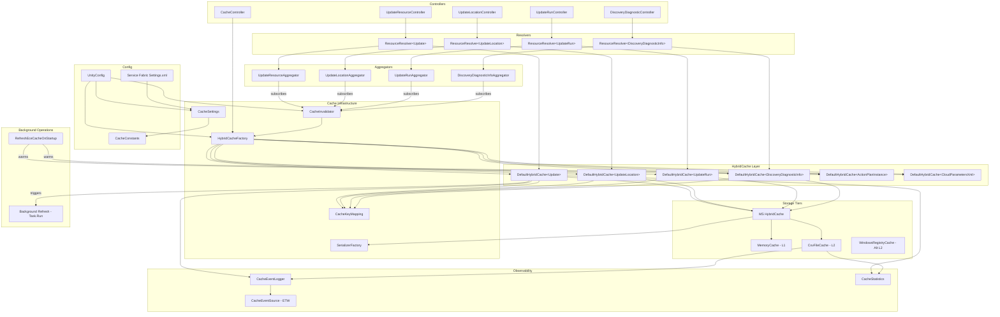
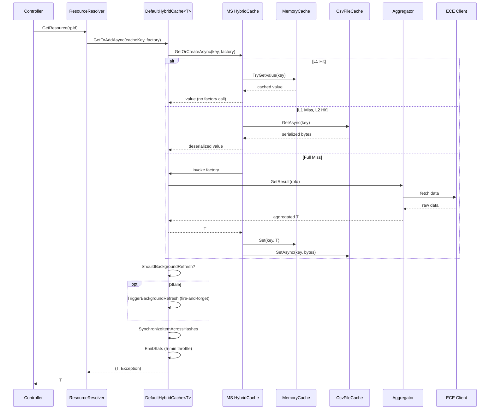
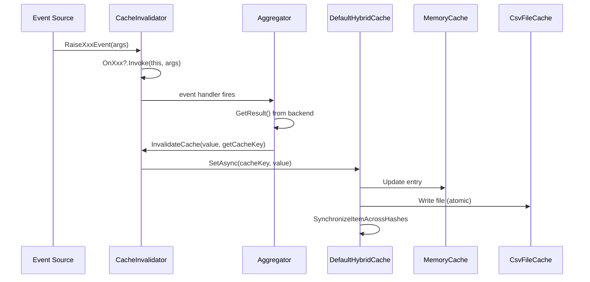

# HybridCache Deep-Dive: Exhaustive Code Archaeology

> Every line of code in this repository linked to the HybridCache feature, traced exhaustively across 12 dimensions.

---

## Table of Contents

1. [Registration & Wiring](#1-registration--wiring)
2. [Serialization & Type Handling](#2-serialization--type-handling)
3. [Storage & Persistence](#3-storage--persistence)
4. [Runtime Behavior & Data Flow](#4-runtime-behavior--data-flow)
5. [Resilience & Failure Handling](#5-resilience--failure-handling)
6. [Concurrency & Thread Safety](#6-concurrency--thread-safety)
7. [Messaging & Event-Driven Behavior](#7-messaging--event-driven-behavior)
8. [Observability](#8-observability)
9. [Performance](#9-performance)
10. [Cross-Cutting Concerns](#10-cross-cutting-concerns)
11. [Testing](#11-testing)
12. [Knowledge Graph](#12-knowledge-graph)

---

## 1. Registration & Wiring

### 1.1 Entry Point

**File:** `src/UpdateResourceProvider/UpdateService/Service/Source/UnityConfig.cs`

The cache system bootstraps via `RegisterComponents<TDependency>()` (lines 69-78):

```csharp
public static UnityContainer RegisterComponents<TDependency>(TDependency dependency)
    where TDependency : IConfigurationDependency, IReliableStateDependency, IServiceDiscoveryDependency
{
    var container = new UnityContainer();
    RegisterCaching(container);                              // Line 74
    RegisterServiceComponents(dependency, container);        // Line 75
    return container;
}
```

### 1.2 RegisterCaching — Complete 7-Step Chain

**File:** `src/UpdateResourceProvider/UpdateService/Service/Source/UnityConfig.cs`, lines 454-588

#### Step 1: Configuration Dictionary (lines 456-457)

```csharp
var configDict = ConfigurationHandler.Instance.GetDictionary();
container.RegisterInstance<Dictionary<string, string>>("config", configDict);
```

`ConfigurationHandler` reads from Service Fabric `Settings.xml` (`PackageRoot/Config/Settings.xml`) and produces a flat `Dictionary<string, string>`.

#### Step 2: Global Cache Settings (lines 460-467)

```csharp
var cacheSettings = CacheSettings.GetCacheSettings(configDict);
if (!cacheSettings.FileCacheSettings.IsDisabled)
{
    if (!Directory.Exists(cacheSettings.FileCacheSettings.CacheFolder))
    {
        Directory.CreateDirectory(cacheSettings.FileCacheSettings.CacheFolder);
    }
}
```

`CacheSettings.GetCacheSettings()` (file: `src/Common/Common/Source/Caching/CacheSettings.cs`, lines 62-93) reads global parameters:

| Parameter Name | Default | Source Constant |
|---|---|---|
| `Cache/Memory/Disabled` | `false` | `IsMemoryCacheDisabledParameterName` |
| `Cache/Memory/CompactionPercentage` | `0.05` | `MemoryCacheCompactionPercentageParameterName` |
| `Cache/Memory/SizeLimit` | `104857600` (100 MB) | `MemoryCacheSizeLimitParameterName` |
| `Cache/Memory/TimeToLive` | `00:02:00:00` (120 min) | `MemoryCacheTimeToLiveParameterName` |
| `Cache/File/Disabled` | `false` | `IsFileCacheDisabledParameterName` |
| `Cache/File/CacheFolder` | `C:\ClusterStorage\Infrastructure_1\Shares\SU1_Infrastructure_1\Updates\Caches` | `FileCacheFolderParameterName` |
| `Cache/File/TimeToLive` | `1.00:00:00` (24 hours) | `FileCacheTimeToLiveParameterName` |
| `Cache/File/PurgeExpirationInDays` | `null` | `FileCachePurgeExpirationInDaysParameterName` |
| `Cache/MaximumPayloadSize` | `104857600` (100 MB) | `MaximumPayloadSizeParameterName` |
| `Cache/ReportStats` | `true` | `ReportStatsParameterName` |
| `Cache/BackgroundRefresh/Enabled` | `true` | `BackgroundRefreshEnabledParameterName` |
| `Cache/BackgroundRefresh/ValueFactoryTimeout` | `00:03:00` (3 min) | `BackgroundValueFactoryTimeoutParameterName` |
| `Cache/BackgroundRefresh/StalenessThreshold` | `00:05:00` (5 min) | `BackgroundRefreshStalenessThresholdParameterName` |

These are defined in `CacheConstants.cs` (file: `src/Common/Common/Source/Caching/CacheConstants.cs`, 112 lines).

#### Step 3: Type-Specific Settings Pre-Registration (lines 471-498)

Six types are configured with type-specific TTLs before any cache instances are created:

```csharp
CacheSettings.GetCacheSettings<DiscoveryDiagnosticInfo>(
    configDict,
    TimeSpan.FromMinutes(30),    // defaultTtl
    false,                        // enableBackgroundRefresh
    TimeSpan.FromMinutes(3),     // valueFactoryTimeout
    TimeSpan.FromSeconds(10))    // stalenessThreshold
    .AddToConfig<DiscoveryDiagnosticInfo>(configDict);

CacheSettings.GetCacheSettings<Update>(configDict, TimeSpan.FromMinutes(30), false,
    TimeSpan.FromMinutes(3), TimeSpan.FromSeconds(10))
    .AddToConfig<Update>(configDict);

CacheSettings.GetCacheSettings<UpdateRun>(configDict, TimeSpan.FromMinutes(30), false,
    TimeSpan.FromMinutes(3), TimeSpan.FromSeconds(10))
    .AddToConfig<UpdateRun>(configDict);

CacheSettings.GetCacheSettings<UpdateLocation>(configDict, TimeSpan.FromMinutes(30), false,
    TimeSpan.FromMinutes(3), TimeSpan.FromSeconds(10))
    .AddToConfig<UpdateLocation>(configDict);

CacheSettings.GetCacheSettings<ActionPlanInstance>(configDict,
    BufferedECEClientSettings.Default.ActionPlanInstanceExpirationTime,
    false, TimeSpan.FromMinutes(3), TimeSpan.FromSeconds(10))
    .AddToConfig<ActionPlanInstance>(configDict);

CacheSettings.GetCacheSettings<CloudParametersXml>(configDict,
    BufferedECEClientSettings.Default.CloudDefinitionExpirationTime)
    .AddToConfig<CloudParametersXml>(configDict);
```

`AddToConfig<T>()` writes config keys with a type suffix. The suffix is computed by `CacheConstants.TypeSettingSuffix<T>()` which returns `"." + typeof(T).Name` (e.g., `.Update`, `.UpdateRun`). This allows per-type override of any global cache setting.

`GetCacheSettings<T>()` (lines 105-143) reads the same parameter names but appended with the type suffix. If a type-specific value is not found, it falls back to the defaults passed as method parameters.

#### Step 4: Microsoft.Extensions.Caching Infrastructure (lines 515-571)

A separate `ServiceCollection` is built to leverage the MS.Extensions.Caching.Hybrid library:

```csharp
var services = new ServiceCollection();
```

**SystemClock** (lines 516-517):
```csharp
var clock = new SystemClock();
services.AddSingleton<ISystemClock>(clock);
```

**MemoryCache (L1)** (lines 518-531):
```csharp
var memoryCacheOptions = new MemoryCacheOptions()
{
    Clock = clock,
    SizeLimit = cacheSettings.MemoryCacheSettings.SizeLimit,                      // 100 MB
    TrackStatistics = cacheSettings.ReportCacheStats,                              // true
    TrackLinkedCacheEntries = false,
    CompactionPercentage = cacheSettings.MemoryCacheSettings.CompactionPercentage, // 0.05
    ExpirationScanFrequency =
        cacheSettings.MemoryCacheSettings.TimeToLive.HasValue
            ? TimeSpan.FromTicks(cacheSettings.MemoryCacheSettings.TimeToLive.Value.Ticks / 2)
            : CacheConstants.DefaultMemoryCacheTimeToLive  // 120 minutes
};
var memoryCache = new MemoryCache(memoryCacheOptions);
services.AddSingleton<IMemoryCache>(memoryCache);
```

**CsvFileCache (L2)** (lines 533-534):
```csharp
var fileCache = new CsvFileCache(cacheSettings.FileCacheSettings, clock);
services.AddSingleton<IDistributedCache>(fileCache);
```

**SerializerFactory** (lines 536-541):
```csharp
var serializerFactory = new SerializerFactory();
serializerFactory.RegisterConverter<Update>(new UpdateJsonConverter());
serializerFactory.RegisterConverter<UpdateRun>(new UpdateRunJsonConverter());
serializerFactory.RegisterConverter<UpdateLocation>(new UpdateLocationJsonConverter());
serializerFactory.RegisterConverter<DiscoveryDiagnosticInfo>(new DiscoveryDiagnosticInfoJsonConverter());
services.AddSingleton<IHybridCacheSerializerFactory>(serializerFactory);
```

**HybridCache Entry Options** (lines 543-570):
```csharp
var defaultHybridCacheFlags = HybridCacheEntryFlags.None;
if (cacheSettings.MemoryCacheSettings.IsDisabled)
    defaultHybridCacheFlags |= HybridCacheEntryFlags.DisableLocalCache;
if (cacheSettings.FileCacheSettings.IsDisabled)
    defaultHybridCacheFlags |= HybridCacheEntryFlags.DisableDistributedCache;

services.AddHybridCache(options =>
{
    options.MaximumPayloadBytes = cacheSettings.MaximumPayloadBytes;   // 100 MB
    options.MaximumKeyLength = 260;                                    // file path limit
    options.DefaultEntryOptions = new HybridCacheEntryOptions()
    {
        Expiration = cacheSettings.FileCacheSettings.IsDisabled
            ? null : cacheSettings.FileCacheSettings.TimeToLive,       // 24 hours
        LocalCacheExpiration = cacheSettings.MemoryCacheSettings.IsDisabled
            ? null : cacheSettings.MemoryCacheSettings.TimeToLive,     // 120 minutes
        Flags = defaultHybridCacheFlags
    };
});
```

#### Step 5: Bridge to Unity Container (lines 572-578)

```csharp
var serviceProvider = services.BuildServiceProvider();
var hybridCache = serviceProvider.GetRequiredService<HybridCache>();

container.RegisterInstance<IHybridCacheSerializerFactory>(serializerFactory);
container.RegisterInstance<IMemoryCache>(memoryCache);
container.RegisterInstance<IDistributedCache>(fileCache);
container.RegisterInstance<HybridCache>(hybridCache);
```

This bridges Microsoft.Extensions.DependencyInjection (modern) to Unity (legacy) by resolving from one container and registering instances in the other.

#### Step 6: HybridCacheFactory (lines 579-584)

```csharp
var hybridCacheFactory = new HybridCacheFactory(
    hybridCache,
    memoryCache,
    fileCache,
    configDict);
container.RegisterInstance<IHybridCacheFactory>(hybridCacheFactory);
```

**File:** `src/Common/Common/Source/Caching/HybridCacheFactory.cs` (113 lines)

`HybridCacheFactory` holds a `ConcurrentDictionary<Type, IHybridCache>` (line 24) providing singleton-per-type semantics:

```csharp
public IHybridCache<T> CreateCache<T>(TimeSpan expirySpan, TimeSpan? valueFactoryTimeout = null)
    where T : ICachedItem
{
    return (IHybridCache<T>)this.cacheInstances.GetOrAdd(typeof(T), _ =>
    {
        this.PopulateConfig<T>(expirySpan, valueFactoryTimeout);
        return new DefaultHybridCache<T>(
            this.innerCache, this.memoryCache, this.distributedCache,
            CacheSettings.GetCacheSettings<T>(this.configDict));
    });
}
```

`PopulateConfig<T>()` (lines 90-111) writes type-specific TTL and background refresh settings into `configDict` before `GetCacheSettings<T>` reads them.

`RegisterHybridCache<T>()` (lines 67-70) uses `AddOrUpdate` to allow explicit replacement:
```csharp
public void RegisterHybridCache<T>(IHybridCache<T> cache) where T : ICachedItem
{
    this.cacheInstances.AddOrUpdate(typeof(T), cache, (_, _) => cache);
}
```

#### Step 7: CacheInvalidator (lines 586-587)

```csharp
ICacheInvalidator cacheInvalidator = new CacheInvalidator(hybridCacheFactory);
container.RegisterInstance<ICacheInvalidator>(cacheInvalidator);
```

### 1.3 Consumer Registrations

After `RegisterCaching()`, `RegisterServiceComponents()` resolves the caching infrastructure and registers four resource type caches. Each follows an identical pattern through its handler's `RegisterDependencyInjectedTypes()`:

#### Update (file: `src/UpdateResourceProvider/UpdateService/Core/Source/UpdateResourceHandler.cs`, lines 154-182)

```csharp
container.RegisterType<IResourceAggregator<Update>, UpdateResourceAggregator>(
    new ContainerControlledLifetimeManager());

container.RegisterType<IHybridCache<Update>, DefaultHybridCache<Update>>(
    new ContainerControlledLifetimeManager(),
    new InjectionConstructor(
        container.Resolve<HybridCache>(),
        container.Resolve<IMemoryCache>(),
        container.Resolve<IDistributedCache>(),
        cacheSettings));
var hybCache = container.Resolve<IHybridCache<Update>>();
var cacheFactory = container.Resolve<IHybridCacheFactory>();
cacheFactory.RegisterHybridCache(hybCache);

container.RegisterType<IResourceResolver<Update>, ResourceResolver<Update>>(
    new ContainerControlledLifetimeManager(),
    new InjectionConstructor(
        new ResolvedParameter<IHybridCache<Update>>(),
        new ResolvedParameter<IResourceAggregator<Update>>(),
        resolverTimeoutSpan));
```

#### UpdateLocation (file: `src/UpdateResourceProvider/UpdateService/Core/Source/UpdateLocationResourceHandler.cs`, lines 61-86)

Identical pattern for `IHybridCache<UpdateLocation>`.

#### UpdateRun (file: `src/UpdateResourceProvider/UpdateService/Core/Source/UpdateRunResourceHandler.cs`, lines 63-87)

Identical pattern for `IHybridCache<UpdateRun>`.

#### DiscoveryDiagnosticInfo (file: `src/UpdateResourceProvider/UpdateService/Core/Source/DiscoveryDiagnosticInfoHandler.cs`, lines 42-66)

Identical pattern for `IHybridCache<DiscoveryDiagnosticInfo>`.

### 1.4 Complete Registration Call Sequence

```
UnityConfig.RegisterComponents<TDependency>()
  |
  +-- RegisterCaching(container)
  |    +-- Load global config dictionary from ConfigurationHandler
  |    +-- Create CacheSettings (global)
  |    +-- Pre-register type-specific settings:
  |    |    +-- DiscoveryDiagnosticInfo (TTL: 30 min, ValueFactory: 3 min, Staleness: 10 sec)
  |    |    +-- Update              (TTL: 30 min, ValueFactory: 3 min, Staleness: 10 sec)
  |    |    +-- UpdateRun           (TTL: 30 min, ValueFactory: 3 min, Staleness: 10 sec)
  |    |    +-- UpdateLocation      (TTL: 30 min, ValueFactory: 3 min, Staleness: 10 sec)
  |    |    +-- ActionPlanInstance   (TTL: from ECE settings, ValueFactory: 3 min)
  |    |    +-- CloudParametersXml  (TTL: from ECE settings)
  |    +-- Create ServiceCollection and SystemClock
  |    +-- Create MemoryCache (L1)
  |    |    - SizeLimit: 100 MB
  |    |    - CompactionPercentage: 5%
  |    |    - ExpirationScanFrequency: 60 min (half of 120 min TTL)
  |    +-- Create CsvFileCache (L2)
  |    |    - CacheFolder: C:\ClusterStorage\...\Updates\Caches
  |    +-- Create SerializerFactory + register 4 custom JSON converters
  |    +-- Configure HybridCache options (MaxPayload: 100 MB, MaxKeyLength: 260)
  |    +-- Build ServiceProvider and resolve HybridCache
  |    +-- Bridge instances to Unity container
  |    +-- Create HybridCacheFactory (singleton-per-type dictionary)
  |    +-- Create CacheInvalidator
  |
  +-- RegisterServiceComponents<TDependency>()
       +-- Resolve caching infrastructure from container
       +-- For each resource type {Update, UpdateLocation, UpdateRun, DiscoveryDiagnosticInfo}:
       |    +-- Register IResourceAggregator<T> (singleton)
       |    +-- Create DefaultHybridCache<T> (singleton)
       |    +-- Register in HybridCacheFactory.cacheInstances
       |    +-- Register IResourceResolver<T> (singleton)
       +-- Register CacheController, other controllers
       +-- Register ECE clients, download connectors with ICacheInvalidator
```

### 1.5 Key Interfaces

**File:** `src/Common/Common/Source/Caching/IHybridCache.cs` (47 lines)

```csharp
public interface IHybridCache
{
    List<CacheStatistics> ReportStats();
    Task<CacheSettings> ExportSettings();
    Task<bool> ImportSettings(CacheSettings settings, string settingFile);
}

public interface IHybridCache<T> : IHybridCache, IListHybridCache<T> where T : ICachedItem
{
    Task<T> GetFromCacheAsync(CacheKey key, CancellationToken token = default);
    Task<(T, Exception)> GetOrAddAsync(CacheKey key, Func<CancellationToken, Task<T>> valueFactory,
        TimeSpan? expiration = null, CancellationToken token = default);
    Task SetAsync(CacheKey key, T value, TimeSpan? expiration = null, CancellationToken token = default);
    Task RemoveAsync(CacheKey key, CancellationToken token = default);
    Task<bool> ExistsAsync(CacheKey key, CancellationToken token = default);
    Task ClearAsync(CacheKey key, CancellationToken token = default);
}
```

**File:** `src/Common/Common/Source/Caching/IListHybridCache.cs` (36 lines)

```csharp
public interface IListHybridCache<T> where T : ICachedItem
{
    Task<List<T>> GetListFromCacheAsync(CacheKey listKey, CancellationToken token = default);
    Task<(List<T>, Exception)> GetOrAddListAsync(CacheKey listKey,
        Func<CancellationToken, Task<List<T>>> valueFactory,
        TimeSpan? expiration = null, CancellationToken token = default);
    Task SetListAsync(List<T> list, TimeSpan? expiration = null, CacheKey? listCacheKeyOverride = null,
        CancellationToken token = default);
    Task<bool> ListExistsAsync(CacheKey listKey, CancellationToken token = default);
}
```

**File:** `src/Common/Common/Source/Caching/IHybridCacheFactory.cs` (58 lines)

```csharp
public interface IHybridCacheFactory
{
    IHybridCache<T> CreateCache<T>(TimeSpan expirySpan, TimeSpan? valueFactoryTimeout = null)
        where T : ICachedItem;
    IListHybridCache<T> CreateListCache<T>(TimeSpan expirySpan, TimeSpan? valueFactoryTimeout = null)
        where T : ICachedItem;
    void RegisterHybridCache<T>(IHybridCache<T> cache) where T : ICachedItem;
    IHybridCache<T> TryGet<T>() where T : ICachedItem;
    IHybridCache TryGet(string typeName);
    IHybridCache GetFirstOrDefault();
}
```

---

## 2. Serialization & Type Handling

### 2.1 SerializerFactory Dispatch Chain

**File:** `src/Common/Common/Source/Serialization/SerializerFactory.cs` (219 lines)

`SerializerFactory` implements `IHybridCacheSerializerFactory` (from Microsoft.Extensions.Caching.Hybrid). Its `TryCreateSerializer<T>()` method (lines 67-99) follows a strict ordered dispatch:

| Priority | Condition | Serializer Returned |
|---|---|---|
| 1 | `TypeMatches(typeof(T), typeof(XElement), "CloudParametersXml")` | `DefaultXElementSerializer<T>` |
| 2 | `TypeInNamespace(typeof(T), eceNamespaces)` | `DefaultTextSerializer<T>` |
| 3 | `typeSpecificSettings.TryGetValue(typeof(T), ...)` | `HybridJsonSerializer<T>(settings)` |
| 4 | `TypeMatches(typeof(T), "InstalledVersion")` | `DefaultTextSerializer<T>` |
| 5 | `TypeMatches(typeof(T), "EnvironmentReadinessTestResult")` | `DefaultTextSerializer<T>` |
| 6 | `TypeInNamespace(typeof(T), updateNamespaces)` | `DefaultBinarySerializer<T>` |
| 7 | Fallback | `DefaultTextSerializer<T>` |

**Namespace matchers** (lines 20-26):

```csharp
private readonly IReadOnlyList<string> updateNamespaces = new List<string>
{
    "Microsoft.AzureStack.Services.Update",
    "Microsoft.AzureStack.UpdateService",
    "Microsoft.EnvironmentReadiness",
    "Microsoft.AzureStack.Services.Fabric"
};
```

**Type-specific converter registration** (lines 48-58):

```csharp
public void RegisterConverter<T>(JsonConverter<T> converter)
{
    var settings = new JsonSerializerSettings
    {
        NullValueHandling = this.defaultSettings.NullValueHandling,
        Formatting = this.defaultSettings.Formatting,
        Converters = new List<JsonConverter>()
    };
    settings.Converters.Add(converter);
    this.typeSpecificSettings[typeof(T)] = settings;
}
```

The `typeSpecificSettings` is a `ConcurrentDictionary<Type, JsonSerializerSettings>` (line 28).

**Helper methods:**

- `TypeMatches(Type, Type, string)` (lines 171-186): checks type equality OR type.Name match
- `TypeMatches(Type, string)` (lines 188-201): checks type.Name match only
- `TypeInNamespace(Type, IReadOnlyList<string>)` (lines 203-216): checks if type namespace contains any target string
- `GetItemType<T>()` / `GetItemType(Type)` (lines 122-169): extracts element type from collections (Array, `List<T>`, `ConcurrentBag<T>`, `IDictionary<string,T>`, `IEnumerable<T>`)

### 2.2 All Serializer Implementations

#### DefaultBinarySerializer\<T\>

**File:** `src/Common/Common/Source/Serialization/DefaultBinarySerializer.cs` (128 lines)

- Uses `System.Runtime.Serialization.Formatters.Binary.BinaryFormatter`
- Security: Custom `KnownTypesBinder(typeof(T))` restricts deserialization to trusted types (line 30)
- `StreamingContext` set to `StreamingContextStates.All` (line 31)
- Handles null input: returns `null`/`default`
- CodeQL comments (lines 89, 103, 116) note restriction to trusted namespaces

#### DefaultJsonSerializer\<T\>

**File:** `src/Common/Common/Source/Serialization/DefaultJsonSerializer.cs` (128 lines)

- Uses `Newtonsoft.Json.JsonConvert` (no custom settings)
- Special `List<T>` handling (lines 102-125): if JSON is an object not array, wraps single element
- Special `ConcurrentBag<T>` handling (lines 124-139): deserializes as array then creates bag
- UTF-8 encoding throughout
- Error wrapping in `InvalidOperationException` with JSON payload (line 70)

#### HybridJsonSerializer\<T\>

**File:** `src/Common/Common/Source/Serialization/HybridJsonSerializer.cs` (67 lines)

- Uses `Newtonsoft.Json.JsonConvert` with custom `JsonSerializerSettings`
- Default settings: `NullValueHandling = Ignore`, `Formatting = None`
- Constructor accepts optional `JsonSerializerSettings` parameter (line 22)
- This is the serializer used for the four main domain types (Update, UpdateRun, UpdateLocation, DiscoveryDiagnosticInfo) via their registered custom converters

#### HybridJsonTextSerializer\<T\>

**File:** `src/Common/Common/Source/Serialization/HybridJsonTextSerializer.cs` (65 lines)

- Uses `System.Text.Json.JsonSerializer` (modern .NET)
- Default options: `DefaultIgnoreCondition = WhenWritingNull`, `PropertyNameCaseInsensitive = true`, `WriteIndented = false`
- Validates all bytes consumed, throws if trailing content (lines 45-48)

#### DefaultTextSerializer\<T\>

**File:** `src/Common/Common/Source/Serialization/DefaultTextSerializer.cs` (146 lines)

- Uses `System.Text.Json.JsonSerializer`
- Same `List<T>` / `ConcurrentBag<T>` single-object workarounds as DefaultJsonSerializer
- Default fallback serializer for ECE types, InstalledVersion, EnvironmentReadinessTestResult, and unknown types

#### DefaultDataContractSerializer\<T\>

**File:** `src/Common/Common/Source/Serialization/DefaultDataContractSerializer.cs` (87 lines)

- Uses `System.Runtime.Serialization.DataContractSerializer`
- XML-based format via `XmlDictionaryWriter` / `XmlDictionaryReader`
- Available via explicit `CreateSerializer<T>(SerializerType.DataContract)` method

#### DefaultXElementSerializer\<T\>

**File:** `src/Common/Common/Source/Serialization/DefaultXElementSerializer.cs` (152 lines)

- Handles `XElement` directly: `element.Save(stream)` (lines 29, 49, 69)
- Non-XElement: uses `XmlSerializer(typeof(T))` (lines 142-149)
- Large payload chunking: 1 MB chunks for `IBufferWriter` (lines 80-87)
- Used exclusively for `CloudParametersXml`

#### MsgPackSerializer\<T\>

**File:** `src/Common/Common/Source/Serialization/MsgPackSerializer.cs` (91 lines)

- Uses `MessagePack.MessagePackSerializer`
- Options: `StandardResolver.Instance` with `ContractlessStandardResolver` (line 21)
- Available via explicit `CreateSerializer<T>(SerializerType.MessagePack)` method

#### JsonTextSerializer\<T\>

**File:** `src/Common/Common/Source/Serialization/JsonTextSerializer.cs` (56 lines)

- Uses `System.Text.Json.JsonSerializer` (identical behavior to HybridJsonTextSerializer)
- Available via explicit creation

### 2.3 ICachedItemSerializer\<T\> Interface

**File:** `src/Common/Common/Source/Serialization/ICachedItemSerializer.cs` (50 lines)

```csharp
public interface ICachedItemSerializer<T> : IHybridCacheSerializer<T>
{
    byte[] Serialize(T obj);
    T Deserialize(byte[] data);
    ValueTask<byte[]> SerializeAsync(T obj, CancellationToken token = default);
    ValueTask<T> DeserializeAsync(byte[] data, CancellationToken token = default);
}
```

Extends `IHybridCacheSerializer<T>` from Microsoft.Extensions.Caching.Hybrid which requires:
```csharp
void Serialize(T value, IBufferWriter<byte> target);
T Deserialize(ReadOnlySequence<byte> source);
```

### 2.4 Custom JSON Converters for Domain Models

Four Newtonsoft.Json converters handle domain-specific serialization of the main resource types:

#### UpdateJsonConverter

**File:** `src/UpdateResourceProvider/UpdateService/Models/Core/Serialization/UpdateJsonConverter.cs` (486 lines)

Nested converter stack (lines 26-40): `StringEnumConverter`, `VersionConverter`, `ManifestInfoJsonConverter`, `OSInfoJsonConverter`, `UpdateImpactJsonConverter`, `UpdateZipFileJsonConverter`, `UpdateMetadataFileJsonConverter`, `ValidatedConfigurationJsonConverter`, `PackageInfoJsonConverter`.

- `WriteJson` (lines 42-306): manually serializes 50+ properties including RpId, versions (as strings), states, metadata, package info, OEM data, child updates, bill of materials
- `ReadJson` (lines 308-452): parses JObject, validates RpId (required), creates Update via constructor
- Helpers: `ParseVersion(JToken)` (lines 454-463), `ParseEnum<T>(JToken)` (lines 465-484)
- Error handling: logs via `CacheEventLogger.CacheSerializerError()`, throws `JsonConverterException`

#### UpdateRunJsonConverter

**File:** `src/UpdateResourceProvider/UpdateService/Models/Core/Serialization/UpdateRunJsonConverter.cs` (167 lines)

Nested converters: `StringEnumConverter`, `Iso8601TimeSpanConverter`.

- `WriteJson` (lines 32-85): serializes State, Progress, TimeStarted, Duration (ISO 8601), flags
- `ReadJson` (lines 87-123): parses with `ParseTimeSpan()` fallback to `TimeSpan.Zero`

#### UpdateLocationJsonConverter

**File:** `src/UpdateResourceProvider/UpdateService/Models/Core/Serialization/UpdateLocationJsonConverter.cs` (206 lines)

Nested converters: `StringEnumConverter`, `VersionConverter`.

- `WriteJson` (lines 36-122): serializes hardware info, versions, states, health check data
- `ReadJson` (lines 124-172): parses with Version, enum helpers

#### DiscoveryDiagnosticInfoJsonConverter

**File:** `src/UpdateResourceProvider/UpdateService/Models/Core/Serialization/DiscoveryDiagnosticInfoJsonConverter.cs` (283 lines)

Nested converters: `StringEnumConverter`, `VersionConverter`.

- `WriteJson` (lines 33-78): serializes ManifestDiagnostics, NonApplicableUpdates, DiscoveryConfiguration via dedicated helper methods
- `ReadJson` (lines 80-132): parses with `ReadManifestDiagnostics()`, `ReadDiscoveredUpdateDiagnostics()`, `ReadDiscoveryConfiguration()`

### 2.5 ICachedItem Implementations

**File:** `src/Common/Common/Source/Caching/ICachedItem.cs` (41 lines)

```csharp
public interface ICachedItem
{
    CacheKey GetCacheKey();
    DateTime GetLastModifiedTime();
    string GetStateLogMessage();
}
```

**Base class:** `BaseResourceProperties` (`src/Common/Resource/Source/Models/BaseResourceProperties.cs`, 60 lines)

```csharp
public virtual CacheKey GetCacheKey()
{
    return CacheKey.ForItem(this.GetType(), this.RpId.ArmName, null);
}
```

| Type | GetCacheKey() | GetLastModifiedTime() |
|---|---|---|
| `Update` | Inherited from BaseResourceProperties | Private `DateTime lastModifiedTime` (initialized to `UtcNow`) |
| `UpdateRun` | Inherited | Private `DateTime lastModifiedTime = DateTime.UtcNow` |
| `UpdateLocation` | Inherited | Private `DateTime lastModifiedTime = DateTime.UtcNow` |
| `DiscoveryDiagnosticInfo` | Inherited | `this.lastModifiedTime` |
| `CloudParametersXml` | `CacheKey.ForItem(typeof(CloudParametersXml), "single", null)` | `this.lastModifiedTime` |
| `ActionPlanInstance` | `CacheKey.ForItem<ActionPlanInstance>(InstanceID.ToString(), null)` | `this.lastModifiedTime` |

### 2.6 CacheKey Structure

**File:** `src/Common/Common/Source/Caching/CacheKey.cs` (480 lines)

`CacheKey` is a `readonly struct` with:

- `Key` (string): type-qualified key (e.g., `Update/subscriptions/.../updates/2405`)
- `Hash` (string): query hash for OData filtering, or `null` for default views
- `IsList` (bool): whether this key represents a list
- `FullKey` (string, computed): `Key` or `Key-Hash`

**Factory methods:**

- `ForItem<T>(string name, string queryHash)`: creates item key `TypeName/name[-hash]`
- `ForList<T>(string name, string queryHash)`: creates list key `TypeName/list[-hash]` or `TypeName/name[-hash]` (IsList=true)
- `WithHash(string hash)`: creates copy with different hash
- `WithoutHash()`: creates copy with null hash
- `GetParentListCacheKey<T>()`: derives list key from item key
- `Parse(string)` / `TryParse(string)`: reconstructs from `FullKey` string

**Hash validation:** `IsLikelyHash(string)` validates 16-character uppercase hex (lines 380-400).

**File:** `src/Common/Common/Source/Caching/DefaultCacheKey.cs` (97 lines)

- `GetConsistentHash(string)`: SHA256 -> 16 uppercase hex chars
- `GetQueryHash(string)`: for OData query parameter hashing
- `ComputeHash(string)`: underlying SHA256 computation
- `SanitizeFilename(string)`: removes invalid file path characters
- `HexConverter.ToHexString(byte[])`: byte array to hex extension

---

## 3. Storage & Persistence

### 3.1 Two-Tier Architecture

The HybridCache uses a two-tier (L1 + L2) architecture:

- **L1 (Memory):** `Microsoft.Extensions.Caching.Memory.MemoryCache` — in-process, fast, volatile
- **L2 (File):** `CsvFileCache` — binary files on Cluster Shared Volume (CSV), persistent across restarts, shared across cluster nodes

Both are accessed through the unified `Microsoft.Extensions.Caching.Hybrid.HybridCache` abstraction.

### 3.2 CsvFileCache — L2 File-Based Cache

**File:** `src/Common/Common/Source/Caching/CsvFileCache.cs`

Despite the class name, files are **binary** (NOT CSV).

#### File Format

```
[8 bytes: Absolute Expiration Ticks (Int64, little-endian)]
[remaining bytes: serialized payload]
```

- Header type: `long` via `BitConverter.GetBytes()` / `BitConverter.ToInt64()`
- Value `0` = no absolute expiration set
- Value `> 0` = UTC ticks representing expiration time

#### File Path Construction

```csharp
internal static string CacheKeyToFilePath(string cacheKey, string cacheFolder)
{
    var sanitizedKey = cacheKey.Replace('/', Path.DirectorySeparatorChar)
        .Replace('\\', Path.DirectorySeparatorChar);
    return Path.Combine(cacheFolder, sanitizedKey);
}
```

Example: key `Update/subscriptions/.../updates/2405` becomes `C:\ClusterStorage\...\Updates\Caches\Update\subscriptions\...\updates\2405`.

#### GetAsync Flow

1. Convert cache key to file path
2. Fast path: if file doesn't exist, return null (cache miss)
3. Acquire per-file `SemaphoreSlim` lock
4. Double-check file existence after lock acquisition (TOCTOU protection)
5. Read file with retry logic (`ReadFileWithRetryAsync` — 3 retries, 100ms exponential backoff)
6. Parse 8-byte header for absolute expiration
7. Check TTL expiration: `File.GetCreationTimeUtc(cacheFile) + TimeToLive`
8. Check purge expiration: `creationTime + PurgeExpirationInDays`
9. If expired: schedule background deletion via `Task.Run()` (non-blocking)
10. Return payload (bytes after header), increment hit counter

#### SetAsync Flow

1. Create directory if needed: `Directory.CreateDirectory(cacheFileDirectory)`
2. Calculate absolute expiration from `DistributedCacheEntryOptions`
3. Construct 8-byte header + payload
4. Atomic write via temp file pattern:
   - Create temp file: `filePath + ".tmp." + Guid.NewGuid().ToString("N")`
   - Write to temp with `FileShare.None` (exclusive)
   - Delete old file if exists
   - Atomic rename: `File.Move(tempFile, filePath)`
   - Finally: best-effort temp file cleanup
5. Schedule background purge if `PurgeExpirationInDays` configured

#### RemoveAsync Flow

1. Convert key to file path
2. Call `DeleteFileWithRetryAsync` (5 retries, per-file lock)
3. Log removal event

#### ClearAllFiles

```csharp
public void ClearAllFiles(bool forceDelete = false)
```

- Enumerates all files recursively via `Directory.GetFiles()`
- `Parallel.ForEach` with `MaxDegreeOfParallelism = ProcessorCount * 2`
- If `forceDelete`: deletes all; otherwise checks `PurgeExpirationInDays` threshold
- Per-file exception handling (logs but continues)

### 3.3 WindowsRegistryCache — Alternative L2

**File:** `src/Common/Common/Source/Caching/WindowsRegistryCache.cs`

An alternative `IDistributedCache` implementation using Windows Registry (HKLM).

#### Data Format

```
[8 bytes: Absolute Expiration Ticks (Int64)]
[8 bytes: Sliding Expiration Ticks (Int64)]
[remaining bytes: serialized payload]
```

16-byte header (vs. CsvFileCache's 8-byte). Supports sliding expiration.

#### Sliding Expiration

On each `Get()`, if sliding ticks > 0, the absolute expiration is updated:
```csharp
var slidingCandidate = this.clock.UtcNow.AddTicks(slidingTicks);
var newExpiration = absoluteExpiration ?? slidingCandidate;
// Writes updated header back to registry
```

#### Registry Operations

- **Read:** `Registry.LocalMachine.OpenSubKey(RegistryPath, writable: false)`
- **Write:** `Registry.LocalMachine.CreateSubKey(RegistryPath).SetValue(valueName, value, RegistryValueKind.Binary)`
- **Delete:** `OpenSubKey(RegistryPath, writable: true).DeleteValue(valueName, throwOnMissingValue: false)`

### 3.4 MemoryCache Configuration

**File:** `src/Common/Common/Source/Caching/MemoryCacheSettings.cs` (41 lines)

```csharp
public class MemoryCacheSettings
{
    public bool IsDisabled { get; set; } = false;
    public double CompactionPercentage { get; set; } = 0.05;    // 5%
    public long? SizeLimit { get; set; } = CacheConstants.MaxPayloadSize;  // 100 MB
    public TimeSpan? TimeToLive { get; set; } = null;
}
```

### 3.5 FileCacheSettings

**File:** `src/Common/Common/Source/Caching/FileCacheSettings.cs` (43 lines)

```csharp
public class FileCacheSettings
{
    public bool IsDisabled { get; set; } = false;
    [FolderExistsValidation]
    public string CacheFolder { get; set; };
    public TimeSpan? TimeToLive { get; set; } = null;
    public int? PurgeExpirationInDays { get; set; } = null;
}
```

### 3.6 Settings Import/Export

**File:** `src/Common/Common/Source/Caching/DefaultHybridCache.cs`, lines 955-1005

`ExportSettings()` reads the Service Fabric `Settings.xml` and merges with current runtime settings:
```csharp
var localXmlSettingFile = Path.Combine(Directory.GetCurrentDirectory(), "Settings.xml");
var doc = XDocument.Load(localXmlSettingFile);
XNamespace ns = "http://schemas.microsoft.com/2011/01/fabric";
// reads ServiceConfigSection parameters
```

`ImportSettings()` validates via `DataAnnotations.Validator`, then writes back to XML:
```csharp
this.cacheSettings = settings;
this.RefreshCacheSettings();
if (File.Exists(settingFile))
    return await settings.SetCacheSettingsToXml<T>(settingFile);
```

---

## 4. Runtime Behavior & Data Flow

### 4.1 DefaultHybridCache\<T\> — Core Implementation

**File:** `src/Common/Common/Source/Caching/DefaultHybridCache.cs` (1009 lines)

This is the central class. Every cache operation flows through it.

### 4.2 GetFromCacheAsync (Read-Only)

Lines 120-168. Reads from cache without calling a value factory on miss.

```csharp
public async Task<T> GetFromCacheAsync(CacheKey key, CancellationToken token)
{
    if (this.isDisabled) return default;

    T result = default;
    await this.hybridCache.GetOrCreateAsync(
        key.FullKey,
        async ct => { cacheHit = false; return default; },  // factory returns default on miss
        readonlyCacheEntryOptions,  // DisableDistributedCacheWrite | DisableLocalCacheWrite
        cancellationToken: token);

    if (cacheHit)
        CacheEventLogger.CacheHit(key.FullKey);
    else
        CacheEventLogger.CacheMiss(key.FullKey);

    this.EmitStats();
    return result;
}
```

The `readonlyCacheEntryOptions` uses flags `DisableDistributedCacheWrite | DisableLocalCacheWrite` to prevent the "miss factory" result from being written back.

### 4.3 GetOrAddAsync (Read-Through)

Lines 183-279. The primary read method.

```csharp
public async Task<(T, Exception)> GetOrAddAsync(CacheKey key,
    Func<CancellationToken, Task<T>> valueFactory,
    TimeSpan? expiration, CancellationToken token)
{
    if (this.isDisabled)
    {
        // Bypass cache: call factory directly, return result without caching
        var value = await valueFactory(token);
        return (value, null);
    }

    T result = default;
    Exception valueFactoryException = null;
    bool cacheHit = true;

    result = await this.hybridCache.GetOrCreateAsync(
        key.FullKey,
        async ct =>
        {
            cacheHit = false;
            try
            {
                var value = await valueFactory(ct);
                return value;
            }
            catch (Exception ex)
            {
                valueFactoryException = ex;
                if (ex is OperationCanceledException)
                    this.TriggerBackgroundRefresh(key, valueFactory, expiration, key, result);
                return default;
            }
        },
        cacheEntryOptions.WithTtl(expiration),
        cancellationToken: token);

    if (!cacheHit && result != null)
        this.SynchronizeItemAcrossHashes(key, result, expiration);

    if (cacheHit && this.ShouldBackgroundRefresh(result))
        this.TriggerBackgroundRefresh(key, valueFactory, expiration, key, result);

    this.EmitStats();
    return (result, valueFactoryException);
}
```

**Key behaviors:**
- Stampede prevention is delegated to `HybridCache.GetOrCreateAsync()` which uses internal lock-per-key
- On `OperationCanceledException` from factory: triggers background refresh with existing stale value
- On cache hit with stale data: triggers background refresh proactively
- On cache miss with successful factory: synchronizes item across hash-matched lists

### 4.4 SetAsync

Lines 289-335. Explicit cache write.

```csharp
public async Task SetAsync(CacheKey key, T value, TimeSpan? expiration, CancellationToken token)
{
    if (this.isDisabled) return;

    await this.hybridCache.SetAsync(key.FullKey, value,
        cacheEntryOptions.WithTtl(expiration), token);

    CacheEventLogger.CacheSet(key.FullKey, "set");
    this.SynchronizeItemAcrossHashes(key, value, expiration);
    this.EmitStats();
}
```

### 4.5 GetOrAddListAsync

Lines 453-540. List retrieval with item-by-item cache reconstruction.

```csharp
public async Task<(List<T>, Exception)> GetOrAddListAsync(CacheKey listKey,
    Func<CancellationToken, Task<List<T>>> valueFactory,
    TimeSpan? expiration, CancellationToken token)
```

On cache hit: attempts to reconstruct the list from individually-cached items via `cacheKeyMapping.GetItemsInList()`. If the item count doesn't match (line 486: `itemKeys?.Count != cachedList.Count`), triggers background refresh.

On cache miss: calls factory, then `CacheListItems()` to store items individually and update mappings.

### 4.6 SetListAsync

Lines 551-588. Stores a list by caching each item individually.

```csharp
public async Task SetListAsync(List<T> list, TimeSpan? expiration,
    CacheKey? listCacheKeyOverride, CancellationToken token)
```

### 4.7 CacheListItems (Internal)

Lines 684-715. Core list caching logic:

1. For each item in the list: calls `SetAsync()` for the individual item
2. Collects all item cache keys
3. Calls `cacheKeyMapping.UpdateListMappings(listCacheKey, itemCacheKeys)` to update bidirectional maps
4. Items are cached sequentially (not parallel) to avoid overwhelming the system

### 4.8 Item-List Synchronization

**File:** `src/Common/Common/Source/Caching/CacheKeyMapping.cs` (270 lines)

`CacheKeyMapping` maintains bidirectional maps between items and lists:

```csharp
private readonly ConcurrentDictionary<CacheKey, HashSet<CacheKey>> itemToListsMap = new();
private readonly ConcurrentDictionary<CacheKey, HashSet<CacheKey>> listToItemsMap = new();
private readonly object syncLock = new object();
```

All mutations are guarded by `lock (this.syncLock)`:
- `AddItemToListMapping` (line 52)
- `RemoveItemFromListMapping` (line 84)
- `ClearListMappings` (line 154)
- `ClearItemMappings` (line 178)
- `UpdateListMappings` (line 207)
- `GetOrAddListsByHash` (line 247)
- `Clear` (line 263)

Hash-based filtering: Items only sync with lists sharing the same hash value.

`SynchronizeItemAcrossHashes()` in DefaultHybridCache (lines 717-737):
```csharp
var listCacheKey = itemCacheKey.GetParentListCacheKey<T>();
if (listCacheKey != default)
{
    var listsWithMatchingHash = this.cacheKeyMapping.GetOrAddListsByHash<T>(listCacheKey);
    foreach (var listKey in listsWithMatchingHash)
        this.cacheKeyMapping.AddItemToListMapping(itemCacheKey, listKey);
}
```

### 4.9 Background Refresh

Lines 761-814. Two fire-and-forget methods:

#### TriggerBackgroundRefresh (Single Item)

```csharp
private void TriggerBackgroundRefresh(CacheKey key,
    Func<CancellationToken, Task<T>> valueFactory,
    TimeSpan? expiration, CacheKey itemCacheKey, T staleResult)
{
    var timeout = cacheSettings.BackgroundRefreshSettings.ValueFactoryTimeout ?? TimeSpan.FromSeconds(30);
    var cts = new CancellationTokenSource(timeout);

    _ = Task.Run(async () =>
    {
        try
        {
            var freshValue = await valueFactory(cts.Token);
            if (freshValue != null)
                await this.SetAsync(key, freshValue, expiration, cts.Token);
        }
        catch (Exception ex)
        {
            CacheEventLogger.CacheRefreshFailed(key.FullKey, ex);
            // Stale value remains in cache — resilience by design
        }
    }, cts.Token);
}
```

#### TriggerListBackgroundRefresh (List)

Similar pattern but for lists. If refresh returns null/empty, calls `RemoveListAndAssociatedItems()` to clean up.

#### ShouldBackgroundRefresh

Lines 852-883. Determines staleness:

```csharp
internal bool ShouldBackgroundRefresh(T item)
{
    if (this.cacheSettings.BackgroundRefreshSettings.IsEnabled)
    {
        if (item == null) return true;
        var age = DateTime.UtcNow - item.GetLastModifiedTime();
        return age > this.cacheSettings.BackgroundRefreshSettings.StalenessThreshold;
    }
    return false;
}
```

### 4.10 WithTtl Extension

**File:** `src/Common/Common/Source/Caching/HybridCacheOptionExtensions.cs` (28 lines)

```csharp
public static HybridCacheEntryOptions WithTtl(this HybridCacheEntryOptions options, TimeSpan? ttl)
{
    var isLocalCacheDisabled = (options.Flags & HybridCacheEntryFlags.DisableLocalCache) != 0;
    var isRemoteCacheDisabled = (options.Flags & HybridCacheEntryFlags.DisableDistributedCache) != 0;
    return ttl.HasValue
        ? new HybridCacheEntryOptions()
        {
            Expiration = isRemoteCacheDisabled ? null : ttl,
            LocalCacheExpiration = isLocalCacheDisabled ? null : ttl,
            Flags = options.Flags
        }
        : options;
}
```

### 4.11 Global Disable Cache

When `CacheSettings.IsDisabled` is true (both L1 and L2 disabled):

| Method | Behavior |
|---|---|
| `GetFromCacheAsync` | Returns `default(T)` immediately |
| `GetOrAddAsync` | Calls valueFactory directly, does not cache result |
| `SetAsync` | No-op |
| `GetOrAddListAsync` | Calls valueFactory directly, does not cache result |

---

## 5. Resilience & Failure Handling

### 5.1 Exception Handling by Method

**File:** `src/Common/Common/Source/Caching/DefaultHybridCache.cs`

| Method | Lines | Catch Pattern | Recovery |
|---|---|---|---|
| `GetFromCacheAsync` | 120-168 | Catches `!(OperationCanceledException)` at 158 | Wraps in CacheException, propagates |
| `GetOrAddAsync` | 183-279 | Catches `!(OperationCanceledException)` at 253 | Wraps in CacheException, propagates |
| `SetAsync` | 289-335 | Catches `!(OperationCanceledException)` at 330 | Wraps in CacheException, propagates |
| `RemoveAsync` | 340-392 | Catches `!(OperationCanceledException)` at 387 | Wraps in CacheException, propagates |
| `SetListAsync` | 565-588 | Catches `!(OperationCanceledException)` at 583 | Wraps in CacheException, propagates |
| `ClearAsync` | 624-678 | Catches `!(OperationCanceledException)` at 671 | Wraps in CacheException, propagates |
| `ReportStats` | 913-953 | General catch at 947 | **Swallows exception**, logs only |

`OperationCanceledException` is always allowed to propagate uncaught — cancellation unwinds the call stack by design.

### 5.2 CacheException

**File:** `src/Common/Common/Source/Caching/CacheException.cs` (42 lines)

```csharp
public class CacheException : ResourceProviderException
{
    public CacheException(string message) : base(message) { }
    public CacheException(string message, Exception innerException) : base(message, innerException) { }
}
```

### 5.3 CsvFileCache Retry Logic

**Read retries** (ReadFileWithRetryAsync):
- Max 3 retries, 100ms base delay with exponential backoff
- `FileShare.ReadWrite` allows concurrent reads
- `IOException`: retry; `FileNotFoundException`: return null immediately
- After all retries: return null (cache miss)

**Write retries** (WriteFileAtomicAsync):
- Atomic temp file + rename pattern
- Max 3 retries for rename operation
- Finally block ensures temp file cleanup (best-effort)

**Delete retries** (DeleteFileWithRetryAsync):
- Max 5 retries with exponential backoff
- Catches `IOException` and `UnauthorizedAccessException`
- After retries: logs failure, does not throw

### 5.4 CacheInvalidator Failure Handling

**File:** `src/Common/Common/Source/Caching/CacheInvalidator.cs`, lines 53-156

```csharp
public async Task InvalidateCache<T>(T value, Func<T, CacheKey> getCacheKey, CancellationToken cancel)
{
    var cacheKey = getCacheKey(value);
    try
    {
        var cache = this.cacheFactory.TryGet<T>();
        if (cache != null)
            await cache.SetAsync(cacheKey, value, token: cancel);
    }
    catch (Exception e)
    {
        CacheEventLogger.CacheSetFailed(cacheKey.FullKey, e);
        // Exception swallowed — invalidation failures don't fail the operation
    }
}
```

### 5.5 Background Refresh Resilience

If background refresh fails:
- Exception is caught and logged via `CacheEventLogger.CacheRefreshFailed()`
- Stale value **remains in cache** — resilience by design
- Caller already received the stale value, so no impact on current request

### 5.6 Serializer Error Handling

Custom JSON converters log errors via `CacheEventLogger.CacheSerializerError()` and throw `JsonConverterException`. The HybridCache catches these and wraps in `CacheException`.

---

## 6. Concurrency & Thread Safety

### 6.1 DefaultHybridCache Shared State

| Field | Type | Synchronization |
|---|---|---|
| `cacheSettings` | `CacheSettings` | **None** (written by `ImportSettings`, read by all methods) |
| `isDisabled` | `bool` | Written once at init + `RefreshCacheSettings()`, read everywhere |
| `lastCacheStatsReportTime` | `DateTime?` | Check-then-act without lock |
| `cacheKeyMapping` | `CacheKeyMapping` | Internal `syncLock` (see below) |
| `hybridCache` | `HybridCache` | Thread-safe (MS library) |
| `memoryCache` | `IMemoryCache` | Thread-safe (`MemoryCache`) |
| `distributedCache` | `IDistributedCache` | Per-file locks (`CsvFileCache`) |

**Known race:** `cacheSettings` (line 56) is written by `ImportSettings()` without synchronization while read by all methods. Concurrent reads during import could see partial state.

### 6.2 Stampede Prevention

`HybridCache.GetOrCreateAsync()` internally uses a lock-per-key mechanism. When multiple threads call with the same key concurrently:
- Only the first executes the value factory
- Others wait for the result
- Prevents concurrent execution of expensive backend fetches

### 6.3 CsvFileCache Concurrency

**Per-file locking** (line 28):
```csharp
private readonly ConcurrentDictionary<string, SemaphoreSlim> fileLocks = new();
```

Each file path gets its own `SemaphoreSlim(1, 1)` (binary semaphore) via:
```csharp
private SemaphoreSlim GetOrCreateFileLock(string filePath)
{
    return this.fileLocks.GetOrAdd(filePath, _ => new SemaphoreSlim(1, 1));
}
```

**Double-check locking** in GetAsync:
```csharp
if (!File.Exists(cacheFile))       // Check 1: no lock, fast path
    return null;

var fileLock = this.GetOrCreateFileLock(cacheFile);
await fileLock.WaitAsync(token);
try {
    if (!File.Exists(cacheFile))   // Check 2: after lock, TOCTOU guard
        return null;
    // ... read file ...
}
finally { fileLock.Release(); }
```

**Lock cleanup race** (lines 476-487):
```csharp
private void CleanupFileLockIfPossible(string filePath)
{
    if (!File.Exists(filePath) && this.fileLocks.TryGetValue(filePath, out var semaphore))
    {
        if (semaphore.CurrentCount == 1)   // Not in use
        {
            this.fileLocks.TryRemove(filePath, out _);
            semaphore.Dispose();
        }
    }
}
```

Between `CurrentCount == 1` check and `TryRemove()`/`Dispose()`, another thread could call `WaitAsync()`. This can lead to dead semaphores in the dictionary — a bounded memory leak.

**Statistics** use `Interlocked.Increment` / `Interlocked.Read` for hit/miss counters. The `ReaderWriterLockSlim` (`statsLock`) is vestigial — `Interlocked` operations alone provide sufficient protection.

### 6.4 CacheKeyMapping Synchronization

All mutating operations use `lock (this.syncLock)`. Only `GetListsContainingItem()` is deliberately lock-free (marked with `// ReSharper disable once InconsistentlySynchronizedField`), taking a snapshot via `.ToList()`.

**Nested lock risk:** `UpdateListMappings()` (line 207) acquires `syncLock` then calls `ClearListMappings()` (line 210) which also acquires `syncLock` (line 154). In C#, `Monitor.Enter` (used by `lock`) **is reentrant** on the same thread, so this does **not** deadlock. The same thread can acquire the same `lock` object multiple times.

### 6.5 HybridCacheFactory Thread Safety

`ConcurrentDictionary<Type, IHybridCache>.GetOrAdd()` ensures singleton-per-type. `PopulateConfig<T>()` writes to a plain `Dictionary<string, string>`, but each type gets its own keys (via type suffix), preventing cross-type collision.

### 6.6 CacheInvalidator Thread Safety

Stateless — only holds a reference to `IHybridCacheFactory`. Event raising via `?.Invoke()` is inherently thread-safe (delegate invocation on a captured snapshot).

### 6.7 Concurrency Issue Summary

| File | Lines | Issue | Severity |
|---|---|---|---|
| DefaultHybridCache.cs | 56, 997 | `cacheSettings` written without synchronization | HIGH |
| DefaultHybridCache.cs | 57, 896-905 | `lastCacheStatsReportTime` check-then-act | LOW |
| DefaultHybridCache.cs | 771, 793 | Fire-and-forget background refresh | MEDIUM (by design) |
| CsvFileCache.cs | 476-487 | File lock cleanup race | MEDIUM (bounded leak) |
| CsvFileCache.cs | 275-301 | Purge without per-file lock | MEDIUM (handled) |
| CacheInvalidator.cs | 162+ | Exception in event handler breaks chain | MEDIUM |

---

## 7. Messaging & Event-Driven Behavior

### 7.1 CacheInvalidator Events

**File:** `src/Common/Common/Source/Caching/CacheInvalidator.cs` (227 lines)
**File:** `src/Common/Common/Source/Caching/ICacheInvalidator.cs` (460 lines)

The `CacheInvalidator` exposes 11 C# events:

| Event | EventArgs | Key Properties |
|---|---|---|
| `OnUpdateLocationSystemHealthCheckFinished` | `UpdateLocationHealthCheckFinishedEventArgs` | `RpIdString` |
| `OnUpdateAdded` | `UpdateAddedEventArgs` | `RpIdString`, `IncludeSuperseded`, `SkipPlatformUpdate` |
| `OnRefreshUpdate` | `RefreshUpdateEventArgs` | `RpIdString` |
| `OnRefreshUpdates` | `RefreshUpdatesEventArgs` | (none) |
| `OnUpdateRunAdded` | `UpdateRunAddedEventArgs` | `RpIdString`, `Phase` |
| `OnRefreshUpdateRun` | `RefreshUpdateRunEventArgs` | `RpIdString`, `Phase` |
| `OnRefreshActionPlanInstance` | `RefreshActionPlanInstanceEventArgs` | `InstanceId` (Guid) |
| `OnRefreshUpdateActionPlanInstances` | `RefreshUpdateActionPlanInstancesEventArgs` | (none) |
| `OnMonitorUpdateInstallationActionPlanInstance` | `MonitorUpdateInstallationActionPlanInstanceEventArgs` | `UpdateRpIdString`, `InstanceId` |
| `OnRefreshCloudParametersXml` | `RefreshCloudParametersXmlEventArgs` | (none) |
| `OnRefreshDiscoveryConfig` | `RefreshDiscoveryConfigEventArgs` | (none) |

All EventArgs derive from `BaseEventArgs` which captures caller info:
```csharp
public abstract class BaseEventArgs : EventArgs
{
    public string CallerFile { get; }
    public string CallerMember { get; }
    public int CallerLineNumber { get; }
}
```

`UpdateRunPhase` enum has 17 values covering all phases of update execution.

### 7.2 Event Subscribers

| Subscriber | Events Subscribed |
|---|---|
| `UpdateResourceAggregator` | `OnUpdateAdded`, `OnRefreshUpdate`, `OnRefreshUpdates`, `OnFeatureFlagChanged` |
| `UpdateRunAggregator` | `OnUpdateRunAdded`, `OnRefreshUpdateRun` |
| `UpdateLocationAggregator` | `OnUpdateLocationSystemHealthCheckFinished` |
| `BufferedECEClient` | `OnRefreshActionPlanInstance`, `OnRefreshUpdateActionPlanInstances`, `OnMonitorUpdateInstallationActionPlanInstance`, `OnRefreshCloudParametersXml` |
| `DiscoveryDiagnosticInfoAggregator` | `OnRefreshDiscoveryConfig` |

### 7.3 Detailed Event Flows

#### Flow 1: Update Sideload

1. Controller receives sideload request
2. Calls `cacheInvalidator.RaiseUpdateAdded(updateRpId.IdString, true, true)`
3. `UpdateResourceAggregator.OnUpdateSideloaded()` fires:
   - Fetches fresh update list via `GetAllResults(resolverContext)`
   - Calls `cacheInvalidator.InvalidateCache(parentArmName, updates, updateListCacheKey)`
4. `DefaultHybridCache<Update>.SetListAsync()` stores items individually and updates mappings

#### Flow 2: Update Run Completion

1. `UpdateRunAggregator.GetAllResults()` detects completed run from ECE
2. Calls `cacheInvalidator.RaiseMonitorUpdateInstallationActionPlanInstance()`
3. `BufferedECEClient.MonitorUpdateActionPlanInstance()` detects completion
4. Calls `cacheInvalidator.RaiseRefreshUpdateRun(runRpIdString, phase)`
5. `UpdateRunAggregator.RefreshUpdateRun()`:
   - Gets fresh `UpdateRun` from aggregator
   - Calls `cacheInvalidator.InvalidateCache<UpdateRun>(updateRun, cacheKey)`
   - **Cascades**: calls `cacheInvalidator.RaiseRefreshUpdate(parentIdString)`
6. `UpdateResourceAggregator.OnRefreshUpdate()` refreshes parent Update

#### Flow 3: Feature Flag Change

1. `DynamicConfigurationControllerImplementation` receives flag change
2. Calls `cacheInvalidator.RaiseRefreshUpdates()`
3. `UpdateResourceAggregator.OnFeatureFlagChanged()`:
   - Re-evaluates all updates via `GetAllResults()`
   - Calls `cacheInvalidator.InvalidateCache(locationRpId.ArmName, updates, updateListCacheKey)`

#### Flow 4: Health Check Completion

1. `UpdateLocationResourceHandler` completes health check
2. Calls `cacheInvalidator.RaiseUpdateLocationHealthCheckFinished(location.RpId.IdString)`
3. `UpdateLocationAggregator.OnSystemHealthCheckFinished()`:
   - Gets fresh location via `GetAllResults()`
   - Calls `cacheInvalidator.InvalidateCache(location, cacheKey)`

#### Flow 5: Cloud Parameters Update

1. `CacheControllerImplementation` admin API updates package version
2. Calls `cacheInvalidator.RaiseRefreshCloudParametersXml()`
3. `BufferedECEClient.RefreshCloudParameters()` clears cloud params cache
4. Also triggers `RefreshUpdateActionPlanInstances()` to clear action plan caches

#### Flow 6: Discovery Configuration Change

1. `DiscoveryConfigControllerImplementation` updates discovery config
2. Calls `cacheInvalidator.RaiseRefreshDiscoveryConfig()`
3. `DiscoveryDiagnosticInfoAggregator.RefreshDiscoveryConfig()` triggers fresh aggregation

### 7.4 Cache Warm-Up on Startup

**File:** `src/UpdateResourceProvider/UpdateService/Core/Source/BackgroundOperation/RefreshEceCache.cs`

```csharp
public class RefreshEceCacheOnStartup : RefreshEceCache
{
    public RefreshEceCacheOnStartup() : base(TimeSpan.FromMinutes(5), startupOnly: true) { }
}
```

On service start:
1. `RefreshEceCacheOnStartup.Initialize()` queues work to ThreadPool
2. Calls ECE getters sequentially: `GetUpdateActionPlans()`, `GetStampVersion()`, `GetOemVersion()`, `GetOemFamily()`, `GetOemPublisher()`, `GetStampInformation()`, `GetPackageVersions()`
3. Each getter populates the cache via `BufferedECEClient`
4. After success, `Enabled = false` (one-time warmup)
5. On failure, remains enabled for periodic retry

### 7.5 Event Handler Exception Behavior

All events are raised synchronously via `?.Invoke()`. If a subscriber throws:
- The exception **propagates immediately** to the raiser
- **Remaining subscribers are NOT called** (standard C# event behavior)
- No exception isolation between handlers

### 7.6 CacheInvalidator Operations

```csharp
InvalidateCache<T>(T value, Func<T, CacheKey> getCacheKey, CancellationToken)
    // Updates single item in cache via SetAsync()
    // Exceptions swallowed and logged

InvalidateCache<T>(string parentArmName, List<T> list, CacheKey? listCacheKeyOverride)
    // Updates list in cache via SetListAsync()
    // Exceptions swallowed and logged

TryAddToCache<T>(T value, Func<T, CacheKey> getCacheKey, CancellationToken)
    // Conditional add: checks ExistsAsync() first
    // Only calls SetAsync() if item doesn't exist

ClearCache<T>(string[] cacheKeyPrefixes)
    // Clears items matching prefixes (test-only)
```

---

## 8. Observability

### 8.1 CacheEventLogger

**File:** `src/Common/Common/Source/Trace/CacheEventLogger.cs`

Static class providing all cache logging. Every method captures caller info via `[CallerFilePath]`, `[CallerMemberName]`, `[CallerLineNumber]` attributes.

| Method | Parameters | Purpose |
|---|---|---|
| `CacheHit` | `key` | Logs cache hit + increments counter |
| `CacheMiss` | `key` | Logs cache miss + increments counter |
| `CacheGet` | `key` | Logs get operation + increments counter |
| `CacheGetFailed` | `key, Exception` | Logs failed get with error |
| `CacheSet` | `key, mode` | Logs set operation (mode: "add", "update", "remove") |
| `CacheSetFailed` | `key, Exception` | Logs failed set with error |
| `CacheRemove` | `key` | Logs removal + increments counter |
| `CacheRemoveFailed` | `key, Exception` | Logs failed removal |
| `CacheRefresh` | `key` | Logs background refresh start |
| `CacheRefreshFailed` | `key, Exception` | Logs failed background refresh |
| `CacheExpired` | `key` | Logs cache entry expiration |
| `CacheCorrupted` | `key, errorMessage` | Logs corrupted cache entry |
| `CacheSettingError` | `errorMessage` | Logs invalid configuration |
| `CacheSerializerError` | `errorMessage` | Logs serialization failure |
| `CacheSerializerWarning` | `warningMessage` | Non-critical serialization warning |
| `CacheUnknownError` | `key, errorMessage` | Generic/unexpected cache error |
| `ReportCacheSize` | `cacheKey, size` | Reports file size; maintains aggregated size |
| `ReportCacheStats` | `CacheStatistics` | Reports all statistics at interval |
| `HandleCacheInvalidation` | `key, type, details` | Cache invalidation events |

Internal state: `private static readonly ConcurrentDictionary<string, long> cacheSizes` tracks per-key sizes.

### 8.2 CacheEventSource (ETW)

**File:** `src/Common/Common/Source/Trace/CacheEventSource.cs`

**EventSource name:** `"Microsoft-UpdateService-CacheEventSource"`

19 ETW events (IDs 3201-3219):

| Event ID | Name | Level |
|---|---|---|
| 3201 | CacheHit | Verbose |
| 3202 | CacheMiss | Verbose |
| 3203 | CacheGet | Verbose |
| 3204 | CacheGetFailed | Error |
| 3205 | CacheSet | Verbose |
| 3206 | CacheSetFailed | Error |
| 3207 | CacheRemove | Verbose |
| 3208 | CacheRemoveFailed | Error |
| 3209 | CacheRefresh | Verbose |
| 3210 | CacheRefreshFailed | Error |
| 3211 | CacheExpired | Informational |
| 3212 | ReportCacheFileSize | Informational |
| 3213 | CacheCorrupted | Error |
| 3214 | CacheSettingError | Error |
| 3215 | CacheSerializerError | Error |
| 3216 | CacheUnknownError | Error |
| 3217 | ReportCacheStatistics | Informational |
| 3218 | CacheSerializerWarning | Warning |
| 3219 | HandleCacheInvalidation | Informational |

**EventCounters** (lazy-initialized on `EventCommand.Enable`):
- `cacheHitCounter`, `cacheMissCounter`, `cacheGetCounter`, `cacheSetCounter`, `cacheRemoveCounter`, `cacheSizeCounter`

### 8.3 UrpInfraEventSource

**File:** `src/UpdateResourceProvider/UpdateService/Trace/UrpInfraEventSource.cs`

**EventSource name:** `"Microsoft-URP-InfraEventSource"`

Inherits from `AdminRpEventSourceBase`. Broader infrastructure EventSource covering resolver, aggregator, and ARM wrapping events.

### 8.4 Correlation ID

```csharp
// CacheEventLogger, lines 127-130
private static Guid GetCorrelationId()
{
    return DiagnosticContext.CorrelationRequestId ?? Guid.Empty;
}
```

Every cache event includes the current correlation ID from `DiagnosticContext` (from `AzureStack.Common.Infrastructure.Diagnostics`).

**File:** `src/Common/Trace/Source/CorrelationIdFactory.cs`

Background operations get prefixed GUIDs:
- `StorageProviderCleanup = 0x01`
- `BackgroundUpdateDiscovery = 0x02`
- `SystemBackgroundTelemetry = 0x03`
- `RefreshEceCache = 0x04`

### 8.5 CacheStatistics

**File:** `src/Common/Common/Source/Caching/CacheStatistics.cs` (24 lines)

```csharp
public class CacheStatistics
{
    public CacheTier Tier { get; set; }
    public long CurrentEntryCount { get; set; }
    public long CurrentEstimatedSize { get; set; }
    public long TotalHits { get; set; }
    public long TotalMisses { get; set; }
}

public enum CacheTier { Local, File, Registry }
```

`DefaultHybridCache.ReportStats()` (lines 913-953) collects from both tiers:
- L1: `MemoryCache.GetCurrentStatistics()` (built-in when `TrackStatistics = true`)
- L2: `CsvFileCache.GetStatistics()` (parallel file enumeration)

### 8.6 Statistics Emission Interval

`EmitStats()` (lines 889-907) is called after every cache operation but throttled to 5-minute intervals:

```csharp
private DateTime? lastCacheStatsReportTime;
private TimeSpan cacheStatsReportInterval = TimeSpan.FromMinutes(5);
```

### 8.7 Cache Diagnostic REST API

**File:** `src/UpdateResourceProvider/UpdateService/Controllers/Contract/CacheController.cs`

| HTTP Method | Route | Purpose |
|---|---|---|
| GET | `/caches/stats` | Returns `List<CacheStatistics>` from all tiers |
| GET | `/caches/{typeName}` | Returns cached item by type and key |
| GET | `/caches/{typeName}/list` | Returns cached list items |
| DELETE | `/caches/{typeName}` | Clears cached items of type |
| GET | `/caches/settings/export/{typeName}` | Exports current settings |
| POST | `/caches/settings/import/{typeName}` | Imports settings (triggers refresh) |
| GET | `/caches/packageVersions` | Returns ECE package versions |
| PUT | `/caches/setStampVersion/{stampVersion}` | Updates stamp version + invalidates |
| PUT | `/caches/setSbeVersion/{sbeVersion}` | Updates SBE version + invalidates |

---

## 9. Performance

### 9.1 TTL Defaults and Precedence

TTL resolution order (most specific wins):

1. **Per-call TTL**: passed to `GetOrAddAsync(expiration:)` or `SetAsync(expiration:)`
2. **Type-specific TTL**: from `CacheSettings<T>` via config suffix
3. **Global TTL**: from `CacheSettings` global parameters
4. **Framework defaults**: L1 = 120 min, L2 = 24 hours

### 9.2 Memory Cache Settings

- **SizeLimit:** 100 MB (compacts at 5% when exceeded)
- **ExpirationScanFrequency:** half of L1 TTL (default: 60 min)
- **TrackStatistics:** enabled by default

### 9.3 Maximum Key Length

Set to 260 (matching Windows file path limit) in `HybridCache` options.

### 9.4 Maximum Payload Size

100 MB (`CacheConstants.MaxPayloadSize = 100 * 1024 * 1024`). Applied to both `HybridCache.MaximumPayloadBytes` and `MemoryCacheSettings.SizeLimit`.

### 9.5 Background Refresh Timing

**File:** `src/Common/Common/Source/Caching/BackgroundRefreshSettings.cs` (40 lines)

```csharp
public class BackgroundRefreshSettings
{
    public bool IsEnabled { get; set; } = true;
    public TimeSpan? ValueFactoryTimeout { get; set; } = TimeSpan.FromMinutes(3);
    public TimeSpan StalenessThreshold { get; set; } = TimeSpan.FromMinutes(5);
}
```

- **StalenessThreshold** (5 min default): age at which item is eligible for proactive refresh
- **ValueFactoryTimeout** (3 min default): CancellationToken timeout for background factory execution
- If factory times out: stale value preserved, CancellationTokenSource cancelled

### 9.6 CsvFileCache I/O Settings

- **Concurrent files:** `maxConcurrentFiles = Environment.ProcessorCount * 2`
- **Read buffer:** 4096 bytes (default `FileStream` buffer)
- **Read sharing:** `FileShare.ReadWrite` allows concurrent readers
- **Write sharing:** `FileShare.None` (exclusive during temp write)
- **Read retries:** 3 attempts, 100ms exponential backoff
- **Write retries:** 3 attempts for rename operation
- **Delete retries:** 5 attempts

### 9.7 Cache Key Hashing

SHA256 produces 32 bytes, but only the first 8 bytes (16 hex chars) are used:
```csharp
// DefaultCacheKey.cs
public static string GetConsistentHash(string input)
{
    using var sha256 = SHA256.Create();
    var hash = sha256.ComputeHash(Encoding.UTF8.GetBytes(input));
    return HexConverter.ToHexString(hash).Substring(0, 16).ToUpper();
}
```

### 9.8 L1 vs. L2 Lookup Precedence

| Scenario | Behavior |
|---|---|
| L1 hit | HybridCache returns immediately from memory. No L2 access. |
| L1 miss, L2 hit | HybridCache reads from L2, deserializes, populates L1. Factory not called. |
| L1 miss, L2 miss | Factory called. Result cached in both L1 and L2. |
| L1 expired | HybridCache evicts L1, checks L2. If L2 valid, re-populates L1. |

---

## 10. Cross-Cutting Concerns

### 10.1 CacheSettings Configuration Flow

**File:** `src/Common/Common/Source/Caching/CacheSettings.cs` (653 lines)

`CacheSettings` is the central configuration model. It supports:

- **Global settings:** `GetCacheSettings(configDict)` — used at startup
- **Type-specific settings:** `GetCacheSettings<T>(configDict, ...)` — per-type overrides
- **Runtime import/export:** XML serialization to/from Service Fabric `Settings.xml`
- **Builder methods:** `SetEnabled()`, `WithTtl()`, `WithBackgroundRefreshEnabled()`, etc.
- **Validation:** uses `DataAnnotations` (`Validator.TryValidateObject`)
- **`AddToConfig<T>()`:** writes settings back to config dictionary with type suffix

### 10.2 Configuration Sources

1. **Service Fabric Settings.xml** — primary configuration source
2. **Dictionary<string, string>** — runtime configuration dictionary
3. **REST API** — `POST /caches/settings/import/{typeName}` for runtime changes
4. **HybridCacheFactory.PopulateConfig<T>()** — programmatic defaults at cache creation time

### 10.3 CacheAction Enum

**File:** `src/Common/Common/Source/Caching/CacheAction.cs` (15 lines)

```csharp
public enum CacheAction { NoOp, Set, Remove }
```

### 10.4 CacheKeyType Enum

**File:** `src/Common/Common/Source/Caching/CacheKeyType.cs` (16 lines)

```csharp
public enum CacheKeyType
{
    ItemDefaultCacheKey,
    ItemNonDefaultCacheKey,
    ListDefaultCacheKey,
    ListNonDefaultCacheKey
}
```

### 10.5 MemoryCacheValidationAttribute

**File:** `src/Common/Common/Source/Caching/MemoryCacheValidationAttribute.cs`

Custom DataAnnotation attribute for validating MemoryCacheSettings values.

### 10.6 ResourceResolver Integration

**File:** `src/Common/ResourceProvider/Source/ResourceResolver.cs`

```csharp
public class ResourceResolver<T> where T : ICachedItem
{
    private readonly IHybridCache<T> cache;
    private readonly IResourceAggregator<T> aggregator;

    public async Task<T> GetResource(RpId key, ResolverContext context, CancellationToken cancel)
    {
        var cacheKey = CacheKey.ForItem<T>(key.Name);
        var (result, exception) = await cache.GetOrAddAsync(
            cacheKey,
            async (ct) => await aggregator.GetResult(key, context, ct),
            token: cancel);
        return result;
    }
}
```

This is the primary consumer pattern: controllers -> resolvers -> cache -> aggregators.

### 10.7 Global Disable Mechanism

`CacheSettings.IsDisabled` is true only when **both** L1 and L2 are disabled:

```csharp
public bool IsDisabled => this.MemoryCacheSettings.IsDisabled && this.FileCacheSettings.IsDisabled;
```

Per-type disabling is also supported via type-suffixed parameters:
- `Cache/Memory/Disabled.Update` — disables L1 for Update type only
- `Cache/File/Disabled.UpdateRun` — disables L2 for UpdateRun type only

---

## 11. Testing

### 11.1 Test Files

All cache-related test files in `src/Common/Common/UnitTest/`:

| Test File | Focus Area |
|---|---|
| `HybridCacheTests.cs` | Core DefaultHybridCache operations |
| `HybridCacheNullTests.cs` | Null/edge case handling |
| `HybridCacheFactoryTests.cs` | Factory singleton-per-type behavior |
| `CsvFileCacheTests.cs` | File-based L2 cache |
| `FileCacheTests.cs` | Additional file cache scenarios |
| `CacheKeyTests.cs` | CacheKey struct operations |
| `CacheKeyMappingTests.cs` | Item-list mapping operations |
| `CacheSettingTests.cs` | Settings parsing and validation |
| `CacheInvalidationTests.cs` | CacheInvalidator event/invalidation flows |
| `CacheProviderTests.cs` | Provider integration tests |
| `CacheConcurrencyTests.cs` | Multi-threaded cache access |
| `CacheStampedeTests.cs` | Stampede prevention under load |
| `CacheSynchronizationTests.cs` | Item-list sync across hashes |
| `CacheExpirationTests.cs` | TTL and expiration logic |
| `CacheErrorHandlerTests.cs` | Error handling paths |
| `CacheStatsReportTests.cs` | Statistics collection and reporting |

### 11.2 Test Infrastructure

- **Framework:** MSTest (`[TestClass]`, `[TestMethod]`, `[TestInitialize]`)
- **Mocking:** Moq (`Mock<IHybridCache<T>>`, `Mock<ICacheInvalidator>`)
- **Assertions:** FluentAssertions
- **Time control:** `FakeTime` class (`src/Common/Common/UnitTest/FakeTime.cs`) — implements `ISystemClock` for deterministic time-based tests

### 11.3 Test Patterns

```csharp
[TestClass]
public class HybridCacheTests
{
    private Mock<IDependency> _mockDependency;
    private DefaultHybridCache<TestCachedItem> _sut;

    [TestInitialize]
    public void Setup()
    {
        _mockDependency = new Mock<IDependency>();
        _sut = new DefaultHybridCache<TestCachedItem>(...);
    }

    [TestMethod]
    public async Task MethodName_Scenario_ExpectedResult() { }
}
```

### 11.4 Key Test Scenarios

**CsvFileCacheTests:**
- `ConcurrentReadWrite_DifferentKeys_ShouldNotBlock` — 10 concurrent operations, verifies no cross-file blocking
- `ConcurrentReadWrite_SameKey_ShouldHandleGracefully` — 20 mixed operations, tests per-file locking
- `FileInUse_ShouldRetryAndSucceed` — exclusive file lock, verifies retry logic
- `ExpiredEntry_ShouldBeDeletedAsynchronously` — 1ms expiration, verifies background deletion
- `GetStatistics_WithConcurrentOperations_ShouldNotDeadlock` — 100 file creates + 5 stat queries
- `AtomicWrite_ShouldPreventPartialReads` — 1 MB write + 10 concurrent reads
- `PurgeOldFiles_WithConcurrentAccess_ShouldNotInterfere` — old vs new files
- `FileLockCleanup_ShouldPreventMemoryLeak` — 100 create/remove cycles

**CacheStampedeTests:**
- Multiple concurrent callers with same key
- Verifies factory called exactly once
- Others receive same result

**CacheSynchronizationTests:**
- Item added → appears in matching-hash lists
- Item updated → reflected in all containing lists
- Hash mismatch → no cross-contamination

---

## 12. Knowledge Graph

### 12.1 Complete Component Dependency Graph



### 12.2 Data Flow Sequence



### 12.3 Cache Invalidation Event Flow



### 12.4 File Reference Index

All source files in `src/Common/Common/Source/Caching/` (29 files):

| File | Lines | Purpose |
|---|---|---|
| `IHybridCache.cs` | 47 | Core cache interfaces |
| `IListHybridCache.cs` | 36 | List cache interface |
| `ICachedItem.cs` | 41 | Cacheable item contract |
| `IHybridCacheFactory.cs` | 58 | Factory interface |
| `ICacheInvalidator.cs` | 460 | Invalidator interface + all EventArgs |
| `ICacheKeyMapping.cs` | 76 | Key mapping interface |
| `DefaultHybridCache.cs` | 1009 | Core implementation |
| `HybridCacheFactory.cs` | 113 | Singleton-per-type factory |
| `CacheInvalidator.cs` | 227 | Event-driven invalidation |
| `CacheKeyMapping.cs` | 270 | Bidirectional item-list maps |
| `CacheKey.cs` | 480 | Cache key readonly struct |
| `DefaultCacheKey.cs` | 97 | Hash computation (SHA256) |
| `CacheSettings.cs` | 653 | Configuration model |
| `CacheConstants.cs` | 112 | All parameter names and defaults |
| `BackgroundRefreshSettings.cs` | 40 | Background refresh config |
| `MemoryCacheSettings.cs` | 41 | L1 config |
| `FileCacheSettings.cs` | 43 | L2 config |
| `CsvFileCache.cs` | ~600 | File-based L2 cache |
| `WindowsRegistryCache.cs` | ~170 | Registry-based alt L2 |
| `CacheStatistics.cs` | 24 | Stats model + CacheTier enum |
| `CacheException.cs` | 42 | Domain exception |
| `CacheAction.cs` | 15 | NoOp/Set/Remove enum |
| `CacheKeyType.cs` | 16 | Key type classification enum |
| `HybridCacheOptionExtensions.cs` | 28 | WithTtl extension method |
| `MemoryCacheValidationAttribute.cs` | ~30 | DataAnnotation validation |

Serialization files in `src/Common/Common/Source/Serialization/`:

| File | Purpose |
|---|---|
| `SerializerFactory.cs` | Dispatch chain (7 priority levels) |
| `ICachedItemSerializer.cs` | Extended serializer interface |
| `DefaultBinarySerializer.cs` | BinaryFormatter with KnownTypesBinder |
| `DefaultJsonSerializer.cs` | Newtonsoft.Json (no settings) |
| `HybridJsonSerializer.cs` | Newtonsoft.Json with custom settings |
| `HybridJsonTextSerializer.cs` | System.Text.Json |
| `DefaultTextSerializer.cs` | System.Text.Json (fallback) |
| `DefaultDataContractSerializer.cs` | DataContractSerializer (XML) |
| `DefaultXElementSerializer.cs` | XElement/XmlSerializer |
| `MsgPackSerializer.cs` | MessagePack binary |
| `JsonTextSerializer.cs` | System.Text.Json (duplicate) |

Custom converters in `src/UpdateResourceProvider/UpdateService/Models/Core/Serialization/`:

| File | Lines | Type |
|---|---|---|
| `UpdateJsonConverter.cs` | 486 | 50+ properties, 9 nested converters |
| `UpdateRunJsonConverter.cs` | 167 | State, Progress, Duration |
| `UpdateLocationJsonConverter.cs` | 206 | Hardware, versions, health |
| `DiscoveryDiagnosticInfoJsonConverter.cs` | 283 | Manifests, configs |

Trace files:

| File | Purpose |
|---|---|
| `src/Common/Common/Source/Trace/CacheEventLogger.cs` | Static logging facade |
| `src/Common/Common/Source/Trace/CacheEventSource.cs` | ETW EventSource (19 events) |
| `src/Common/Trace/Source/CorrelationIdFactory.cs` | Background operation GUIDs |
| `src/UpdateResourceProvider/UpdateService/Trace/UrpInfraEventSource.cs` | Infrastructure ETW |

---

*Generated by exhaustive code archaeology across 60+ source files, 16 test files, and full DI/event/data flow tracing.*
