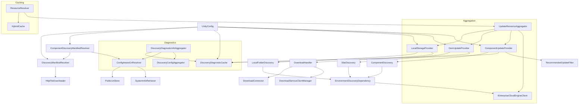
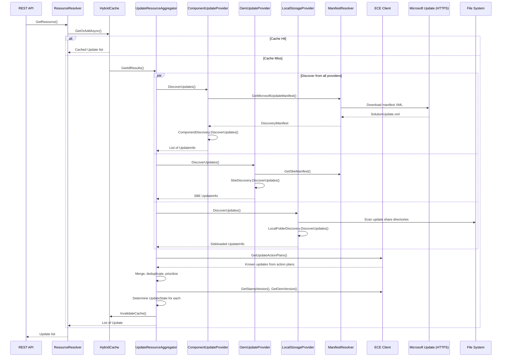
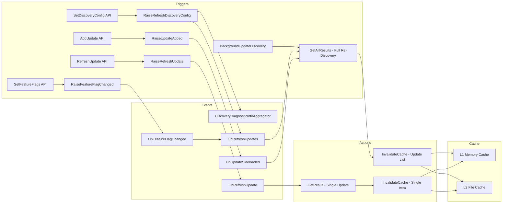

# Update Discovery Feature — Exhaustive Deep Dive

> Generated: 2026-02-08 | Scope: every line of code linked to update discovery

---

## Table of Contents

1. [Registration & Wiring](#1-registration--wiring)
2. [Serialization & Type Handling](#2-serialization--type-handling)
3. [Storage & Persistence](#3-storage--persistence)
4. [Runtime Behavior & Data Flow](#4-runtime-behavior--data-flow)
5. [Resilience & Failure Handling](#5-resilience--failure-handling)
6. [Concurrency & Thread Safety](#6-concurrency--thread-safety)
7. [Messaging & Event-Driven Behavior](#7-messaging--event-driven-behavior)
8. [Observability](#8-observability)
9. [Performance](#9-performance)
10. [Cross-Cutting Concerns](#10-cross-cutting-concerns)
11. [Testing](#11-testing)
12. [Knowledge Graph](#12-knowledge-graph)

---

## 1. Registration & Wiring

### 1.1 Entry Point — UnityConfig.cs

**File:** `src/UpdateResourceProvider/UpdateService/Service/Source/UnityConfig.cs`

All discovery DI registration flows through `RegisterComponents<TDependency>()` (Lines 69-78), which calls `RegisterCaching()` and `RegisterServiceComponents()`.

### 1.2 Discovery Infrastructure Registration (Lines 188-227)

| Line(s) | Interface | Implementation | Lifetime | Dependencies |
|---------|-----------|---------------|----------|-------------|
| 190 | `IUriResolver` | `ConfigAwareUriResolver` | Singleton (instance) | `ISystemInfoRetriever`, `IPublicUriStore` |
| 193-194 | `IDiscoveryConfigAggregator` | `DiscoveryConfigAggregator` | Singleton (instance) | `IUriResolver` |
| 210-211 | `IDiscoveryConfiguration` | `UrpConfiguration` | Singleton (instance) | — |
| 210-211 | `IUpdatePreparationConfiguration` | `UrpConfiguration` (same) | Singleton (instance) | — |
| 225-227 | `IUpdateDiscoveryManager` | `UpdateDiscoveryManager` | Singleton (CCL) | `ITransactionManager` |
| 313-314 | `IEnvironmentDiscoveryDependency` | `EnvironmentDiscoveryDependency` | Singleton (instance) | `IEnterpriseCloudEngineClient` |
| 316-317 | `ILocalFolderDiscovery` | `LocalFolderDiscovery` | Singleton (instance) | `IEnvironmentDiscoveryDependency`, `UpdateProviderType.LocalStorageProvider`, `IEnterpriseCloudEngineClient` |
| 319-320 | `ISbeDiscovery` | `SbeDiscovery` | Singleton (instance) | `IEnvironmentDiscoveryDependency`, `UpdateProviderType.OemUpdateProvider`, `IEnterpriseCloudEngineClient` |
| 322-323 | `IComponentDiscovery` | `ComponentDiscovery` | Singleton (instance) | `IEnvironmentDiscoveryDependency`, `UpdateProviderType.ComponentUpdateProvider`, `IEnterpriseCloudEngineClient`, `IDownloadServiceClientManager` |

### 1.3 Manifest Resolution Chain (Lines 351-377)

| Line(s) | Interface | Implementation | Dependencies |
|---------|-----------|---------------|-------------|
| 351 | `IFileDownloader` | `HttpFileDownloader` | — |
| 353-354 | `IDiscoveryManifestResolver` | `DiscoveryManifestResolver` | `IFileDownloader` |
| 356-357 | `IDiscoveryDiagnosticCache` | `DiscoveryDiagnosticCache` | `IUpdatePrerequisitesManager` |
| 373-377 | `IComponentDiscoveryManifestResolver` | `ComponentDiscoveryManifestResolver` | `updateManifestPath`, `IDiscoveryManifestResolver`, `IUriResolver` |

### 1.4 Update Package Providers (Lines 390-422)

Three `Lazy<IUpdatePackageProvider>` instances registered as `IEnumerable<Lazy<IUpdatePackageProvider>>` (Line 422, `ContainerControlledLifetimeManager`):

#### Provider 1: LocalStorageProvider (Lines 392-400)

```
IEnterpriseCloudEngineClient
IDownloadServiceClientManager
string updateSharePath (config)
IFileDownloader
ILocalFolderDiscovery
IDownloadHandler
IComponentDiscoveryManifestResolver
```

#### Provider 2: OemUpdateProvider (Lines 401-408)

```
IEnterpriseCloudEngineClient
IFileDownloader
IUriResolver
IDiscoveryDiagnosticCache
ISbeDiscovery
IDownloadHandler
IComponentDiscoveryManifestResolver
```

#### Provider 3: ComponentUpdateProvider (Lines 409-419)

```
IEnterpriseCloudEngineClient
IDownloadServiceClientManager
IFileDownloader
IUriResolver
IDownloadHandler
IComponentDiscoveryManifestResolver
IDiscoveryDiagnosticCache
IComponentDiscovery
IRecommendedUpdateFilter (new RecommendedUpdateFilter())
IFeatureFlagStore
```

### 1.5 Download Handler (Lines 379-387)

`IDownloadHandler` is constructed but **not registered** (transient-like, used only by providers):

```
IDirectoryAccessControlHandler
IDownloadConnector
IEnterpriseCloudEngineClient
IDownloadProgressTracker (new instance)
IFileDownloader
IFileOperations
IDownloadServiceClientManager
IComponentDiscoveryManifestResolver
```

### 1.6 Resource Handler & Controller Registration

**UpdateResourceHandler** (`src/UpdateResourceProvider/UpdateService/Core/Source/UpdateResourceHandler.cs`, Lines 154-182):

| Line(s) | Interface | Implementation | Lifetime |
|---------|-----------|---------------|----------|
| 159 | `IResourceAggregator<Update>` | `UpdateResourceAggregator` | Singleton (CCL) |
| 161-167 | `IHybridCache<Update>` | `DefaultHybridCache<Update>` | Singleton (CCL) |
| 172-177 | `IResourceResolver<Update>` | `ResourceResolver<Update>` | Singleton (CCL) |
| 178-180 | `ISolutionUpdateManifestParser` | `SolutionUpdateManifestParser` | Singleton |
| 181 | `IManifestDiscoveryManager` | `ManifestDiscoveryManager` | Singleton |

**DiscoveryDiagnosticInfoHandler** (`src/UpdateResourceProvider/UpdateService/Controllers/Source/DiscoveryDiagnosticControllerImplementation.cs`, Lines 44-50):

| Line | Interface | Implementation |
|------|-----------|---------------|
| 46 | `IResourceHandler<DiscoveryDiagnosticInfo>` | `DiscoveryDiagnosticInfoHandler` |
| 47 | `IODataQueryHandler` | `ODataQueryHandlerBase` |
| 48 | `IArmResourceWrappingHandler` | `ArmResourceWrappingHandlerBase` |
| 49 | `IResourcePropertiesMappingHandler<DiscoveryDiagnosticInfo>` | `DiscoveryDiagnosticInfoPropertiesMappingHandler` |

### 1.7 Standalone Discovery Factories

For out-of-service discovery scenarios:

| Factory | File | Creates |
|---------|------|---------|
| `SbeDiscoveryFactory` | `Discovery/Source/Common/SbeDiscoveryFactory.cs` | `ISbeDiscovery` with `UpdateProviderType.StandaloneDiscovery` |
| `LocalFolderDiscoveryFactory` | `Discovery/Source/Local/LocalFolderDiscoveryFactory.cs` | `ILocalFolderDiscovery` with `UpdateProviderType.StandaloneDiscovery` |
| `ComponentDiscoveryFactory` | `Discovery/Source/Common/ComponentDiscoveryFactory.cs` | `IComponentDiscovery` with `UpdateProviderType.StandaloneDiscovery` |

### 1.8 Constructor Injection Chain Summary

```
UpdateResourceController
  -> IUpdateResourceHandler (UpdateResourceHandler)
    -> IEnumerable<Lazy<IUpdatePackageProvider>>
      -> LocalStorageProvider
        -> ILocalFolderDiscovery
          -> IEnvironmentDiscoveryDependency -> IEnterpriseCloudEngineClient
      -> OemUpdateProvider
        -> ISbeDiscovery
          -> IEnvironmentDiscoveryDependency -> IEnterpriseCloudEngineClient
      -> ComponentUpdateProvider
        -> IComponentDiscovery
          -> IEnvironmentDiscoveryDependency -> IEnterpriseCloudEngineClient
        -> IComponentDiscoveryManifestResolver
          -> IDiscoveryManifestResolver -> IFileDownloader
```

### 1.9 Lifetime Management Summary

| Component | Lifetime |
|-----------|----------|
| All Discovery Interfaces | Singleton (RegisterInstance) |
| IUpdatePackageProvider (via Lazy) | Singleton (lazy + CCL) |
| IUpdateDiscoveryManager | Singleton (CCL) |
| IDownloadHandler | Constructed (not registered) |
| Resource Aggregators/Resolvers | Singleton (CCL) |

---

## 2. Serialization & Type Handling

### 2.1 Discovery Model Classes

#### Update.cs (`src/UpdateResourceProvider/UpdateService/Models/Core/Update.cs`, ~653 lines)

**Discovery-sourced properties:**

| Property | Type | Source |
|----------|------|--------|
| `Version` | `System.Version` | Metadata XML `<Version>` |
| `SbeVersion` | `System.Version` | Metadata XML `<OEMVersion>` |
| `MinVersionRequired` | `System.Version` | Metadata XML or ValidatedConfigurations |
| `MinSbeVersionRequired` | `System.Version` | Metadata XML or ValidatedConfigurations |
| `DisplayName` | `string` | Metadata XML `<UpdateName>` |
| `PackageType` | `string` | Metadata XML Type attribute |
| `Publisher` | `string` | Metadata XML `<Publisher>` |
| `Description` | `string` | Metadata XML `<Description>` |
| `KbLink` | `string` | Metadata XML `<KBLink>` |
| `ReleaseLink` | `string` | Metadata XML `<ReleaseLink>` |
| `ManifestInfo` | `ManifestInfo` | Manifest `<ManifestInfo>` element |
| `OSInfo` | `OSInfo` | Metadata XML `<OS>` element |
| `ZipFiles` | `List<UpdateZipFile>` | Manifest `<File>` elements |
| `MetadataFile` | `UpdateMetadataFile` | Manifest `<MetadataFile>` element |
| `ValidatedConfigurations` | `List<ValidatedConfiguration>` | `<RequiredPackages>` elements |
| `UpdateImpact` | `List<UpdateImpact>` | `<InstalledSBE>` elements |
| `ChildUpdates` | `List<Update>` | `<SolutionMetadata>` elements |
| `BillOfMaterials` | `List<BomItem>` | `<BillOfMaterials>` elements |
| `AvailabilityType` | `AvailabilityType` | Discovery logic (Online/Notify/Local) |
| `DeliveryType` | `DeliveryType` | Metadata XML File Type attribute |
| `IsRecalled` | `bool` | `RecalledUpdate` vs `ApplicableUpdate` element |
| `ReleaseRing` | `ReleaseRing` | ReleaseRing attribute |
| `DeferScanAndDownload` | `bool` | DeferScanAndDownload attribute |
| `OemFamily` | `string` | Family attribute or `<OEMFamily>` |
| `SupportedModels` | `List<SupportedModel>` | Manifest models section |
| `PackageProviderType` | `UpdateProviderType` | Set by provider during discovery |
| `InstallType` | `InstallType` | InstallType attribute (Update/Hotfix) |

**Serialization:** `[JsonConverter(typeof(UpdateJsonConverter))]`
**Caching:** Implements `ICachedItem`

#### DiscoveryDiagnosticInfo.cs (`src/UpdateResourceProvider/UpdateService/Models/Core/DiscoveryDiagnosticInfo.cs`, ~71 lines)

| Property | Type |
|----------|------|
| `SolutionManifestResult` | `ManifestDiagnostics` |
| `SbeManifestResult` | `ManifestDiagnostics` |
| `NonApplicableUpdates` | `List<DiscoveredUpdateDiagnostics>` |
| `Configuration` | `DiscoveryConfiguration` |

**Serialization:** `[JsonConverter(typeof(DiscoveryDiagnosticInfoJsonConverter))]`
**Caching:** Implements `ICachedItem`

#### ManifestInfo.cs (`src/UpdateResourceProvider/UpdateService/Models/Core/ManifestInfo.cs`, ~141 lines)

| Property | Type | Values |
|----------|------|--------|
| `CreationDate` | `DateTime` | Manifest creation timestamp |
| `CreatedBy` | `CreatedByType?` | OEMBuild, VaaS, Manual |
| `ManifestType` | `ManifestType?` | OEM, SBE, Component, Solution |
| `ReleaseType` | `ReleaseType?` | Draft, ReleaseCandidate, OEMRelease, MicrosoftPublished |

#### OSInfo.cs (`src/UpdateResourceProvider/UpdateService/Models/Core/OSInfo.cs`, ~121 lines)

| Property | Type |
|----------|------|
| `Branch` | `string` |
| `Product` | `string` |
| `SKU` | `uint` |
| `Hotpatch` | `HotpatchInfo` (Version, BaselineVersion) |
| `Coldpatch` | `ColdpatchInfo` (Version) |

#### PackageInfo.cs (`src/UpdateResourceProvider/UpdateService/Models/Core/PackageInfo.cs`, ~115 lines)

| Property | Type | Notes |
|----------|------|-------|
| `Type` | `string` | Infrastructure, OEM, SBE, Platform, Solution |
| `Version` | `string` | May contain wildcards (e.g., `2.3.*`) |
| `MinVersionRequired` | `string` | Defaults to Version with wildcards replaced |
| `Publisher` | `string` | Microsoft, OEM publisher |
| `Family` | `string` | OEM family |

#### ValidatedConfiguration.cs (`src/UpdateResourceProvider/UpdateService/Models/Core/ValidatedConfiguration.cs`, ~64 lines)

| Property | Type |
|----------|------|
| `RequiredPackages` | `IList<PackageInfo>` |
| `RequiredFeatures` | `IList<string>` |

#### UpdateZipFile.cs / UpdateMetadataFile.cs

| Model | Properties |
|-------|-----------|
| `UpdateZipFile` | `Name`, `Uri`, `Hash` (SHA256) |
| `UpdateMetadataFile` | `Name`, `Uri` |

### 2.2 Discovery-Internal Models

#### UpdateInfo.cs (`src/UpdateResourceProvider/UpdateService/Discovery/Source/Common/UpdateInfo.cs`, ~178 lines)

Wraps `Update` with payload references:

| Property | Type |
|----------|------|
| `Update` | `Update` |
| `ZipFiles` | `List<UpdateZipFile>` |
| `MetadataFile` | `UpdateMetadataFile` |
| `ChildUpdateInfo` | `List<UpdateInfo>` |

**Factory Methods:**
- `CreateInstanceFromLegacyDiscoveryManifestAsync()` — Downloads metadata from URI, validates signature
- `CreateInstanceFromEmbeddedMetadata()` — Parses embedded metadata from manifest XML
- `CreateFromUpdateObject()` — Wraps existing Update

#### UpdateDiscoveryResult.cs (`src/UpdateResourceProvider/UpdateService/Discovery/Source/Common/UpdateDiscoveryResult.cs`)

| Property | Type |
|----------|------|
| `ApplicableUpdates` | `List<UpdateInfo>` |
| `RecalledUpdates` | `List<UpdateInfo>` |
| `DiscoveryManifestResult` | `DiscoveryManifestResolverResult` |

#### DiscoveryManifestResolverResult.cs

| Property | Type | Notes |
|----------|------|-------|
| `Source` | `string` | Path or URI |
| `SourceType` | `DiscoveryManifestSource` | Online or Local (computed) |
| `IsResolved` | `bool` | XML root loaded |
| `IsSigned` | `bool` | Signature validated |
| `Exception` | `Exception` | Error during resolution |
| `DiscoveryManifest` | `IDiscoveryManifest` | Parsed manifest |

### 2.3 Configuration Models

#### DiscoveryConfiguration.cs (`src/UpdateResourceProvider/UpdateService/Models/Client/DiscoveryConfiguration.cs`)

| Property | Type |
|----------|------|
| `ComponentUris` | `Dictionary<string, string>` |
| `UpdateRing` | `UpdateRing` |

#### DiscoveryConfigParameter.cs

| Property | Type |
|----------|------|
| `RingName` | `UpdateRing?` |
| `ComponentName` | `string` |
| `OverrideUri` | `string` |

### 2.4 Enumerations

```csharp
// ReleaseRing.cs — Manifest release ring
enum ReleaseRing { Undefined = -1, Canary = 0, EarlyProduction = 1, Production = 2 }

// UpdateRing (PublicUriStore.cs) — Discovery endpoint ring
enum UpdateRing { Unknown = 0, Production, EarlyProduction, Canary }

// ManifestStatus.cs — Manifest resolution status
enum ManifestStatus { Unknown = 0, Ok, ConnectionFailure, ReadError, SignatureValidationFailure }

// UpdateState.cs — Update lifecycle state (~17 values)
enum UpdateState { HasPrerequisite, Obsolete, Ready, Preparing, Installing, Installed,
    PreparationFailed, InstallationFailed, Recalled, Downloading, DownloadFailed,
    HealthChecking, HealthCheckFailed, ReadyToInstall, AdditionalContentRequired, ... }

// DeliveryType.cs — Package delivery method
enum DeliveryType { Unknown, Notify = 1, Distribute = 2, DownloadConnector = 3 }

// UpdateProviderType.cs — Discovery provider source
enum UpdateProviderType { LocalStorageProvider, BlobStorageProvider, OemUpdateProvider,
    MicrosoftUpdateProvider, ComponentUpdateProvider, StandaloneDiscovery }

// AvailabilityType — Content availability
enum AvailabilityType { Online, Notify, Local, ... }

// UpdateNotApplicableReason — Diagnostic reason
enum UpdateNotApplicableReason { Unknown = 0, NoMatchingValidatedConfigurations, DifferentSbeFamily }
```

### 2.5 JSON Converters

All custom `Newtonsoft.Json.JsonConverter<T>` implementations in `Models/Core/Serialization/`:

| Converter | Target Type | Nested Converters |
|-----------|------------|-------------------|
| `UpdateJsonConverter` | `Update` | StringEnumConverter, VersionConverter, ManifestInfoJsonConverter, OSInfoJsonConverter, UpdateImpactJsonConverter, UpdateZipFileJsonConverter, UpdateMetadataFileJsonConverter, ValidatedConfigurationJsonConverter, PackageInfoJsonConverter |
| `DiscoveryDiagnosticInfoJsonConverter` | `DiscoveryDiagnosticInfo` | StringEnumConverter, VersionConverter |
| `ManifestInfoJsonConverter` | `ManifestInfo` | — |
| `OSInfoJsonConverter` | `OSInfo` | — |
| `PackageInfoJsonConverter` | `PackageInfo` | — |
| `ValidatedConfigurationJsonConverter` | `ValidatedConfiguration` | PackageInfoJsonConverter |
| `UpdateImpactJsonConverter` | `UpdateImpact` | — |
| `UpdateZipFileJsonConverter` | `UpdateZipFile` | — |
| `UpdateMetadataFileJsonConverter` | `UpdateMetadataFile` | — |

**Serializer Factory Registration** (UnityConfig.cs Lines 536-541):

```csharp
var serializerFactory = new SerializerFactory();
serializerFactory.RegisterConverter<Update>(new UpdateJsonConverter());
serializerFactory.RegisterConverter<UpdateRun>(new UpdateRunJsonConverter());
serializerFactory.RegisterConverter<UpdateLocation>(new UpdateLocationJsonConverter());
serializerFactory.RegisterConverter<DiscoveryDiagnosticInfo>(new DiscoveryDiagnosticInfoJsonConverter());
```

This routes through `SerializerFactory.TryCreateSerializer<T>()` priority 3 (type-specific settings with custom converter) to produce `HybridJsonSerializer<T>` instances used by HybridCache for L2 serialization.

### 2.6 XML Metadata Parser (UpdateMetadata inner class)

**File:** `src/UpdateResourceProvider/UpdateService/Discovery/Source/Local/Helper/UpdateExtensions.cs` (Lines 643-882)

Parses `metadata.xml` / `oemMetadata.xml` via `UpdateMetadata(XDocument metadata)`:

| Extracted Field | XML Element/Attribute |
|----------------|----------------------|
| Version | `<Version>` |
| OemVersion | `<OEMVersion>` |
| UpdateName | `<UpdateName>` |
| MinVersionRequired | `<MinVersionRequired>` or derived |
| MinOemVersionRequired | `<MinOEMVersionRequired>` or derived |
| PackageSizeInMb | `<PackageSizeInMb>` |
| Description | `<Description>` |
| KbLink | `<KBLink>` |
| Publisher | `<Publisher>` |
| OemFamily | Family attribute or `<OEMFamily>` |
| DeliveryType | File element Type attribute |
| RebootRequired | `<RebootRequired>` |
| IsRecalled | ApplicableUpdate vs RecalledUpdate |
| ReleaseRing | ReleaseRing attribute |
| OSInfo | `<OS>` with `<Hotpatch>`, `<Coldpatch>` children |
| ManifestInfo | `<ManifestInfo>` element |
| ValidatedConfigurations | `<RequiredPackages>` elements |
| UpdateImpact | `<InstalledSBE>` elements |
| ZipFiles | `<File>` elements (Name, Uri, PackageHash) |
| MetadataFile | `<MetadataFile>` element |
| BillOfMaterials | `<BillOfMaterials>` (recursive) |
| DeferScanAndDownload | DeferScanAndDownload attribute |
| InstallType | InstallType attribute |

### 2.7 Discovery Manifest XML Format

**File:** `src/UpdateResourceProvider/UpdateService/Discovery/Source/Local/DiscoveryManifest.cs` (~520 lines)

```xml
<DiscoveryManifest>
  <ManifestInfo CreationDate="..." CreatedBy="..." ManifestType="..." ReleaseType="..."/>
  <[PackageType]>
    <ApplicableUpdate|RecalledUpdate ReleaseRing="...">
      <File Name="..." Uri="..." PackageHash="..."/>
      <MetadataFile Name="..." Uri="..."/>
      <UpdateInfo>
        <UpdateName>...</UpdateName>
        <Version>...</Version>
        <OEMVersion>...</OEMVersion>
        ...
      </UpdateInfo>
      <ValidatedConfigurations>
        <RequiredPackages>
          <Package Type="..." Version="..." MinVersionRequired="..." Publisher="..." Family="..."/>
          <FeatureFlag Name="..."/>
        </RequiredPackages>
      </ValidatedConfigurations>
      <SolutionMetadata>
        <Update Type="..." Version="..." Publisher="..." Family="...">
          <UpdateInfo>...</UpdateInfo>
          <File .../> <MetadataFile .../>
        </Update>
      </SolutionMetadata>
    </ApplicableUpdate|RecalledUpdate>
  </[PackageType]>
</DiscoveryManifest>
```

---

## 3. Storage & Persistence

### 3.1 HybridCache Integration

Discovery results flow into HybridCache (L1 memory + L2 file) via `ResourceResolver<T>`:

| Cached Type | Cache Key Pattern | TTL | Background Refresh |
|------------|------------------|-----|-------------------|
| `Update` | `Update/{armName}` (item), `Update/list` (list) | 30 min | Enabled (factory: 3 min, staleness: 10 sec) |
| `DiscoveryDiagnosticInfo` | `DiscoveryDiagnosticInfo/{armName}` | 30 min | Enabled (factory: 3 min, staleness: 10 sec) |

Cache settings registered in UnityConfig.cs Lines 471-498.

### 3.2 Provider-Level In-Memory Caching

Each provider caches discovery results independently:

| Provider | Cache Field | Type |
|----------|-----------|------|
| `ComponentUpdateProvider` | `availableUpdateInfoList` | `ConcurrentBag<UpdateInfo>` |
| `OemUpdateProvider` | `availableUpdateInfo`, `recalledUpdateInfos` | Fields (simple assignment) |
| `LocalStorageProvider` | `availableUpdateInfoCache` | `ConcurrentDictionary<string, UpdateInfo>` |

### 3.3 Manifest Resolution Cache

**File:** `src/UpdateResourceProvider/UpdateService/Core/Source/ComponentDiscoveryManifestResolver.cs`

```csharp
private ConcurrentDictionary<string, DiscoveryManifestResolverResult> componentManifests;
```

- Cache key: composite of file path + URI
- First call: fetches and caches manifest
- Subsequent calls: returns cached value, triggers background refresh via `ThreadPool.QueueUserWorkItem()`

### 3.4 URI Validity Cache

**File:** `src/UpdateResourceProvider/UpdateService/Core/Source/DiscoveryManifestResolver.cs`

```csharp
private readonly ConcurrentDictionary<string, UriEntry> uriValidityCache;

private class UriEntry {
    public bool IsValid;
    public DateTimeOffset Timestamp;
}
```

Time-based invalidation via `UrpConstants.UriCacheInvalidation`.

### 3.5 Discovery Diagnostic Cache

**File:** `src/UpdateResourceProvider/UpdateService/Core/Source/DiscoveryDiagnosticCache.cs`

| Property | Type |
|----------|------|
| `SolutionDiscoveryResult` | `DiscoveryManifestResolverResult?` |
| `SbeDiscoveryResult` | `DiscoveryManifestResolverResult?` |
| `NonApplicableSolutionUpdates` | `ConcurrentDictionary<string, (Update, UpdateNotApplicableReason)>` |
| `NonApplicableSbeUpdates` | `ConcurrentDictionary<string, (Update, UpdateNotApplicableReason)>` |

### 3.6 Reliable State Persistence

**File:** `src/UpdateResourceProvider/UpdateService/Core/Source/UpdateDiscoveryManager.cs`

```csharp
public async Task ReportLastUpdateDiscoveryTime(DateTime lastDiscoveryTime)
    => await transactionManager.SetUrpStateInReliableStorage(
        UrpConstants.LastUpdateDiscoveryKey, lastDiscoveryTime);

public async Task<DateTime> GetLastUpdateDiscoveryTime()
    => await transactionManager.GetUrpStateFromReliableStorage<DateTime>(
        UrpConstants.LastUpdateDiscoveryKey);
```

Uses Service Fabric Reliable Collections for durable storage.

### 3.7 Public URI Store — Ring-to-URI Mapping

**File:** `src/UpdateResourceProvider/Common/Source/PublicUriStore.cs`

| Ring | URI |
|------|-----|
| Production | `https://aka.ms/AzureEdgeUpdates` |
| EarlyProduction | `https://aka.ms/AzureEdgeUpdatesRing20` |
| Canary | `https://aka.ms/AzureEdgeUpdatesRing10` |

---

## 4. Runtime Behavior & Data Flow

### 4.1 Complete Discovery Flow

```
API Request (GET /updates)
  |
  v
UpdateResourceController.GetAllResourcesByShortCut()
  |
  v
ResourceResolver<Update>.GetResource()
  |-- cache hit? -> return from HybridCache
  |-- cache miss:
  v
UpdateResourceAggregator.GetAllResults()            [Lines 107-212]
  |
  |-- Step 1: GetAllResultsFromMetadata(true)       [Lines 437-487]
  |     |
  |     |-- For each IUpdatePackageProvider:
  |     |     ComponentUpdateProvider.DiscoverUpdates()
  |     |     OemUpdateProvider.DiscoverUpdates()
  |     |     LocalStorageProvider.DiscoverUpdates()
  |     |
  |     |-- Get ECE known updates (action plans)
  |     |-- Recall updates superseded by newer manifests
  |     |-- Deduplicate (prefer ECE-known over remote)
  |     |-- Record last discovery time
  |     |-- Final dedup: group by RpId, prioritize by provider
  |     v
  |     List<Update> (raw discovered + ECE-known)
  |
  |-- Step 2: For each update:
  |     - Set health check results
  |     - Set availability type
  |     - Call UpdateStateIdentifier.GetUpdateState()
  |     - Mark installed date
  |     - Set bill of materials
  |
  |-- Step 3: Fix interdependent states
  |-- Step 4: Set notifications, sizing
  |-- Step 5: Invalidate cache
  v
List<Update> returned to client
```

### 4.2 ComponentUpdateProvider Discovery Flow

**File:** `src/UpdateResourceProvider/UpdateService/Core/Source/StorageProvider/ComponentUpdateProvider.cs`

```
ComponentUpdateProvider.DiscoverUpdates()           [Lines 124-181]
  |
  |-- Check: deployment complete? No -> skip
  |-- Check: update in progress? No -> continue
  |
  |-- EnsureInitializedAsync()
  |     |-- RefreshComponentUpdateInfoLocked()      [Lines 342-438]
  |           |
  |           |-- ComponentDiscoveryManifestResolver.GetMicrosoftUpdateManifest()
  |           |-- Validate manifest (resolved, signed)
  |           |-- Get SBE manifest
  |           |-- Get feature flags
  |           |-- ComponentDiscovery.DiscoverUpdates()
  |           |     |
  |           |     |-- Get current versions, SBE info from ECE
  |           |     |-- Extract component types from solution manifest
  |           |     |-- If SBE manifest valid: InjectSBEUpdate()
  |           |     |-- For each component type:
  |           |     |     ComponentUpdateHelpers.GetApplicableAndRecalledUpdates()
  |           |     |     UpdateInfo.CreateInstanceFromEmbeddedMetadata()
  |           |     v
  |           |     UpdateDiscoveryResult
  |           |
  |           |-- Identify non-applicable updates -> DiscoveryDiagnosticCache
  |           |-- Cache results in availableUpdateInfoList
  |           v
  |
  |-- Return cached updates
  |-- Apply RecommendedUpdateFilter
  |-- Tag superseded updates
  v
List<UpdateInfo>
```

### 4.3 OemUpdateProvider Discovery Flow

**File:** `src/UpdateResourceProvider/UpdateService/Core/Source/StorageProvider/OemUpdateProvider.cs`

```
OemUpdateProvider.DiscoverUpdates()                 [Lines 103-142]
  |
  |-- Check: deployment complete? No -> skip
  |-- Queue RefreshOemUpdateInfo() async             [Lines 159-261]
  |     |
  |     |-- Get SBE manifest
  |     |-- Validate (resolved, signed)
  |     |-- SbeDiscovery.DiscoverUpdates()
  |     |     |
  |     |     |-- Get current versions, family/model/sku
  |     |     |-- AttemptFamilySeeding() if needed
  |     |     |-- OemUpdateExtensions.GetApplicableSbeUpdate()
  |     |     |-- OemUpdateExtensions.GetRecalledSbeUpdates()
  |     |     v
  |     |     UpdateDiscoveryResult
  |     |
  |     |-- Cache results
  |     |-- Report non-applicable to diagnostics
  |     v
  |
  |-- Return cached availableUpdateInfo + recalledUpdateInfos
  v
```

### 4.4 LocalStorageProvider Discovery Flow

**File:** `src/UpdateResourceProvider/UpdateService/Core/Source/StorageProvider/LocalStorageProvider.cs`

```
LocalStorageProvider.DiscoverUpdates()              [Lines 92-150]
  |
  |-- Get/create directory lock
  |-- For each subdirectory in update share:
  |     |-- LocalFolderDiscovery.DiscoverUpdates()
  |     |     |
  |     |     |-- Look for SBE and Solution manifests
  |     |     |-- DiscoverOemUpdate() (OEM manifest -> SBE manifest -> OEM metadata)
  |     |     |-- ReadMicrosoftUpdateFromMetadataOrManifest()
  |     |     |     |-- If solution manifest: parse, inject SBE, create Update
  |     |     |     |-- Else if metadata.xml: parse metadata, create Update
  |     |     |     |-- Validate zip files against manifest
  |     |     |     |-- Set child update availability (Local/Online/Notify)
  |     |     v
  |     |     List<Update>
  |     v
  |-- Deduplicate by RpId
  |-- Update availableUpdateInfoCache
  |-- Clean up unused locks
  v
```

### 4.5 Update Filtering Logic

#### Version Matching (VersionHelpers.cs)

| Method | Logic |
|--------|-------|
| `VersionMatch()` | Compares specific vs allowed version; `*` wildcards match any |
| `VersionLessThan()` | `specific < max` comparison, component by component |
| `VersionLessThanOrEqual()` | `specific <= max` comparison |

#### Component Update Filtering (ComponentUpdateHelpers.cs, Lines 182-265)

1. **Type matching**: `Attribute("Type").Value == componentType`
2. **Version check**: `VersionLessThan(currentVersion, updateVersion)` — only newer
3. **File name matching**: `fileNames.Contains(File.Name)`
4. **RequiredPackages check**: `DoesCurrentStampMatchRequiredPackages(currentVersions, validatedConfigs)`
5. **Feature flag check**: Required features must be enabled

#### OEM/SBE Update Filtering (OemUpdateExtensions.cs)

1. **Version check**: Must be newer than current OEM/SBE version
2. **Family matching**: Case-insensitive, supports "None" for Microsoft
3. **Model matching**: Prefix/fuzzy matching, flexible spacing
4. **SKU matching**: Explicit or prefix, with exclusion lists
5. **RequiredPackages**: Current stamp versions must satisfy prerequisites

### 4.6 Provider Priority for Deduplication

When the same update (by RpId) is discovered by multiple providers:

```
LocalStorage (P0) > BlobStorage > MicrosoftUpdate > ComponentUpdate > OEM
```

ECE-known updates (from action plans) always take precedence over remote discoveries.

---

## 5. Resilience & Failure Handling

### 5.1 Exception Hierarchy

| Exception | File | Purpose |
|-----------|------|---------|
| `SbeSideloadException` | `Core/Contract/Exceptions/SbeSideloadException.cs` | SBE sideload failures |
| `SolutionUpdateException` | `Core/Contract/Exceptions/SolutionUpdateException.cs` | Solution update errors |
| `SbeDownloadException` | `Core/Source/DownloadConnector/SbeDownloadException.cs` | SBE download failures (transient) |
| `SbeDownloadTerminalException` | `Core/Source/DownloadConnector/SbeDownloadTerminalException.cs` | Non-recoverable SBE download errors |
| `ActionPlanMonitoringTimeOutException` | `Core/Source/DownloadConnector/` | Action plan timeout |
| `InvalidDataException` | System | Malformed XML, invalid manifests |
| `FileNotFoundException` | System | Missing local files, inaccessible URIs |
| `UriFormatException` | System | Malformed URIs |
| `WebException` | System | HTTP connection failures |

### 5.2 Manifest Resolution Fallback Chain

**File:** `src/UpdateResourceProvider/UpdateService/Core/Source/DiscoveryManifestResolver.cs` (Lines 53-171)

```
1. Try URI download (if configured and not marked invalid)
   |-- Success: add to results
   |-- InvalidDataException/TaskCanceledException: mark URI invalid, log warning
   |-- Other exception: log error, add exception result
   v
2. Try local file (if path configured)
   |-- File exists: parse manifest, add to results
   |-- FileNotFoundException: add exception result
   |-- Parse error: add exception result
   v
3. Select best result: most recent by ManifestInfo.CreationDate
   |-- No resolved results: return first (with exception)
   |-- No results at all: return empty DiscoveryManifest
```

### 5.3 OEM/SBE Discovery Fallback

**File:** `src/UpdateResourceProvider/UpdateService/Discovery/Source/Local/LocalFolderDiscovery.cs` (Lines 73-147)

```
1. Try OEM update manifest (signed XML)
   |-- Success: parse OEM manifest
   v
2. Try SBE discovery manifest (only if no solution manifest present)
   |-- Success: parse SBE manifest
   v
3. Try OEM metadata file (raw metadata)
   |-- Success: parse metadata
   v
4. None found: return null
```

### 5.4 Retry Logic

#### ECE Action Plan Retry

**File:** `src/UpdateResourceProvider/Utilities/Source/UpdateActionPlanUtilities.cs` (Lines 101-145)

```csharp
// Time-bounded retry loop with fixed delay
while (DateTime.UtcNow < endTime)
{
    try { actionPlanInstance = await eceClient.CreateActionPlanInstance(...); break; }
    catch (Exception ex) when (
        DateTime.UtcNow < endWaitTime && (
            ex is TransientException ||
            (ex as TerminalException)?.ErrorDetails.Code == ErrorCodes.ExclusiveLockConflict))
    {
        await Task.Delay(retryDelay); // Fixed 15-second delay
    }
}
```

Retryable conditions: `TransientException`, 409 `ExclusiveLockConflict`.

#### ECE HTTP Retry Policy

**File:** `src/EceClient/Source/ECEClientCustomErrorRetryPolicy.cs`

Extends standard retry to also retry on:
- 409 Conflict (action plan lock contention)
- 423 Locked

#### Download Service Retry

**File:** `src/DownloadServiceClient/Core/Source/DownloadServiceClientManager.cs` (Lines 148-195)

Exponential backoff: 60 seconds to 2 hours, with semaphore limiting parallel scans.

### 5.5 URI Validity Circuit Breaker

**File:** `src/UpdateResourceProvider/UpdateService/Core/Source/DiscoveryManifestResolver.cs`

```
State: CLOSED (URI valid)
  |-- Download fails with InvalidDataException/TaskCanceledException
  v
State: OPEN (URI marked IsValid = false)
  |-- Skip all download attempts
  |-- After UriCacheInvalidation timeout
  v
State: HALF-OPEN (timestamp expired)
  |-- Re-attempt download
  |-- Success -> CLOSED
  |-- Failure -> OPEN
```

### 5.6 Partial Failure Handling

- **Multiple providers**: Each provider's failure is isolated; one failing provider doesn't block others
- **Multiple component types**: `ComponentDiscovery` iterates all component types; null results are skipped
- **Multiple manifest sources**: Both URI and file results collected; best (most recent) selected
- **Background operations**: Exceptions captured but not rethrown (fire-and-forget pattern)

### 5.7 Defensive Coding Patterns

- **Guard clauses**: `ArgumentNullException` at all entry points (`ConfigAwareUriResolver`, `UpdateDiscoveryManager`, etc.)
- **Null-conditional operators**: `sbeManifest?.Contents`, `sbeXDoc?.Root`, `(sbeManifest?.IsSignValidated ?? false)`
- **Null coalescing**: `allUpdates?.Count.ToString() ?? "0"`
- **Exception translation**: `SbeDownloadException` wraps transient errors; `SbeDownloadTerminalException` stops retries

---

## 6. Concurrency & Thread Safety

### 6.1 Thread-Safe Collections

| Location | Collection | Purpose |
|----------|-----------|---------|
| `DiscoveryDiagnosticCache` | `ConcurrentDictionary<string, (Update, UpdateNotApplicableReason)>` | Non-applicable updates (2 instances: Solution + SBE) |
| `DiscoveryManifestResolver` | `ConcurrentDictionary<string, UriEntry>` | URI validity cache |
| `ComponentDiscoveryManifestResolver` | `ConcurrentDictionary<string, DiscoveryManifestResolverResult>` | Manifest resolution cache |
| `ComponentUpdateProvider` | `ConcurrentBag<UpdateInfo>` | Discovered applicable updates |
| `LocalStorageProvider` | `ConcurrentDictionary<string, UpdateInfo>` | Local update cache |

### 6.2 Background Thread Patterns

#### Background Manifest Refresh

**File:** `src/UpdateResourceProvider/UpdateService/Core/Source/ComponentDiscoveryManifestResolver.cs`

```csharp
private void GetManifestInBackground(string manifestFilePath, string manifestUri)
{
    ThreadPool.QueueUserWorkItem(async _ =>
    {
        var result = await this.GetManifestInternal(manifestFilePath, manifestUri);
        this.componentManifests.AddOrUpdate(cacheKey, result, (key, _) => result);
    });
}
```

Pattern: Return stale cached value immediately, refresh asynchronously.

#### Provider Initialization

Both `ComponentUpdateProvider` and `OemUpdateProvider` queue initialization on `ThreadPool.QueueUserWorkItem()` during construction.

### 6.3 Discovery Skip Guards

**File:** `ComponentUpdateProvider.cs` (Line 333):

```csharp
// DiscoverySkippedBecauseItIsAlreadyRunning
// Prevents concurrent discovery runs for the same provider
```

### 6.4 Cancellation Token Flow

```
API Request CancellationToken
  -> DiscoverUpdates(cancellationToken)
    -> HttpFileDownloader.GetStreamAsync(uri)
      -> StorageProviderHelper.CopyToAsyncWithTimeout(stream, timeout, cancellationToken)
    -> Task.Delay(pollingInterval, cancellationToken)  // Action plan polling
```

Separate `CancellationTokenSource` for progress tracking (cancelled in `finally` block).

### 6.5 Cancellation Handler

**File:** `src/UpdateResourceProvider/UpdateService/Core/Source/Helpers/CancellationHandler.cs`

```csharp
public void CancelCurrentOperationAndWait(TimeSpan pollingInterval, TimeSpan timeout)
{
    this.cancellationTokenSource.Cancel();
    while (this.operationInProgress)
    {
        Thread.Sleep(pollingInterval);
        if (DateTime.UtcNow - start > timeout) throw new TimeoutException(...);
    }
    // Catches ObjectDisposedException for token source disposal race
}
```

---

## 7. Messaging & Event-Driven Behavior

### 7.1 Cache Invalidation Events

**Interface:** `src/Common/Common/Source/Caching/ICacheInvalidator.cs`

| Event | EventArgs | Trigger | Handler |
|-------|----------|---------|---------|
| `OnRefreshDiscoveryConfig` | `RefreshDiscoveryConfigEventArgs` | Discovery config change (ring/URI) | `DiscoveryDiagnosticInfoAggregator.RefreshDiscoveryConfig()` |
| `OnRefreshUpdates` | `RefreshUpdatesEventArgs` | Full update list refresh | `UpdateResourceAggregator.OnRefreshUpdates()` |
| `OnUpdateAdded` | `UpdateAddedEventArgs` | Update sideloaded | `UpdateResourceAggregator.OnUpdateSideloaded()` |
| `OnRefreshUpdate` | `RefreshUpdateEventArgs` | Single update refresh | `UpdateResourceAggregator.OnRefreshUpdate()` |
| `OnFeatureFlagChanged` | — | Feature flag modified | `UpdateResourceAggregator.OnFeatureFlagChanged()` -> triggers `OnRefreshUpdates` |

### 7.2 Event Subscription in Aggregators

**UpdateResourceAggregator** (Lines 93-96):

```csharp
this.cacheInvalidator.OnUpdateAdded += this.OnUpdateSideloaded;
this.cacheInvalidator.OnRefreshUpdate += this.OnRefreshUpdate;
this.cacheInvalidator.OnRefreshUpdates += this.OnRefreshUpdates;
this.cacheInvalidator.OnFeatureFlagChanged += this.OnFeatureFlagChanged;
```

### 7.3 Event Flow: Configuration Change

```
SetDiscoveryConfig REST API
  -> UpdateDynamicConfigurationStore (ring/URI)
  -> RefreshCurrentConfig()
  -> cacheInvalidator.RaiseRefreshDiscoveryConfig()
  -> Manifest resolver invalidates cache
  -> Discovery providers re-fetch manifests
  -> UpdateResourceAggregator.OnRefreshUpdates()
  -> GetAllResults() (full re-discovery)
  -> cacheInvalidator.InvalidateCache() (update L1+L2)
```

### 7.4 Event Flow: Update Sideload

```
AddUpdate() REST API
  -> Copy package to update share
  -> cacheInvalidator.RaiseUpdateAdded(rpIdString, includeSuperseded, skipPlatformUpdate)
  -> UpdateResourceAggregator.OnUpdateSideloaded()
  -> GetAllResults() (full re-discovery with new local package)
  -> cacheInvalidator.InvalidateCache(parentArmName, updates, listCacheKey)
```

### 7.5 Event Flow: Feature Flag Change

```
Feature Flag REST API
  -> FeatureFlagStore.SetFeatureFlags()
  -> cacheInvalidator.RaiseFeatureFlagChanged()
  -> UpdateResourceAggregator.OnFeatureFlagChanged()
  -> OnRefreshUpdates() (re-evaluate all updates with new flags)
```

### 7.6 Background Discovery Timer

**File:** `src/UpdateResourceProvider/UpdateService/Core/Source/BackgroundOperation/BackgroundUpdateDiscovery.cs`

- Period: **1 hour** (`TimeSpan.FromHours(1)`)
- Calls `updateAggregator.GetAllResults()` to trigger full discovery cycle
- Identifies stale prepared updates for re-preparation
- Fire-and-forget: exceptions logged but not propagated

---

## 8. Observability

### 8.1 ETW Events (UrpInfraEventSource / UrpTelemetryEventSource)

**EventSource Name:** `"Microsoft-URP-InfraEventSource"`

| Event ID | Name | Level | When Emitted |
|----------|------|-------|-------------|
| 2111 | `SkipUpdateDiscoveryBecauseOfRunningInstance` | Info | Discovery skipped due to running action plans |
| 3010 | `LocalPackageProviderLoaded` | Info | Local provider initialized |
| 3011 | `RemotePackageProviderLoaded` | Info | Remote provider initialized |
| 3012 | `RemoteDiscoveryVerboseProgress` | Verbose | Discovery workflow steps (manifest fetch, inject, filter) |
| 3013 | `RemoteDiscoveryFoundNonPackage` | Verbose | Non-package item found in update directory |
| 3014 | `ProviderDiscoveryFailed` | Error | Exception from update provider |
| 3049 | `UpdatePackageDiscoverStart` | Info | Provider begins discovery |
| 3050 | `UpdatePackageDiscoverStop` | Info | Provider completes discovery (with update count) |
| 3051 | `UpdatePackageDiscoveryFailed` | Error | Discovery failure |
| 3055 | `UpdatePackageDiscoverFailed` | Error | Discovery failure with manifest details |
| 3123 | `DiscoveryDiagnosticAggregatorStart` | Info | Diagnostic aggregation begins |
| 3124 | `DiscoveryDiagnosticAggregatorStop` | Info | Diagnostic aggregation completes |
| 3129 | `DiscoverySkippedBecauseItIsAlreadyRunning` | Info | Concurrent discovery prevented |
| 8001 | `BackgroungUpdateDiscoveryStart` | Info | Background discovery cycle begins |
| 8002 | `BackgroungUpdateDiscoveryEnd` | Info | Background discovery cycle ends |
| 8003 | `BackgroungUpdateDiscoveryFoundUpdatesToReprepare` | Info | Stale updates identified for re-prep |
| 8004 | `BackgroungUpdateDiscoveryBeganBackgroundPreparation` | Info | Background prep started |
| 8005 | `BackgroungUpdateDiscoveryFoundUpdateInProgress` | Info | Running update detected |
| 8500 | `FamilySeeded` | Verbose | SBE family seeded from manifest |
| 8501 | `SBEInjection` | Verbose | SBE update injected into solution manifest |
| 9100 | `DiscoverySkippedDeploymentIsNotFinished` | Info | Discovery skipped — deployment incomplete |

### 8.2 Telemetry Metrics

**File:** `src/Common/Trace/Source/UpdateServiceMetricConstants.cs` (Lines 68-72)

| Metric Constant | Usage |
|-----------------|-------|
| `BackgroundUpdateDiscoveryDuration` | `BackgroundUpdateDiscovery.InvokeActionAsync()` |
| `ComponentDiscoveryDuration` | `ComponentUpdateProvider` discovery operations |
| `OemDiscoveryDuration` | `OemUpdateProvider.RefreshOemUpdateInfo()` |
| `LocalDiscoveryDuration` | Local folder discovery operations |

**Parameters captured per metric:**

| Parameter | Content |
|-----------|---------|
| `totalUpdates` | Count of discovered updates |
| `error` | Exception message (if failure) |
| `DurationMS` | Elapsed time (automatic via Stopwatch) |
| `solutionManifestStatus` | ManifestStatus enum value |
| `sbeManifestStatus` | ManifestStatus enum value |
| `triggerFeatureFlagCacheInvalidation` | Boolean flag |

### 8.3 Correlation IDs

**File:** `src/Common/Trace/Source/CorrelationIdFactory.cs`

| Prefix | Constant | Usage |
|--------|----------|-------|
| `0x02` | `BackgroundUpdateDiscovery` | Background discovery timer |
| `0x101` | `ComponentUpdateProviderCtor` | Component provider initialization |
| `0x102` | `OemUpdateProviderCtor` | OEM provider initialization |

All ETW events include correlation ID via `DiagnosticContext.CorrelationRequestId`.

### 8.4 Diagnostic REST Endpoints

#### Discovery Diagnostic Controller

| Method | Route | Returns |
|--------|-------|---------|
| GET | `/discoveryDiagnosticInfo` | `DiscoveryDiagnosticInfo` (manifest status, non-applicable updates, config) |

#### Discovery Config Controller

| Method | Route | Returns |
|--------|-------|---------|
| GET | `/discoveryConfig` | Current ring + component URIs |
| PUT | `/discoveryConfig` | Updates ring/override, validates URI, clears caches |

### 8.5 Diagnostic Data Model

```
DiscoveryDiagnosticInfo
  |- SolutionManifestResult: ManifestDiagnostics
  |    |- ManifestSource (URI or path)
  |    |- Status (Ok/ConnectionFailure/ReadError/SignatureValidationFailure)
  |    |- Description
  |
  |- SbeManifestResult: ManifestDiagnostics
  |    |- (same structure)
  |
  |- NonApplicableUpdates: List<DiscoveredUpdateDiagnostics>
  |    |- PackageType, Version, Description (reason)
  |
  |- Configuration: DiscoveryConfiguration
       |- ComponentUris (dict)
       |- UpdateRing
```

### 8.6 File-by-File Logging Summary

| Source File | Key Logging Calls |
|------------|-------------------|
| `ComponentUpdateProvider.cs` | 8 calls: provider loaded, discover start/stop, skip reasons, failures |
| `OemUpdateProvider.cs` | 7 calls: provider loaded, discover start/stop, skip reasons, failures |
| `LocalFolderDiscovery.cs` | 5+ calls: directory processing, OEM manifest, non-package items |
| `DiscoveryManifestResolver.cs` | 6 calls: manifest URI/file, resolution status, errors |
| `ComponentDiscovery.cs` | 1 call: SBE injection progress |
| `BackgroundUpdateDiscovery.cs` | 3 calls: start, end, correlation ID |
| `DiscoveryDiagnosticInfoAggregator.cs` | 2 calls: aggregator start/stop |
| `SolutionUpdateHelpers.cs` | Multiple SBEInjection verbose calls |
| `ComponentUpdateHelpers.cs` | Version matching verbose calls |

---

## 9. Performance

### 9.1 Background Discovery Period

- **BackgroundUpdateDiscovery**: 1 hour cycle
- **RefreshEceCache**: Periodic (configurable), startup-only variant runs once
- **Provider initialization retry**: 5-minute delay on failure

### 9.2 Manifest Caching Strategy

| Level | Cache | Behavior |
|-------|-------|----------|
| L0 | Provider fields | `ConcurrentBag`/`ConcurrentDictionary` in each provider |
| L1 | `ComponentDiscoveryManifestResolver` | `ConcurrentDictionary` with background refresh |
| L2 | `DiscoveryManifestResolver` URI cache | Time-based validity tracking |
| L3 | `HybridCache` (memory) | 30-min TTL per type |
| L4 | `HybridCache` (file/CSV) | 30-min TTL, cluster shared volume |

### 9.3 Lazy Initialization

All three package providers use `Lazy<IUpdatePackageProvider>`:
- Initialization deferred to first access
- Background initialization via `ThreadPool.QueueUserWorkItem()` during construction
- `EnsureInitializedAsync()` / `TryRefreshAsync()` patterns for non-blocking refresh

### 9.4 Download Timeouts

| Operation | Timeout |
|-----------|---------|
| File download (HTTP) | 4 hours |
| Action plan monitoring | Configurable `maxDownloadDurationMinutes` + buffer |
| Action plan creation retry | 5 minutes max wait, 15-second intervals |
| Download service polling | Exponential backoff, 60s to 2h |

### 9.5 Discovery Skip Conditions

Discovery is short-circuited when:
1. Deployment is not finished (`DiscoverySkippedDeploymentIsNotFinished`)
2. Update already in progress (`SkipUpdateDiscoveryBecauseOfRunningInstance`)
3. Discovery already running (`DiscoverySkippedBecauseItIsAlreadyRunning`)

---

## 10. Cross-Cutting Concerns

### 10.1 Manifest Signature Validation

All manifests validated via `SignedXmlValidatorFactory.Validator.ValidateAsync()`:

| Manifest Type | Required Signed |
|--------------|----------------|
| Solution update manifest | Yes |
| SBE discovery manifest | Yes |
| OEM update manifest | Yes |
| Metadata XML files | Yes (for legacy discovery) |

### 10.2 URI Resolution Precedence

**File:** `src/UpdateResourceProvider/UpdateService/Discovery/Source/Common/ConfigAwareUriResolver.cs`

```
1. Override URI (from DynamicConfigurationStore, if valid)
2. Ring-based URI (from PublicUriStore, by UpdateRing)
3. Default URI (fallback)
```

Config keys:
- `AutomaticComponentUpdateUriName` — Solution URI override
- `AutomaticOemUpdateUriName` — OEM/SBE URI override
- `UpdateRingNameConfigParameter` — Ring selection

### 10.3 Feature Flag Integration

- Feature flags stored in `FeatureFlagStore` (JSON file)
- Passed to `ComponentUpdateHelpers.GetApplicableAndRecalledUpdates()` as filter parameter
- `RequiredFeatures` in `ValidatedConfiguration` checked against active flags
- Changes trigger `OnFeatureFlagChanged` -> full re-discovery

### 10.4 Hash Validation

- File downloads validated via SHA256 hash comparison
- `PackageHelpers.ComputeFileHash()` computes actual hash
- Compared against `UpdateZipFile.Hash` from manifest
- Files matching hash are skipped (resume/idempotency)

### 10.5 Resource Naming Convention

| PackageType | Resource Name Pattern |
|------------|----------------------|
| Solution | `Solution {version}` |
| OEM | `OEM {version}` |
| SBE | `SBE {version}` |
| Hotfix | `Hotfix {version}` |
| Default | `Microsoft {version}` |

### 10.6 ECE Data Dependencies

Discovery requires the following from ECE at runtime:

| ECE Call | Used For |
|----------|---------|
| `GetStampVersion()` | Current platform version for applicability |
| `GetOemVersion()` | Current OEM/SBE version |
| `GetOemFamily()` | Hardware family matching |
| `GetOemPublisher()` | Publisher identification |
| `GetHardwareOemModel()` | Model matching |
| `GetHardwareSku()` | SKU matching |
| `GetPackageVersions()` | Installed package versions for ValidatedConfig checks |
| `GetUpdateActionPlans()` | ECE-known updates (previously started) |

### 10.7 External System Dependencies

| System | Protocol | Integration Point |
|--------|----------|-------------------|
| ECE | Direct API | Stamp info, action plans, package versions |
| Download Service | HTTP REST | Platform update scan/download |
| Microsoft Update Manifest | HTTPS (aka.ms) | Solution discovery manifest |
| SBE Update Manifest | HTTPS (aka.ms) | OEM/SBE discovery manifest |
| Local Update Share | File System | Sideloaded packages |
| Service Fabric Reliable Collections | Internal | Last discovery time persistence |

---

## 11. Testing

### 11.1 Test File Index

| Test File | Location | Tests | Focus |
|-----------|----------|-------|-------|
| `DiscoveryManifestTests.cs` | `Discovery/UnitTest/` | 17 | Manifest reading/writing, circular deps, revocation |
| `DiscoveryManifestResolverTests.cs` | `Core/UnitTest/` | 5 | URI vs local resolution, fallback, version comparison |
| `ComponentDiscoveryManifestResolverTests.cs` | `Core/UnitTest/` | 2 | Caching, background refresh performance |
| `UpdateDiscoveryManagerTests.cs` | `Core/UnitTest/` | 1 | Reliable storage get/set |
| `ManifestDiscoveryManagerTests.cs` | `Core/UnitTest/` | 3 | File pattern matching, IO error handling |
| `BackgroundUpdateDiscoveryHelperTests.cs` | `Core/UnitTest/` | 3 | Applicable update filtering, stale update detection |
| `DiscoveryDiagnosticInfoAggregatorTests.cs` | `Core/UnitTest/` | 5 | Diagnostic info aggregation, manifest failures |
| `DiscoveryConfigControllerTests.cs` | `Controllers/UnitTest/` | 9 | Ring/override validation, URI reachability |
| `ConfigAwareUriResolverTests.cs` | `Discovery/UnitTest/` | 5 | URI resolution precedence, SBE URIs |
| `CommonHelpersUnitTests.cs` | `Discovery/UnitTest/` | 2 | Sequence comparison, overlapping versions |
| `VersionHelpersUnitTests.cs` | `Discovery/UnitTest/` | 3 | Version matching, wildcards, comparison |
| `UpdateExtensionsTests.cs` | `Discovery/UnitTest/` | 15 | Metadata loading, round-trip serialization |
| `OemUpdateExtensionsTests.cs` | `Discovery/UnitTest/` | 15 | OEM matching, family/model/SKU, recalled updates |
| `DiscoveryDiagnosticCacheTests.cs` | `Core/UnitTest/Caching/` | 4 | Cache state, prerequisite tracking |
| `DiscoveryDiagnosticInfoJsonConverterTests.cs` | `Models/UnitTest/` | 10 | JSON serialization round-trips |
| `SBEDiscoveryUnitTests.cs` | `StandaloneDiscovery/ZTPDiscovery/UnitTest/` | 3 | Standalone SBE discovery |
| `DiscoveryManifestHelperUnitTests.cs` | `StandaloneDiscovery/ZTPDiscovery/UnitTest/` | 2 | Manifest file location |
| `DiscoveryConfigControllerIntegrationTests.cs` | `IntegrationTest/Source/` | 1 | End-to-end config update + cache invalidation |

**Total: ~105+ test methods across 18 test classes**

### 11.2 Test Data Files

Located in `UpdateData/` directories within test projects:

| Category | Files |
|----------|-------|
| Discovery Manifests | `ComponentUpdateManifest_ReadSuccessful.xml`, `_ReadFail1.xml`, `_ReadFail2.xml`, `_CircularDependency.xml`, `_Invalid1.xml`, `_Invalid2.xml`, `_RecalledUpdateWithUpgradePath.xml`, `_RecalledUpdateNoUpgradePath.xml` |
| Metadata Files | `metadata.xml`, `oemMetadata.xml`, `metadataOemVersionRequired.xml`, `validMetadata.xml`, `validMetadata2.xml`, `invalidMetadata.xml` |
| Solution Manifests | `SolutionUpdate_Metadata.xml`, `SolutionUpdate_WithRequiredFeatures.xml` |
| OEM/SBE Manifests | `OemUpdate_HPE20210419.xml`, `_HPE20210425.xml`, `_HPE20210428.xml`, `SBE_Discovery_Contoso_Test.xml`, `_Test_V2.xml`, `_MultipleRecalled.xml`, `SBE_Discovery_HPE.xml` |
| SBE Test Dirs | `ValidSBE/`, `ValidSBEWithSku/`, `MetadataFileMissing/` |

### 11.3 Key Test Scenarios

#### Manifest Parsing
- Successful read with all fields populated
- Incomplete package/metadata info (expected failures)
- Circular dependency detection in required packages
- Invalid URIs in manifest entries
- Recalled updates with and without upgrade paths
- Version comparison edge cases

#### Discovery Configuration
- Both ring and override specified (validation error)
- Invalid ring names
- URI format/reachability validation
- Override clears manifest cache
- Ring config clears override URIs

#### OEM/SBE Matching
- Family-only, model-only, family+model matching
- SKU prefix and exclusion list matching
- Multiple matches (highest version selected)
- Recalled vs applicable distinction
- "None" family for Microsoft SBE

#### Serialization
- Full round-trip: `DiscoveryDiagnosticInfo` -> JSON -> object
- Null value handling
- Missing required RpId (throws)
- Empty collections
- Enum serialization

### 11.4 Mocking Patterns

```csharp
// Standard strict mock pattern
var mockCache = new Mock<IDiscoveryDiagnosticCache>(MockBehavior.Strict);
mockCache.Setup(c => c.SolutionDiscoveryResult).Returns(manifestResult);

var mockEceClient = new Mock<IEnterpriseCloudEngineClient>(MockBehavior.Strict);
mockEceClient.Setup(e => e.GetOemFamily()).ReturnsAsync("HPE1");

var mockUriResolver = new Mock<IUriResolver>(MockBehavior.Strict);
mockUriResolver.Setup(u => u.GetComponentUri("Solution")).Returns(new Uri("https://..."));
```

### 11.5 Test Infrastructure

- `DisposableDirectory` — Temp directory cleanup
- `IntegrationTestHttpServer` — In-process HTTP server for manifest hosting
- `ConfigurationHandlerTestUtilities` — Configuration setup
- `UnsignedXmlValidator` — Bypasses signature validation in tests

---

## 12. Knowledge Graph

### 12.1 Discovery Component Dependencies



### 12.2 Discovery Data Flow



### 12.3 Event-Driven Invalidation Flow



### 12.4 File Reference Index

| Area | Key Files |
|------|-----------|
| **DI Registration** | `Service/Source/UnityConfig.cs` |
| **Discovery Contracts** | `Discovery/Contract/*.cs` |
| **Component Discovery** | `Discovery/Source/Common/ComponentDiscovery.cs` |
| **SBE Discovery** | `Discovery/Source/Common/SbeDiscovery.cs` |
| **Local Discovery** | `Discovery/Source/Local/LocalFolderDiscovery.cs` |
| **Manifest Parsing** | `Discovery/Source/Local/DiscoveryManifest.cs` |
| **Manifest Resolution** | `Core/Source/DiscoveryManifestResolver.cs`, `Core/Source/ComponentDiscoveryManifestResolver.cs` |
| **URI Resolution** | `Discovery/Source/Common/ConfigAwareUriResolver.cs` |
| **Package Providers** | `Core/Source/StorageProvider/ComponentUpdateProvider.cs`, `OemUpdateProvider.cs`, `LocalStorageProvider.cs` |
| **Aggregation** | `Core/Source/UpdateResourceAggregator.cs` |
| **Filtering Helpers** | `Discovery/Source/Local/Helper/ComponentUpdateHelpers.cs`, `OemUpdateExtensions.cs`, `VersionHelpers.cs`, `UpdateExtensions.cs` |
| **Diagnostics** | `Core/Source/DiscoveryDiagnosticInfoAggregator.cs`, `Core/Source/DiscoveryDiagnosticCache.cs` |
| **Background Ops** | `Core/Source/BackgroundOperation/BackgroundUpdateDiscovery.cs` |
| **Download** | `Core/Source/HttpFileDownloader.cs`, `Core/Source/DownloadHandler.cs`, `Core/Source/DownloadConnector/DownloadConnector.cs` |
| **Models** | `Models/Core/Update.cs`, `Models/Core/DiscoveryDiagnosticInfo.cs`, `Models/Core/ManifestInfo.cs` |
| **Serialization** | `Models/Core/Serialization/UpdateJsonConverter.cs`, `DiscoveryDiagnosticInfoJsonConverter.cs` |
| **ETW Tracing** | `Trace/UrpEventIds.cs`, `Trace/UrpInfraEventSource.cs` |
| **Telemetry** | `Common/Trace/Source/UpdateServiceMetricConstants.cs` |
| **Standalone** | `StandaloneDiscovery/ZTPDiscovery/` |
| **Release Mgmt** | `ReleaseManagement/Update.ReleaseManagement/` (Add/Export/Revoke/Test manifest cmdlets) |
