## Knowledge Graph

```mermaid
graph TB
  subgraph EntryPoints
    UpdateService["UpdateService.StartAsync"]
    UnityConfig["UnityConfig.RegisterComponents/RegisterCaching"]
    CacheCtrl["CacheControllerImplementation"]
  end

  subgraph Factories
    IHCFactory["IHybridCacheFactory"]
    HCFactory["HybridCacheFactory"]
    SerFactory["SerializerFactory"]
    DSCFactory["DownloadServiceClientFactory"]
  end

  subgraph CoreCache
    IHC["IHybridCache<T>"]
    ILHC["IListHybridCache<T>"]
    DHC["DefaultHybridCache<T>"]
    MSHC["Microsoft.Extensions.Caching.Hybrid.HybridCache"]
  end

  subgraph KeysAndMapping
    CK["CacheKey"]
    CKM["CacheKeyMapping"]
    DCK["DefaultCacheKey"]
  end

  subgraph Persistence
    IMC["IMemoryCache"]
    MC["MemoryCache"]
    IDC["IDistributedCache"]
    CsvFC["CsvFileCache"]
    WinRC["WindowsRegistryCache"]
  end

  subgraph Config
    CS["CacheSettings"]
    MCS["MemoryCacheSettings"]
    FCS["FileCacheSettings"]
    BRS["BackgroundRefreshSettings"]
    CC["CacheConstants"]
    CfgHandler["ConfigurationHandler"]
  end

  subgraph Serialization
    ISer["IHybridCacheSerializer<T>"]
    BinSer["DefaultBinarySerializer"]
    HybJsonSer["HybridJsonSerializer"]
    TxtSer["DefaultTextSerializer"]
    MsgPack["MsgPackSerializer"]
    XElSer["DefaultXElementSerializer"]
  end

  subgraph DomainConsumers
    RR["ResourceResolver<T>"]
    BRA["BaseResourceAggregator<T>"]
    URA["UpdateResourceAggregator"]
    URNA["UpdateRunAggregator"]
    ULA["UpdateLocationAggregator"]
    DDIA["DiscoveryDiagnosticInfoAggregator"]
    URH["UpdateResourceHandler"]
    URRH["UpdateRunResourceHandler"]
    ULRH["UpdateLocationResourceHandler"]
    DDIH["DiscoveryDiagnosticInfoHandler"]
    BEC["BufferedECEClient"]
    ACE["AutoCacheECEResult<T>"]
  end

  subgraph Invalidation
    ICI["ICacheInvalidator"]
    CI["CacheInvalidator"]
    Events["12 Cache Invalidation Events"]
  end

  subgraph Logging
    CEL["CacheEventLogger"]
    CES["CacheEventSource"]
  end

  subgraph Tests
    T_HC["HybridCacheTests"]
    T_HCN["HybridCacheNullTests"]
    T_CK["CacheKeyTests"]
    T_CKM["CacheKeyMappingTests"]
    T_EXP["CacheExpirationTests"]
    T_SYNC["CacheSynchronizationTests"]
    T_BG["BackgroundRefreshTests"]
    T_VFT["ValueFactoryTimeoutTests"]
    T_CSV["CsvFileCacheTests"]
    T_SER["SerializationTests"]
    T_SET["CacheSettingTests"]
    T_ECE["EceClient cache tests"]
    T_CTRL["CacheControllerTests"]
  end

  UpdateService --> UnityConfig
  UnityConfig --> HCFactory
  UnityConfig --> CI
  UnityConfig --> MC
  UnityConfig --> CsvFC
  UnityConfig --> SerFactory
  UnityConfig --> CS
  HCFactory --> IHCFactory
  HCFactory --> DHC
  DHC --> IHC
  DHC --> ILHC
  DHC --> MSHC
  DHC --> IMC
  DHC --> IDC
  DHC --> CK
  DHC --> CKM
  DHC --> CEL
  MC --> IMC
  CsvFC --> IDC
  WinRC --> IDC
  SerFactory --> ISer
  SerFactory --> BinSer
  SerFactory --> HybJsonSer
  SerFactory --> TxtSer
  SerFactory --> MsgPack
  SerFactory --> XElSer
  CS --> MCS
  CS --> FCS
  CS --> BRS
  CS --> CC
  CfgHandler --> CS
  RR --> IHC
  RR --> BRA
  BRA --> URA
  BRA --> URNA
  BRA --> ULA
  BRA --> DDIA
  URH --> RR
  URRH --> RR
  ULRH --> RR
  DDIH --> RR
  BEC --> IHCFactory
  BEC --> ICI
  BEC --> ACE
  CI --> ICI
  CI --> Events
  CacheCtrl --> IHCFactory
  CacheCtrl --> ICI
  CEL --> CES
  T_HC --> DHC
  T_CK --> CK
  T_CKM --> CKM
  T_CSV --> CsvFC
  T_SER --> SerFactory
  T_SET --> CS
```

- Entry points: `UnityConfig.RegisterCaching`, `HybridCacheFactory.CreateCache<T>`, `CacheControllerImplementation` endpoints, `CacheInvalidator` events  
- Extension points: `IDistributedCache`, `ICachedItem`, `IHybridCacheSerializerFactory`, `IResourceAggregator<T>`, `ICacheInvalidator` events  
- Invariants: hash isolation for list/item sync; lists never stored directly; atomic CsvFileCache writes + per-file locks; background refresh fire-and-forget; staleness based on `ICachedItem.GetLastModifiedTime()`; max key length 260; type-specific config overrides global  

**Prose summary:** Hybridcache in this repo is a two-tier (memory + file) cache built around `DefaultHybridCache<T>` and registered via `UnityConfig.RegisterCaching`, with type-specific settings, hash-aware list/item synchronization, and event-driven invalidation. It is consumed primarily through `ResourceResolver<T>` and domain aggregators/handlers, plus ECE client caching via `BufferedECEClient`/`AutoCacheECEResult<T>`, and it must preserve hash isolation, atomic file writes, and fire-and-forget refresh semantics when extended.