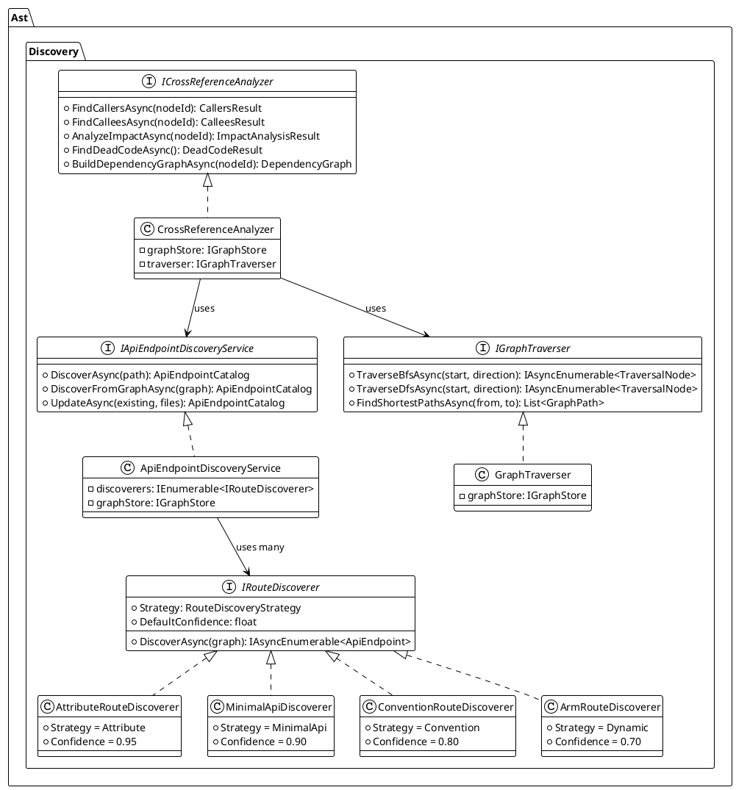
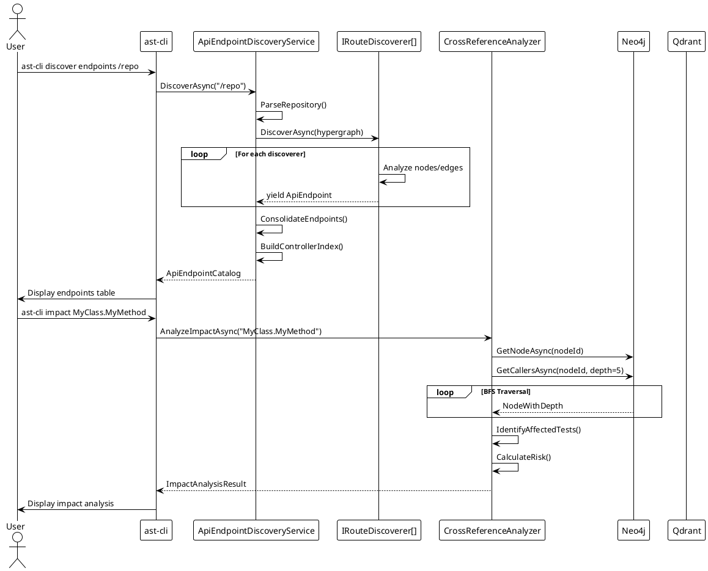
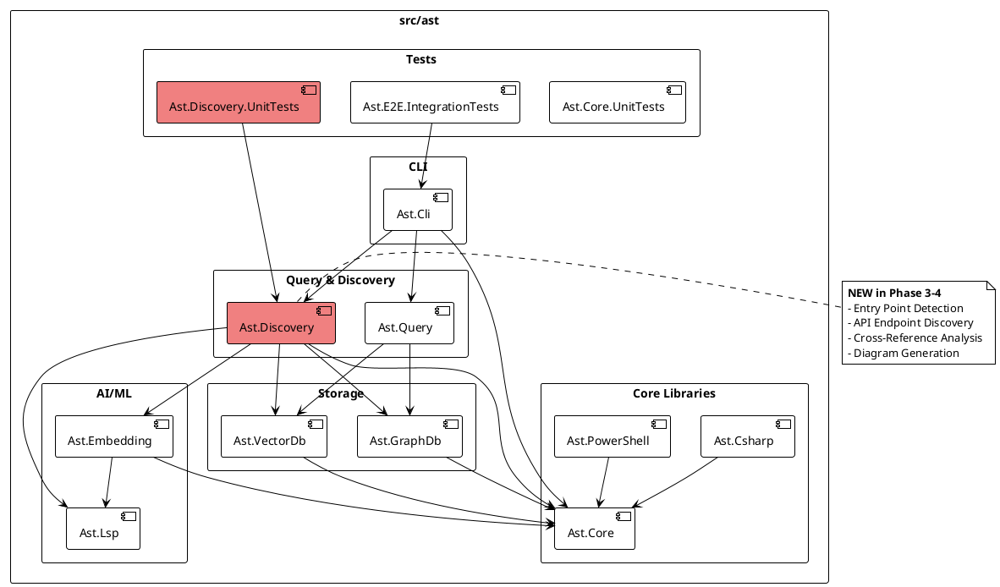

# Code Intelligence Master Architecture

> **Version**: 2.0  
> **Last Updated**: 2026-01-29  
> **Status**: Comprehensive Design Document

This document provides the complete architecture for Phases 3-4 of the Code Intelligence Enhancement, covering API Discovery, Cross-Reference Analysis, and overall system integration.

---

## Table of Contents

1. [Executive Summary](#executive-summary)
2. [System Architecture Overview](#system-architecture-overview)
3. [Phase 1: Entry Point Detection](#phase-1-entry-point-detection)
4. [Phase 2: Diagram Generation](#phase-2-diagram-generation)
5. [Phase 3: API Endpoint Discovery](#phase-3-api-endpoint-discovery)
6. [Phase 4: Cross-Reference Analysis](#phase-4-cross-reference-analysis)
7. [Architecture Integration](#architecture-integration)
8. [Complete Deliverables List](#complete-deliverables-list)
9. [Validation Strategy](#validation-strategy)
10. [Test Matrix](#test-matrix)
11. [Risk Mitigation](#risk-mitigation)
12. [PlantUML Architecture Diagram](#plantuml-architecture-diagram)

---

## Executive Summary

### Vision

Build a comprehensive code intelligence system that provides:
- **Deep API Discovery**: Attribute-based, minimal API, convention-based, and dynamic routing detection
- **Full Cross-Reference Analysis**: Caller/callee tracking, impact analysis, dead code detection
- **Unified Graph Traversal**: Neo4j-powered queries with semantic enhancement from Qdrant

### Current State (Phases 1-7 Complete)

| Component | Status | Tests |
|-----------|--------|-------|
| AST Extraction (C#/PowerShell) | Complete | 166 tests |
| Embedding Generation | Complete | 65 tests |
| Vector Database (Qdrant) | Complete | 28 tests |
| Graph Database (Neo4j) | Complete | 35 tests |
| Query Interface | Complete | 52 tests |
| LSP Integration | Complete | 56 tests |
| CLI Application | Complete | 7 commands |
| E2E Tests | Complete | 20 tests |

**Total: 437 unit tests passing**

### Target State (After Phases 3-4)

| Component | Additions |
|-----------|-----------|
| API Discovery Service | Full endpoint catalog |
| Cross-Reference Analyzer | Complete call graph |
| Impact Analysis Engine | Change propagation |
| Diagram Generator | PlantUML/Mermaid output |

---
## System Architecture Overview

The system follows a layered architecture with clear separation of concerns:

### Layer 1: CLI (User Interface)
- **Ast.Cli**: Spectre.Console-based CLI with commands for parse, enrich, embed, index, query, discover

### Layer 2: Service Layer (Business Logic)
- **Ast.Core**: Repository parsing and hypergraph construction
- **Ast.Lsp**: Language Server Protocol integration for semantic enrichment
- **Ast.Discovery** [NEW]: Entry point and API endpoint discovery
- **Ast.Embedding**: Vector embedding generation
- **Ast.Query**: Fluent query API for graph + vector search

### Layer 3: Data Layer (Models)
- **HypergraphData**: Nodes and edges representing code structure
- **CodeEmbedding**: Vector representations for semantic search
- **ApiEndpointCatalog** [NEW]: Complete API endpoint inventory

### Layer 4: Persistence Layer (Storage)
- **Neo4j**: Graph database for structural queries
- **Qdrant**: Vector database for semantic search
- **File System**: JSON cache for hypergraphs

---

## Phase 3: API Endpoint Discovery

### 3.1 Overview

The API Endpoint Discovery system identifies all HTTP endpoints in a codebase using multiple detection strategies.

### 3.2 Detection Strategies

| Strategy | Confidence | Pattern Types |
|----------|------------|---------------|
| **Attribute-Based** | 0.95 | [Route], [HttpGet/Post/etc], [ApiController] |
| **Minimal API** | 0.90 | app.MapGet(), app.MapPost(), etc. |
| **Convention-Based** | 0.80 | MapControllerRoute patterns |
| **Custom Route Provider** | 0.75 | IDirectRouteProvider implementations |
| **Dynamic/ARM** | 0.70 | Runtime-generated routes |
| **Configuration** | 0.65 | Routes in config files |

### 3.3 Core Interfaces

```csharp
// -----------------------------------------------------------------------
// File: Ast.Discovery/IApiEndpointDiscovery.cs
// -----------------------------------------------------------------------

namespace Ast.Discovery;

using Ast.Core;

/// <summary>
/// Primary interface for API endpoint discovery across a repository.
/// </summary>
public interface IApiEndpointDiscoveryService
{
    /// <summary>
    /// Discovers all API endpoints in the repository using multiple strategies.
    /// </summary>
    Task<ApiEndpointCatalog> DiscoverAsync(
        string repositoryPath,
        DiscoveryOptions? options = null,
        CancellationToken ct = default);

    /// <summary>
    /// Discovers endpoints from an existing hypergraph (faster, no re-parsing).
    /// </summary>
    Task<ApiEndpointCatalog> DiscoverFromGraphAsync(
        HypergraphData hypergraph,
        DiscoveryOptions? options = null,
        CancellationToken ct = default);

    /// <summary>
    /// Incrementally updates endpoint catalog for changed files.
    /// </summary>
    Task<ApiEndpointCatalog> UpdateAsync(
        ApiEndpointCatalog existing,
        IEnumerable<string> changedFiles,
        CancellationToken ct = default);
}

/// <summary>
/// Interface for individual route discoverers (strategy pattern).
/// </summary>
public interface IRouteDiscoverer
{
    RouteDiscoveryStrategy Strategy { get; }
    float DefaultConfidence { get; }
    
    IAsyncEnumerable<ApiEndpoint> DiscoverAsync(
        HypergraphData hypergraph,
        DiscoveryOptions options,
        CancellationToken ct = default);
}

/// <summary>
/// Interface for custom route provider analysis.
/// </summary>
public interface ICustomRouteProviderAnalyzer
{
    Task<CustomRouteProviderInfo> AnalyzeAsync(
        HypergraphNode providerClass,
        CancellationToken ct = default);
    
    IAsyncEnumerable<ApiEndpoint> GenerateRoutesAsync(
        CustomRouteProviderInfo provider,
        CancellationToken ct = default);
}
```

### 3.4 Complete Model Definitions

```csharp
// -----------------------------------------------------------------------
// File: Ast.Discovery/Models/ApiEndpointModels.cs
// -----------------------------------------------------------------------

namespace Ast.Discovery.Models;

/// <summary>
/// Complete catalog of discovered API endpoints.
/// </summary>
public class ApiEndpointCatalog
{
    public string RepositoryPath { get; init; } = string.Empty;
    public DateTime GeneratedAt { get; init; } = DateTime.UtcNow;
    public IReadOnlyList<ApiEndpoint> Endpoints { get; init; } = [];
    public IReadOnlyList<ApiController> Controllers { get; init; } = [];
    public IReadOnlyList<CustomRouteProviderInfo> CustomProviders { get; init; } = [];
    public DiscoveryStatistics Statistics { get; init; } = new();
    
    // Indexing for fast lookup
    public IReadOnlyDictionary<string, ApiEndpoint> ByRoute { get; init; } 
        = new Dictionary<string, ApiEndpoint>();
    public IReadOnlyDictionary<string, IReadOnlyList<ApiEndpoint>> ByController { get; init; } 
        = new Dictionary<string, IReadOnlyList<ApiEndpoint>>();
}

/// <summary>
/// Represents a single API endpoint.
/// </summary>
public record ApiEndpoint
{
    // Identity
    public required string Id { get; init; }
    public required string FilePath { get; init; }
    public required int LineNumber { get; init; }
    public required string NodeId { get; init; }  // Reference to HypergraphNode
    
    // Controller/Action
    public required string ControllerName { get; init; }
    public required string ActionName { get; init; }
    public string? ControllerNodeId { get; init; }
    
    // HTTP Details
    public required HttpMethod HttpMethod { get; init; }
    public required string RouteTemplate { get; init; }
    public string? ResolvedRoute { get; init; }
    public IReadOnlyList<string> RouteConstraints { get; init; } = [];
    
    // Parameters
    public IReadOnlyList<ApiParameter> Parameters { get; init; } = [];
    public string? RequestBodyType { get; init; }
    public string? ResponseType { get; init; }
    
    // Metadata
    public required RouteDiscoveryStrategy Strategy { get; init; }
    public required float Confidence { get; init; }
    public IReadOnlyList<string> Filters { get; init; } = [];
    public IReadOnlyList<string> ProducesMediaTypes { get; init; } = [];
    public IReadOnlyList<string> ConsumesMediaTypes { get; init; } = [];
    
    // Authorization
    public bool RequiresAuthentication { get; init; }
    public IReadOnlyList<string> AuthorizationPolicies { get; init; } = [];
    public IReadOnlyList<string> AllowedRoles { get; init; } = [];
    
    // ARM-specific
    public ArmRouteInfo? ArmInfo { get; init; }
}

/// <summary>
/// API parameter details.
/// </summary>
public record ApiParameter
{
    public required string Name { get; init; }
    public required string Type { get; init; }
    public required ParameterSource Source { get; init; }
    public bool IsRequired { get; init; } = true;
    public string? DefaultValue { get; init; }
    public string? Description { get; init; }
    public IReadOnlyList<string> ValidationAttributes { get; init; } = [];
}

public enum ParameterSource
{
    Route, Query, Body, Header, Form, Services, Cookie, Unknown
}

public enum HttpMethod
{
    GET, POST, PUT, DELETE, PATCH, HEAD, OPTIONS, CONNECT, TRACE, ANY
}

public enum RouteDiscoveryStrategy
{
    Attribute, Convention, CustomProvider, MinimalApi, Dynamic, Configuration, GraphTraversal, Embedding
}

/// <summary>
/// ARM-specific route information for Azure Resource Manager patterns.
/// </summary>
public record ArmRouteInfo
{
    public required string ProviderNamespace { get; init; }
    public required string ResourceType { get; init; }
    public required string ApiVersion { get; init; }
    public required ArmOperationType OperationType { get; init; }
    public bool IsNestedResource { get; init; }
    public int NestingLevel { get; init; }
}

public enum ArmOperationType
{
    List, Get, Create, Update, Delete, Action, Provider
}
```

### 3.5 Route Discoverer Implementations

```csharp
// -----------------------------------------------------------------------
// File: Ast.Discovery/Routes/AttributeRouteDiscoverer.cs
// -----------------------------------------------------------------------

namespace Ast.Discovery.Routes;

using System.Text.RegularExpressions;

/// <summary>
/// Discovers routes from [Route], [HttpGet], [HttpPost], etc. attributes.
/// </summary>
public class AttributeRouteDiscoverer : IRouteDiscoverer
{
    public RouteDiscoveryStrategy Strategy => RouteDiscoveryStrategy.Attribute;
    public float DefaultConfidence => 0.95f;

    private static readonly Regex RouteAttributePattern = new(
        @"\[Route(?:Prefix)?\s*\(\s*""([^""]+)""\s*\)\]",
        RegexOptions.Compiled);

    private static readonly Regex HttpMethodPattern = new(
        @"\[Http(Get|Post|Put|Delete|Patch|Head|Options)(?:\s*\(\s*""([^""]*)""\s*\))?\]",
        RegexOptions.Compiled);

    public async IAsyncEnumerable<ApiEndpoint> DiscoverAsync(
        HypergraphData hypergraph,
        DiscoveryOptions options,
        [EnumeratorCancellation] CancellationToken ct = default)
    {
        var controllers = hypergraph.Nodes
            .Where(n => n.NodeType == "Class")
            .Where(this.IsController);

        foreach (var controller in controllers)
        {
            var controllerRoute = this.ExtractControllerRoute(controller);
            var actions = this.GetActionsForController(hypergraph, controller);

            foreach (var action in actions)
            {
                if (ct.IsCancellationRequested) yield break;

                var endpoint = this.BuildEndpoint(controller, action, controllerRoute);
                if (endpoint != null) yield return endpoint;
            }
        }
    }

    private bool IsController(HypergraphNode node)
    {
        if (node.Name.EndsWith("Controller")) return true;
        
        if (node.Metadata.TryGetValue("Attributes", out var attrs) && attrs is string attrStr)
            if (attrStr.Contains("[ApiController]")) return true;

        if (node.Metadata.TryGetValue("BaseTypes", out var bases) && bases is string baseStr)
            if (baseStr.Contains("ControllerBase")) return true;

        return false;
    }
}
```

```csharp
// -----------------------------------------------------------------------
// File: Ast.Discovery/Routes/MinimalApiDiscoverer.cs
// -----------------------------------------------------------------------

namespace Ast.Discovery.Routes;

/// <summary>
/// Discovers minimal API endpoints (app.MapGet, app.MapPost, etc.).
/// </summary>
public class MinimalApiDiscoverer : IRouteDiscoverer
{
    public RouteDiscoveryStrategy Strategy => RouteDiscoveryStrategy.MinimalApi;
    public float DefaultConfidence => 0.90f;

    private static readonly string[] MapMethods = 
    {
        "MapGet", "MapPost", "MapPut", "MapDelete", "MapPatch",
        "MapMethods", "Map", "MapWhen", "MapGroup"
    };

    public async IAsyncEnumerable<ApiEndpoint> DiscoverAsync(
        HypergraphData hypergraph,
        DiscoveryOptions options,
        [EnumeratorCancellation] CancellationToken ct = default)
    {
        var mapCalls = hypergraph.Edges
            .Where(e => e.Type == HyperedgeType.MethodInvocation)
            .Where(this.IsMapMethodCall);

        foreach (var call in mapCalls)
        {
            if (ct.IsCancellationRequested) yield break;
            var endpoint = this.ParseMapCall(call, hypergraph);
            if (endpoint != null) yield return endpoint;
        }
    }

    private bool IsMapMethodCall(Hyperedge edge)
    {
        var calleeName = edge.Metadata.GetValueOrDefault("CalleeName")?.ToString();
        return MapMethods.Any(m => calleeName?.StartsWith(m) == true);
    }
}
```

```csharp
// -----------------------------------------------------------------------
// File: Ast.Discovery/Routes/ArmRouteDiscoverer.cs
// -----------------------------------------------------------------------

namespace Ast.Discovery.Routes;

/// <summary>
/// Discovers Azure Resource Manager (ARM) style routes.
/// Pattern: /subscriptions/{subId}/resourceGroups/{rg}/providers/...
/// </summary>
public class ArmRouteDiscoverer : IRouteDiscoverer
{
    public RouteDiscoveryStrategy Strategy => RouteDiscoveryStrategy.Dynamic;
    public float DefaultConfidence => 0.70f;

    private static readonly Regex ArmRoutePattern = new(
        @"/subscriptions/\{[^}]+\}/resourceGroups/\{[^}]+\}/providers/([^/]+)/([^/{\s]+)",
        RegexOptions.Compiled | RegexOptions.IgnoreCase);

    public async IAsyncEnumerable<ApiEndpoint> DiscoverAsync(
        HypergraphData hypergraph,
        DiscoveryOptions options,
        [EnumeratorCancellation] CancellationToken ct = default)
    {
        // Find IDirectRouteProvider implementations
        var providers = hypergraph.Nodes
            .Where(n => n.NodeType == "Class")
            .Where(this.IsArmRouteProvider);

        foreach (var provider in providers)
        {
            if (ct.IsCancellationRequested) yield break;
            
            var routes = await this.ExtractArmRoutesAsync(provider, hypergraph);
            foreach (var route in routes) yield return route;
        }
    }

    private bool IsArmRouteProvider(HypergraphNode node)
    {
        if (!node.Metadata.TryGetValue("BaseTypes", out var bases) || bases is not string baseStr)
            return false;

        return baseStr.Contains("IDirectRouteProvider") ||
               baseStr.Contains("ResourceProviderDirectRouteProvider") ||
               node.Name.Contains("ResourceProvider");
    }
}
```

---

## Phase 4: Cross-Reference Analysis

### 4.1 Overview

Cross-reference analysis provides complete visibility into code dependencies, enabling:
- Finding all callers of a method across files and projects
- Impact analysis for change management
- Dead code detection
- Dependency graph construction

### 4.2 Core Interfaces

```csharp
// -----------------------------------------------------------------------
// File: Ast.Discovery/ICrossReferenceAnalyzer.cs
// -----------------------------------------------------------------------

namespace Ast.Discovery;

using Ast.Core;
using Ast.GraphDb;

/// <summary>
/// Primary interface for cross-reference analysis.
/// </summary>
public interface ICrossReferenceAnalyzer
{
    /// <summary>
    /// Finds all callers of a method/function.
    /// </summary>
    Task<CallersResult> FindCallersAsync(
        string nodeId,
        CallersOptions? options = null,
        CancellationToken ct = default);

    /// <summary>
    /// Finds all methods/functions called by a node.
    /// </summary>
    Task<CalleesResult> FindCalleesAsync(
        string nodeId,
        CalleesOptions? options = null,
        CancellationToken ct = default);

    /// <summary>
    /// Analyzes impact of changing a node.
    /// </summary>
    Task<ImpactAnalysisResult> AnalyzeImpactAsync(
        string nodeId,
        ImpactOptions? options = null,
        CancellationToken ct = default);

    /// <summary>
    /// Finds potentially dead code (unreachable from entry points).
    /// </summary>
    Task<DeadCodeResult> FindDeadCodeAsync(
        DeadCodeOptions? options = null,
        CancellationToken ct = default);

    /// <summary>
    /// Builds complete dependency graph for a node.
    /// </summary>
    Task<DependencyGraph> BuildDependencyGraphAsync(
        string nodeId,
        DependencyOptions? options = null,
        CancellationToken ct = default);

    /// <summary>
    /// Finds all implementations of an interface or overrides of a method.
    /// </summary>
    Task<ImplementationsResult> FindImplementationsAsync(
        string nodeId,
        CancellationToken ct = default);

    /// <summary>
    /// Finds all usages of a type.
    /// </summary>
    Task<TypeUsagesResult> FindTypeUsagesAsync(
        string typeNodeId,
        CancellationToken ct = default);
}

/// <summary>
/// Interface for graph traversal operations.
/// </summary>
public interface IGraphTraverser
{
    /// <summary>
    /// Performs BFS traversal from a starting node.
    /// </summary>
    IAsyncEnumerable<TraversalNode> TraverseBfsAsync(
        string startNodeId,
        TraversalDirection direction,
        TraversalOptions options,
        CancellationToken ct = default);

    /// <summary>
    /// Performs DFS traversal from a starting node.
    /// </summary>
    IAsyncEnumerable<TraversalNode> TraverseDfsAsync(
        string startNodeId,
        TraversalDirection direction,
        TraversalOptions options,
        CancellationToken ct = default);

    /// <summary>
    /// Finds shortest paths between two nodes.
    /// </summary>
    Task<IReadOnlyList<GraphPath>> FindShortestPathsAsync(
        string fromNodeId,
        string toNodeId,
        int maxPaths = 5,
        CancellationToken ct = default);
}

public enum TraversalDirection
{
    Callers,    // Who calls me?
    Callees,    // Who do I call?
    Both,       // Bidirectional
    Dependents, // Who depends on me?
    Dependencies // What do I depend on?
}
```

### 4.3 Cross-Reference Models

```csharp
// -----------------------------------------------------------------------
// File: Ast.Discovery/Models/CrossReferenceModels.cs
// -----------------------------------------------------------------------

namespace Ast.Discovery.Models;

/// <summary>
/// Result of finding callers of a node.
/// </summary>
public record CallersResult
{
    public required string TargetNodeId { get; init; }
    public required string TargetNodeName { get; init; }
    public required IReadOnlyList<CallerInfo> Callers { get; init; }
    public int TotalCallers { get; init; }
    public TimeSpan AnalysisDuration { get; init; }
    public int MaxDepthReached { get; init; }
    public bool WasTruncated { get; init; }
}

public record CallerInfo
{
    public required HypergraphNode Node { get; init; }
    public required int Depth { get; init; }
    public required string CallSite { get; init; }  // Line number and context
    public required Hyperedge Edge { get; init; }   // The invocation edge
    public bool IsCrossProject { get; init; }
    public bool IsCrossLanguage { get; init; }
    public string? ProjectName { get; init; }
}

/// <summary>
/// Result of finding callees of a node.
/// </summary>
public record CalleesResult
{
    public required string SourceNodeId { get; init; }
    public required string SourceNodeName { get; init; }
    public required IReadOnlyList<CalleeInfo> Callees { get; init; }
    public int TotalCallees { get; init; }
    public TimeSpan AnalysisDuration { get; init; }
}

public record CalleeInfo
{
    public required HypergraphNode Node { get; init; }
    public required int Depth { get; init; }
    public required string CallSite { get; init; }
    public required Hyperedge Edge { get; init; }
    public bool IsExternal { get; init; }  // External library call
    public bool IsAsync { get; init; }
    public bool IsAwait { get; init; }
}

/// <summary>
/// Result of impact analysis.
/// </summary>
public record ImpactAnalysisResult
{
    public required string TargetNodeId { get; init; }
    public required string TargetNodeName { get; init; }
    
    /// <summary>Directly affected nodes (immediate callers).</summary>
    public required IReadOnlyList<ImpactedNode> DirectImpacts { get; init; }
    
    /// <summary>Indirectly affected nodes (transitive callers).</summary>
    public required IReadOnlyList<ImpactedNode> TransitiveImpacts { get; init; }
    
    /// <summary>Affected test classes/methods.</summary>
    public required IReadOnlyList<ImpactedNode> AffectedTests { get; init; }
    
    /// <summary>Affected API endpoints.</summary>
    public required IReadOnlyList<ApiEndpoint> AffectedEndpoints { get; init; }
    
    /// <summary>Risk assessment based on impact scope.</summary>
    public required ImpactRisk Risk { get; init; }
    
    public TimeSpan AnalysisDuration { get; init; }
    public int TotalImpactedNodes { get; init; }
}

public record ImpactedNode
{
    public required HypergraphNode Node { get; init; }
    public required int Depth { get; init; }
    public required ImpactType ImpactType { get; init; }
    public required float ImpactScore { get; init; }  // 0.0 - 1.0
    public string? Reason { get; init; }
}

public enum ImpactType
{
    DirectCaller,       // Directly calls the changed node
    TransitiveCaller,   // Indirectly calls through chain
    TestCoverage,       // Test that exercises this code
    InterfaceImpl,      // Implements interface being changed
    Override,           // Overrides method being changed
    TypeUsage,          // Uses the type being changed
    ConfigDependency    // Configuration dependency
}

public enum ImpactRisk
{
    Low,        // < 10 affected nodes, no public API
    Medium,     // 10-50 affected nodes or internal API
    High,       // > 50 affected nodes or public API
    Critical    // Public API with external consumers
}

/// <summary>
/// Result of dead code detection.
/// </summary>
public record DeadCodeResult
{
    public required IReadOnlyList<DeadCodeCandidate> Candidates { get; init; }
    public required IReadOnlyList<HypergraphNode> EntryPoints { get; init; }
    public int TotalNodesAnalyzed { get; init; }
    public int DeadCodeCount { get; init; }
    public float DeadCodePercentage { get; init; }
    public TimeSpan AnalysisDuration { get; init; }
}

public record DeadCodeCandidate
{
    public required HypergraphNode Node { get; init; }
    public required DeadCodeReason Reason { get; init; }
    public required float Confidence { get; init; }
    public string? Explanation { get; init; }
    public bool IsTestCode { get; init; }
    public bool IsGeneratedCode { get; init; }
}

public enum DeadCodeReason
{
    Unreachable,            // No path from any entry point
    UnusedPrivate,          // Private member never used
    UnusedParameter,        // Parameter never used in method body
    UnusedVariable,         // Variable assigned but never read
    UnusedReturn,           // Return value always discarded
    ObsoleteWithNoCallers   // Marked obsolete with no remaining callers
}

/// <summary>
/// Complete dependency graph for a node.
/// </summary>
public record DependencyGraph
{
    public required string RootNodeId { get; init; }
    public required IReadOnlyList<DependencyNode> Nodes { get; init; }
    public required IReadOnlyList<DependencyEdge> Edges { get; init; }
    public int Depth { get; init; }
    public int TotalNodes { get; init; }
    public int TotalEdges { get; init; }
    
    /// <summary>Generates Mermaid diagram syntax.</summary>
    public string ToMermaid() { /* ... */ }
    
    /// <summary>Generates PlantUML diagram syntax.</summary>
    public string ToPlantUml() { /* ... */ }
    
    /// <summary>Generates DOT graph syntax.</summary>
    public string ToDot() { /* ... */ }
}

public record DependencyNode
{
    public required string Id { get; init; }
    public required string Name { get; init; }
    public required string NodeType { get; init; }
    public required int Depth { get; init; }
    public string? Stereotype { get; init; }  // For diagram styling
}

public record DependencyEdge
{
    public required string FromId { get; init; }
    public required string ToId { get; init; }
    public required DependencyType Type { get; init; }
    public string? Label { get; init; }
}

public enum DependencyType
{
    Calls,
    Inherits,
    Implements,
    Uses,
    Creates,
    Injects,
    References
}
```

### 4.4 Cross-Reference Analyzer Implementation

```csharp
// -----------------------------------------------------------------------
// File: Ast.Discovery/CrossReferenceAnalyzer.cs
// -----------------------------------------------------------------------

namespace Ast.Discovery;

public class CrossReferenceAnalyzer : ICrossReferenceAnalyzer
{
    private readonly IGraphStore _graphStore;
    private readonly IGraphTraverser _traverser;
    private readonly IApiEndpointDiscoveryService _endpointDiscovery;
    private readonly ILogger<CrossReferenceAnalyzer> _logger;

    public CrossReferenceAnalyzer(
        IGraphStore graphStore,
        IGraphTraverser traverser,
        IApiEndpointDiscoveryService endpointDiscovery,
        ILogger<CrossReferenceAnalyzer> logger)
    {
        this._graphStore = graphStore;
        this._traverser = traverser;
        this._endpointDiscovery = endpointDiscovery;
        this._logger = logger;
    }

    public async Task<CallersResult> FindCallersAsync(
        string nodeId,
        CallersOptions? options = null,
        CancellationToken ct = default)
    {
        options ??= new CallersOptions();
        var stopwatch = Stopwatch.StartNew();

        var targetNode = await this._graphStore.GetNodeAsync(nodeId, ct);
        if (targetNode == null)
            throw new NodeNotFoundException(nodeId);

        var callers = new List<CallerInfo>();
        var seen = new HashSet<string>();

        await foreach (var node in this._traverser.TraverseBfsAsync(
            nodeId, 
            TraversalDirection.Callers,
            new TraversalOptions 
            { 
                MaxDepth = options.MaxDepth,
                IncludeCrossProject = options.IncludeCrossProject,
                IncludeCrossLanguage = options.IncludeCrossLanguage
            },
            ct))
        {
            if (seen.Add(node.Node.Id))
            {
                callers.Add(new CallerInfo
                {
                    Node = node.Node,
                    Depth = node.Depth,
                    CallSite = this.FormatCallSite(node.Edge),
                    Edge = node.Edge,
                    IsCrossProject = node.IsCrossProject,
                    IsCrossLanguage = node.IsCrossLanguage
                });
            }

            if (callers.Count >= options.MaxResults)
                break;
        }

        stopwatch.Stop();

        return new CallersResult
        {
            TargetNodeId = nodeId,
            TargetNodeName = targetNode.Name,
            Callers = callers,
            TotalCallers = callers.Count,
            AnalysisDuration = stopwatch.Elapsed,
            MaxDepthReached = callers.Max(c => c.Depth),
            WasTruncated = callers.Count >= options.MaxResults
        };
    }

    public async Task<ImpactAnalysisResult> AnalyzeImpactAsync(
        string nodeId,
        ImpactOptions? options = null,
        CancellationToken ct = default)
    {
        options ??= new ImpactOptions();
        var stopwatch = Stopwatch.StartNew();

        var targetNode = await this._graphStore.GetNodeAsync(nodeId, ct);
        if (targetNode == null)
            throw new NodeNotFoundException(nodeId);

        // Find direct callers (depth 1)
        var directCallers = await this.FindCallersAsync(
            nodeId, 
            new CallersOptions { MaxDepth = 1 }, 
            ct);

        // Find transitive callers (depth 2+)
        var transitiveCallers = await this.FindCallersAsync(
            nodeId,
            new CallersOptions { MaxDepth = options.MaxDepth, MaxResults = options.MaxResults },
            ct);

        // Identify affected tests
        var affectedTests = transitiveCallers.Callers
            .Where(c => this.IsTestMethod(c.Node))
            .Select(c => new ImpactedNode
            {
                Node = c.Node,
                Depth = c.Depth,
                ImpactType = ImpactType.TestCoverage,
                ImpactScore = 1.0f / c.Depth
            })
            .ToList();

        // Find affected endpoints
        var affectedEndpoints = await this.FindAffectedEndpointsAsync(
            transitiveCallers.Callers.Select(c => c.Node.Id), 
            ct);

        // Calculate risk
        var risk = this.CalculateRisk(
            directCallers.Callers.Count,
            transitiveCallers.Callers.Count,
            affectedEndpoints.Count,
            targetNode);

        stopwatch.Stop();

        return new ImpactAnalysisResult
        {
            TargetNodeId = nodeId,
            TargetNodeName = targetNode.Name,
            DirectImpacts = directCallers.Callers.Select(c => new ImpactedNode
            {
                Node = c.Node,
                Depth = c.Depth,
                ImpactType = ImpactType.DirectCaller,
                ImpactScore = 1.0f
            }).ToList(),
            TransitiveImpacts = transitiveCallers.Callers
                .Where(c => c.Depth > 1)
                .Select(c => new ImpactedNode
                {
                    Node = c.Node,
                    Depth = c.Depth,
                    ImpactType = ImpactType.TransitiveCaller,
                    ImpactScore = 1.0f / c.Depth
                }).ToList(),
            AffectedTests = affectedTests,
            AffectedEndpoints = affectedEndpoints,
            Risk = risk,
            AnalysisDuration = stopwatch.Elapsed,
            TotalImpactedNodes = transitiveCallers.TotalCallers
        };
    }

    public async Task<DeadCodeResult> FindDeadCodeAsync(
        DeadCodeOptions? options = null,
        CancellationToken ct = default)
    {
        options ??= new DeadCodeOptions();
        var stopwatch = Stopwatch.StartNew();

        // Step 1: Find all entry points
        var entryPointSvc = new EntryPointDiscoveryService(/* ... */);
        var entryPoints = await entryPointSvc.DiscoverEntryPointsAsync(options.RepositoryPath, ct);

        // Step 2: Mark all reachable nodes starting from entry points
        var reachable = new HashSet<string>();
        foreach (var ep in entryPoints.EntryPoints)
        {
            await foreach (var node in this._traverser.TraverseBfsAsync(
                ep.NodeId,
                TraversalDirection.Callees,
                new TraversalOptions { MaxDepth = 100 },
                ct))
            {
                reachable.Add(node.Node.Id);
            }
        }

        // Step 3: Find unreachable nodes
        var allNodes = await this._graphStore.GetNodesAsync(
            new NodeFilter { Types = new[] { "Method", "Function", "Class" } },
            ct);

        var deadCode = allNodes
            .Where(n => !reachable.Contains(n.Id))
            .Where(n => !this.IsExcluded(n, options))
            .Select(n => new DeadCodeCandidate
            {
                Node = n,
                Reason = DeadCodeReason.Unreachable,
                Confidence = 0.85f,
                IsTestCode = this.IsTestCode(n),
                IsGeneratedCode = this.IsGeneratedCode(n)
            })
            .ToList();

        stopwatch.Stop();

        return new DeadCodeResult
        {
            Candidates = deadCode,
            EntryPoints = entryPoints.EntryPoints.Select(e => /* ... */).ToList(),
            TotalNodesAnalyzed = allNodes.Count,
            DeadCodeCount = deadCode.Count,
            DeadCodePercentage = (float)deadCode.Count / allNodes.Count * 100,
            AnalysisDuration = stopwatch.Elapsed
        };
    }

    private ImpactRisk CalculateRisk(
        int directCallers, 
        int transitiveCallers, 
        int affectedEndpoints,
        HypergraphNode targetNode)
    {
        var isPublicApi = targetNode.Modifiers.Contains("public") && 
                         !targetNode.FilePath.Contains("Internal");

        if (affectedEndpoints > 0 && isPublicApi)
            return ImpactRisk.Critical;
        if (transitiveCallers > 50 || affectedEndpoints > 0)
            return ImpactRisk.High;
        if (transitiveCallers > 10)
            return ImpactRisk.Medium;
        return ImpactRisk.Low;
    }

    private bool IsTestMethod(HypergraphNode node)
    {
        if (node.FilePath.Contains("Test")) return true;
        if (node.Metadata.TryGetValue("Attributes", out var attrs) && attrs is string attrStr)
        {
            return attrStr.Contains("[Test") || 
                   attrStr.Contains("[Fact") ||
                   attrStr.Contains("[Theory");
        }
        return false;
    }
}
```

### 4.5 Graph Traverser Implementation

```csharp
// -----------------------------------------------------------------------
// File: Ast.Discovery/GraphTraverser.cs
// -----------------------------------------------------------------------

namespace Ast.Discovery;

/// <summary>
/// Implements graph traversal algorithms using Neo4j.
/// </summary>
public class GraphTraverser : IGraphTraverser
{
    private readonly IGraphStore _graphStore;

    public GraphTraverser(IGraphStore graphStore)
    {
        this._graphStore = graphStore;
    }

    public async IAsyncEnumerable<TraversalNode> TraverseBfsAsync(
        string startNodeId,
        TraversalDirection direction,
        TraversalOptions options,
        [EnumeratorCancellation] CancellationToken ct = default)
    {
        var visited = new HashSet<string> { startNodeId };
        var queue = new Queue<(string NodeId, int Depth)>();
        queue.Enqueue((startNodeId, 0));

        while (queue.Count > 0 && !ct.IsCancellationRequested)
        {
            var (currentId, depth) = queue.Dequeue();
            
            if (depth >= options.MaxDepth)
                continue;

            var neighbors = direction switch
            {
                TraversalDirection.Callers => await this._graphStore.GetCallersAsync(currentId, 1, ct),
                TraversalDirection.Callees => await this._graphStore.GetCalleesAsync(currentId, 1, ct),
                _ => throw new ArgumentException(nameof(direction))
            };

            foreach (var neighbor in neighbors)
            {
                if (!visited.Add(neighbor.Node.Id))
                    continue;

                // Filter by options
                if (!options.IncludeCrossLanguage && neighbor.Node.Language != options.SourceLanguage)
                    continue;

                queue.Enqueue((neighbor.Node.Id, depth + 1));

                yield return new TraversalNode
                {
                    Node = neighbor.Node,
                    Depth = depth + 1,
                    Edge = neighbor.Edge,
                    IsCrossProject = this.IsCrossProject(startNodeId, neighbor.Node.Id),
                    IsCrossLanguage = neighbor.Node.Language != options.SourceLanguage
                };
            }
        }
    }

    public async Task<IReadOnlyList<GraphPath>> FindShortestPathsAsync(
        string fromNodeId,
        string toNodeId,
        int maxPaths = 5,
        CancellationToken ct = default)
    {
        return await this._graphStore.FindPathsAsync(fromNodeId, toNodeId, 10, ct);
    }
}

public record TraversalNode
{
    public required HypergraphNode Node { get; init; }
    public required int Depth { get; init; }
    public required Hyperedge Edge { get; init; }
    public bool IsCrossProject { get; init; }
    public bool IsCrossLanguage { get; init; }
}

public class TraversalOptions
{
    public int MaxDepth { get; set; } = 5;
    public bool IncludeCrossProject { get; set; } = true;
    public bool IncludeCrossLanguage { get; set; } = true;
    public string? SourceLanguage { get; set; }
    public HyperedgeType[]? EdgeTypes { get; set; }
}
```

---

## Architecture Integration

### 5.1 CLI Workflow

The CLI provides a unified interface for all code intelligence operations:

```bash
# Full pipeline: parse -> enrich -> embed -> index -> discover
ast-cli pipeline /path/to/repo --output ./analysis

# Individual commands
ast-cli parse /path/to/repo --output ./hypergraph.json
ast-cli enrich ./hypergraph.json --lsp
ast-cli embed ./hypergraph.json --model qwen2.5-coder
ast-cli index ./hypergraph.json --neo4j --qdrant
ast-cli discover entrypoints /path/to/repo
ast-cli discover endpoints /path/to/repo
ast-cli discover deadcode /path/to/repo

# Cross-reference queries
ast-cli callers MyClass.MyMethod --depth 5
ast-cli callees MyClass.MyMethod --depth 3
ast-cli impact MyClass.MyMethod --json
ast-cli path FromClass.Method ToClass.Method

# Diagram generation
ast-cli diagram dependency MyClass --format plantuml --output diagram.puml
ast-cli diagram callgraph MyMethod --format mermaid --output callgraph.md
```

### 5.2 Service Interaction Flow

```
┌─────────────────────────────────────────────────────────────────────────────────┐
│                          Data Flow: Source to Diagram                            │
└─────────────────────────────────────────────────────────────────────────────────┘

     Source Files              Hypergraph                 Databases
    ┌──────────┐             ┌───────────┐             ┌───────────┐
    │ *.cs     │             │           │             │           │
    │ *.ps1    │────parse───>│   Nodes   │────index───>│  Neo4j    │
    │ *.config │             │   Edges   │             │  Qdrant   │
    └──────────┘             └───────────┘             └───────────┘
                                   │                        │
                              embed │                       │ query
                                   ▼                        ▼
                            ┌───────────┐             ┌───────────┐
                            │ Vectors   │             │  Results  │
                            └───────────┘             └───────────┘
                                   │                        │
                                   └──────────┬─────────────┘
                                              │
                                              ▼
                                   ┌──────────────────┐
                                   │   Discovery      │
                                   │   - Entry Points │
                                   │   - Endpoints    │
                                   │   - Dead Code    │
                                   └────────┬─────────┘
                                            │
                                            ▼
                                   ┌──────────────────┐
                                   │   Cross-Ref      │
                                   │   - Callers      │
                                   │   - Impact       │
                                   │   - Paths        │
                                   └────────┬─────────┘
                                            │
                                            ▼
                                   ┌──────────────────┐
                                   │   Diagrams       │
                                   │   - PlantUML     │
                                   │   - Mermaid      │
                                   │   - DOT          │
                                   └──────────────────┘
```

### 5.3 Dependency Injection Configuration

```csharp
// -----------------------------------------------------------------------
// File: Ast.Discovery/ServiceCollectionExtensions.cs
// -----------------------------------------------------------------------

namespace Ast.Discovery;

public static class ServiceCollectionExtensions
{
    public static IServiceCollection AddDiscoveryServices(
        this IServiceCollection services,
        IConfiguration configuration)
    {
        // Configuration
        services.Configure<DiscoveryConfiguration>(
            configuration.GetSection(DiscoveryConfiguration.SectionName));

        // Route Discoverers (Strategy Pattern)
        services.AddSingleton<IRouteDiscoverer, AttributeRouteDiscoverer>();
        services.AddSingleton<IRouteDiscoverer, MinimalApiDiscoverer>();
        services.AddSingleton<IRouteDiscoverer, ConventionRouteDiscoverer>();
        services.AddSingleton<IRouteDiscoverer, ArmRouteDiscoverer>();
        services.AddSingleton<IRouteDiscoverer, CustomRouteProviderDiscoverer>();

        // Entry Point Discovery
        services.AddSingleton<EntryPointHeuristics>();
        services.AddSingleton<ServiceFabricConfigParser>();
        services.AddSingleton<KubernetesConfigParser>();
        services.AddSingleton<DockerfileParser>();
        services.AddSingleton<IEntryPointDiscoveryService, EntryPointDiscoveryService>();

        // API Endpoint Discovery
        services.AddSingleton<ICustomRouteProviderAnalyzer, CustomRouteProviderAnalyzer>();
        services.AddSingleton<IApiEndpointDiscoveryService, ApiEndpointDiscoveryService>();

        // Cross-Reference Analysis
        services.AddSingleton<IGraphTraverser, GraphTraverser>();
        services.AddSingleton<ICrossReferenceAnalyzer, CrossReferenceAnalyzer>();

        // Diagram Generation
        services.AddSingleton<IDiagramGenerator, PlantUmlDiagramGenerator>();
        services.AddSingleton<IDiagramGenerator, MermaidDiagramGenerator>();
        services.AddSingleton<DiagramGeneratorFactory>();

        return services;
    }

    public static IServiceCollection AddFullCodeIntelligence(
        this IServiceCollection services,
        IConfiguration configuration)
    {
        // Core services (from Ast.Core, Ast.Lsp, etc.)
        services.AddAstCore(configuration);
        services.AddLspServices(configuration);
        services.AddEmbeddingServices(configuration);
        services.AddGraphDbServices(configuration);
        services.AddVectorDbServices(configuration);
        services.AddQueryServices(configuration);

        // Discovery services
        services.AddDiscoveryServices(configuration);

        return services;
    }
}
```

### 5.4 New CLI Commands

```csharp
// -----------------------------------------------------------------------
// File: Ast.Cli/Commands/DiscoverCommand.cs
// -----------------------------------------------------------------------

namespace Ast.Cli.Commands;

[Description("Discover entry points, endpoints, and code patterns")]
public class DiscoverCommand : AsyncCommand<DiscoverCommand.Settings>
{
    public class Settings : CommandSettings
    {
        [CommandArgument(0, "<type>")]
        [Description("Discovery type: entrypoints, endpoints, deadcode, all")]
        public string Type { get; set; } = "all";

        [CommandArgument(1, "<path>")]
        [Description("Repository path")]
        public string Path { get; set; } = ".";

        [CommandOption("--output|-o")]
        [Description("Output file path")]
        public string? Output { get; set; }

        [CommandOption("--format|-f")]
        [Description("Output format: json, table, markdown")]
        public string Format { get; set; } = "table";

        [CommandOption("--min-confidence")]
        [DefaultValue(0.7f)]
        public float MinConfidence { get; set; }
    }

    private readonly IEntryPointDiscoveryService _entryPointSvc;
    private readonly IApiEndpointDiscoveryService _endpointSvc;
    private readonly ICrossReferenceAnalyzer _crossRefAnalyzer;

    public override async Task<int> ExecuteAsync(
        CommandContext context, 
        Settings settings)
    {
        var type = settings.Type.ToLowerInvariant();

        return type switch
        {
            "entrypoints" => await this.DiscoverEntryPointsAsync(settings),
            "endpoints" => await this.DiscoverEndpointsAsync(settings),
            "deadcode" => await this.DiscoverDeadCodeAsync(settings),
            "all" => await this.DiscoverAllAsync(settings),
            _ => throw new ArgumentException($"Unknown type: {type}")
        };
    }
}
```

```csharp
// -----------------------------------------------------------------------
// File: Ast.Cli/Commands/ImpactCommand.cs
// -----------------------------------------------------------------------

namespace Ast.Cli.Commands;

[Description("Analyze impact of changing a code element")]
public class ImpactCommand : AsyncCommand<ImpactCommand.Settings>
{
    public class Settings : CommandSettings
    {
        [CommandArgument(0, "<target>")]
        [Description("Target node (ClassName.MethodName or file:line)")]
        public string Target { get; set; } = string.Empty;

        [CommandOption("--depth|-d")]
        [DefaultValue(5)]
        public int Depth { get; set; }

        [CommandOption("--include-tests")]
        [DefaultValue(true)]
        public bool IncludeTests { get; set; }

        [CommandOption("--format|-f")]
        public string Format { get; set; } = "table";

        [CommandOption("--output|-o")]
        public string? Output { get; set; }
    }

    public override async Task<int> ExecuteAsync(
        CommandContext context, 
        Settings settings)
    {
        var result = await this._analyzer.AnalyzeImpactAsync(
            settings.Target,
            new ImpactOptions 
            { 
                MaxDepth = settings.Depth,
                IncludeTests = settings.IncludeTests
            });

        this.RenderResult(result, settings.Format);
        return 0;
    }
}
```

```csharp
// -----------------------------------------------------------------------
// File: Ast.Cli/Commands/DiagramCommand.cs
// -----------------------------------------------------------------------

namespace Ast.Cli.Commands;

[Description("Generate code diagrams")]
public class DiagramCommand : AsyncCommand<DiagramCommand.Settings>
{
    public class Settings : CommandSettings
    {
        [CommandArgument(0, "<type>")]
        [Description("Diagram type: dependency, callgraph, inheritance, sequence")]
        public string Type { get; set; } = "dependency";

        [CommandArgument(1, "<target>")]
        [Description("Target node")]
        public string Target { get; set; } = string.Empty;

        [CommandOption("--format|-f")]
        [Description("Output format: plantuml, mermaid, dot")]
        public string Format { get; set; } = "plantuml";

        [CommandOption("--output|-o")]
        public string? Output { get; set; }

        [CommandOption("--depth|-d")]
        [DefaultValue(3)]
        public int Depth { get; set; }
    }

    public override async Task<int> ExecuteAsync(
        CommandContext context, 
        Settings settings)
    {
        var graph = await this._analyzer.BuildDependencyGraphAsync(
            settings.Target,
            new DependencyOptions { MaxDepth = settings.Depth });

        var diagram = settings.Format.ToLowerInvariant() switch
        {
            "plantuml" => graph.ToPlantUml(),
            "mermaid" => graph.ToMermaid(),
            "dot" => graph.ToDot(),
            _ => throw new ArgumentException($"Unknown format: {settings.Format}")
        };

        if (settings.Output != null)
            await File.WriteAllTextAsync(settings.Output, diagram);
        else
            AnsiConsole.WriteLine(diagram);

        return 0;
    }
}
```

---

## Complete Deliverables List

### 6.1 New Projects

| Project | Description | Dependencies |
|---------|-------------|--------------|
| **Ast.Discovery** | Entry point and API discovery | Ast.Core, Ast.GraphDb, Ast.VectorDb |
| **Ast.Discovery.UnitTests** | Unit tests for discovery | Ast.Discovery |
| **Ast.Discovery.IntegrationTests** | Integration tests | Ast.Discovery, Docker |

### 6.2 Phase 3 Deliverables (API Discovery)

#### Interfaces
| File | Interface | Description |
|------|-----------|-------------|
| IApiEndpointDiscovery.cs | IApiEndpointDiscoveryService | Main API discovery interface |
| IApiEndpointDiscovery.cs | IRouteDiscoverer | Strategy pattern for route discovery |
| IApiEndpointDiscovery.cs | ICustomRouteProviderAnalyzer | ARM/custom route analysis |

#### Implementations
| File | Class | Description |
|------|-------|-------------|
| ApiEndpointDiscoveryService.cs | ApiEndpointDiscoveryService | Main discovery orchestrator |
| Routes/AttributeRouteDiscoverer.cs | AttributeRouteDiscoverer | [Route], [HttpGet] discovery |
| Routes/MinimalApiDiscoverer.cs | MinimalApiDiscoverer | app.MapGet() discovery |
| Routes/ConventionRouteDiscoverer.cs | ConventionRouteDiscoverer | MapControllerRoute patterns |
| Routes/ArmRouteDiscoverer.cs | ArmRouteDiscoverer | ARM-style route detection |
| Routes/CustomRouteProviderDiscoverer.cs | CustomRouteProviderDiscoverer | IDirectRouteProvider analysis |
| CustomRouteProviderAnalyzer.cs | CustomRouteProviderAnalyzer | Route provider analysis |

#### Models
| File | Class/Record | Description |
|------|--------------|-------------|
| Models/ApiEndpointModels.cs | ApiEndpointCatalog | Complete endpoint inventory |
| Models/ApiEndpointModels.cs | ApiEndpoint | Single endpoint details |
| Models/ApiEndpointModels.cs | ApiParameter | Parameter details |
| Models/ApiEndpointModels.cs | ApiController | Controller aggregation |
| Models/ApiEndpointModels.cs | ArmRouteInfo | ARM-specific metadata |
| Models/ApiEndpointModels.cs | CustomRouteProviderInfo | Custom provider info |
| Models/ApiEndpointModels.cs | DiscoveryStatistics | Discovery metrics |

#### Configuration
| File | Class | Description |
|------|-------|-------------|
| DiscoveryConfiguration.cs | DiscoveryConfiguration | Main configuration |
| DiscoveryConfiguration.cs | ApiEndpointDiscoveryOptions | Endpoint options |
| DiscoveryConfiguration.cs | PerformanceOptions | Tuning options |
| DiscoveryConfiguration.cs | DiscoveryOptions | Per-operation options |

### 6.3 Phase 4 Deliverables (Cross-Reference)

#### Interfaces
| File | Interface | Description |
|------|-----------|-------------|
| ICrossReferenceAnalyzer.cs | ICrossReferenceAnalyzer | Main cross-ref interface |
| ICrossReferenceAnalyzer.cs | IGraphTraverser | Graph traversal algorithms |

#### Implementations
| File | Class | Description |
|------|-------|-------------|
| CrossReferenceAnalyzer.cs | CrossReferenceAnalyzer | Caller/callee/impact analysis |
| GraphTraverser.cs | GraphTraverser | BFS/DFS traversal |
| DeadCodeAnalyzer.cs | DeadCodeAnalyzer | Dead code detection |
| DiagramGenerator.cs | PlantUmlDiagramGenerator | PlantUML output |
| DiagramGenerator.cs | MermaidDiagramGenerator | Mermaid output |
| DiagramGenerator.cs | DotDiagramGenerator | DOT/Graphviz output |

#### Models
| File | Class/Record | Description |
|------|--------------|-------------|
| Models/CrossReferenceModels.cs | CallersResult | Caller query result |
| Models/CrossReferenceModels.cs | CallerInfo | Single caller details |
| Models/CrossReferenceModels.cs | CalleesResult | Callee query result |
| Models/CrossReferenceModels.cs | CalleeInfo | Single callee details |
| Models/CrossReferenceModels.cs | ImpactAnalysisResult | Impact analysis result |
| Models/CrossReferenceModels.cs | ImpactedNode | Single impacted node |
| Models/CrossReferenceModels.cs | DeadCodeResult | Dead code detection result |
| Models/CrossReferenceModels.cs | DeadCodeCandidate | Single dead code candidate |
| Models/CrossReferenceModels.cs | DependencyGraph | Dependency graph structure |
| Models/CrossReferenceModels.cs | DependencyNode | Graph node |
| Models/CrossReferenceModels.cs | DependencyEdge | Graph edge |
| Models/CrossReferenceModels.cs | TraversalNode | Traversal result item |
| Models/CrossReferenceModels.cs | TraversalOptions | Traversal configuration |

#### CLI Commands
| File | Class | Description |
|------|-------|-------------|
| Commands/DiscoverCommand.cs | DiscoverCommand | Entry points/endpoints discovery |
| Commands/CallersCommand.cs | CallersCommand | Find callers of a method |
| Commands/CalleesCommand.cs | CalleesCommand | Find callees of a method |
| Commands/ImpactCommand.cs | ImpactCommand | Impact analysis |
| Commands/PathCommand.cs | PathCommand | Find paths between nodes |
| Commands/DiagramCommand.cs | DiagramCommand | Generate diagrams |
| Commands/DeadCodeCommand.cs | DeadCodeCommand | Dead code detection |

### 6.4 Configuration Classes Summary

| Class | Section | Description |
|-------|---------|-------------|
| DiscoveryConfiguration | Discovery | Root configuration |
| EntryPointDiscoveryOptions | Discovery:EntryPoints | Entry point options |
| ApiEndpointDiscoveryOptions | Discovery:Endpoints | Endpoint options |
| CrossReferenceOptions | Discovery:CrossReference | Cross-ref options |
| PerformanceOptions | Discovery:Performance | Performance tuning |
| CallersOptions | - | Per-call options |
| CalleesOptions | - | Per-call options |
| ImpactOptions | - | Per-call options |
| DeadCodeOptions | - | Per-call options |
| DependencyOptions | - | Per-call options |

---

## Validation Strategy

### 7.1 Unit Test Cases by Class

#### ApiEndpointDiscoveryService (10+ tests)

| Test Case | Description |
|-----------|-------------|
| DiscoverAsync_EmptyRepository_ReturnsEmptyCatalog | No files returns empty |
| DiscoverAsync_SingleController_FindsAllEndpoints | Basic controller discovery |
| DiscoverAsync_NestedRoutes_CombinesCorrectly | Controller + action routes |
| DiscoverAsync_MinimalApi_FindsMapMethods | MapGet/MapPost discovery |
| DiscoverAsync_MixedRoutes_ConsolidatesDeduplicates | Multiple strategies |
| DiscoverAsync_CustomRouteProvider_AnalyzesPatterns | IDirectRouteProvider |
| DiscoverAsync_ArmRoutes_ExtractsMetadata | ARM pattern extraction |
| DiscoverAsync_WithFilters_ExcludesCorrectly | Exclude patterns work |
| DiscoverAsync_LargeRepo_PerformsAcceptably | Performance test |
| UpdateAsync_ChangedFiles_UpdatesIncrementally | Incremental update |

#### AttributeRouteDiscoverer (8+ tests)

| Test Case | Description |
|-----------|-------------|
| DiscoverAsync_RouteAttribute_ExtractsTemplate | [Route("api/users")] |
| DiscoverAsync_HttpGetWithRoute_CombinesRoutes | [HttpGet("{id}")] |
| DiscoverAsync_ControllerToken_Replaces | [controller] token |
| DiscoverAsync_AreaAttribute_IncludesArea | [Area("admin")] |
| DiscoverAsync_AuthorizeAttribute_SetsFlag | [Authorize] detection |
| DiscoverAsync_MultipleHttpMethods_CreatesMultiple | Same action, many methods |
| DiscoverAsync_FromBodyParameter_IdentifiesCorrectly | [FromBody] |
| DiscoverAsync_RouteConstraints_Extracts | {id:int:min(1)} |

#### MinimalApiDiscoverer (6+ tests)

| Test Case | Description |
|-----------|-------------|
| DiscoverAsync_MapGet_FindsRoute | app.MapGet("/api", ...) |
| DiscoverAsync_MapPost_FindsRoute | app.MapPost("/api", ...) |
| DiscoverAsync_MapGroup_CombinesRoutes | RouteGroupBuilder |
| DiscoverAsync_LambdaHandler_ExtractsParams | Lambda parameters |
| DiscoverAsync_MethodGroupHandler_ResolvesSig | Method group handler |
| DiscoverAsync_WithFilters_ExtractsAuth | .RequireAuthorization() |

#### ArmRouteDiscoverer (6+ tests)

| Test Case | Description |
|-----------|-------------|
| DiscoverAsync_StandardArmRoute_ParsesCorrectly | Standard ARM pattern |
| DiscoverAsync_NestedResource_DetectsNesting | Nested resources |
| DiscoverAsync_ActionRoute_IdentifiesType | /listKeys, /start |
| DiscoverAsync_ApiVersion_Extracts | api-version query param |
| DiscoverAsync_ProviderNamespace_Extracts | Microsoft.Compute, etc |
| DiscoverAsync_MultipleProviders_FindsAll | Multiple in same file |

#### CrossReferenceAnalyzer (10+ tests)

| Test Case | Description |
|-----------|-------------|
| FindCallersAsync_DirectCallers_ReturnsAll | Single depth |
| FindCallersAsync_TransitiveCallers_ReturnsChain | Multi-depth |
| FindCallersAsync_NoCaller_ReturnsEmpty | Orphan method |
| FindCallersAsync_CrossProject_IncludesWhenEnabled | Cross-project refs |
| FindCalleesAsync_DirectCallees_ReturnsAll | Methods called |
| FindCalleesAsync_ExternalCalls_MarksAsExternal | Framework calls |
| AnalyzeImpactAsync_DirectImpact_HighScore | Direct callers |
| AnalyzeImpactAsync_TransitiveImpact_LowerScore | Transitive callers |
| AnalyzeImpactAsync_AffectedTests_Identifies | Test methods |
| AnalyzeImpactAsync_RiskCalculation_Correct | Risk levels |
| FindDeadCodeAsync_UnreachableCode_Identifies | Dead code |
| FindDeadCodeAsync_ExcludesTests_WhenConfigured | Test exclusion |

#### GraphTraverser (6+ tests)

| Test Case | Description |
|-----------|-------------|
| TraverseBfsAsync_SingleLevel_AllNeighbors | BFS depth 1 |
| TraverseBfsAsync_MultiLevel_CorrectOrder | BFS ordering |
| TraverseBfsAsync_MaxDepth_Respects | Depth limit |
| TraverseDfsAsync_SingleLevel_AllNeighbors | DFS depth 1 |
| TraverseDfsAsync_MultiLevel_CorrectOrder | DFS ordering |
| FindShortestPathsAsync_PathExists_FindsShortest | Path finding |
| FindShortestPathsAsync_NoPath_ReturnsEmpty | No connection |

### 7.2 Integration Test Scenarios

#### Scenario 1: Full Repository Analysis

```gherkin
Feature: Full Repository Code Intelligence

  @integration @slow
  Scenario: Analyze complete repository
    Given a repository with 50+ C# files
    And the repository contains:
      | Controllers | 5 |
      | Services | 10 |
      | Interfaces | 8 |
    When I run the full pipeline
    Then the Neo4j database should contain:
      | Nodes | > 200 |
      | Edges | > 500 |
    And the API catalog should contain:
      | Endpoints | > 20 |
      | Controllers | 5 |
    And the entry points should be identified
```

#### Scenario 2: Impact Analysis Accuracy

```gherkin
Feature: Impact Analysis

  @integration
  Scenario: Accurate impact analysis
    Given an indexed repository
    And method "UserService.ValidateUser" is called by 3 methods
    When I analyze impact of changing "UserService.ValidateUser"
    Then I should see 3 direct impacts
    And I should see affected tests
    And the risk level should be "Medium" or higher
```

#### Scenario 3: Cross-Language Reference

```gherkin
Feature: Cross-Language References

  @integration
  Scenario: PowerShell calling C# types
    Given a PowerShell script that calls "[MyApp.Services.DataProcessor]::Process()"
    When I index the repository
    Then there should be a cross-language hyperedge
    And FindCallers for DataProcessor.Process should include the PowerShell script
```

#### Scenario 4: Dead Code Detection

```gherkin
Feature: Dead Code Detection

  @integration
  Scenario: Find unreachable code
    Given a repository with 100 methods
    And 10 methods have no callers and are not entry points
    When I run dead code detection
    Then I should find at least 8 dead code candidates
    And test methods should not be marked as dead code
```

### 7.3 E2E Validation Approach

1. **Sample Repository Creation**: Create test repositories with known structures
2. **Ground Truth Files**: JSON files with expected results
3. **Automated Comparison**: Compare actual vs expected
4. **Performance Baselines**: Track timing across runs

```csharp
[TestClass]
public class E2EValidationTests
{
    [TestMethod]
    public async Task FullPipeline_KnownRepository_MatchesGroundTruth()
    {
        // Arrange
        var repoPath = TestData.GetKnownRepoPath("sample-webapi");
        var expectedPath = TestData.GetGroundTruth("sample-webapi-expected.json");
        var expected = JsonSerializer.Deserialize<GroundTruth>(
            await File.ReadAllTextAsync(expectedPath));

        // Act
        var catalog = await this._endpointService.DiscoverAsync(repoPath);

        // Assert
        catalog.Endpoints.Should().HaveCount(expected.EndpointCount);
        catalog.Controllers.Should().HaveCount(expected.ControllerCount);
        
        foreach (var expectedEndpoint in expected.Endpoints)
        {
            catalog.Endpoints.Should().Contain(e => 
                e.RouteTemplate == expectedEndpoint.Route &&
                e.HttpMethod.ToString() == expectedEndpoint.Method);
        }
    }
}
```

### 7.4 Success Metrics

| Metric | Target | Measurement Method |
|--------|--------|-------------------|
| **API Discovery Precision** | > 95% | Manual review sample |
| **API Discovery Recall** | > 98% | Known endpoints in test repos |
| **Caller Detection Accuracy** | > 99% | Compare to manual trace |
| **Impact Analysis Recall** | > 95% | All affected code identified |
| **Dead Code False Positives** | < 10% | Manual review sample |
| **Discovery Time (1K files)** | < 30s | Automated timing |
| **Cross-Ref Query Time** | < 500ms | P95 latency |
| **Memory Usage (10K nodes)** | < 500MB | Process monitoring |

---

## Risk Mitigation

### 8.1 Performance with Large Repositories

**Risk**: Slow discovery/analysis on repositories with 10K+ files

**Mitigations**:

| Strategy | Implementation |
|----------|----------------|
| **Incremental Processing** | Track file timestamps, only re-process changed files |
| **Parallel Discovery** | Run multiple route discoverers concurrently |
| **Lazy Loading** | Load node details on-demand, not upfront |
| **Graph Indexing** | Create Neo4j indexes on nodeId, type, name |
| **Result Caching** | Cache discovery results with TTL |
| **Streaming Results** | Use IAsyncEnumerable to avoid loading all results |

```csharp
// Example: Incremental processing
public async Task<ApiEndpointCatalog> UpdateAsync(
    ApiEndpointCatalog existing,
    IEnumerable<string> changedFiles,
    CancellationToken ct = default)
{
    // Only re-process changed files
    var affectedEndpoints = existing.Endpoints
        .Where(e => changedFiles.Contains(e.FilePath))
        .ToList();

    // Remove old endpoints for changed files
    var updatedEndpoints = existing.Endpoints
        .Except(affectedEndpoints)
        .ToList();

    // Re-discover for changed files only
    var newEndpoints = await this.DiscoverForFilesAsync(changedFiles, ct);
    updatedEndpoints.AddRange(newEndpoints);

    return existing with { Endpoints = updatedEndpoints };
}
```

### 8.2 Memory Usage

**Risk**: Out of memory when processing large hypergraphs

**Mitigations**:

| Strategy | Implementation |
|----------|----------------|
| **Streaming Parsing** | Parse files one at a time, emit nodes |
| **Batched Database Writes** | Batch inserts to Neo4j/Qdrant |
| **Object Pooling** | Reuse parser contexts, string builders |
| **Memory-Mapped Files** | Use for large JSON hypergraphs |
| **GC Optimization** | Server GC, explicit collection between batches |

```csharp
// Example: Batched processing
public async Task IndexAsync(HypergraphData hypergraph, CancellationToken ct)
{
    const int batchSize = 100;
    
    foreach (var nodeBatch in hypergraph.Nodes.Chunk(batchSize))
    {
        await this._graphStore.CreateNodesAsync(nodeBatch, ct);
        
        // Allow GC between batches
        if (GC.GetTotalMemory(false) > 500_000_000)
        {
            GC.Collect(2, GCCollectionMode.Optimized);
        }
    }
}
```

### 8.3 LSP Server Stability

**Risk**: Language server crashes or becomes unresponsive

**Mitigations**:

| Strategy | Implementation |
|----------|----------------|
| **Timeout Handling** | 30-second timeout on all LSP requests |
| **Automatic Restart** | LspServerManager restarts on crash |
| **Fallback to AST** | Use AST-only analysis if LSP unavailable |
| **Health Checks** | Periodic ping to detect hangs |
| **Resource Limits** | Max memory/time per LSP session |

```csharp
// Example: Resilient LSP client
public async Task<HoverResult?> GetHoverAsync(string file, int line, int col, CancellationToken ct)
{
    try
    {
        using var cts = CancellationTokenSource.CreateLinkedTokenSource(ct);
        cts.CancelAfter(TimeSpan.FromSeconds(30));

        return await this._lspClient.HoverAsync(file, line, col, cts.Token);
    }
    catch (OperationCanceledException)
    {
        this._logger.LogWarning("LSP hover timed out");
        return null; // Fallback to AST-only
    }
    catch (Exception ex)
    {
        this._logger.LogError(ex, "LSP error, restarting");
        await this._serverManager.RestartAsync(ct);
        return null;
    }
}
```

### 8.4 Graph Query Performance

**Risk**: Slow Cypher queries on large graphs

**Mitigations**:

| Strategy | Implementation |
|----------|----------------|
| **Index Creation** | Indexes on id, type, name, file_path |
| **Query Optimization** | Use PROFILE to identify slow queries |
| **Depth Limits** | Cap traversal depth (default 5) |
| **Result Limits** | Cap result count (default 1000) |
| **Query Caching** | Cache common query results |
| **Read Replicas** | Scale reads with Neo4j cluster |

```cypher
// Optimized indexes for common queries
CREATE INDEX node_id IF NOT EXISTS FOR (n:CodeNode) ON (n.id);
CREATE INDEX node_type IF NOT EXISTS FOR (n:CodeNode) ON (n.type);
CREATE INDEX node_name IF NOT EXISTS FOR (n:CodeNode) ON (n.name);
CREATE INDEX node_file IF NOT EXISTS FOR (n:CodeNode) ON (n.file_path);
CREATE INDEX edge_type IF NOT EXISTS FOR (e:Hyperedge) ON (e.type);

// Composite index for common filter
CREATE INDEX node_type_name IF NOT EXISTS FOR (n:CodeNode) ON (n.type, n.name);
```

### 8.5 Risk Summary Matrix

| Risk | Probability | Impact | Mitigation | Residual Risk |
|------|-------------|--------|------------|---------------|
| Large repo performance | High | High | Incremental, parallel, caching | Medium |
| Memory exhaustion | Medium | High | Streaming, batching, pooling | Low |
| LSP crashes | Medium | Medium | Timeout, restart, fallback | Low |
| Graph query slow | Medium | Medium | Indexing, limits, caching | Low |
| Embedding quality | Low | Medium | Model selection, fine-tuning | Low |
| Data loss | Low | Critical | Transactions, backups | Very Low |

---

## PlantUML Architecture Diagram

### 9.1 Complete System Architecture

```plantuml
@startuml Code Intelligence Architecture
!theme plain
skinparam linetype ortho
skinparam rectangle {
    BackgroundColor<<cli>> LightBlue
    BackgroundColor<<service>> LightGreen
    BackgroundColor<<data>> LightYellow
    BackgroundColor<<db>> LightPink
    BackgroundColor<<new>> LightCoral
}

' Title
title Code Intelligence System Architecture\nPhases 1-7 Complete + Phases 3-4 (New)

' CLI Layer
package "CLI Layer" <<cli>> {
    rectangle "Ast.Cli" as cli {
        rectangle "parse" as cmd_parse
        rectangle "enrich" as cmd_enrich
        rectangle "embed" as cmd_embed
        rectangle "index" as cmd_index
        rectangle "query" as cmd_query
        rectangle "discover" as cmd_discover <<new>>
        rectangle "impact" as cmd_impact <<new>>
        rectangle "diagram" as cmd_diagram <<new>>
    }
}

' Service Layer
package "Service Layer" <<service>> {
    rectangle "Ast.Core" as core {
        rectangle "RepositoryProcessor" as repo_proc
        rectangle "CsharpAstParser" as cs_parser
        rectangle "PowerShellAstParser" as ps_parser
    }
    
    rectangle "Ast.Lsp" as lsp {
        rectangle "LspClient" as lsp_client
        rectangle "LspServerManager" as lsp_mgr
        rectangle "LspEnrichmentService" as lsp_enrich
    }
    
    rectangle "Ast.Embedding" as embedding {
        rectangle "LLamaEmbeddingGenerator" as llama_embed
        rectangle "HttpEmbeddingGenerator" as http_embed
        rectangle "CodeEmbeddingService" as code_embed
    }
    
    rectangle "Ast.Discovery" as discovery <<new>> {
        rectangle "EntryPointDiscoveryService" as entry_svc
        rectangle "ApiEndpointDiscoveryService" as api_svc
        rectangle "CrossReferenceAnalyzer" as xref_svc
        rectangle "GraphTraverser" as traverser
        rectangle "DiagramGenerator" as diagram_gen
    }
    
    rectangle "Ast.Query" as query {
        rectangle "CodeQueryBuilder" as query_builder
        rectangle "HybridQueryService" as hybrid_svc
    }
}

' Data Layer
package "Data Layer" <<data>> {
    rectangle "HypergraphData" as hypergraph {
        rectangle "HypergraphNode[]" as nodes
        rectangle "Hyperedge[]" as edges
    }
    
    rectangle "CodeEmbedding[]" as embeddings
    
    rectangle "ApiEndpointCatalog" as api_catalog <<new>> {
        rectangle "ApiEndpoint[]" as endpoints
        rectangle "ApiController[]" as controllers
    }
    
    rectangle "CrossReferenceData" as xref_data <<new>> {
        rectangle "CallersResult" as callers
        rectangle "ImpactAnalysisResult" as impact
        rectangle "DependencyGraph" as dep_graph
    }
}

' Persistence Layer
package "Persistence Layer" <<db>> {
    database "Neo4j" as neo4j {
        rectangle "CodeNode" as neo_node
        rectangle "Hyperedge" as neo_edge
    }
    
    database "Qdrant" as qdrant {
        rectangle "code_nodes" as qdrant_nodes
        rectangle "code_edges" as qdrant_edges
    }
    
    folder "File System" as fs {
        file "hypergraph.json" as json_file
        file "diagram.puml" as puml_file
    }
}

' Connections - CLI to Services
cmd_parse --> repo_proc
cmd_enrich --> lsp_enrich
cmd_embed --> code_embed
cmd_index --> query_builder
cmd_query --> hybrid_svc
cmd_discover --> api_svc
cmd_discover --> entry_svc
cmd_impact --> xref_svc
cmd_diagram --> diagram_gen

' Connections - Services internal
repo_proc --> cs_parser
repo_proc --> ps_parser
lsp_enrich --> lsp_client
lsp_client --> lsp_mgr
code_embed --> llama_embed
code_embed --> http_embed
api_svc --> traverser
xref_svc --> traverser
diagram_gen --> dep_graph

' Connections - Services to Data
repo_proc --> hypergraph
code_embed --> embeddings
api_svc --> api_catalog
xref_svc --> xref_data

' Connections - Data to Persistence
hypergraph --> neo4j
hypergraph --> json_file
embeddings --> qdrant
dep_graph --> puml_file

' Connections - Query flow
query_builder --> neo4j
hybrid_svc --> qdrant
hybrid_svc --> neo4j
traverser --> neo4j

@enduml
```



### 9.2 Discovery Service Component Diagram



### 9.3 Data Flow Sequence Diagram



### 9.4 Project Structure Diagram



---

## Appendix A: File Structure

```
src/ast/
├── Ast.Discovery/                      # [NEW - Phase 3-4]
│   ├── Ast.Discovery.csproj
│   ├── ServiceCollectionExtensions.cs
│   ├── DiscoveryConfiguration.cs
│   │
│   ├── EntryPoints/
│   │   ├── IEntryPointDiscoveryService.cs
│   │   ├── EntryPointDiscoveryService.cs
│   │   └── EntryPointHeuristics.cs
│   │
│   ├── Routes/
│   │   ├── IRouteDiscoverer.cs
│   │   ├── AttributeRouteDiscoverer.cs
│   │   ├── MinimalApiDiscoverer.cs
│   │   ├── ConventionRouteDiscoverer.cs
│   │   ├── ArmRouteDiscoverer.cs
│   │   └── CustomRouteProviderDiscoverer.cs
│   │
│   ├── CrossReference/
│   │   ├── ICrossReferenceAnalyzer.cs
│   │   ├── CrossReferenceAnalyzer.cs
│   │   ├── IGraphTraverser.cs
│   │   ├── GraphTraverser.cs
│   │   └── DeadCodeAnalyzer.cs
│   │
│   ├── Diagrams/
│   │   ├── IDiagramGenerator.cs
│   │   ├── PlantUmlDiagramGenerator.cs
│   │   ├── MermaidDiagramGenerator.cs
│   │   └── DotDiagramGenerator.cs
│   │
│   ├── Parsers/
│   │   ├── ServiceFabricConfigParser.cs
│   │   ├── KubernetesConfigParser.cs
│   │   └── DockerfileParser.cs
│   │
│   └── Models/
│       ├── ApiEndpointModels.cs
│       ├── EntryPointModels.cs
│       ├── CrossReferenceModels.cs
│       └── DiagramModels.cs
│
├── Ast.Discovery.UnitTests/            # [NEW]
│   ├── Ast.Discovery.UnitTests.csproj
│   ├── ApiEndpointDiscoveryServiceTests.cs
│   ├── AttributeRouteDiscovererTests.cs
│   ├── MinimalApiDiscovererTests.cs
│   ├── ArmRouteDiscovererTests.cs
│   ├── CrossReferenceAnalyzerTests.cs
│   ├── GraphTraverserTests.cs
│   └── DiagramGeneratorTests.cs
│
├── Ast.Discovery.IntegrationTests/     # [NEW]
│   ├── Ast.Discovery.IntegrationTests.csproj
│   ├── FullPipelineTests.cs
│   ├── ImpactAnalysisTests.cs
│   └── DeadCodeDetectionTests.cs
│
└── Ast.Cli/
    └── Commands/
        ├── DiscoverCommand.cs          # [NEW]
        ├── CallersCommand.cs           # [NEW]
        ├── CalleesCommand.cs           # [NEW]
        ├── ImpactCommand.cs            # [NEW]
        ├── PathCommand.cs              # [NEW]
        ├── DiagramCommand.cs           # [NEW]
        └── DeadCodeCommand.cs          # [NEW]
```

---

## Appendix B: Configuration Example

```json
{
  "Discovery": {
    "UseGraphTraversal": true,
    "UseEmbeddingSearch": true,
    "ParseConfigurationFiles": true,
    "MinimumConfidenceThreshold": 0.70,
    
    "EntryPoints": {
      "ExcludePatterns": ["*Test*", "*Mock*", "*Fake*", "*Stub*"],
      "FrameworkHints": ["ServiceFabric", "AspNetCore", "AzureFunctions"],
      "IncludeTestHosts": false
    },
    
    "Endpoints": {
      "IncludeInternalRoutes": false,
      "ResolveRouteTokens": true,
      "ExcludeControllers": ["Health", "Diagnostics", "Swagger"],
      "ExcludeRoutePrefixes": ["/health", "/metrics", "/swagger"],
      "ParseOpenApiDefinitions": true
    },
    
    "CrossReference": {
      "MaxTraversalDepth": 10,
      "MaxImpactDepth": 5,
      "IncludeCrossProject": true,
      "IncludeCrossLanguage": true,
      "DeadCodeThreshold": 0.0
    },
    
    "Performance": {
      "GraphQueryBatchSize": 100,
      "MaxParallelDiscovery": 4,
      "EnableCaching": true,
      "CacheExpirationMinutes": 60
    }
  }
}
```

---

## Appendix C: NuGet Package Additions

Add to Directory.Packages.props:

```xml
<!-- Discovery - Phase 3-4 -->
<PackageVersion Include="YamlDotNet" Version="16.0.0" />
<!-- For Kubernetes/Docker config parsing -->
```

---

## Conclusion

This architecture document provides a comprehensive design for Phases 3-4 of the Code Intelligence Enhancement:

1. **Phase 3 (API Discovery)**: Complete system for discovering all API endpoints using 6 different strategies
2. **Phase 4 (Cross-Reference)**: Full caller/callee tracking, impact analysis, and dead code detection
3. **Architecture Integration**: Clear CLI workflow, service interactions, and data flow
4. **Exhaustive Deliverables**: 60+ new files across 3 projects
5. **Validation Strategy**: 50+ unit tests, integration scenarios, success metrics
6. **Risk Mitigation**: Strategies for performance, memory, stability, and query optimization

The implementation follows established patterns from Phases 1-7, maintaining consistency with existing code style and testing practices.
