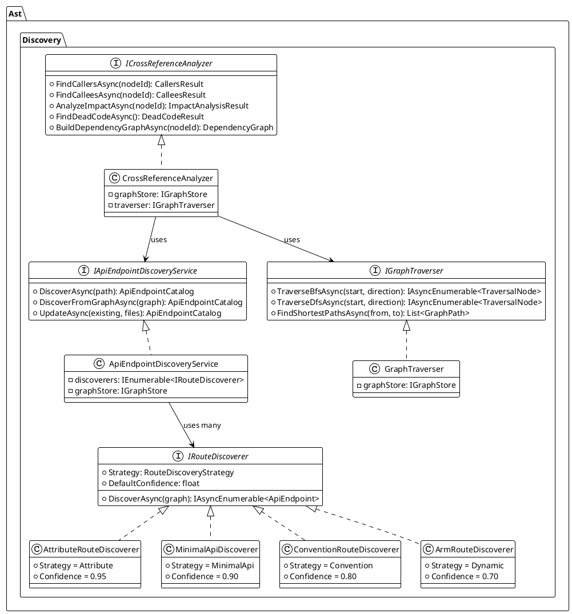
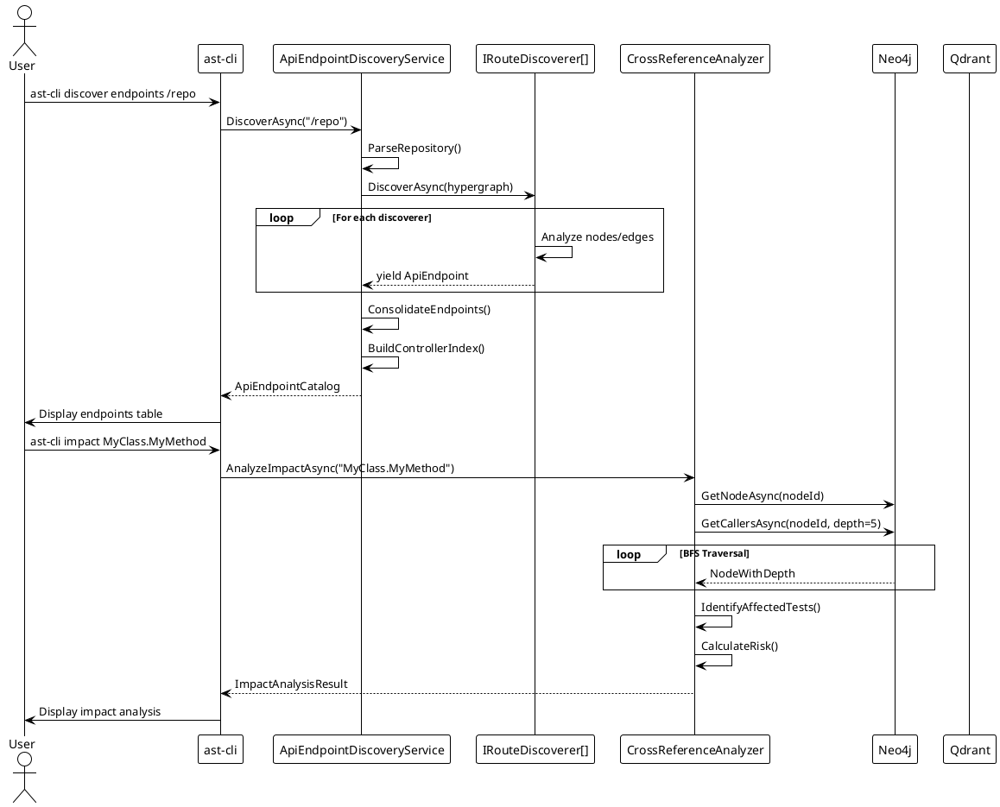
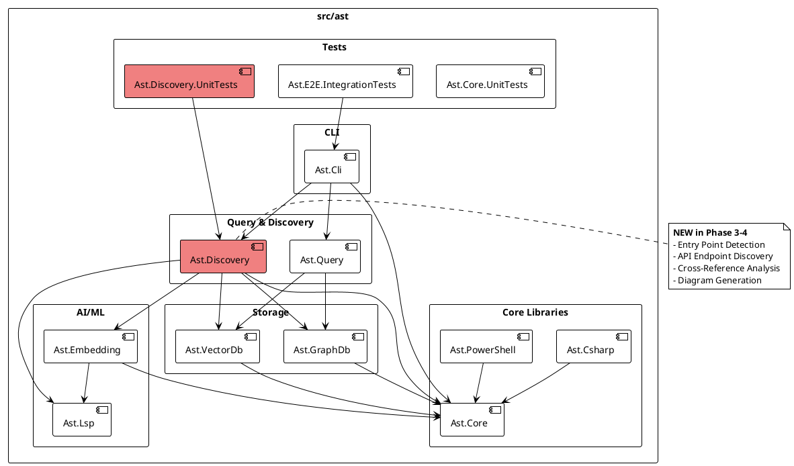

# Code Intelligence Master Architecture

> **Version**: 2.0  
> **Last Updated**: 2026-01-29  
> **Status**: Comprehensive Design Document

This document provides the complete architecture for Phases 3-4 of the Code Intelligence Enhancement, covering API Discovery, Cross-Reference Analysis, and overall system integration.

---

## Table of Contents

1. [Executive Summary](#executive-summary)
2. [System Architecture Overview](#system-architecture-overview)
3. [Phase 1: Entry Point Detection](#phase-1-entry-point-detection)
4. [Phase 2: Diagram Generation](#phase-2-diagram-generation)
5. [Phase 3: API Endpoint Discovery](#phase-3-api-endpoint-discovery)
6. [Phase 4: Cross-Reference Analysis](#phase-4-cross-reference-analysis)
7. [Architecture Integration](#architecture-integration)
8. [Complete Deliverables List](#complete-deliverables-list)
9. [Validation Strategy](#validation-strategy)
10. [Test Matrix](#test-matrix)
11. [Risk Mitigation](#risk-mitigation)
12. [PlantUML Architecture Diagram](#plantuml-architecture-diagram)
13. [Appendices](#appendix-a-file-structure)
14. [Enhancement Areas (Detailed Design)](#enhancement-areas-detailed-design)
15. [Generic Detection Architecture](#generic-detection-architecture)
16. [Technical Specifications](#technical-specifications)
17. [Conclusion](#conclusion)

---

## Executive Summary

### Vision

Build a comprehensive code intelligence system that provides:
- **Deep API Discovery**: Attribute-based, minimal API, convention-based, and dynamic routing detection
- **Full Cross-Reference Analysis**: Caller/callee tracking, impact analysis, dead code detection
- **Unified Graph Traversal**: Neo4j-powered queries with semantic enhancement from Qdrant

### Current State (Phases 1-7 Complete)

| Component | Status | Tests |
|-----------|--------|-------|
| AST Extraction (C#/PowerShell) | Complete | 166 tests |
| Embedding Generation | Complete | 65 tests |
| Vector Database (Qdrant) | Complete | 28 tests |
| Graph Database (Neo4j) | Complete | 35 tests |
| Query Interface | Complete | 52 tests |
| LSP Integration | Complete | 56 tests |
| CLI Application | Complete | 7 commands |
| E2E Tests | Complete | 20 tests |

**Total: 437 unit tests passing**

### Target State (After Phases 3-4)

| Component | Additions |
|-----------|-----------|
| API Discovery Service | Full endpoint catalog |
| Cross-Reference Analyzer | Complete call graph |
| Impact Analysis Engine | Change propagation |
| Diagram Generator | PlantUML/Mermaid output |

---
## System Architecture Overview

The system follows a layered architecture with clear separation of concerns:

### Layer 1: CLI (User Interface)
- **Ast.Cli**: Spectre.Console-based CLI with commands for parse, enrich, embed, index, query, discover

### Layer 2: Service Layer (Business Logic)
- **Ast.Core**: Repository parsing and hypergraph construction
- **Ast.Lsp**: Language Server Protocol integration for semantic enrichment
- **Ast.Discovery** [NEW]: Entry point and API endpoint discovery
- **Ast.Embedding**: Vector embedding generation
- **Ast.Query**: Fluent query API for graph + vector search

### Layer 3: Data Layer (Models)
- **HypergraphData**: Nodes and edges representing code structure
- **CodeEmbedding**: Vector representations for semantic search
- **ApiEndpointCatalog** [NEW]: Complete API endpoint inventory

### Layer 4: Persistence Layer (Storage)
- **Neo4j**: Graph database for structural queries
- **Qdrant**: Vector database for semantic search
- **File System**: JSON cache for hypergraphs

---

## Phase 3: API Endpoint Discovery

### 3.1 Overview

The API Endpoint Discovery system identifies all HTTP endpoints in a codebase using multiple detection strategies.

### 3.2 Detection Strategies

| Strategy | Confidence | Pattern Types |
|----------|------------|---------------|
| **Attribute-Based** | 0.95 | [Route], [HttpGet/Post/etc], [ApiController] |
| **Minimal API** | 0.90 | app.MapGet(), app.MapPost(), etc. |
| **Convention-Based** | 0.80 | MapControllerRoute patterns |
| **Custom Route Provider** | 0.75 | IDirectRouteProvider implementations |
| **Dynamic/ARM** | 0.70 | Runtime-generated routes |
| **Configuration** | 0.65 | Routes in config files |

### 3.3 Core Interfaces

```csharp
// -----------------------------------------------------------------------
// File: Ast.Discovery/IApiEndpointDiscovery.cs
// -----------------------------------------------------------------------

namespace Ast.Discovery;

using Ast.Core;

/// <summary>
/// Primary interface for API endpoint discovery across a repository.
/// </summary>
public interface IApiEndpointDiscoveryService
{
    /// <summary>
    /// Discovers all API endpoints in the repository using multiple strategies.
    /// </summary>
    Task<ApiEndpointCatalog> DiscoverAsync(
        string repositoryPath,
        DiscoveryOptions? options = null,
        CancellationToken ct = default);

    /// <summary>
    /// Discovers endpoints from an existing hypergraph (faster, no re-parsing).
    /// </summary>
    Task<ApiEndpointCatalog> DiscoverFromGraphAsync(
        HypergraphData hypergraph,
        DiscoveryOptions? options = null,
        CancellationToken ct = default);

    /// <summary>
    /// Incrementally updates endpoint catalog for changed files.
    /// </summary>
    Task<ApiEndpointCatalog> UpdateAsync(
        ApiEndpointCatalog existing,
        IEnumerable<string> changedFiles,
        CancellationToken ct = default);
}

/// <summary>
/// Interface for individual route discoverers (strategy pattern).
/// </summary>
public interface IRouteDiscoverer
{
    RouteDiscoveryStrategy Strategy { get; }
    float DefaultConfidence { get; }
    
    IAsyncEnumerable<ApiEndpoint> DiscoverAsync(
        HypergraphData hypergraph,
        DiscoveryOptions options,
        CancellationToken ct = default);
}

/// <summary>
/// Interface for custom route provider analysis.
/// </summary>
public interface ICustomRouteProviderAnalyzer
{
    Task<CustomRouteProviderInfo> AnalyzeAsync(
        HypergraphNode providerClass,
        CancellationToken ct = default);
    
    IAsyncEnumerable<ApiEndpoint> GenerateRoutesAsync(
        CustomRouteProviderInfo provider,
        CancellationToken ct = default);
}
```

### 3.4 Complete Model Definitions

```csharp
// -----------------------------------------------------------------------
// File: Ast.Discovery/Models/ApiEndpointModels.cs
// -----------------------------------------------------------------------

namespace Ast.Discovery.Models;

/// <summary>
/// Complete catalog of discovered API endpoints.
/// </summary>
public class ApiEndpointCatalog
{
    public string RepositoryPath { get; init; } = string.Empty;
    public DateTime GeneratedAt { get; init; } = DateTime.UtcNow;
    public IReadOnlyList<ApiEndpoint> Endpoints { get; init; } = [];
    public IReadOnlyList<ApiController> Controllers { get; init; } = [];
    public IReadOnlyList<CustomRouteProviderInfo> CustomProviders { get; init; } = [];
    public DiscoveryStatistics Statistics { get; init; } = new();
    
    // Indexing for fast lookup
    public IReadOnlyDictionary<string, ApiEndpoint> ByRoute { get; init; } 
        = new Dictionary<string, ApiEndpoint>();
    public IReadOnlyDictionary<string, IReadOnlyList<ApiEndpoint>> ByController { get; init; } 
        = new Dictionary<string, IReadOnlyList<ApiEndpoint>>();
}

/// <summary>
/// Represents a single API endpoint.
/// </summary>
public record ApiEndpoint
{
    // Identity
    public required string Id { get; init; }
    public required string FilePath { get; init; }
    public required int LineNumber { get; init; }
    public required string NodeId { get; init; }  // Reference to HypergraphNode
    
    // Controller/Action
    public required string ControllerName { get; init; }
    public required string ActionName { get; init; }
    public string? ControllerNodeId { get; init; }
    
    // HTTP Details
    public required HttpMethod HttpMethod { get; init; }
    public required string RouteTemplate { get; init; }
    public string? ResolvedRoute { get; init; }
    public IReadOnlyList<string> RouteConstraints { get; init; } = [];
    
    // Parameters
    public IReadOnlyList<ApiParameter> Parameters { get; init; } = [];
    public string? RequestBodyType { get; init; }
    public string? ResponseType { get; init; }
    
    // Metadata
    public required RouteDiscoveryStrategy Strategy { get; init; }
    public required float Confidence { get; init; }
    public IReadOnlyList<string> Filters { get; init; } = [];
    public IReadOnlyList<string> ProducesMediaTypes { get; init; } = [];
    public IReadOnlyList<string> ConsumesMediaTypes { get; init; } = [];
    
    // Authorization
    public bool RequiresAuthentication { get; init; }
    public IReadOnlyList<string> AuthorizationPolicies { get; init; } = [];
    public IReadOnlyList<string> AllowedRoles { get; init; } = [];
    
    // ARM-specific
    public ArmRouteInfo? ArmInfo { get; init; }
}

/// <summary>
/// API parameter details.
/// </summary>
public record ApiParameter
{
    public required string Name { get; init; }
    public required string Type { get; init; }
    public required ParameterSource Source { get; init; }
    public bool IsRequired { get; init; } = true;
    public string? DefaultValue { get; init; }
    public string? Description { get; init; }
    public IReadOnlyList<string> ValidationAttributes { get; init; } = [];
}

public enum ParameterSource
{
    Route, Query, Body, Header, Form, Services, Cookie, Unknown
}

public enum HttpMethod
{
    GET, POST, PUT, DELETE, PATCH, HEAD, OPTIONS, CONNECT, TRACE, ANY
}

public enum RouteDiscoveryStrategy
{
    Attribute, Convention, CustomProvider, MinimalApi, Dynamic, Configuration, GraphTraversal, Embedding
}

/// <summary>
/// ARM-specific route information for Azure Resource Manager patterns.
/// </summary>
public record ArmRouteInfo
{
    public required string ProviderNamespace { get; init; }
    public required string ResourceType { get; init; }
    public required string ApiVersion { get; init; }
    public required ArmOperationType OperationType { get; init; }
    public bool IsNestedResource { get; init; }
    public int NestingLevel { get; init; }
}

public enum ArmOperationType
{
    List, Get, Create, Update, Delete, Action, Provider
}
```

### 3.5 Route Discoverer Implementations

```csharp
// -----------------------------------------------------------------------
// File: Ast.Discovery/Routes/AttributeRouteDiscoverer.cs
// -----------------------------------------------------------------------

namespace Ast.Discovery.Routes;

using System.Text.RegularExpressions;

/// <summary>
/// Discovers routes from [Route], [HttpGet], [HttpPost], etc. attributes.
/// </summary>
public class AttributeRouteDiscoverer : IRouteDiscoverer
{
    public RouteDiscoveryStrategy Strategy => RouteDiscoveryStrategy.Attribute;
    public float DefaultConfidence => 0.95f;

    private static readonly Regex RouteAttributePattern = new(
        @"\[Route(?:Prefix)?\s*\(\s*""([^""]+)""\s*\)\]",
        RegexOptions.Compiled);

    private static readonly Regex HttpMethodPattern = new(
        @"\[Http(Get|Post|Put|Delete|Patch|Head|Options)(?:\s*\(\s*""([^""]*)""\s*\))?\]",
        RegexOptions.Compiled);

    public async IAsyncEnumerable<ApiEndpoint> DiscoverAsync(
        HypergraphData hypergraph,
        DiscoveryOptions options,
        [EnumeratorCancellation] CancellationToken ct = default)
    {
        var controllers = hypergraph.Nodes
            .Where(n => n.NodeType == "Class")
            .Where(this.IsController);

        foreach (var controller in controllers)
        {
            var controllerRoute = this.ExtractControllerRoute(controller);
            var actions = this.GetActionsForController(hypergraph, controller);

            foreach (var action in actions)
            {
                if (ct.IsCancellationRequested) yield break;

                var endpoint = this.BuildEndpoint(controller, action, controllerRoute);
                if (endpoint != null) yield return endpoint;
            }
        }
    }

    private bool IsController(HypergraphNode node)
    {
        if (node.Name.EndsWith("Controller")) return true;
        
        if (node.Metadata.TryGetValue("Attributes", out var attrs) && attrs is string attrStr)
            if (attrStr.Contains("[ApiController]")) return true;

        if (node.Metadata.TryGetValue("BaseTypes", out var bases) && bases is string baseStr)
            if (baseStr.Contains("ControllerBase")) return true;

        return false;
    }
}
```

```csharp
// -----------------------------------------------------------------------
// File: Ast.Discovery/Routes/MinimalApiDiscoverer.cs
// -----------------------------------------------------------------------

namespace Ast.Discovery.Routes;

/// <summary>
/// Discovers minimal API endpoints (app.MapGet, app.MapPost, etc.).
/// </summary>
public class MinimalApiDiscoverer : IRouteDiscoverer
{
    public RouteDiscoveryStrategy Strategy => RouteDiscoveryStrategy.MinimalApi;
    public float DefaultConfidence => 0.90f;

    private static readonly string[] MapMethods = 
    {
        "MapGet", "MapPost", "MapPut", "MapDelete", "MapPatch",
        "MapMethods", "Map", "MapWhen", "MapGroup"
    };

    public async IAsyncEnumerable<ApiEndpoint> DiscoverAsync(
        HypergraphData hypergraph,
        DiscoveryOptions options,
        [EnumeratorCancellation] CancellationToken ct = default)
    {
        var mapCalls = hypergraph.Edges
            .Where(e => e.Type == HyperedgeType.MethodInvocation)
            .Where(this.IsMapMethodCall);

        foreach (var call in mapCalls)
        {
            if (ct.IsCancellationRequested) yield break;
            var endpoint = this.ParseMapCall(call, hypergraph);
            if (endpoint != null) yield return endpoint;
        }
    }

    private bool IsMapMethodCall(Hyperedge edge)
    {
        var calleeName = edge.Metadata.GetValueOrDefault("CalleeName")?.ToString();
        return MapMethods.Any(m => calleeName?.StartsWith(m) == true);
    }
}
```

```csharp
// -----------------------------------------------------------------------
// File: Ast.Discovery/Routes/ArmRouteDiscoverer.cs
// -----------------------------------------------------------------------

namespace Ast.Discovery.Routes;

/// <summary>
/// Discovers Azure Resource Manager (ARM) style routes.
/// Pattern: /subscriptions/{subId}/resourceGroups/{rg}/providers/...
/// </summary>
public class ArmRouteDiscoverer : IRouteDiscoverer
{
    public RouteDiscoveryStrategy Strategy => RouteDiscoveryStrategy.Dynamic;
    public float DefaultConfidence => 0.70f;

    private static readonly Regex ArmRoutePattern = new(
        @"/subscriptions/\{[^}]+\}/resourceGroups/\{[^}]+\}/providers/([^/]+)/([^/{\s]+)",
        RegexOptions.Compiled | RegexOptions.IgnoreCase);

    public async IAsyncEnumerable<ApiEndpoint> DiscoverAsync(
        HypergraphData hypergraph,
        DiscoveryOptions options,
        [EnumeratorCancellation] CancellationToken ct = default)
    {
        // Find IDirectRouteProvider implementations
        var providers = hypergraph.Nodes
            .Where(n => n.NodeType == "Class")
            .Where(this.IsArmRouteProvider);

        foreach (var provider in providers)
        {
            if (ct.IsCancellationRequested) yield break;
            
            var routes = await this.ExtractArmRoutesAsync(provider, hypergraph);
            foreach (var route in routes) yield return route;
        }
    }

    private bool IsArmRouteProvider(HypergraphNode node)
    {
        if (!node.Metadata.TryGetValue("BaseTypes", out var bases) || bases is not string baseStr)
            return false;

        return baseStr.Contains("IDirectRouteProvider") ||
               baseStr.Contains("ResourceProviderDirectRouteProvider") ||
               node.Name.Contains("ResourceProvider");
    }
}
```

---

## Phase 4: Cross-Reference Analysis

### 4.1 Overview

Cross-reference analysis provides complete visibility into code dependencies, enabling:
- Finding all callers of a method across files and projects
- Impact analysis for change management
- Dead code detection
- Dependency graph construction

### 4.2 Core Interfaces

```csharp
// -----------------------------------------------------------------------
// File: Ast.Discovery/ICrossReferenceAnalyzer.cs
// -----------------------------------------------------------------------

namespace Ast.Discovery;

using Ast.Core;
using Ast.GraphDb;

/// <summary>
/// Primary interface for cross-reference analysis.
/// </summary>
public interface ICrossReferenceAnalyzer
{
    /// <summary>
    /// Finds all callers of a method/function.
    /// </summary>
    Task<CallersResult> FindCallersAsync(
        string nodeId,
        CallersOptions? options = null,
        CancellationToken ct = default);

    /// <summary>
    /// Finds all methods/functions called by a node.
    /// </summary>
    Task<CalleesResult> FindCalleesAsync(
        string nodeId,
        CalleesOptions? options = null,
        CancellationToken ct = default);

    /// <summary>
    /// Analyzes impact of changing a node.
    /// </summary>
    Task<ImpactAnalysisResult> AnalyzeImpactAsync(
        string nodeId,
        ImpactOptions? options = null,
        CancellationToken ct = default);

    /// <summary>
    /// Finds potentially dead code (unreachable from entry points).
    /// </summary>
    Task<DeadCodeResult> FindDeadCodeAsync(
        DeadCodeOptions? options = null,
        CancellationToken ct = default);

    /// <summary>
    /// Builds complete dependency graph for a node.
    /// </summary>
    Task<DependencyGraph> BuildDependencyGraphAsync(
        string nodeId,
        DependencyOptions? options = null,
        CancellationToken ct = default);

    /// <summary>
    /// Finds all implementations of an interface or overrides of a method.
    /// </summary>
    Task<ImplementationsResult> FindImplementationsAsync(
        string nodeId,
        CancellationToken ct = default);

    /// <summary>
    /// Finds all usages of a type.
    /// </summary>
    Task<TypeUsagesResult> FindTypeUsagesAsync(
        string typeNodeId,
        CancellationToken ct = default);
}

/// <summary>
/// Interface for graph traversal operations.
/// </summary>
public interface IGraphTraverser
{
    /// <summary>
    /// Performs BFS traversal from a starting node.
    /// </summary>
    IAsyncEnumerable<TraversalNode> TraverseBfsAsync(
        string startNodeId,
        TraversalDirection direction,
        TraversalOptions options,
        CancellationToken ct = default);

    /// <summary>
    /// Performs DFS traversal from a starting node.
    /// </summary>
    IAsyncEnumerable<TraversalNode> TraverseDfsAsync(
        string startNodeId,
        TraversalDirection direction,
        TraversalOptions options,
        CancellationToken ct = default);

    /// <summary>
    /// Finds shortest paths between two nodes.
    /// </summary>
    Task<IReadOnlyList<GraphPath>> FindShortestPathsAsync(
        string fromNodeId,
        string toNodeId,
        int maxPaths = 5,
        CancellationToken ct = default);
}

public enum TraversalDirection
{
    Callers,    // Who calls me?
    Callees,    // Who do I call?
    Both,       // Bidirectional
    Dependents, // Who depends on me?
    Dependencies // What do I depend on?
}
```

### 4.3 Cross-Reference Models

```csharp
// -----------------------------------------------------------------------
// File: Ast.Discovery/Models/CrossReferenceModels.cs
// -----------------------------------------------------------------------

namespace Ast.Discovery.Models;

/// <summary>
/// Result of finding callers of a node.
/// </summary>
public record CallersResult
{
    public required string TargetNodeId { get; init; }
    public required string TargetNodeName { get; init; }
    public required IReadOnlyList<CallerInfo> Callers { get; init; }
    public int TotalCallers { get; init; }
    public TimeSpan AnalysisDuration { get; init; }
    public int MaxDepthReached { get; init; }
    public bool WasTruncated { get; init; }
}

public record CallerInfo
{
    public required HypergraphNode Node { get; init; }
    public required int Depth { get; init; }
    public required string CallSite { get; init; }  // Line number and context
    public required Hyperedge Edge { get; init; }   // The invocation edge
    public bool IsCrossProject { get; init; }
    public bool IsCrossLanguage { get; init; }
    public string? ProjectName { get; init; }
}

/// <summary>
/// Result of finding callees of a node.
/// </summary>
public record CalleesResult
{
    public required string SourceNodeId { get; init; }
    public required string SourceNodeName { get; init; }
    public required IReadOnlyList<CalleeInfo> Callees { get; init; }
    public int TotalCallees { get; init; }
    public TimeSpan AnalysisDuration { get; init; }
}

public record CalleeInfo
{
    public required HypergraphNode Node { get; init; }
    public required int Depth { get; init; }
    public required string CallSite { get; init; }
    public required Hyperedge Edge { get; init; }
    public bool IsExternal { get; init; }  // External library call
    public bool IsAsync { get; init; }
    public bool IsAwait { get; init; }
}

/// <summary>
/// Result of impact analysis.
/// </summary>
public record ImpactAnalysisResult
{
    public required string TargetNodeId { get; init; }
    public required string TargetNodeName { get; init; }
    
    /// <summary>Directly affected nodes (immediate callers).</summary>
    public required IReadOnlyList<ImpactedNode> DirectImpacts { get; init; }
    
    /// <summary>Indirectly affected nodes (transitive callers).</summary>
    public required IReadOnlyList<ImpactedNode> TransitiveImpacts { get; init; }
    
    /// <summary>Affected test classes/methods.</summary>
    public required IReadOnlyList<ImpactedNode> AffectedTests { get; init; }
    
    /// <summary>Affected API endpoints.</summary>
    public required IReadOnlyList<ApiEndpoint> AffectedEndpoints { get; init; }
    
    /// <summary>Risk assessment based on impact scope.</summary>
    public required ImpactRisk Risk { get; init; }
    
    public TimeSpan AnalysisDuration { get; init; }
    public int TotalImpactedNodes { get; init; }
}

public record ImpactedNode
{
    public required HypergraphNode Node { get; init; }
    public required int Depth { get; init; }
    public required ImpactType ImpactType { get; init; }
    public required float ImpactScore { get; init; }  // 0.0 - 1.0
    public string? Reason { get; init; }
}

public enum ImpactType
{
    DirectCaller,       // Directly calls the changed node
    TransitiveCaller,   // Indirectly calls through chain
    TestCoverage,       // Test that exercises this code
    InterfaceImpl,      // Implements interface being changed
    Override,           // Overrides method being changed
    TypeUsage,          // Uses the type being changed
    ConfigDependency    // Configuration dependency
}

public enum ImpactRisk
{
    Low,        // < 10 affected nodes, no public API
    Medium,     // 10-50 affected nodes or internal API
    High,       // > 50 affected nodes or public API
    Critical    // Public API with external consumers
}

/// <summary>
/// Result of dead code detection.
/// </summary>
public record DeadCodeResult
{
    public required IReadOnlyList<DeadCodeCandidate> Candidates { get; init; }
    public required IReadOnlyList<HypergraphNode> EntryPoints { get; init; }
    public int TotalNodesAnalyzed { get; init; }
    public int DeadCodeCount { get; init; }
    public float DeadCodePercentage { get; init; }
    public TimeSpan AnalysisDuration { get; init; }
}

public record DeadCodeCandidate
{
    public required HypergraphNode Node { get; init; }
    public required DeadCodeReason Reason { get; init; }
    public required float Confidence { get; init; }
    public string? Explanation { get; init; }
    public bool IsTestCode { get; init; }
    public bool IsGeneratedCode { get; init; }
}

public enum DeadCodeReason
{
    Unreachable,            // No path from any entry point
    UnusedPrivate,          // Private member never used
    UnusedParameter,        // Parameter never used in method body
    UnusedVariable,         // Variable assigned but never read
    UnusedReturn,           // Return value always discarded
    ObsoleteWithNoCallers   // Marked obsolete with no remaining callers
}

/// <summary>
/// Complete dependency graph for a node.
/// </summary>
public record DependencyGraph
{
    public required string RootNodeId { get; init; }
    public required IReadOnlyList<DependencyNode> Nodes { get; init; }
    public required IReadOnlyList<DependencyEdge> Edges { get; init; }
    public int Depth { get; init; }
    public int TotalNodes { get; init; }
    public int TotalEdges { get; init; }
    
    /// <summary>Generates Mermaid diagram syntax.</summary>
    public string ToMermaid() { /* ... */ }
    
    /// <summary>Generates PlantUML diagram syntax.</summary>
    public string ToPlantUml() { /* ... */ }
    
    /// <summary>Generates DOT graph syntax.</summary>
    public string ToDot() { /* ... */ }
}

public record DependencyNode
{
    public required string Id { get; init; }
    public required string Name { get; init; }
    public required string NodeType { get; init; }
    public required int Depth { get; init; }
    public string? Stereotype { get; init; }  // For diagram styling
}

public record DependencyEdge
{
    public required string FromId { get; init; }
    public required string ToId { get; init; }
    public required DependencyType Type { get; init; }
    public string? Label { get; init; }
}

public enum DependencyType
{
    Calls,
    Inherits,
    Implements,
    Uses,
    Creates,
    Injects,
    References
}
```

### 4.4 Cross-Reference Analyzer Implementation

```csharp
// -----------------------------------------------------------------------
// File: Ast.Discovery/CrossReferenceAnalyzer.cs
// -----------------------------------------------------------------------

namespace Ast.Discovery;

public class CrossReferenceAnalyzer : ICrossReferenceAnalyzer
{
    private readonly IGraphStore _graphStore;
    private readonly IGraphTraverser _traverser;
    private readonly IApiEndpointDiscoveryService _endpointDiscovery;
    private readonly ILogger<CrossReferenceAnalyzer> _logger;

    public CrossReferenceAnalyzer(
        IGraphStore graphStore,
        IGraphTraverser traverser,
        IApiEndpointDiscoveryService endpointDiscovery,
        ILogger<CrossReferenceAnalyzer> logger)
    {
        this._graphStore = graphStore;
        this._traverser = traverser;
        this._endpointDiscovery = endpointDiscovery;
        this._logger = logger;
    }

    public async Task<CallersResult> FindCallersAsync(
        string nodeId,
        CallersOptions? options = null,
        CancellationToken ct = default)
    {
        options ??= new CallersOptions();
        var stopwatch = Stopwatch.StartNew();

        var targetNode = await this._graphStore.GetNodeAsync(nodeId, ct);
        if (targetNode == null)
            throw new NodeNotFoundException(nodeId);

        var callers = new List<CallerInfo>();
        var seen = new HashSet<string>();

        await foreach (var node in this._traverser.TraverseBfsAsync(
            nodeId, 
            TraversalDirection.Callers,
            new TraversalOptions 
            { 
                MaxDepth = options.MaxDepth,
                IncludeCrossProject = options.IncludeCrossProject,
                IncludeCrossLanguage = options.IncludeCrossLanguage
            },
            ct))
        {
            if (seen.Add(node.Node.Id))
            {
                callers.Add(new CallerInfo
                {
                    Node = node.Node,
                    Depth = node.Depth,
                    CallSite = this.FormatCallSite(node.Edge),
                    Edge = node.Edge,
                    IsCrossProject = node.IsCrossProject,
                    IsCrossLanguage = node.IsCrossLanguage
                });
            }

            if (callers.Count >= options.MaxResults)
                break;
        }

        stopwatch.Stop();

        return new CallersResult
        {
            TargetNodeId = nodeId,
            TargetNodeName = targetNode.Name,
            Callers = callers,
            TotalCallers = callers.Count,
            AnalysisDuration = stopwatch.Elapsed,
            MaxDepthReached = callers.Max(c => c.Depth),
            WasTruncated = callers.Count >= options.MaxResults
        };
    }

    public async Task<ImpactAnalysisResult> AnalyzeImpactAsync(
        string nodeId,
        ImpactOptions? options = null,
        CancellationToken ct = default)
    {
        options ??= new ImpactOptions();
        var stopwatch = Stopwatch.StartNew();

        var targetNode = await this._graphStore.GetNodeAsync(nodeId, ct);
        if (targetNode == null)
            throw new NodeNotFoundException(nodeId);

        // Find direct callers (depth 1)
        var directCallers = await this.FindCallersAsync(
            nodeId, 
            new CallersOptions { MaxDepth = 1 }, 
            ct);

        // Find transitive callers (depth 2+)
        var transitiveCallers = await this.FindCallersAsync(
            nodeId,
            new CallersOptions { MaxDepth = options.MaxDepth, MaxResults = options.MaxResults },
            ct);

        // Identify affected tests
        var affectedTests = transitiveCallers.Callers
            .Where(c => this.IsTestMethod(c.Node))
            .Select(c => new ImpactedNode
            {
                Node = c.Node,
                Depth = c.Depth,
                ImpactType = ImpactType.TestCoverage,
                ImpactScore = 1.0f / c.Depth
            })
            .ToList();

        // Find affected endpoints
        var affectedEndpoints = await this.FindAffectedEndpointsAsync(
            transitiveCallers.Callers.Select(c => c.Node.Id), 
            ct);

        // Calculate risk
        var risk = this.CalculateRisk(
            directCallers.Callers.Count,
            transitiveCallers.Callers.Count,
            affectedEndpoints.Count,
            targetNode);

        stopwatch.Stop();

        return new ImpactAnalysisResult
        {
            TargetNodeId = nodeId,
            TargetNodeName = targetNode.Name,
            DirectImpacts = directCallers.Callers.Select(c => new ImpactedNode
            {
                Node = c.Node,
                Depth = c.Depth,
                ImpactType = ImpactType.DirectCaller,
                ImpactScore = 1.0f
            }).ToList(),
            TransitiveImpacts = transitiveCallers.Callers
                .Where(c => c.Depth > 1)
                .Select(c => new ImpactedNode
                {
                    Node = c.Node,
                    Depth = c.Depth,
                    ImpactType = ImpactType.TransitiveCaller,
                    ImpactScore = 1.0f / c.Depth
                }).ToList(),
            AffectedTests = affectedTests,
            AffectedEndpoints = affectedEndpoints,
            Risk = risk,
            AnalysisDuration = stopwatch.Elapsed,
            TotalImpactedNodes = transitiveCallers.TotalCallers
        };
    }

    public async Task<DeadCodeResult> FindDeadCodeAsync(
        DeadCodeOptions? options = null,
        CancellationToken ct = default)
    {
        options ??= new DeadCodeOptions();
        var stopwatch = Stopwatch.StartNew();

        // Step 1: Find all entry points
        var entryPointSvc = new EntryPointDiscoveryService(/* ... */);
        var entryPoints = await entryPointSvc.DiscoverEntryPointsAsync(options.RepositoryPath, ct);

        // Step 2: Mark all reachable nodes starting from entry points
        var reachable = new HashSet<string>();
        foreach (var ep in entryPoints.EntryPoints)
        {
            await foreach (var node in this._traverser.TraverseBfsAsync(
                ep.NodeId,
                TraversalDirection.Callees,
                new TraversalOptions { MaxDepth = 100 },
                ct))
            {
                reachable.Add(node.Node.Id);
            }
        }

        // Step 3: Find unreachable nodes
        var allNodes = await this._graphStore.GetNodesAsync(
            new NodeFilter { Types = new[] { "Method", "Function", "Class" } },
            ct);

        var deadCode = allNodes
            .Where(n => !reachable.Contains(n.Id))
            .Where(n => !this.IsExcluded(n, options))
            .Select(n => new DeadCodeCandidate
            {
                Node = n,
                Reason = DeadCodeReason.Unreachable,
                Confidence = 0.85f,
                IsTestCode = this.IsTestCode(n),
                IsGeneratedCode = this.IsGeneratedCode(n)
            })
            .ToList();

        stopwatch.Stop();

        return new DeadCodeResult
        {
            Candidates = deadCode,
            EntryPoints = entryPoints.EntryPoints.Select(e => /* ... */).ToList(),
            TotalNodesAnalyzed = allNodes.Count,
            DeadCodeCount = deadCode.Count,
            DeadCodePercentage = (float)deadCode.Count / allNodes.Count * 100,
            AnalysisDuration = stopwatch.Elapsed
        };
    }

    private ImpactRisk CalculateRisk(
        int directCallers, 
        int transitiveCallers, 
        int affectedEndpoints,
        HypergraphNode targetNode)
    {
        var isPublicApi = targetNode.Modifiers.Contains("public") && 
                         !targetNode.FilePath.Contains("Internal");

        if (affectedEndpoints > 0 && isPublicApi)
            return ImpactRisk.Critical;
        if (transitiveCallers > 50 || affectedEndpoints > 0)
            return ImpactRisk.High;
        if (transitiveCallers > 10)
            return ImpactRisk.Medium;
        return ImpactRisk.Low;
    }

    private bool IsTestMethod(HypergraphNode node)
    {
        if (node.FilePath.Contains("Test")) return true;
        if (node.Metadata.TryGetValue("Attributes", out var attrs) && attrs is string attrStr)
        {
            return attrStr.Contains("[Test") || 
                   attrStr.Contains("[Fact") ||
                   attrStr.Contains("[Theory");
        }
        return false;
    }
}
```

### 4.5 Graph Traverser Implementation

```csharp
// -----------------------------------------------------------------------
// File: Ast.Discovery/GraphTraverser.cs
// -----------------------------------------------------------------------

namespace Ast.Discovery;

/// <summary>
/// Implements graph traversal algorithms using Neo4j.
/// </summary>
public class GraphTraverser : IGraphTraverser
{
    private readonly IGraphStore _graphStore;

    public GraphTraverser(IGraphStore graphStore)
    {
        this._graphStore = graphStore;
    }

    public async IAsyncEnumerable<TraversalNode> TraverseBfsAsync(
        string startNodeId,
        TraversalDirection direction,
        TraversalOptions options,
        [EnumeratorCancellation] CancellationToken ct = default)
    {
        var visited = new HashSet<string> { startNodeId };
        var queue = new Queue<(string NodeId, int Depth)>();
        queue.Enqueue((startNodeId, 0));

        while (queue.Count > 0 && !ct.IsCancellationRequested)
        {
            var (currentId, depth) = queue.Dequeue();
            
            if (depth >= options.MaxDepth)
                continue;

            var neighbors = direction switch
            {
                TraversalDirection.Callers => await this._graphStore.GetCallersAsync(currentId, 1, ct),
                TraversalDirection.Callees => await this._graphStore.GetCalleesAsync(currentId, 1, ct),
                _ => throw new ArgumentException(nameof(direction))
            };

            foreach (var neighbor in neighbors)
            {
                if (!visited.Add(neighbor.Node.Id))
                    continue;

                // Filter by options
                if (!options.IncludeCrossLanguage && neighbor.Node.Language != options.SourceLanguage)
                    continue;

                queue.Enqueue((neighbor.Node.Id, depth + 1));

                yield return new TraversalNode
                {
                    Node = neighbor.Node,
                    Depth = depth + 1,
                    Edge = neighbor.Edge,
                    IsCrossProject = this.IsCrossProject(startNodeId, neighbor.Node.Id),
                    IsCrossLanguage = neighbor.Node.Language != options.SourceLanguage
                };
            }
        }
    }

    public async Task<IReadOnlyList<GraphPath>> FindShortestPathsAsync(
        string fromNodeId,
        string toNodeId,
        int maxPaths = 5,
        CancellationToken ct = default)
    {
        return await this._graphStore.FindPathsAsync(fromNodeId, toNodeId, 10, ct);
    }
}

public record TraversalNode
{
    public required HypergraphNode Node { get; init; }
    public required int Depth { get; init; }
    public required Hyperedge Edge { get; init; }
    public bool IsCrossProject { get; init; }
    public bool IsCrossLanguage { get; init; }
}

public class TraversalOptions
{
    public int MaxDepth { get; set; } = 5;
    public bool IncludeCrossProject { get; set; } = true;
    public bool IncludeCrossLanguage { get; set; } = true;
    public string? SourceLanguage { get; set; }
    public HyperedgeType[]? EdgeTypes { get; set; }
}
```

---

## Architecture Integration

### 5.1 CLI Workflow

The CLI provides a unified interface for all code intelligence operations:

```bash
# Full pipeline: parse -> enrich -> embed -> index -> discover
ast-cli pipeline /path/to/repo --output ./analysis

# Individual commands
ast-cli parse /path/to/repo --output ./hypergraph.json
ast-cli enrich ./hypergraph.json --lsp
ast-cli embed ./hypergraph.json --model qwen2.5-coder
ast-cli index ./hypergraph.json --neo4j --qdrant
ast-cli discover entrypoints /path/to/repo
ast-cli discover endpoints /path/to/repo
ast-cli discover deadcode /path/to/repo

# Cross-reference queries
ast-cli callers MyClass.MyMethod --depth 5
ast-cli callees MyClass.MyMethod --depth 3
ast-cli impact MyClass.MyMethod --json
ast-cli path FromClass.Method ToClass.Method

# Diagram generation
ast-cli diagram dependency MyClass --format plantuml --output diagram.puml
ast-cli diagram callgraph MyMethod --format mermaid --output callgraph.md
```

### 5.2 Service Interaction Flow

```
┌─────────────────────────────────────────────────────────────────────────────────┐
│                          Data Flow: Source to Diagram                            │
└─────────────────────────────────────────────────────────────────────────────────┘

     Source Files              Hypergraph                 Databases
    ┌──────────┐             ┌───────────┐             ┌───────────┐
    │ *.cs     │             │           │             │           │
    │ *.ps1    │────parse───>│   Nodes   │────index───>│  Neo4j    │
    │ *.config │             │   Edges   │             │  Qdrant   │
    └──────────┘             └───────────┘             └───────────┘
                                   │                        │
                              embed │                       │ query
                                   ▼                        ▼
                            ┌───────────┐             ┌───────────┐
                            │ Vectors   │             │  Results  │
                            └───────────┘             └───────────┘
                                   │                        │
                                   └──────────┬─────────────┘
                                              │
                                              ▼
                                   ┌──────────────────┐
                                   │   Discovery      │
                                   │   - Entry Points │
                                   │   - Endpoints    │
                                   │   - Dead Code    │
                                   └────────┬─────────┘
                                            │
                                            ▼
                                   ┌──────────────────┐
                                   │   Cross-Ref      │
                                   │   - Callers      │
                                   │   - Impact       │
                                   │   - Paths        │
                                   └────────┬─────────┘
                                            │
                                            ▼
                                   ┌──────────────────┐
                                   │   Diagrams       │
                                   │   - PlantUML     │
                                   │   - Mermaid      │
                                   │   - DOT          │
                                   └──────────────────┘
```

### 5.3 Dependency Injection Configuration

```csharp
// -----------------------------------------------------------------------
// File: Ast.Discovery/ServiceCollectionExtensions.cs
// -----------------------------------------------------------------------

namespace Ast.Discovery;

public static class ServiceCollectionExtensions
{
    public static IServiceCollection AddDiscoveryServices(
        this IServiceCollection services,
        IConfiguration configuration)
    {
        // Configuration
        services.Configure<DiscoveryConfiguration>(
            configuration.GetSection(DiscoveryConfiguration.SectionName));

        // Route Discoverers (Strategy Pattern)
        services.AddSingleton<IRouteDiscoverer, AttributeRouteDiscoverer>();
        services.AddSingleton<IRouteDiscoverer, MinimalApiDiscoverer>();
        services.AddSingleton<IRouteDiscoverer, ConventionRouteDiscoverer>();
        services.AddSingleton<IRouteDiscoverer, ArmRouteDiscoverer>();
        services.AddSingleton<IRouteDiscoverer, CustomRouteProviderDiscoverer>();

        // Entry Point Discovery
        services.AddSingleton<EntryPointHeuristics>();
        services.AddSingleton<ServiceFabricConfigParser>();
        services.AddSingleton<KubernetesConfigParser>();
        services.AddSingleton<DockerfileParser>();
        services.AddSingleton<IEntryPointDiscoveryService, EntryPointDiscoveryService>();

        // API Endpoint Discovery
        services.AddSingleton<ICustomRouteProviderAnalyzer, CustomRouteProviderAnalyzer>();
        services.AddSingleton<IApiEndpointDiscoveryService, ApiEndpointDiscoveryService>();

        // Cross-Reference Analysis
        services.AddSingleton<IGraphTraverser, GraphTraverser>();
        services.AddSingleton<ICrossReferenceAnalyzer, CrossReferenceAnalyzer>();

        // Diagram Generation
        services.AddSingleton<IDiagramGenerator, PlantUmlDiagramGenerator>();
        services.AddSingleton<IDiagramGenerator, MermaidDiagramGenerator>();
        services.AddSingleton<DiagramGeneratorFactory>();

        return services;
    }

    public static IServiceCollection AddFullCodeIntelligence(
        this IServiceCollection services,
        IConfiguration configuration)
    {
        // Core services (from Ast.Core, Ast.Lsp, etc.)
        services.AddAstCore(configuration);
        services.AddLspServices(configuration);
        services.AddEmbeddingServices(configuration);
        services.AddGraphDbServices(configuration);
        services.AddVectorDbServices(configuration);
        services.AddQueryServices(configuration);

        // Discovery services
        services.AddDiscoveryServices(configuration);

        return services;
    }
}
```

### 5.4 New CLI Commands

```csharp
// -----------------------------------------------------------------------
// File: Ast.Cli/Commands/DiscoverCommand.cs
// -----------------------------------------------------------------------

namespace Ast.Cli.Commands;

[Description("Discover entry points, endpoints, and code patterns")]
public class DiscoverCommand : AsyncCommand<DiscoverCommand.Settings>
{
    public class Settings : CommandSettings
    {
        [CommandArgument(0, "<type>")]
        [Description("Discovery type: entrypoints, endpoints, deadcode, all")]
        public string Type { get; set; } = "all";

        [CommandArgument(1, "<path>")]
        [Description("Repository path")]
        public string Path { get; set; } = ".";

        [CommandOption("--output|-o")]
        [Description("Output file path")]
        public string? Output { get; set; }

        [CommandOption("--format|-f")]
        [Description("Output format: json, table, markdown")]
        public string Format { get; set; } = "table";

        [CommandOption("--min-confidence")]
        [DefaultValue(0.7f)]
        public float MinConfidence { get; set; }
    }

    private readonly IEntryPointDiscoveryService _entryPointSvc;
    private readonly IApiEndpointDiscoveryService _endpointSvc;
    private readonly ICrossReferenceAnalyzer _crossRefAnalyzer;

    public override async Task<int> ExecuteAsync(
        CommandContext context, 
        Settings settings)
    {
        var type = settings.Type.ToLowerInvariant();

        return type switch
        {
            "entrypoints" => await this.DiscoverEntryPointsAsync(settings),
            "endpoints" => await this.DiscoverEndpointsAsync(settings),
            "deadcode" => await this.DiscoverDeadCodeAsync(settings),
            "all" => await this.DiscoverAllAsync(settings),
            _ => throw new ArgumentException($"Unknown type: {type}")
        };
    }
}
```

```csharp
// -----------------------------------------------------------------------
// File: Ast.Cli/Commands/ImpactCommand.cs
// -----------------------------------------------------------------------

namespace Ast.Cli.Commands;

[Description("Analyze impact of changing a code element")]
public class ImpactCommand : AsyncCommand<ImpactCommand.Settings>
{
    public class Settings : CommandSettings
    {
        [CommandArgument(0, "<target>")]
        [Description("Target node (ClassName.MethodName or file:line)")]
        public string Target { get; set; } = string.Empty;

        [CommandOption("--depth|-d")]
        [DefaultValue(5)]
        public int Depth { get; set; }

        [CommandOption("--include-tests")]
        [DefaultValue(true)]
        public bool IncludeTests { get; set; }

        [CommandOption("--format|-f")]
        public string Format { get; set; } = "table";

        [CommandOption("--output|-o")]
        public string? Output { get; set; }
    }

    public override async Task<int> ExecuteAsync(
        CommandContext context, 
        Settings settings)
    {
        var result = await this._analyzer.AnalyzeImpactAsync(
            settings.Target,
            new ImpactOptions 
            { 
                MaxDepth = settings.Depth,
                IncludeTests = settings.IncludeTests
            });

        this.RenderResult(result, settings.Format);
        return 0;
    }
}
```

```csharp
// -----------------------------------------------------------------------
// File: Ast.Cli/Commands/DiagramCommand.cs
// -----------------------------------------------------------------------

namespace Ast.Cli.Commands;

[Description("Generate code diagrams")]
public class DiagramCommand : AsyncCommand<DiagramCommand.Settings>
{
    public class Settings : CommandSettings
    {
        [CommandArgument(0, "<type>")]
        [Description("Diagram type: dependency, callgraph, inheritance, sequence")]
        public string Type { get; set; } = "dependency";

        [CommandArgument(1, "<target>")]
        [Description("Target node")]
        public string Target { get; set; } = string.Empty;

        [CommandOption("--format|-f")]
        [Description("Output format: plantuml, mermaid, dot")]
        public string Format { get; set; } = "plantuml";

        [CommandOption("--output|-o")]
        public string? Output { get; set; }

        [CommandOption("--depth|-d")]
        [DefaultValue(3)]
        public int Depth { get; set; }
    }

    public override async Task<int> ExecuteAsync(
        CommandContext context, 
        Settings settings)
    {
        var graph = await this._analyzer.BuildDependencyGraphAsync(
            settings.Target,
            new DependencyOptions { MaxDepth = settings.Depth });

        var diagram = settings.Format.ToLowerInvariant() switch
        {
            "plantuml" => graph.ToPlantUml(),
            "mermaid" => graph.ToMermaid(),
            "dot" => graph.ToDot(),
            _ => throw new ArgumentException($"Unknown format: {settings.Format}")
        };

        if (settings.Output != null)
            await File.WriteAllTextAsync(settings.Output, diagram);
        else
            AnsiConsole.WriteLine(diagram);

        return 0;
    }
}
```

---

## Complete Deliverables List

### 6.1 New Projects

| Project | Description | Dependencies |
|---------|-------------|--------------|
| **Ast.Discovery** | Entry point and API discovery | Ast.Core, Ast.GraphDb, Ast.VectorDb |
| **Ast.Discovery.UnitTests** | Unit tests for discovery | Ast.Discovery |
| **Ast.Discovery.IntegrationTests** | Integration tests | Ast.Discovery, Docker |

### 6.2 Phase 3 Deliverables (API Discovery)

#### Interfaces
| File | Interface | Description |
|------|-----------|-------------|
| IApiEndpointDiscovery.cs | IApiEndpointDiscoveryService | Main API discovery interface |
| IApiEndpointDiscovery.cs | IRouteDiscoverer | Strategy pattern for route discovery |
| IApiEndpointDiscovery.cs | ICustomRouteProviderAnalyzer | ARM/custom route analysis |

#### Implementations
| File | Class | Description |
|------|-------|-------------|
| ApiEndpointDiscoveryService.cs | ApiEndpointDiscoveryService | Main discovery orchestrator |
| Routes/AttributeRouteDiscoverer.cs | AttributeRouteDiscoverer | [Route], [HttpGet] discovery |
| Routes/MinimalApiDiscoverer.cs | MinimalApiDiscoverer | app.MapGet() discovery |
| Routes/ConventionRouteDiscoverer.cs | ConventionRouteDiscoverer | MapControllerRoute patterns |
| Routes/ArmRouteDiscoverer.cs | ArmRouteDiscoverer | ARM-style route detection |
| Routes/CustomRouteProviderDiscoverer.cs | CustomRouteProviderDiscoverer | IDirectRouteProvider analysis |
| CustomRouteProviderAnalyzer.cs | CustomRouteProviderAnalyzer | Route provider analysis |

#### Models
| File | Class/Record | Description |
|------|--------------|-------------|
| Models/ApiEndpointModels.cs | ApiEndpointCatalog | Complete endpoint inventory |
| Models/ApiEndpointModels.cs | ApiEndpoint | Single endpoint details |
| Models/ApiEndpointModels.cs | ApiParameter | Parameter details |
| Models/ApiEndpointModels.cs | ApiController | Controller aggregation |
| Models/ApiEndpointModels.cs | ArmRouteInfo | ARM-specific metadata |
| Models/ApiEndpointModels.cs | CustomRouteProviderInfo | Custom provider info |
| Models/ApiEndpointModels.cs | DiscoveryStatistics | Discovery metrics |

#### Configuration
| File | Class | Description |
|------|-------|-------------|
| DiscoveryConfiguration.cs | DiscoveryConfiguration | Main configuration |
| DiscoveryConfiguration.cs | ApiEndpointDiscoveryOptions | Endpoint options |
| DiscoveryConfiguration.cs | PerformanceOptions | Tuning options |
| DiscoveryConfiguration.cs | DiscoveryOptions | Per-operation options |

### 6.3 Phase 4 Deliverables (Cross-Reference)

#### Interfaces
| File | Interface | Description |
|------|-----------|-------------|
| ICrossReferenceAnalyzer.cs | ICrossReferenceAnalyzer | Main cross-ref interface |
| ICrossReferenceAnalyzer.cs | IGraphTraverser | Graph traversal algorithms |

#### Implementations
| File | Class | Description |
|------|-------|-------------|
| CrossReferenceAnalyzer.cs | CrossReferenceAnalyzer | Caller/callee/impact analysis |
| GraphTraverser.cs | GraphTraverser | BFS/DFS traversal |
| DeadCodeAnalyzer.cs | DeadCodeAnalyzer | Dead code detection |
| DiagramGenerator.cs | PlantUmlDiagramGenerator | PlantUML output |
| DiagramGenerator.cs | MermaidDiagramGenerator | Mermaid output |
| DiagramGenerator.cs | DotDiagramGenerator | DOT/Graphviz output |

#### Models
| File | Class/Record | Description |
|------|--------------|-------------|
| Models/CrossReferenceModels.cs | CallersResult | Caller query result |
| Models/CrossReferenceModels.cs | CallerInfo | Single caller details |
| Models/CrossReferenceModels.cs | CalleesResult | Callee query result |
| Models/CrossReferenceModels.cs | CalleeInfo | Single callee details |
| Models/CrossReferenceModels.cs | ImpactAnalysisResult | Impact analysis result |
| Models/CrossReferenceModels.cs | ImpactedNode | Single impacted node |
| Models/CrossReferenceModels.cs | DeadCodeResult | Dead code detection result |
| Models/CrossReferenceModels.cs | DeadCodeCandidate | Single dead code candidate |
| Models/CrossReferenceModels.cs | DependencyGraph | Dependency graph structure |
| Models/CrossReferenceModels.cs | DependencyNode | Graph node |
| Models/CrossReferenceModels.cs | DependencyEdge | Graph edge |
| Models/CrossReferenceModels.cs | TraversalNode | Traversal result item |
| Models/CrossReferenceModels.cs | TraversalOptions | Traversal configuration |

#### CLI Commands
| File | Class | Description |
|------|-------|-------------|
| Commands/DiscoverCommand.cs | DiscoverCommand | Entry points/endpoints discovery |
| Commands/CallersCommand.cs | CallersCommand | Find callers of a method |
| Commands/CalleesCommand.cs | CalleesCommand | Find callees of a method |
| Commands/ImpactCommand.cs | ImpactCommand | Impact analysis |
| Commands/PathCommand.cs | PathCommand | Find paths between nodes |
| Commands/DiagramCommand.cs | DiagramCommand | Generate diagrams |
| Commands/DeadCodeCommand.cs | DeadCodeCommand | Dead code detection |

### 6.4 Configuration Classes Summary

| Class | Section | Description |
|-------|---------|-------------|
| DiscoveryConfiguration | Discovery | Root configuration |
| EntryPointDiscoveryOptions | Discovery:EntryPoints | Entry point options |
| ApiEndpointDiscoveryOptions | Discovery:Endpoints | Endpoint options |
| CrossReferenceOptions | Discovery:CrossReference | Cross-ref options |
| PerformanceOptions | Discovery:Performance | Performance tuning |
| CallersOptions | - | Per-call options |
| CalleesOptions | - | Per-call options |
| ImpactOptions | - | Per-call options |
| DeadCodeOptions | - | Per-call options |
| DependencyOptions | - | Per-call options |

---

## Validation Strategy

### 7.1 Unit Test Cases by Class

#### ApiEndpointDiscoveryService (10+ tests)

| Test Case | Description |
|-----------|-------------|
| DiscoverAsync_EmptyRepository_ReturnsEmptyCatalog | No files returns empty |
| DiscoverAsync_SingleController_FindsAllEndpoints | Basic controller discovery |
| DiscoverAsync_NestedRoutes_CombinesCorrectly | Controller + action routes |
| DiscoverAsync_MinimalApi_FindsMapMethods | MapGet/MapPost discovery |
| DiscoverAsync_MixedRoutes_ConsolidatesDeduplicates | Multiple strategies |
| DiscoverAsync_CustomRouteProvider_AnalyzesPatterns | IDirectRouteProvider |
| DiscoverAsync_ArmRoutes_ExtractsMetadata | ARM pattern extraction |
| DiscoverAsync_WithFilters_ExcludesCorrectly | Exclude patterns work |
| DiscoverAsync_LargeRepo_PerformsAcceptably | Performance test |
| UpdateAsync_ChangedFiles_UpdatesIncrementally | Incremental update |

#### AttributeRouteDiscoverer (8+ tests)

| Test Case | Description |
|-----------|-------------|
| DiscoverAsync_RouteAttribute_ExtractsTemplate | [Route("api/users")] |
| DiscoverAsync_HttpGetWithRoute_CombinesRoutes | [HttpGet("{id}")] |
| DiscoverAsync_ControllerToken_Replaces | [controller] token |
| DiscoverAsync_AreaAttribute_IncludesArea | [Area("admin")] |
| DiscoverAsync_AuthorizeAttribute_SetsFlag | [Authorize] detection |
| DiscoverAsync_MultipleHttpMethods_CreatesMultiple | Same action, many methods |
| DiscoverAsync_FromBodyParameter_IdentifiesCorrectly | [FromBody] |
| DiscoverAsync_RouteConstraints_Extracts | {id:int:min(1)} |

#### MinimalApiDiscoverer (6+ tests)

| Test Case | Description |
|-----------|-------------|
| DiscoverAsync_MapGet_FindsRoute | app.MapGet("/api", ...) |
| DiscoverAsync_MapPost_FindsRoute | app.MapPost("/api", ...) |
| DiscoverAsync_MapGroup_CombinesRoutes | RouteGroupBuilder |
| DiscoverAsync_LambdaHandler_ExtractsParams | Lambda parameters |
| DiscoverAsync_MethodGroupHandler_ResolvesSig | Method group handler |
| DiscoverAsync_WithFilters_ExtractsAuth | .RequireAuthorization() |

#### ArmRouteDiscoverer (6+ tests)

| Test Case | Description |
|-----------|-------------|
| DiscoverAsync_StandardArmRoute_ParsesCorrectly | Standard ARM pattern |
| DiscoverAsync_NestedResource_DetectsNesting | Nested resources |
| DiscoverAsync_ActionRoute_IdentifiesType | /listKeys, /start |
| DiscoverAsync_ApiVersion_Extracts | api-version query param |
| DiscoverAsync_ProviderNamespace_Extracts | Microsoft.Compute, etc |
| DiscoverAsync_MultipleProviders_FindsAll | Multiple in same file |

#### CrossReferenceAnalyzer (10+ tests)

| Test Case | Description |
|-----------|-------------|
| FindCallersAsync_DirectCallers_ReturnsAll | Single depth |
| FindCallersAsync_TransitiveCallers_ReturnsChain | Multi-depth |
| FindCallersAsync_NoCaller_ReturnsEmpty | Orphan method |
| FindCallersAsync_CrossProject_IncludesWhenEnabled | Cross-project refs |
| FindCalleesAsync_DirectCallees_ReturnsAll | Methods called |
| FindCalleesAsync_ExternalCalls_MarksAsExternal | Framework calls |
| AnalyzeImpactAsync_DirectImpact_HighScore | Direct callers |
| AnalyzeImpactAsync_TransitiveImpact_LowerScore | Transitive callers |
| AnalyzeImpactAsync_AffectedTests_Identifies | Test methods |
| AnalyzeImpactAsync_RiskCalculation_Correct | Risk levels |
| FindDeadCodeAsync_UnreachableCode_Identifies | Dead code |
| FindDeadCodeAsync_ExcludesTests_WhenConfigured | Test exclusion |

#### GraphTraverser (6+ tests)

| Test Case | Description |
|-----------|-------------|
| TraverseBfsAsync_SingleLevel_AllNeighbors | BFS depth 1 |
| TraverseBfsAsync_MultiLevel_CorrectOrder | BFS ordering |
| TraverseBfsAsync_MaxDepth_Respects | Depth limit |
| TraverseDfsAsync_SingleLevel_AllNeighbors | DFS depth 1 |
| TraverseDfsAsync_MultiLevel_CorrectOrder | DFS ordering |
| FindShortestPathsAsync_PathExists_FindsShortest | Path finding |
| FindShortestPathsAsync_NoPath_ReturnsEmpty | No connection |

### 7.2 Integration Test Scenarios

#### Scenario 1: Full Repository Analysis

```gherkin
Feature: Full Repository Code Intelligence

  @integration @slow
  Scenario: Analyze complete repository
    Given a repository with 50+ C# files
    And the repository contains:
      | Controllers | 5 |
      | Services | 10 |
      | Interfaces | 8 |
    When I run the full pipeline
    Then the Neo4j database should contain:
      | Nodes | > 200 |
      | Edges | > 500 |
    And the API catalog should contain:
      | Endpoints | > 20 |
      | Controllers | 5 |
    And the entry points should be identified
```

#### Scenario 2: Impact Analysis Accuracy

```gherkin
Feature: Impact Analysis

  @integration
  Scenario: Accurate impact analysis
    Given an indexed repository
    And method "UserService.ValidateUser" is called by 3 methods
    When I analyze impact of changing "UserService.ValidateUser"
    Then I should see 3 direct impacts
    And I should see affected tests
    And the risk level should be "Medium" or higher
```

#### Scenario 3: Cross-Language Reference

```gherkin
Feature: Cross-Language References

  @integration
  Scenario: PowerShell calling C# types
    Given a PowerShell script that calls "[MyApp.Services.DataProcessor]::Process()"
    When I index the repository
    Then there should be a cross-language hyperedge
    And FindCallers for DataProcessor.Process should include the PowerShell script
```

#### Scenario 4: Dead Code Detection

```gherkin
Feature: Dead Code Detection

  @integration
  Scenario: Find unreachable code
    Given a repository with 100 methods
    And 10 methods have no callers and are not entry points
    When I run dead code detection
    Then I should find at least 8 dead code candidates
    And test methods should not be marked as dead code
```

### 7.3 E2E Validation Approach

1. **Sample Repository Creation**: Create test repositories with known structures
2. **Ground Truth Files**: JSON files with expected results
3. **Automated Comparison**: Compare actual vs expected
4. **Performance Baselines**: Track timing across runs

```csharp
[TestClass]
public class E2EValidationTests
{
    [TestMethod]
    public async Task FullPipeline_KnownRepository_MatchesGroundTruth()
    {
        // Arrange
        var repoPath = TestData.GetKnownRepoPath("sample-webapi");
        var expectedPath = TestData.GetGroundTruth("sample-webapi-expected.json");
        var expected = JsonSerializer.Deserialize<GroundTruth>(
            await File.ReadAllTextAsync(expectedPath));

        // Act
        var catalog = await this._endpointService.DiscoverAsync(repoPath);

        // Assert
        catalog.Endpoints.Should().HaveCount(expected.EndpointCount);
        catalog.Controllers.Should().HaveCount(expected.ControllerCount);
        
        foreach (var expectedEndpoint in expected.Endpoints)
        {
            catalog.Endpoints.Should().Contain(e => 
                e.RouteTemplate == expectedEndpoint.Route &&
                e.HttpMethod.ToString() == expectedEndpoint.Method);
        }
    }
}
```

### 7.4 Success Metrics

| Metric | Target | Measurement Method |
|--------|--------|-------------------|
| **API Discovery Precision** | > 95% | Manual review sample |
| **API Discovery Recall** | > 98% | Known endpoints in test repos |
| **Caller Detection Accuracy** | > 99% | Compare to manual trace |
| **Impact Analysis Recall** | > 95% | All affected code identified |
| **Dead Code False Positives** | < 10% | Manual review sample |
| **Discovery Time (1K files)** | < 30s | Automated timing |
| **Cross-Ref Query Time** | < 500ms | P95 latency |
| **Memory Usage (10K nodes)** | < 500MB | Process monitoring |

---

## Risk Mitigation

### 8.1 Performance with Large Repositories

**Risk**: Slow discovery/analysis on repositories with 10K+ files

**Mitigations**:

| Strategy | Implementation |
|----------|----------------|
| **Incremental Processing** | Track file timestamps, only re-process changed files |
| **Parallel Discovery** | Run multiple route discoverers concurrently |
| **Lazy Loading** | Load node details on-demand, not upfront |
| **Graph Indexing** | Create Neo4j indexes on nodeId, type, name |
| **Result Caching** | Cache discovery results with TTL |
| **Streaming Results** | Use IAsyncEnumerable to avoid loading all results |

```csharp
// Example: Incremental processing
public async Task<ApiEndpointCatalog> UpdateAsync(
    ApiEndpointCatalog existing,
    IEnumerable<string> changedFiles,
    CancellationToken ct = default)
{
    // Only re-process changed files
    var affectedEndpoints = existing.Endpoints
        .Where(e => changedFiles.Contains(e.FilePath))
        .ToList();

    // Remove old endpoints for changed files
    var updatedEndpoints = existing.Endpoints
        .Except(affectedEndpoints)
        .ToList();

    // Re-discover for changed files only
    var newEndpoints = await this.DiscoverForFilesAsync(changedFiles, ct);
    updatedEndpoints.AddRange(newEndpoints);

    return existing with { Endpoints = updatedEndpoints };
}
```

### 8.2 Memory Usage

**Risk**: Out of memory when processing large hypergraphs

**Mitigations**:

| Strategy | Implementation |
|----------|----------------|
| **Streaming Parsing** | Parse files one at a time, emit nodes |
| **Batched Database Writes** | Batch inserts to Neo4j/Qdrant |
| **Object Pooling** | Reuse parser contexts, string builders |
| **Memory-Mapped Files** | Use for large JSON hypergraphs |
| **GC Optimization** | Server GC, explicit collection between batches |

```csharp
// Example: Batched processing
public async Task IndexAsync(HypergraphData hypergraph, CancellationToken ct)
{
    const int batchSize = 100;
    
    foreach (var nodeBatch in hypergraph.Nodes.Chunk(batchSize))
    {
        await this._graphStore.CreateNodesAsync(nodeBatch, ct);
        
        // Allow GC between batches
        if (GC.GetTotalMemory(false) > 500_000_000)
        {
            GC.Collect(2, GCCollectionMode.Optimized);
        }
    }
}
```

### 8.3 LSP Server Stability

**Risk**: Language server crashes or becomes unresponsive

**Mitigations**:

| Strategy | Implementation |
|----------|----------------|
| **Timeout Handling** | 30-second timeout on all LSP requests |
| **Automatic Restart** | LspServerManager restarts on crash |
| **Fallback to AST** | Use AST-only analysis if LSP unavailable |
| **Health Checks** | Periodic ping to detect hangs |
| **Resource Limits** | Max memory/time per LSP session |

```csharp
// Example: Resilient LSP client
public async Task<HoverResult?> GetHoverAsync(string file, int line, int col, CancellationToken ct)
{
    try
    {
        using var cts = CancellationTokenSource.CreateLinkedTokenSource(ct);
        cts.CancelAfter(TimeSpan.FromSeconds(30));

        return await this._lspClient.HoverAsync(file, line, col, cts.Token);
    }
    catch (OperationCanceledException)
    {
        this._logger.LogWarning("LSP hover timed out");
        return null; // Fallback to AST-only
    }
    catch (Exception ex)
    {
        this._logger.LogError(ex, "LSP error, restarting");
        await this._serverManager.RestartAsync(ct);
        return null;
    }
}
```

### 8.4 Graph Query Performance

**Risk**: Slow Cypher queries on large graphs

**Mitigations**:

| Strategy | Implementation |
|----------|----------------|
| **Index Creation** | Indexes on id, type, name, file_path |
| **Query Optimization** | Use PROFILE to identify slow queries |
| **Depth Limits** | Cap traversal depth (default 5) |
| **Result Limits** | Cap result count (default 1000) |
| **Query Caching** | Cache common query results |
| **Read Replicas** | Scale reads with Neo4j cluster |

```cypher
// Optimized indexes for common queries
CREATE INDEX node_id IF NOT EXISTS FOR (n:CodeNode) ON (n.id);
CREATE INDEX node_type IF NOT EXISTS FOR (n:CodeNode) ON (n.type);
CREATE INDEX node_name IF NOT EXISTS FOR (n:CodeNode) ON (n.name);
CREATE INDEX node_file IF NOT EXISTS FOR (n:CodeNode) ON (n.file_path);
CREATE INDEX edge_type IF NOT EXISTS FOR (e:Hyperedge) ON (e.type);

// Composite index for common filter
CREATE INDEX node_type_name IF NOT EXISTS FOR (n:CodeNode) ON (n.type, n.name);
```

### 8.5 Risk Summary Matrix

| Risk | Probability | Impact | Mitigation | Residual Risk |
|------|-------------|--------|------------|---------------|
| Large repo performance | High | High | Incremental, parallel, caching | Medium |
| Memory exhaustion | Medium | High | Streaming, batching, pooling | Low |
| LSP crashes | Medium | Medium | Timeout, restart, fallback | Low |
| Graph query slow | Medium | Medium | Indexing, limits, caching | Low |
| Embedding quality | Low | Medium | Model selection, fine-tuning | Low |
| Data loss | Low | Critical | Transactions, backups | Very Low |

---

## PlantUML Architecture Diagram

### 9.1 Complete System Architecture

```plantuml
@startuml Code Intelligence Architecture
!theme plain
skinparam linetype ortho
skinparam rectangle {
    BackgroundColor<<cli>> LightBlue
    BackgroundColor<<service>> LightGreen
    BackgroundColor<<data>> LightYellow
    BackgroundColor<<db>> LightPink
    BackgroundColor<<new>> LightCoral
}

' Title
title Code Intelligence System Architecture\nPhases 1-7 Complete + Phases 3-4 (New)

' CLI Layer
package "CLI Layer" <<cli>> {
    rectangle "Ast.Cli" as cli {
        rectangle "parse" as cmd_parse
        rectangle "enrich" as cmd_enrich
        rectangle "embed" as cmd_embed
        rectangle "index" as cmd_index
        rectangle "query" as cmd_query
        rectangle "discover" as cmd_discover <<new>>
        rectangle "impact" as cmd_impact <<new>>
        rectangle "diagram" as cmd_diagram <<new>>
    }
}

' Service Layer
package "Service Layer" <<service>> {
    rectangle "Ast.Core" as core {
        rectangle "RepositoryProcessor" as repo_proc
        rectangle "CsharpAstParser" as cs_parser
        rectangle "PowerShellAstParser" as ps_parser
    }
    
    rectangle "Ast.Lsp" as lsp {
        rectangle "LspClient" as lsp_client
        rectangle "LspServerManager" as lsp_mgr
        rectangle "LspEnrichmentService" as lsp_enrich
    }
    
    rectangle "Ast.Embedding" as embedding {
        rectangle "LLamaEmbeddingGenerator" as llama_embed
        rectangle "HttpEmbeddingGenerator" as http_embed
        rectangle "CodeEmbeddingService" as code_embed
    }
    
    rectangle "Ast.Discovery" as discovery <<new>> {
        rectangle "EntryPointDiscoveryService" as entry_svc
        rectangle "ApiEndpointDiscoveryService" as api_svc
        rectangle "CrossReferenceAnalyzer" as xref_svc
        rectangle "GraphTraverser" as traverser
        rectangle "DiagramGenerator" as diagram_gen
    }
    
    rectangle "Ast.Query" as query {
        rectangle "CodeQueryBuilder" as query_builder
        rectangle "HybridQueryService" as hybrid_svc
    }
}

' Data Layer
package "Data Layer" <<data>> {
    rectangle "HypergraphData" as hypergraph {
        rectangle "HypergraphNode[]" as nodes
        rectangle "Hyperedge[]" as edges
    }
    
    rectangle "CodeEmbedding[]" as embeddings
    
    rectangle "ApiEndpointCatalog" as api_catalog <<new>> {
        rectangle "ApiEndpoint[]" as endpoints
        rectangle "ApiController[]" as controllers
    }
    
    rectangle "CrossReferenceData" as xref_data <<new>> {
        rectangle "CallersResult" as callers
        rectangle "ImpactAnalysisResult" as impact
        rectangle "DependencyGraph" as dep_graph
    }
}

' Persistence Layer
package "Persistence Layer" <<db>> {
    database "Neo4j" as neo4j {
        rectangle "CodeNode" as neo_node
        rectangle "Hyperedge" as neo_edge
    }
    
    database "Qdrant" as qdrant {
        rectangle "code_nodes" as qdrant_nodes
        rectangle "code_edges" as qdrant_edges
    }
    
    folder "File System" as fs {
        file "hypergraph.json" as json_file
        file "diagram.puml" as puml_file
    }
}

' Connections - CLI to Services
cmd_parse --> repo_proc
cmd_enrich --> lsp_enrich
cmd_embed --> code_embed
cmd_index --> query_builder
cmd_query --> hybrid_svc
cmd_discover --> api_svc
cmd_discover --> entry_svc
cmd_impact --> xref_svc
cmd_diagram --> diagram_gen

' Connections - Services internal
repo_proc --> cs_parser
repo_proc --> ps_parser
lsp_enrich --> lsp_client
lsp_client --> lsp_mgr
code_embed --> llama_embed
code_embed --> http_embed
api_svc --> traverser
xref_svc --> traverser
diagram_gen --> dep_graph

' Connections - Services to Data
repo_proc --> hypergraph
code_embed --> embeddings
api_svc --> api_catalog
xref_svc --> xref_data

' Connections - Data to Persistence
hypergraph --> neo4j
hypergraph --> json_file
embeddings --> qdrant
dep_graph --> puml_file

' Connections - Query flow
query_builder --> neo4j
hybrid_svc --> qdrant
hybrid_svc --> neo4j
traverser --> neo4j

@enduml
```



### 9.2 Discovery Service Component Diagram



### 9.3 Data Flow Sequence Diagram



### 9.4 Project Structure Diagram



---

## Appendix A: File Structure

```
src/ast/
├── Ast.Discovery/                      # [NEW - Phase 3-4]
│   ├── Ast.Discovery.csproj
│   ├── ServiceCollectionExtensions.cs
│   ├── DiscoveryConfiguration.cs
│   │
│   ├── EntryPoints/
│   │   ├── IEntryPointDiscoveryService.cs
│   │   ├── EntryPointDiscoveryService.cs
│   │   └── EntryPointHeuristics.cs
│   │
│   ├── Routes/
│   │   ├── IRouteDiscoverer.cs
│   │   ├── AttributeRouteDiscoverer.cs
│   │   ├── MinimalApiDiscoverer.cs
│   │   ├── ConventionRouteDiscoverer.cs
│   │   ├── ArmRouteDiscoverer.cs
│   │   └── CustomRouteProviderDiscoverer.cs
│   │
│   ├── CrossReference/
│   │   ├── ICrossReferenceAnalyzer.cs
│   │   ├── CrossReferenceAnalyzer.cs
│   │   ├── IGraphTraverser.cs
│   │   ├── GraphTraverser.cs
│   │   └── DeadCodeAnalyzer.cs
│   │
│   ├── Diagrams/
│   │   ├── IDiagramGenerator.cs
│   │   ├── PlantUmlDiagramGenerator.cs
│   │   ├── MermaidDiagramGenerator.cs
│   │   └── DotDiagramGenerator.cs
│   │
│   ├── Parsers/
│   │   ├── ServiceFabricConfigParser.cs
│   │   ├── KubernetesConfigParser.cs
│   │   └── DockerfileParser.cs
│   │
│   └── Models/
│       ├── ApiEndpointModels.cs
│       ├── EntryPointModels.cs
│       ├── CrossReferenceModels.cs
│       └── DiagramModels.cs
│
├── Ast.Discovery.UnitTests/            # [NEW]
│   ├── Ast.Discovery.UnitTests.csproj
│   ├── ApiEndpointDiscoveryServiceTests.cs
│   ├── AttributeRouteDiscovererTests.cs
│   ├── MinimalApiDiscovererTests.cs
│   ├── ArmRouteDiscovererTests.cs
│   ├── CrossReferenceAnalyzerTests.cs
│   ├── GraphTraverserTests.cs
│   └── DiagramGeneratorTests.cs
│
├── Ast.Discovery.IntegrationTests/     # [NEW]
│   ├── Ast.Discovery.IntegrationTests.csproj
│   ├── FullPipelineTests.cs
│   ├── ImpactAnalysisTests.cs
│   └── DeadCodeDetectionTests.cs
│
└── Ast.Cli/
    └── Commands/
        ├── DiscoverCommand.cs          # [NEW]
        ├── CallersCommand.cs           # [NEW]
        ├── CalleesCommand.cs           # [NEW]
        ├── ImpactCommand.cs            # [NEW]
        ├── PathCommand.cs              # [NEW]
        ├── DiagramCommand.cs           # [NEW]
        └── DeadCodeCommand.cs          # [NEW]
```

---

## Appendix B: Configuration Example

```json
{
  "Discovery": {
    "UseGraphTraversal": true,
    "UseEmbeddingSearch": true,
    "ParseConfigurationFiles": true,
    "MinimumConfidenceThreshold": 0.70,
    
    "EntryPoints": {
      "ExcludePatterns": ["*Test*", "*Mock*", "*Fake*", "*Stub*"],
      "FrameworkHints": ["ServiceFabric", "AspNetCore", "AzureFunctions"],
      "IncludeTestHosts": false
    },
    
    "Endpoints": {
      "IncludeInternalRoutes": false,
      "ResolveRouteTokens": true,
      "ExcludeControllers": ["Health", "Diagnostics", "Swagger"],
      "ExcludeRoutePrefixes": ["/health", "/metrics", "/swagger"],
      "ParseOpenApiDefinitions": true
    },
    
    "CrossReference": {
      "MaxTraversalDepth": 10,
      "MaxImpactDepth": 5,
      "IncludeCrossProject": true,
      "IncludeCrossLanguage": true,
      "DeadCodeThreshold": 0.0
    },
    
    "Performance": {
      "GraphQueryBatchSize": 100,
      "MaxParallelDiscovery": 4,
      "EnableCaching": true,
      "CacheExpirationMinutes": 60
    }
  }
}
```

---

## Appendix C: NuGet Package Additions

Add to Directory.Packages.props:

```xml
<!-- Discovery - Phase 3-4 -->
<PackageVersion Include="YamlDotNet" Version="16.0.0" />
<!-- For Kubernetes/Docker config parsing -->
```


---

## Enhancement Areas (Detailed Design)

> **Note**: This section provides detailed implementation designs for each enhancement area.
> See [Requirements](./code_intelligence_requirements.md) for the full relationship taxonomy.

### 1. Entry Point Detection

#### Current State
- LSP `textDocument/documentSymbol` finds static `Main()` methods
- Fails for framework-hosted, reflection-loaded, or configuration-driven entry points

#### Proposed Enhancement

**New Component: `EntryPointDiscoveryService`**

```csharp
namespace Ast.Discovery;

public class EntryPointDiscoveryService
{
    private readonly ILspClient _lspClient;
    private readonly IGraphStore _graphStore;
    private readonly EntryPointHeuristics _heuristics;
    private readonly ConfigurationParser _configParser;

    public async Task<EntryPointAnalysis> DiscoverEntryPointsAsync(
        string repositoryPath,
        CancellationToken ct = default)
    {
        var analysis = new EntryPointAnalysis();

        // Strategy 1: Conventional LSP discovery
        var lspResults = await TryLspDiscoveryAsync(repositoryPath, ct);
        analysis.AddResults(lspResults, DiscoveryStrategy.LSP);

        // Strategy 2: Configuration-based discovery
        var configResults = await DiscoverFromConfigurationAsync(repositoryPath, ct);
        analysis.AddResults(configResults, DiscoveryStrategy.Configuration);

        // Strategy 3: Pattern heuristics
        var patternResults = await DiscoverFromPatternsAsync(repositoryPath, ct);
        analysis.AddResults(patternResults, DiscoveryStrategy.Pattern);

        // Strategy 4: Test file inference
        var testResults = await InferFromTestsAsync(repositoryPath, ct);
        analysis.AddResults(testResults, DiscoveryStrategy.TestInference);

        // Rank and deduplicate
        return analysis.Consolidate();
    }
}

public record EntryPointCandidate
{
    public required string FilePath { get; init; }
    public required int LineNumber { get; init; }
    public required string ClassName { get; init; }
    public required string MethodName { get; init; }
    public required EntryPointType Type { get; init; }
    public required DiscoveryStrategy Strategy { get; init; }
    public required float Confidence { get; init; }
    public string? FrameworkHint { get; init; }
    public IReadOnlyList<string> LifecycleMethods { get; init; } = [];
}

public enum EntryPointType
{
    ConsoleMain,           // static void Main()
    WebApiStartup,         // Startup.Configure()
    ServiceFabricService,  // StatelessService/StatefulService
    WorkerService,         // BackgroundService/IHostedService
    AzureFunction,         // [FunctionName] attribute
    AspNetCoreMinimal,     // WebApplication.CreateBuilder()
    PluginEntry,           // IPlugin, MEF exports
    TestHost               // Test service host
}

public enum DiscoveryStrategy
{
    LSP,
    Configuration,
    Pattern,
    TestInference,
    GraphTraversal,
    Embedding
}
```

**Pattern Heuristics Implementation:**

```csharp
namespace Ast.Discovery;

public class EntryPointHeuristics
{
    // Service Fabric patterns
    private static readonly PatternRule[] ServiceFabricRules =
    [
        new("StatelessService", "CreateServiceInstanceListeners", EntryPointType.ServiceFabricService, 0.95f),
        new("StatefulService", "CreateServiceReplicaListeners", EntryPointType.ServiceFabricService, 0.95f),
        new("IWebApiService", "Register", EntryPointType.ServiceFabricService, 0.90f),
        new("ICommunicationListener", "OpenAsync", EntryPointType.ServiceFabricService, 0.85f),
    ];

    // ASP.NET Core patterns
    private static readonly PatternRule[] AspNetCoreRules =
    [
        new("IHostBuilder", "Build", EntryPointType.WebApiStartup, 0.90f),
        new("WebApplication", "CreateBuilder", EntryPointType.AspNetCoreMinimal, 0.95f),
        new("IApplicationBuilder", "UseEndpoints", EntryPointType.WebApiStartup, 0.85f),
        new("Startup", "Configure", EntryPointType.WebApiStartup, 0.80f),
    ];

    // Worker/Background service patterns
    private static readonly PatternRule[] WorkerRules =
    [
        new("BackgroundService", "ExecuteAsync", EntryPointType.WorkerService, 0.90f),
        new("IHostedService", "StartAsync", EntryPointType.WorkerService, 0.85f),
    ];

    // Azure Functions patterns
    private static readonly PatternRule[] AzureFunctionRules =
    [
        new("[FunctionName", null, EntryPointType.AzureFunction, 0.95f),
        new("IFunctionsHostBuilder", "Configure", EntryPointType.AzureFunction, 0.90f),
    ];

    public IEnumerable<EntryPointCandidate> Analyze(HypergraphNode node)
    {
        var allRules = ServiceFabricRules
            .Concat(AspNetCoreRules)
            .Concat(WorkerRules)
            .Concat(AzureFunctionRules);

        foreach (var rule in allRules)
        {
            if (MatchesRule(node, rule))
            {
                yield return CreateCandidate(node, rule);
            }
        }
    }

    private bool MatchesRule(HypergraphNode node, PatternRule rule)
    {
        // Check inheritance/implementation
        if (node.Metadata.TryGetValue("BaseTypes", out var baseTypes))
        {
            if (baseTypes.Contains(rule.BaseTypeOrAttribute))
                return true;
        }

        // Check method names
        if (rule.MethodName != null && node.Name == rule.MethodName)
        {
            var parentClass = GetParentClass(node);
            if (parentClass?.Metadata.TryGetValue("BaseTypes", out var parentBases) == true)
            {
                if (parentBases.Contains(rule.BaseTypeOrAttribute))
                    return true;
            }
        }

        // Check attributes
        if (node.Metadata.TryGetValue("Attributes", out var attrs))
        {
            if (attrs.Contains(rule.BaseTypeOrAttribute))
                return true;
        }

        return false;
    }
}

public record PatternRule(
    string BaseTypeOrAttribute,
    string? MethodName,
    EntryPointType Type,
    float Confidence);
```

#### Hosted Service Entry Point Detection

Many enterprise services don't have a `static Main()` method—instead, they are **loaded dynamically by a host process** at runtime. The entry point is determined by:

1. **Configuration files** (XML manifests) specifying which DLL to load
2. **Interface implementation** that the host discovers via reflection
3. **Base class inheritance** with overridable lifecycle methods

**Understanding the Hosting Pattern (Real-World Example)**

```
┌─────────────────────────────────────────────────────────────────────────────┐
│  HOST PROCESS (has Main())                                                  │
│  Microsoft.AzureStack.Common.Infrastructure.HostModel.WinSvcHost.exe        │
│                                                                             │
│  Program.Main() → Reads WinApplicationManifest.xml                          │
│                 → Extracts: <AssemblyFile>UpdateWinService.dll</AssemblyFile>│
│                 → Assembly.LoadFrom(assemblyPath)                           │
│                 → Reflection: FindType implementing IService<T>             │
│                 → Activator.CreateInstance(serviceType)                     │
│                 → Calls: Initialize() → StartAsync() → [runs] → StopAsync() │
└─────────────────────────────────────────────────────────────────────────────┘
                                    │
                                    ▼
┌─────────────────────────────────────────────────────────────────────────────┐
│  HOSTED SERVICE DLL (no Main())                                             │
│  Microsoft.AzureStack.Services.Update.ResourceProvider.UpdateWinService.dll │
│                                                                             │
│  UpdateWinService<TDependency> : UpdateService<TDependency>                 │
│      where TDependency : IConfigurationDependency,                          │
│                          IReliableStateDependency,                          │
│                          IServiceDiscoveryDependency                        │
│                                                                             │
│  Entry points (overridable methods):                                        │
│    - Initialize(TDependency dependency)                                     │
│    - StartAsync() → Task                                                    │
│    - StopAsync() → Task                                                     │
│    - Register() → configures routes/controllers                             │
└─────────────────────────────────────────────────────────────────────────────┘
```

**Supported Host Types**

| Host Type | Entry Point Signature | Configuration File | Assembly Discovery |
|-----------|----------------------|-------------------|-------------------|
| **WinSvcHost** (Windows Service) | `IService<T>.Initialize()` + `StartAsync()` | `WinApplicationManifest.xml` | `<AssemblyFile>` element |
| **ServiceFabricHost** | `IService<T>.Initialize()` + `StartAsync()` | `Settings.xml` | `ServiceAssembly` parameter |
| **InProcHost** (Test/Debug) | `IService<T>.Initialize()` + `StartAsync()` | Programmatic | Direct type reference |
| **FailoverCluster** | `IClusterService` methods | Cluster configuration | Resource DLL registration |

**Configuration File Analysis (WinApplicationManifest.xml)**

```xml
<?xml version="1.0" encoding="utf-8"?>
<ApplicationManifest>
  <ServiceName>UpdateWinService</ServiceName>
  <Services>
    <Service PkgFolder="UpdateWinService">
      <Name>UpdateWinService</Name>
      <Id>F8192442-0A18-48A7-BC6F-5AB945B48EB9</Id>
      <!-- This DLL is the entry point - loaded via Assembly.LoadFrom() -->
      <AssemblyFile>.\Microsoft.AzureStack.Services.Update.ResourceProvider.UpdateWinService.dll</AssemblyFile>
      <EndpointPort>4900</EndpointPort>
      <ConfigFile>.\Settings.xml</ConfigFile>
    </Service>
  </Services>
</ApplicationManifest>
```

**Configuration File Analysis (Settings.xml for Service Fabric)**

```xml
<Settings xmlns="http://schemas.microsoft.com/2011/01/fabric">
  <Section Name="HostLoadConfigSection">
    <!-- ServiceAssembly specifies which DLL contains the IService<T> implementation -->
    <Parameter Name="ServiceAssembly" Value="Microsoft.AzureStack.Services.Update.ResourceProvider.UpdateWinService.dll" />
    <Parameter Name="ServiceFabricTypeRegistryAssembly" Value="Microsoft.AzureStack.Common.Infrastructure.ServiceRegistry.ServiceFabricTypeRegistry.dll" />
  </Section>
</Settings>
```

**NuGet Package Reference as Entry Point Indicator**

When a project references a host NuGet package and imports its `.targets` file, the project becomes a hosted service entry point:

```xml
<Project Sdk="Microsoft.NET.Sdk">
  <!-- Reference to the host framework -->
  <ItemGroup>
    <PackageReference Include="Microsoft.AzureStack.Common.Infrastructure.Framework" />
  </ItemGroup>

  <!-- Reference to host executable (DLL will be loaded by this EXE) -->
  <ItemGroup>
    <Reference Include="$(PkgPath)\lib\net462\Microsoft.AzureStack.Common.Infrastructure.HostModel.WinSvcHost.exe" />
  </ItemGroup>

  <!-- Import host targets - this makes this project a Windows Service entry point -->
  <PropertyGroup>
    <ServiceTypeName>Microsoft.AzureStack.UpdateService</ServiceTypeName>
  </PropertyGroup>
  <Import Project="$(PkgPath)\build\Microsoft.AzureStack.Common.Infrastructure.HostModel.WinSvcHost.targets" />
</Project>
```

**Detection Signals:**

| Signal | Confidence | Detection Method |
|--------|------------|------------------|
| Implements `IService<T>` interface | 0.95 | Type analysis |
| Inherits from host-specific base class | 0.90 | Inheritance chain |
| Referenced by `<AssemblyFile>` in manifest | 0.95 | XML parsing |
| Referenced by `ServiceAssembly` in Settings.xml | 0.95 | XML parsing |
| Imports `.WinSvcHost.targets` file | 0.90 | MSBuild analysis |
| Generic type with `IDependency` constraints | 0.85 | Type parameter analysis |
| Has `Initialize()` + `StartAsync()` + `StopAsync()` | 0.80 | Method signature analysis |

**Generic Detection Pattern Architecture**

The key insight is that **all hosting patterns share a common structure**:

```
┌─────────────────────────────────────────────────────────────────────────────┐
│  GENERIC HOSTING PATTERN                                                    │
│                                                                             │
│  1. DISCOVERY SIGNAL     → How to find candidate assemblies                 │
│     - Manifest file with assembly reference                                 │
│     - MSBuild property/import                                               │
│     - Package reference                                                     │
│     - Interface implementation                                              │
│                                                                             │
│  2. VALIDATION CRITERIA  → How to confirm it's an entry point               │
│     - Type implements specific interface                                    │
│     - Type has required methods                                             │
│     - Type has generic constraints                                          │
│                                                                             │
│  3. LIFECYCLE MAPPING    → What methods constitute the entry point          │
│     - Initialization method(s)                                              │
│     - Start method(s)                                                       │
│     - Stop method(s)                                                        │
│     - Custom lifecycle hooks                                                │
└─────────────────────────────────────────────────────────────────────────────┘
```

**Core Abstractions for Generic Detection**

```csharp
namespace Ast.Discovery.Abstractions;

/// <summary>
/// A detection rule that can identify hosted service entry points.
/// Implement this interface to add support for new hosting frameworks.
/// </summary>
public interface IHostingPatternDetector
{
    /// <summary>
    /// Unique identifier for this detector.
    /// </summary>
    string DetectorId { get; }

    /// <summary>
    /// Human-readable name of the hosting framework.
    /// </summary>
    string FrameworkName { get; }

    /// <summary>
    /// Priority for ordering detectors (higher = runs first).
    /// </summary>
    int Priority { get; }

    /// <summary>
    /// Quick check if this detector might apply to the repository.
    /// Used for early filtering before expensive analysis.
    /// </summary>
    Task<bool> MightApplyAsync(RepositoryContext context, CancellationToken ct);

    /// <summary>
    /// Discover all entry points matching this hosting pattern.
    /// </summary>
    Task<IReadOnlyList<HostedServiceEntryPoint>> DetectAsync(
        RepositoryContext context,
        CancellationToken ct);
}

/// <summary>
/// Provides repository-level context for detectors.
/// </summary>
public record RepositoryContext
{
    public required string RootPath { get; init; }
    public required IFileSystem FileSystem { get; init; }
    public required ITypeAnalyzer TypeAnalyzer { get; init; }
    public required IMsBuildAnalyzer MsBuildAnalyzer { get; init; }
    public required IGraphStore GraphStore { get; init; }

    // Cached data to avoid repeated scans
    public Lazy<IReadOnlyList<string>> AllCsprojFiles { get; init; }
    public Lazy<IReadOnlyList<string>> AllXmlFiles { get; init; }
    public Lazy<IReadOnlyList<string>> AllDllFiles { get; init; }
}
```

**Declarative Detection Rules (JSON/YAML Configuration)**

Instead of hardcoding patterns, define them declaratively:

```yaml
# hosting-patterns.yaml
patterns:
  - id: winsvchost
    name: "Windows Service Host (WinSvcHost)"
    entryPointType: WindowsService
    priority: 100

    # How to find candidate assemblies
    discovery:
      - type: manifest
        filePattern: "**/WinApplicationManifest.xml"
        assemblyXPath: "/ApplicationManifest/Services/Service/AssemblyFile"

      - type: msbuild
        targetsImport: "Microsoft.AzureStack.Common.Infrastructure.HostModel.WinSvcHost.targets"

      - type: packageReference
        packageId: "Microsoft.AzureStack.Common.Infrastructure.Framework"
        hasReference: "Microsoft.AzureStack.Common.Infrastructure.HostModel.WinSvcHost.exe"

    # How to validate the type is an entry point
    validation:
      interface:
        name: "IService`1"
        namespace: "Microsoft.AzureStack.Common.Infrastructure.HostModel.Service.Core.Contract"
      genericConstraints:
        - "IDependency"
      requiredMethods:
        - name: "Initialize"
          parameters: ["TDependency"]
        - name: "StartAsync"
          returnType: "Task"
        - name: "StopAsync"
          returnType: "Task"

    # Lifecycle method mapping
    lifecycle:
      initialization: ["Initialize"]
      start: ["StartAsync"]
      stop: ["StopAsync"]
      custom: ["Register"]

  - id: servicefabric
    name: "Service Fabric Host"
    entryPointType: ServiceFabricService
    priority: 100

    discovery:
      - type: manifest
        filePattern: "**/Settings.xml"
        assemblyXPath: "//Section[@Name='HostLoadConfigSection']/Parameter[@Name='ServiceAssembly']/@Value"
        namespaces:
          fabric: "http://schemas.microsoft.com/2011/01/fabric"

      - type: typeInheritance
        baseTypes:
          - "StatelessService"
          - "StatefulService"

    validation:
      interface:
        name: "IService`1"
      requiredMethods:
        - name: "CreateServiceInstanceListeners"
        - name: "RunAsync"

    lifecycle:
      initialization: ["Initialize"]
      start: ["StartAsync", "RunAsync"]
      stop: ["StopAsync"]

  - id: aspnetcore-hosted
    name: "ASP.NET Core Hosted Service"
    entryPointType: WorkerService
    priority: 90

    discovery:
      - type: typeInheritance
        baseTypes:
          - "BackgroundService"
          - "IHostedService"

    validation:
      requiredMethods:
        - name: "ExecuteAsync"
          parameters: ["CancellationToken"]
        - name: "StartAsync"
        - name: "StopAsync"

    lifecycle:
      start: ["StartAsync", "ExecuteAsync"]
      stop: ["StopAsync"]

  - id: azure-functions
    name: "Azure Functions"
    entryPointType: AzureFunction
    priority: 95

    discovery:
      - type: attribute
        attributeName: "FunctionName"

      - type: msbuild
        propertyValue:
          property: "AzureFunctionsVersion"
          exists: true

    validation:
      hasAttribute: "FunctionName"

    lifecycle:
      start: [] # Each function is its own entry point
```

**Rule-Based Detector Implementation**

```csharp
namespace Ast.Discovery;

/// <summary>
/// Generic detector that applies declarative rules from configuration.
/// </summary>
public class RuleBasedHostingPatternDetector : IHostingPatternDetector
{
    private readonly HostingPatternRule _rule;
    private readonly IDiscoveryStrategyFactory _strategyFactory;

    public RuleBasedHostingPatternDetector(
        HostingPatternRule rule,
        IDiscoveryStrategyFactory strategyFactory)
    {
        _rule = rule;
        _strategyFactory = strategyFactory;
    }

    public string DetectorId => _rule.Id;
    public string FrameworkName => _rule.Name;
    public int Priority => _rule.Priority;

    public async Task<bool> MightApplyAsync(RepositoryContext context, CancellationToken ct)
    {
        // Quick heuristic checks
        foreach (var discovery in _rule.Discovery)
        {
            var strategy = _strategyFactory.Create(discovery);
            if (await strategy.QuickCheckAsync(context, ct))
                return true;
        }
        return false;
    }

    public async Task<IReadOnlyList<HostedServiceEntryPoint>> DetectAsync(
        RepositoryContext context,
        CancellationToken ct)
    {
        var candidates = new List<DiscoveryCandidate>();

        // Phase 1: Discover candidates using all strategies
        foreach (var discovery in _rule.Discovery)
        {
            var strategy = _strategyFactory.Create(discovery);
            var found = await strategy.DiscoverAsync(context, ct);
            candidates.AddRange(found);
        }

        // Phase 2: Validate candidates against criteria
        var validated = new List<HostedServiceEntryPoint>();
        foreach (var candidate in candidates.DistinctBy(c => c.AssemblyPath))
        {
            var validation = await ValidateCandidateAsync(context, candidate, ct);
            if (validation.IsValid)
            {
                validated.Add(new HostedServiceEntryPoint
                {
                    AssemblyPath = candidate.AssemblyPath,
                    ProjectPath = candidate.ProjectPath,
                    ManifestPath = candidate.ManifestPath,
                    TypeName = validation.MatchedTypeName,
                    HostFramework = _rule.Name,
                    EntryPointType = _rule.EntryPointType,
                    LifecycleMethods = _rule.Lifecycle.AllMethods,
                    Confidence = CalculateConfidence(candidate, validation),
                    DiscoveryMethod = candidate.Method
                });
            }
        }

        return validated;
    }

    private async Task<ValidationResult> ValidateCandidateAsync(
        RepositoryContext context,
        DiscoveryCandidate candidate,
        CancellationToken ct)
    {
        var types = await context.TypeAnalyzer.GetTypesInFileAsync(candidate.AssemblyPath, ct);

        foreach (var type in types)
        {
            // Check interface implementation
            if (_rule.Validation.Interface != null)
            {
                if (!type.Implements(_rule.Validation.Interface.Name))
                    continue;
            }

            // Check generic constraints
            if (_rule.Validation.GenericConstraints?.Any() == true)
            {
                if (!type.HasGenericConstraints(_rule.Validation.GenericConstraints))
                    continue;
            }

            // Check required methods
            if (_rule.Validation.RequiredMethods?.Any() == true)
            {
                var hasAllMethods = _rule.Validation.RequiredMethods
                    .All(m => type.HasMethod(m.Name, m.Parameters, m.ReturnType));
                if (!hasAllMethods)
                    continue;
            }

            // Check attributes
            if (_rule.Validation.HasAttribute != null)
            {
                if (!type.HasAttribute(_rule.Validation.HasAttribute))
                    continue;
            }

            return new ValidationResult(true, type.FullName);
        }

        return new ValidationResult(false, null);
    }

    private float CalculateConfidence(DiscoveryCandidate candidate, ValidationResult validation)
    {
        float confidence = 0.5f;

        // Boost confidence based on discovery method
        confidence += candidate.Method switch
        {
            HostDiscoveryMethod.ManifestFile => 0.35f,
            HostDiscoveryMethod.TargetsImport => 0.30f,
            HostDiscoveryMethod.PackageReference => 0.25f,
            HostDiscoveryMethod.TypeAnalysis => 0.20f,
            _ => 0.10f
        };

        // Boost if validation matched all criteria
        if (validation.MatchedAllCriteria)
            confidence += 0.10f;

        return Math.Min(confidence, 0.99f);
    }
}
```

**Discovery Strategy Factory**

```csharp
namespace Ast.Discovery.Strategies;

public interface IDiscoveryStrategy
{
    Task<bool> QuickCheckAsync(RepositoryContext context, CancellationToken ct);
    Task<IReadOnlyList<DiscoveryCandidate>> DiscoverAsync(RepositoryContext context, CancellationToken ct);
}

public class DiscoveryStrategyFactory : IDiscoveryStrategyFactory
{
    public IDiscoveryStrategy Create(DiscoveryRule rule) => rule.Type switch
    {
        "manifest" => new ManifestDiscoveryStrategy(rule),
        "msbuild" => new MsBuildDiscoveryStrategy(rule),
        "packageReference" => new PackageReferenceDiscoveryStrategy(rule),
        "typeInheritance" => new TypeInheritanceDiscoveryStrategy(rule),
        "attribute" => new AttributeDiscoveryStrategy(rule),
        _ => throw new NotSupportedException($"Unknown discovery type: {rule.Type}")
    };
}

/// <summary>
/// Discovers entry points by parsing XML manifest files.
/// </summary>
public class ManifestDiscoveryStrategy : IDiscoveryStrategy
{
    private readonly DiscoveryRule _rule;

    public ManifestDiscoveryStrategy(DiscoveryRule rule) => _rule = rule;

    public async Task<bool> QuickCheckAsync(RepositoryContext context, CancellationToken ct)
    {
        // Quick glob check for manifest files
        var pattern = _rule.FilePattern ?? "**/*.xml";
        return context.AllXmlFiles.Value.Any(f =>
            Glob.IsMatch(f, pattern));
    }

    public async Task<IReadOnlyList<DiscoveryCandidate>> DiscoverAsync(
        RepositoryContext context,
        CancellationToken ct)
    {
        var candidates = new List<DiscoveryCandidate>();
        var manifestFiles = context.AllXmlFiles.Value
            .Where(f => Glob.IsMatch(f, _rule.FilePattern));

        foreach (var manifestFile in manifestFiles)
        {
            var assemblies = await ParseAssemblyReferencesAsync(manifestFile, ct);
            foreach (var assembly in assemblies)
            {
                var resolvedPath = ResolveAssemblyPath(manifestFile, assembly);
                if (resolvedPath != null)
                {
                    candidates.Add(new DiscoveryCandidate
                    {
                        AssemblyPath = resolvedPath,
                        ManifestPath = manifestFile,
                        Method = HostDiscoveryMethod.ManifestFile
                    });
                }
            }
        }

        return candidates;
    }

    private async Task<IReadOnlyList<string>> ParseAssemblyReferencesAsync(
        string manifestFile,
        CancellationToken ct)
    {
        var doc = new XmlDocument();
        doc.Load(manifestFile);

        var nsManager = new XmlNamespaceManager(doc.NameTable);
        if (_rule.Namespaces != null)
        {
            foreach (var (prefix, uri) in _rule.Namespaces)
                nsManager.AddNamespace(prefix, uri);
        }

        var nodes = doc.SelectNodes(_rule.AssemblyXPath, nsManager);
        return nodes?.Cast<XmlNode>()
            .Select(n => n.InnerText ?? n.Value)
            .Where(v => !string.IsNullOrEmpty(v))
            .ToList() ?? [];
    }
}

/// <summary>
/// Discovers entry points by analyzing type inheritance.
/// </summary>
public class TypeInheritanceDiscoveryStrategy : IDiscoveryStrategy
{
    private readonly DiscoveryRule _rule;

    public TypeInheritanceDiscoveryStrategy(DiscoveryRule rule) => _rule = rule;

    public async Task<bool> QuickCheckAsync(RepositoryContext context, CancellationToken ct)
    {
        // Check if any base types are referenced in the codebase
        foreach (var baseType in _rule.BaseTypes)
        {
            var hasReference = await context.GraphStore.ExistsAsync(
                $"type:{baseType}",
                ct);
            if (hasReference) return true;
        }
        return false;
    }

    public async Task<IReadOnlyList<DiscoveryCandidate>> DiscoverAsync(
        RepositoryContext context,
        CancellationToken ct)
    {
        var candidates = new List<DiscoveryCandidate>();

        foreach (var baseType in _rule.BaseTypes)
        {
            var derivedTypes = await context.TypeAnalyzer.FindDerivedTypesAsync(
                context.RootPath,
                baseType,
                ct);

            foreach (var type in derivedTypes)
            {
                candidates.Add(new DiscoveryCandidate
                {
                    AssemblyPath = type.FilePath,
                    TypeName = type.FullName,
                    Method = HostDiscoveryMethod.TypeAnalysis
                });
            }
        }

        return candidates;
    }
}
```

**Extensible Detector Registry**

```csharp
namespace Ast.Discovery;

/// <summary>
/// Registry for hosting pattern detectors.
/// Supports both built-in and custom detectors.
/// </summary>
public class HostingPatternRegistry
{
    private readonly List<IHostingPatternDetector> _detectors = new();
    private readonly IDiscoveryStrategyFactory _strategyFactory;

    public HostingPatternRegistry(IDiscoveryStrategyFactory strategyFactory)
    {
        _strategyFactory = strategyFactory;
    }

    /// <summary>
    /// Register a custom detector programmatically.
    /// </summary>
    public void Register(IHostingPatternDetector detector)
    {
        _detectors.Add(detector);
        _detectors.Sort((a, b) => b.Priority.CompareTo(a.Priority));
    }

    /// <summary>
    /// Load detector rules from YAML/JSON configuration.
    /// </summary>
    public void LoadFromConfiguration(string configPath)
    {
        var rules = HostingPatternRule.LoadFromFile(configPath);
        foreach (var rule in rules)
        {
            var detector = new RuleBasedHostingPatternDetector(rule, _strategyFactory);
            Register(detector);
        }
    }

    /// <summary>
    /// Load detector rules from embedded resources.
    /// </summary>
    public void LoadBuiltInPatterns()
    {
        var assembly = typeof(HostingPatternRegistry).Assembly;
        using var stream = assembly.GetManifestResourceStream(
            "Ast.Discovery.Resources.hosting-patterns.yaml");
        var rules = HostingPatternRule.LoadFromStream(stream);
        foreach (var rule in rules)
        {
            Register(new RuleBasedHostingPatternDetector(rule, _strategyFactory));
        }
    }

    /// <summary>
    /// Load custom patterns from repository-specific config.
    /// </summary>
    public void LoadRepositoryPatterns(string repositoryPath)
    {
        var configPaths = new[]
        {
            Path.Combine(repositoryPath, ".hosting-patterns.yaml"),
            Path.Combine(repositoryPath, ".claude", "hosting-patterns.yaml"),
            Path.Combine(repositoryPath, ".config", "hosting-patterns.yaml"),
        };

        foreach (var configPath in configPaths.Where(File.Exists))
        {
            LoadFromConfiguration(configPath);
        }
    }

    public IReadOnlyList<IHostingPatternDetector> GetDetectors() => _detectors;
}
```

**Unified HostedServiceDiscoverer Using Registry**

```csharp
namespace Ast.Discovery;

/// <summary>
/// Discovers entry points in DLLs that are dynamically loaded by host processes.
/// Uses a registry of pattern detectors that can be extended via configuration.
/// </summary>
public class HostedServiceDiscoverer
{
    private readonly HostingPatternRegistry _registry;

    public HostedServiceDiscoverer(HostingPatternRegistry registry)
    {
        _registry = registry;
    }

    public async Task<IReadOnlyList<HostedServiceEntryPoint>> DiscoverAsync(
        string repositoryPath,
        CancellationToken ct = default)
    {
        var context = await CreateContextAsync(repositoryPath, ct);
        var results = new List<HostedServiceEntryPoint>();

        // Load repository-specific patterns if present
        _registry.LoadRepositoryPatterns(repositoryPath);

        // Run all applicable detectors
        foreach (var detector in _registry.GetDetectors())
        {
            if (!await detector.MightApplyAsync(context, ct))
                continue;

            var detected = await detector.DetectAsync(context, ct);
            results.AddRange(detected);
        }

        // Deduplicate and merge confidence scores
        return MergeResults(results);
    }

    private IReadOnlyList<HostedServiceEntryPoint> MergeResults(
        List<HostedServiceEntryPoint> results)
    {
        return results
            .GroupBy(r => r.AssemblyPath)
            .Select(g => g.OrderByDescending(r => r.Confidence).First())
            .ToList();
    }
}
```

**Model Classes**

```csharp
public record HostedServiceEntryPoint
{
    public required string AssemblyPath { get; init; }
    public string? ProjectPath { get; init; }
    public string? ManifestPath { get; init; }
    public string? TypeName { get; init; }
    public required string HostFramework { get; init; }
    public required EntryPointType EntryPointType { get; init; }
    public required IReadOnlyList<string> LifecycleMethods { get; init; }
    public required float Confidence { get; init; }
    public required HostDiscoveryMethod DiscoveryMethod { get; init; }
}

public record DiscoveryCandidate
{
    public required string AssemblyPath { get; init; }
    public string? ProjectPath { get; init; }
    public string? ManifestPath { get; init; }
    public string? TypeName { get; init; }
    public required HostDiscoveryMethod Method { get; init; }
}

public record HostingPatternRule
{
    public required string Id { get; init; }
    public required string Name { get; init; }
    public required EntryPointType EntryPointType { get; init; }
    public int Priority { get; init; } = 50;
    public required IReadOnlyList<DiscoveryRule> Discovery { get; init; }
    public required ValidationRule Validation { get; init; }
    public required LifecycleRule Lifecycle { get; init; }

    public static IReadOnlyList<HostingPatternRule> LoadFromFile(string path)
    {
        var yaml = File.ReadAllText(path);
        return LoadFromYaml(yaml);
    }

    public static IReadOnlyList<HostingPatternRule> LoadFromStream(Stream stream)
    {
        using var reader = new StreamReader(stream);
        return LoadFromYaml(reader.ReadToEnd());
    }

    private static IReadOnlyList<HostingPatternRule> LoadFromYaml(string yaml)
    {
        var deserializer = new DeserializerBuilder()
            .WithNamingConvention(CamelCaseNamingConvention.Instance)
            .Build();
        var config = deserializer.Deserialize<HostingPatternsConfig>(yaml);
        return config.Patterns;
    }
}

public record DiscoveryRule
{
    public required string Type { get; init; }  // manifest, msbuild, packageReference, typeInheritance, attribute
    public string? FilePattern { get; init; }
    public string? AssemblyXPath { get; init; }
    public string? TargetsImport { get; init; }
    public string? PackageId { get; init; }
    public string? HasReference { get; init; }
    public IReadOnlyList<string>? BaseTypes { get; init; }
    public string? AttributeName { get; init; }
    public IDictionary<string, string>? Namespaces { get; init; }
    public PropertyValueRule? PropertyValue { get; init; }
}

public record PropertyValueRule
{
    public required string Property { get; init; }
    public string? Value { get; init; }
    public bool Exists { get; init; }
}

public record ValidationRule
{
    public InterfaceRule? Interface { get; init; }
    public IReadOnlyList<string>? GenericConstraints { get; init; }
    public IReadOnlyList<MethodRule>? RequiredMethods { get; init; }
    public string? HasAttribute { get; init; }
}

public record InterfaceRule
{
    public required string Name { get; init; }
    public string? Namespace { get; init; }
}

public record MethodRule
{
    public required string Name { get; init; }
    public IReadOnlyList<string>? Parameters { get; init; }
    public string? ReturnType { get; init; }
}

public record LifecycleRule
{
    public IReadOnlyList<string>? Initialization { get; init; }
    public IReadOnlyList<string>? Start { get; init; }
    public IReadOnlyList<string>? Stop { get; init; }
    public IReadOnlyList<string>? Custom { get; init; }

    public IReadOnlyList<string> AllMethods =>
        (Initialization ?? [])
        .Concat(Start ?? [])
        .Concat(Stop ?? [])
        .Concat(Custom ?? [])
        .Distinct()
        .ToList();
}

public enum HostDiscoveryMethod
{
    ManifestFile,      // Found via WinApplicationManifest.xml or Settings.xml
    TargetsImport,     // Found via .targets file import in .csproj
    PackageReference,  // Found via NuGet package reference
    TypeAnalysis       // Found via IService<T> implementation analysis
}
```

**Extended EntryPointType Enum:**

```csharp
public enum EntryPointType
{
    ConsoleMain,           // static void Main()
    WebApiStartup,         // Startup.Configure()
    ServiceFabricService,  // StatelessService/StatefulService
    WorkerService,         // BackgroundService/IHostedService
    AzureFunction,         // [FunctionName] attribute
    AspNetCoreMinimal,     // WebApplication.CreateBuilder()
    PluginEntry,           // IPlugin, MEF exports
    TestHost,              // Test service host (InProcHost)

    // New hosted service types
    WindowsService,        // WinSvcHost - loaded via WinApplicationManifest.xml
    FailoverClusterService,// Cluster service - loaded via cluster configuration
    GenericHostedService   // Any IService<T> loaded dynamically
}
```

---

### 2. API Endpoint Discovery

#### Current State
- CSharpHyperedgeExtractor captures `[Route]` and `[HttpGet/Post/etc]` attributes
- Limited support for custom routing, ARM-style patterns, or dynamic route registration

#### Proposed Enhancement

**New Component: `ApiEndpointDiscoveryService`**

```csharp
namespace Ast.Discovery;

public class ApiEndpointDiscoveryService
{
    public async Task<ApiEndpointAnalysis> DiscoverEndpointsAsync(
        string repositoryPath,
        CancellationToken ct = default)
    {
        var analysis = new ApiEndpointAnalysis();

        // Strategy 1: Attribute-based routes
        var attributeRoutes = await DiscoverAttributeRoutesAsync(repositoryPath, ct);
        analysis.AddRoutes(attributeRoutes, RouteDiscoveryStrategy.Attribute);

        // Strategy 2: Convention-based routes
        var conventionRoutes = await DiscoverConventionRoutesAsync(repositoryPath, ct);
        analysis.AddRoutes(conventionRoutes, RouteDiscoveryStrategy.Convention);

        // Strategy 3: Custom route providers
        var customRoutes = await DiscoverCustomRouteProvidersAsync(repositoryPath, ct);
        analysis.AddRoutes(customRoutes, RouteDiscoveryStrategy.CustomProvider);

        // Strategy 4: Minimal API endpoints
        var minimalRoutes = await DiscoverMinimalApiEndpointsAsync(repositoryPath, ct);
        analysis.AddRoutes(minimalRoutes, RouteDiscoveryStrategy.MinimalApi);

        // Strategy 5: Dynamic/ARM-style routes
        var dynamicRoutes = await DiscoverDynamicRoutesAsync(repositoryPath, ct);
        analysis.AddRoutes(dynamicRoutes, RouteDiscoveryStrategy.Dynamic);

        return analysis.Consolidate();
    }
}

public record ApiEndpoint
{
    public required string FilePath { get; init; }
    public required int LineNumber { get; init; }
    public required string ControllerName { get; init; }
    public required string ActionName { get; init; }
    public required string HttpMethod { get; init; }
    public required string RouteTemplate { get; init; }
    public string? ResolvedRoute { get; init; }
    public required RouteDiscoveryStrategy Strategy { get; init; }
    public required float Confidence { get; init; }
    public IReadOnlyList<ApiParameter> Parameters { get; init; } = [];
    public string? ReturnType { get; init; }
    public IReadOnlyList<string> Filters { get; init; } = [];
    public IReadOnlyList<string> Produces { get; init; } = [];
    public IReadOnlyList<string> Consumes { get; init; } = [];
}

public record ApiParameter(
    string Name,
    string Type,
    ParameterSource Source,  // Route, Query, Body, Header, Form
    bool IsRequired,
    string? DefaultValue);

public enum RouteDiscoveryStrategy
{
    Attribute,       // [Route], [HttpGet], etc.
    Convention,      // MapControllerRoute conventions
    CustomProvider,  // IDirectRouteProvider implementations
    MinimalApi,      // app.MapGet(), app.MapPost(), etc.
    Dynamic,         // Runtime-generated routes (ARM, OData)
    Configuration    // Routes defined in config files
}
```

**Attribute Route Discovery:**

```csharp
namespace Ast.Discovery;

public class AttributeRouteDiscoverer
{
    private readonly HypergraphData _hypergraph;

    public IEnumerable<ApiEndpoint> DiscoverRoutes()
    {
        // Find all controller classes
        var controllers = _hypergraph.Nodes
            .Where(n => n.NodeType == NodeType.Class)
            .Where(IsController);

        foreach (var controller in controllers)
        {
            var controllerRoute = ExtractControllerRoute(controller);

            // Find action methods
            var actions = GetMethodsInClass(controller)
                .Where(HasHttpMethodAttribute);

            foreach (var action in actions)
            {
                var endpoint = BuildEndpoint(controller, action, controllerRoute);
                yield return endpoint;
            }
        }
    }

    private bool IsController(HypergraphNode node)
    {
        // Check naming convention
        if (node.Name.EndsWith("Controller"))
            return true;

        // Check base class
        if (node.Metadata.TryGetValue("BaseTypes", out var bases))
        {
            if (bases.Contains("Controller") ||
                bases.Contains("ControllerBase") ||
                bases.Contains("ApiController"))
                return true;
        }

        // Check attributes
        if (node.Metadata.TryGetValue("Attributes", out var attrs))
        {
            if (attrs.Contains("[ApiController]") ||
                attrs.Contains("[Controller]"))
                return true;
        }

        return false;
    }

    private string? ExtractControllerRoute(HypergraphNode controller)
    {
        if (!controller.Metadata.TryGetValue("Attributes", out var attrs))
            return null;

        // [Route("api/[controller]")]
        var routeMatch = Regex.Match(attrs, @"\[Route(?:Prefix)?\s*\(\s*""([^""]+)""\s*\)\]");
        if (routeMatch.Success)
        {
            var template = routeMatch.Groups[1].Value;
            // Replace [controller] token
            template = template.Replace("[controller]",
                controller.Name.Replace("Controller", ""),
                StringComparison.OrdinalIgnoreCase);
            return template;
        }

        return null;
    }

    private ApiEndpoint BuildEndpoint(
        HypergraphNode controller,
        HypergraphNode action,
        string? controllerRoute)
    {
        var httpMethod = ExtractHttpMethod(action);
        var actionRoute = ExtractActionRoute(action);
        var fullRoute = CombineRoutes(controllerRoute, actionRoute);

        return new ApiEndpoint
        {
            FilePath = action.FilePath,
            LineNumber = action.LineStart,
            ControllerName = controller.Name,
            ActionName = action.Name,
            HttpMethod = httpMethod,
            RouteTemplate = fullRoute,
            ResolvedRoute = ResolveRouteTokens(fullRoute, action),
            Strategy = RouteDiscoveryStrategy.Attribute,
            Confidence = 0.95f,
            Parameters = ExtractParameters(action),
            ReturnType = action.Metadata.GetValueOrDefault("ReturnType"),
            Filters = ExtractFilters(action),
            Produces = ExtractProducesTypes(action),
            Consumes = ExtractConsumesTypes(action)
        };
    }

    private string ExtractHttpMethod(HypergraphNode action)
    {
        if (!action.Metadata.TryGetValue("Attributes", out var attrs))
            return "GET"; // Default

        if (attrs.Contains("[HttpGet")) return "GET";
        if (attrs.Contains("[HttpPost")) return "POST";
        if (attrs.Contains("[HttpPut")) return "PUT";
        if (attrs.Contains("[HttpDelete")) return "DELETE";
        if (attrs.Contains("[HttpPatch")) return "PATCH";
        if (attrs.Contains("[HttpHead")) return "HEAD";
        if (attrs.Contains("[HttpOptions")) return "OPTIONS";

        return "GET";
    }

    private IReadOnlyList<ApiParameter> ExtractParameters(HypergraphNode action)
    {
        var parameters = new List<ApiParameter>();

        if (!action.Metadata.TryGetValue("Parameters", out var paramStr))
            return parameters;

        // Parse parameter list: "string id, [FromBody] CreateRequest request, CancellationToken ct"
        var paramParts = SplitParameters(paramStr);

        foreach (var param in paramParts)
        {
            var source = DetermineParameterSource(param);
            var (type, name) = ParseTypeAndName(param);
            var isRequired = !param.Contains("?") && !param.Contains("= ");
            var defaultValue = ExtractDefaultValue(param);

            parameters.Add(new ApiParameter(name, type, source, isRequired, defaultValue));
        }

        return parameters;
    }

    private ParameterSource DetermineParameterSource(string param)
    {
        if (param.Contains("[FromBody]")) return ParameterSource.Body;
        if (param.Contains("[FromQuery]")) return ParameterSource.Query;
        if (param.Contains("[FromRoute]")) return ParameterSource.Route;
        if (param.Contains("[FromHeader]")) return ParameterSource.Header;
        if (param.Contains("[FromForm]")) return ParameterSource.Form;
        if (param.Contains("[FromServices]")) return ParameterSource.Services;

        // Infer from type for complex types
        var type = ParseTypeAndName(param).Type;
        if (IsComplexType(type))
            return ParameterSource.Body;

        return ParameterSource.Query; // Default for simple types
    }
}

public enum ParameterSource
{
    Route,
    Query,
    Body,
    Header,
    Form,
    Services
}
```

**Custom Route Provider Discovery:**

This handles patterns like `ResourceProviderDirectRouteProvider` for ARM-style URLs:

```csharp
namespace Ast.Discovery;

public class CustomRouteProviderDiscoverer
{
    private readonly HypergraphData _hypergraph;

    public IEnumerable<CustomRouteProviderInfo> DiscoverProviders()
    {
        // Find IDirectRouteProvider implementations
        var providers = _hypergraph.Nodes
            .Where(n => n.NodeType == NodeType.Class)
            .Where(ImplementsDirectRouteProvider);

        foreach (var provider in providers)
        {
            yield return AnalyzeProvider(provider);
        }
    }

    private bool ImplementsDirectRouteProvider(HypergraphNode node)
    {
        if (!node.Metadata.TryGetValue("BaseTypes", out var bases))
            return false;

        return bases.Contains("IDirectRouteProvider") ||
               bases.Contains("IDirectRouteFactory") ||
               bases.Contains("DirectRouteProviderBase");
    }

    private CustomRouteProviderInfo AnalyzeProvider(HypergraphNode provider)
    {
        var info = new CustomRouteProviderInfo
        {
            ClassName = provider.Name,
            FilePath = provider.FilePath,
            LineNumber = provider.LineStart
        };

        // Find GetDirectRoutes method
        var getRoutesMethod = FindMethod(provider, "GetDirectRoutes");
        if (getRoutesMethod != null)
        {
            info.RoutePatterns = ExtractRoutePatterns(getRoutesMethod);
        }

        // Find route attributes used
        info.CustomAttributes = FindCustomRouteAttributes(provider);

        // Determine route type
        info.RouteType = InferRouteType(provider, info.RoutePatterns);

        return info;
    }

    private RouteType InferRouteType(
        HypergraphNode provider,
        IReadOnlyList<string> patterns)
    {
        var code = provider.SourceCode ?? "";

        // ARM-style detection
        if (code.Contains("subscriptions") &&
            code.Contains("resourceGroups") &&
            code.Contains("providers"))
            return RouteType.AzureResourceManager;

        // OData detection
        if (code.Contains("ODataRoute") ||
            code.Contains("EnableQuery"))
            return RouteType.OData;

        // GraphQL detection
        if (code.Contains("GraphQL") ||
            code.Contains("Query(") ||
            code.Contains("Mutation("))
            return RouteType.GraphQL;

        return RouteType.Custom;
    }
}

public record CustomRouteProviderInfo
{
    public required string ClassName { get; init; }
    public required string FilePath { get; init; }
    public required int LineNumber { get; init; }
    public IReadOnlyList<string> RoutePatterns { get; set; } = [];
    public IReadOnlyList<string> CustomAttributes { get; set; } = [];
    public RouteType RouteType { get; set; }
}

public enum RouteType
{
    Standard,
    AzureResourceManager,  // /subscriptions/{subId}/resourceGroups/{rg}/providers/...
    OData,                 // OData conventions
    GraphQL,               // GraphQL schema-driven
    Custom                 // Other custom patterns
}
```

**ARM-Style Route Analysis:**

```csharp
namespace Ast.Discovery;

public class ArmRouteAnalyzer
{
    // Pattern for ARM resource URLs
    private static readonly Regex ArmPattern = new(
        @"/subscriptions/\{[^}]+\}/resourceGroups/\{[^}]+\}/providers/([^/]+)/([^/]+)",
        RegexOptions.IgnoreCase | RegexOptions.Compiled);

    public ArmRouteInfo? AnalyzeRoute(string routeTemplate)
    {
        var match = ArmPattern.Match(routeTemplate);
        if (!match.Success)
            return null;

        return new ArmRouteInfo
        {
            ProviderNamespace = match.Groups[1].Value,
            ResourceType = match.Groups[2].Value,
            FullTemplate = routeTemplate,
            SegmentCount = routeTemplate.Count(c => c == '/'),
            HasNestedResource = routeTemplate.Count(s => s == '/') > 8,
            OperationType = InferOperationType(routeTemplate)
        };
    }

    private ArmOperationType InferOperationType(string template)
    {
        if (template.EndsWith("/listKeys", StringComparison.OrdinalIgnoreCase))
            return ArmOperationType.Action;
        if (template.Contains("{") && template.Split('/').Length % 2 == 0)
            return ArmOperationType.Resource;
        return ArmOperationType.Collection;
    }
}

public record ArmRouteInfo
{
    public required string ProviderNamespace { get; init; }
    public required string ResourceType { get; init; }
    public required string FullTemplate { get; init; }
    public int SegmentCount { get; init; }
    public bool HasNestedResource { get; init; }
    public ArmOperationType OperationType { get; init; }
}

public enum ArmOperationType
{
    Collection,  // GET /resources
    Resource,    // GET /resources/{id}
    Action       // POST /resources/{id}/action
}
```

**Minimal API Discovery:**

```csharp
namespace Ast.Discovery;

public class MinimalApiDiscoverer
{
    private readonly HypergraphData _hypergraph;

    public IEnumerable<ApiEndpoint> DiscoverEndpoints()
    {
        // Find app.Map* calls
        var mapCalls = _hypergraph.Edges
            .Where(e => e.Type == HyperedgeType.MethodInvocation)
            .Where(e => IsMapMethod(e));

        foreach (var call in mapCalls)
        {
            var endpoint = ParseMapCall(call);
            if (endpoint != null)
                yield return endpoint;
        }
    }

    private bool IsMapMethod(Hyperedge edge)
    {
        var callee = edge.GetNodeByRole("callee");
        if (callee == null) return false;

        var name = callee.Name;
        return name.StartsWith("Map") && (
            name == "MapGet" ||
            name == "MapPost" ||
            name == "MapPut" ||
            name == "MapDelete" ||
            name == "MapPatch" ||
            name == "MapMethods" ||
            name == "Map"
        );
    }

    private ApiEndpoint? ParseMapCall(Hyperedge edge)
    {
        var callee = edge.GetNodeByRole("callee");
        if (callee == null) return null;

        var httpMethod = callee.Name switch
        {
            "MapGet" => "GET",
            "MapPost" => "POST",
            "MapPut" => "PUT",
            "MapDelete" => "DELETE",
            "MapPatch" => "PATCH",
            _ => "ANY"
        };

        // Extract route from first argument
        var routeArg = edge.GetNodeByRole("arg_0");
        var route = routeArg?.SourceCode?.Trim('"') ?? "";

        // Extract handler from second argument
        var handlerArg = edge.GetNodeByRole("arg_1");
        var handlerInfo = AnalyzeHandler(handlerArg);

        return new ApiEndpoint
        {
            FilePath = edge.FilePath,
            LineNumber = edge.LineStart ?? 0,
            ControllerName = "MinimalApi",
            ActionName = handlerInfo?.Name ?? "Anonymous",
            HttpMethod = httpMethod,
            RouteTemplate = route,
            Strategy = RouteDiscoveryStrategy.MinimalApi,
            Confidence = 0.90f,
            Parameters = handlerInfo?.Parameters ?? [],
            ReturnType = handlerInfo?.ReturnType
        };
    }
}
```

---

### 3. Configuration-Based Discovery

#### Service Fabric Configuration Parser

```csharp
namespace Ast.Discovery;

public class ServiceFabricConfigParser
{
    public ServiceFabricManifestInfo? ParseServiceManifest(string manifestPath)
    {
        if (!File.Exists(manifestPath))
            return null;

        var doc = XDocument.Load(manifestPath);
        var ns = doc.Root?.GetDefaultNamespace() ?? XNamespace.None;

        return new ServiceFabricManifestInfo
        {
            ManifestPath = manifestPath,
            ServiceTypes = doc.Descendants(ns + "StatelessServiceType")
                .Concat(doc.Descendants(ns + "StatefulServiceType"))
                .Select(e => new ServiceTypeInfo
                {
                    Name = e.Attribute("ServiceTypeName")?.Value ?? "",
                    IsStateful = e.Name.LocalName == "StatefulServiceType"
                })
                .ToList(),
            CodePackages = doc.Descendants(ns + "CodePackage")
                .Select(e => new CodePackageInfo
                {
                    Name = e.Attribute("Name")?.Value ?? "",
                    Version = e.Attribute("Version")?.Value ?? "",
                    EntryPoint = e.Descendants(ns + "ExeHost")
                        .Select(h => h.Element(ns + "Program")?.Value)
                        .FirstOrDefault()
                })
                .ToList()
        };
    }

    public SettingsInfo? ParseSettings(string settingsPath)
    {
        if (!File.Exists(settingsPath))
            return null;

        var doc = XDocument.Load(settingsPath);
        var ns = doc.Root?.GetDefaultNamespace() ?? XNamespace.None;

        var sections = doc.Descendants(ns + "Section")
            .ToDictionary(
                s => s.Attribute("Name")?.Value ?? "",
                s => s.Descendants(ns + "Parameter")
                    .ToDictionary(
                        p => p.Attribute("Name")?.Value ?? "",
                        p => p.Attribute("Value")?.Value ?? ""));

        return new SettingsInfo
        {
            SettingsPath = settingsPath,
            Sections = sections
        };
    }

    public IEnumerable<EntryPointCandidate> InferEntryPoints(
        ServiceFabricManifestInfo manifest,
        SettingsInfo? settings)
    {
        foreach (var serviceType in manifest.ServiceTypes)
        {
            // Look for ServiceAssembly setting
            var assemblyName = settings?.Sections
                .GetValueOrDefault("Service")?
                .GetValueOrDefault("ServiceAssembly");

            yield return new EntryPointCandidate
            {
                FilePath = manifest.ManifestPath,
                LineNumber = 0,
                ClassName = serviceType.Name,
                MethodName = "CreateServiceInstanceListeners",
                Type = EntryPointType.ServiceFabricService,
                Strategy = DiscoveryStrategy.Configuration,
                Confidence = 0.85f,
                FrameworkHint = "ServiceFabric",
                LifecycleMethods =
                [
                    "CreateServiceInstanceListeners",
                    "RunAsync",
                    "OnOpenAsync",
                    "OnCloseAsync"
                ]
            };
        }
    }
}

public record ServiceFabricManifestInfo
{
    public required string ManifestPath { get; init; }
    public IReadOnlyList<ServiceTypeInfo> ServiceTypes { get; init; } = [];
    public IReadOnlyList<CodePackageInfo> CodePackages { get; init; } = [];
}

public record ServiceTypeInfo
{
    public required string Name { get; init; }
    public bool IsStateful { get; init; }
}

public record CodePackageInfo
{
    public required string Name { get; init; }
    public required string Version { get; init; }
    public string? EntryPoint { get; init; }
}

public record SettingsInfo
{
    public required string SettingsPath { get; init; }
    public IReadOnlyDictionary<string, IReadOnlyDictionary<string, string>> Sections { get; init; }
        = new Dictionary<string, IReadOnlyDictionary<string, string>>();
}
```

#### Kubernetes/Docker Configuration Parser

```csharp
namespace Ast.Discovery;

public class ContainerConfigParser
{
    public ContainerEntryPointInfo? ParseDockerfile(string dockerfilePath)
    {
        if (!File.Exists(dockerfilePath))
            return null;

        var lines = File.ReadAllLines(dockerfilePath);
        var entrypoint = lines
            .FirstOrDefault(l => l.TrimStart().StartsWith("ENTRYPOINT", StringComparison.OrdinalIgnoreCase));
        var cmd = lines
            .FirstOrDefault(l => l.TrimStart().StartsWith("CMD", StringComparison.OrdinalIgnoreCase));

        return new ContainerEntryPointInfo
        {
            FilePath = dockerfilePath,
            EntryPoint = ParseDockerInstruction(entrypoint),
            Command = ParseDockerInstruction(cmd)
        };
    }

    public KubernetesDeploymentInfo? ParseDeployment(string yamlPath)
    {
        if (!File.Exists(yamlPath))
            return null;

        // Parse YAML (using YamlDotNet or similar)
        var yaml = File.ReadAllText(yamlPath);
        // ... parse containers, commands, args, ports

        return new KubernetesDeploymentInfo
        {
            FilePath = yamlPath,
            // ... parsed info
        };
    }
}
```

---

### 4. Cross-Reference Analysis

#### Graph-Based Discovery

```csharp
namespace Ast.Discovery;

public class GraphBasedDiscoverer
{
    private readonly IGraphStore _graphStore;

    public async Task<IReadOnlyList<EntryPointCandidate>> DiscoverFromGraphAsync(
        string repositoryPath,
        CancellationToken ct = default)
    {
        var candidates = new List<EntryPointCandidate>();

        // Find nodes with no incoming calls (potential entry points)
        var rootNodes = await FindRootNodesAsync(ct);

        foreach (var node in rootNodes)
        {
            // Filter out obvious non-entry points
            if (IsLikelyEntryPoint(node))
            {
                candidates.Add(CreateCandidate(node));
            }
        }

        return candidates;
    }

    private async Task<IReadOnlyList<HypergraphNode>> FindRootNodesAsync(
        CancellationToken ct)
    {
        // Cypher query: Find classes with no incoming method calls
        var query = @"
            MATCH (n:CodeNode {type: 'Class'})
            WHERE NOT EXISTS {
                MATCH (caller:CodeNode)-[:PARTICIPATES_IN]->(:Hyperedge {type: 'MethodInvocation'})
                      -[:PARTICIPATES_IN]->(n)
            }
            AND n.name ENDS WITH 'Service' OR n.name ENDS WITH 'Host' OR n.name ENDS WITH 'Startup'
            RETURN n
        ";

        return await _graphStore.ExecuteQueryAsync<HypergraphNode>(query, ct);
    }

    private bool IsLikelyEntryPoint(HypergraphNode node)
    {
        // Has lifecycle methods
        var methods = GetMethodsInClass(node);
        var hasLifecycle = methods.Any(m =>
            m.Name is "Main" or "StartAsync" or "RunAsync" or
                      "Configure" or "Initialize" or "CreateHostBuilder");

        // Not a test class
        var isTest = node.Name.Contains("Test") ||
                     node.FilePath.Contains("Test");

        // Not abstract
        var isAbstract = node.Metadata.GetValueOrDefault("Modifiers")?.Contains("abstract") ?? false;

        return hasLifecycle && !isTest && !isAbstract;
    }
}
```

#### Embedding-Based Discovery

```csharp
namespace Ast.Discovery;

public class EmbeddingBasedDiscoverer
{
    private readonly IVectorStore _vectorStore;
    private readonly IEmbeddingGenerator _embedder;

    public async Task<IReadOnlyList<EntryPointCandidate>> DiscoverSimilarToKnownPatternsAsync(
        CancellationToken ct = default)
    {
        // Known entry point patterns to search for
        var patterns = new[]
        {
            "public static void Main(string[] args) { CreateHostBuilder(args).Build().Run(); }",
            "public class Startup { public void Configure(IApplicationBuilder app) { } }",
            "protected override async Task RunAsync(CancellationToken cancellationToken)",
            "public override IEnumerable<ServiceInstanceListener> CreateServiceInstanceListeners()"
        };

        var candidates = new List<EntryPointCandidate>();

        foreach (var pattern in patterns)
        {
            var embedding = await _embedder.GenerateEmbeddingAsync(pattern, ct);
            var similar = await _vectorStore.SearchSimilarNodesAsync(
                embedding,
                topK: 5,
                filter: new NodeFilter { Type = NodeType.Method },
                ct: ct);

            foreach (var result in similar.Where(r => r.Score > 0.85f))
            {
                candidates.Add(new EntryPointCandidate
                {
                    FilePath = result.Node.FilePath,
                    LineNumber = result.Node.LineStart,
                    ClassName = result.Node.Scope ?? "Unknown",
                    MethodName = result.Node.Name,
                    Type = InferEntryPointType(pattern),
                    Strategy = DiscoveryStrategy.Embedding,
                    Confidence = result.Score
                });
            }
        }

        return candidates.DistinctBy(c => $"{c.FilePath}:{c.LineNumber}").ToList();
    }
}
```

---

## Generic Detection Architecture

All relationship types use the same extensible architecture (see [Requirements](./code_intelligence_requirements.md) for the full taxonomy of 10 relationship categories and 50+ relationship types).

```
┌─────────────────────────────────────────────────────────────────────────────┐
│                        UNIFIED DETECTION FRAMEWORK                          │
│                                                                             │
│  ┌─────────────────┐   ┌─────────────────┐   ┌─────────────────┐           │
│  │ Relationship    │   │ Detection       │   │ Extraction      │           │
│  │ Registry        │──▶│ Strategy        │──▶│ Pipeline        │           │
│  │ (YAML rules)    │   │ Factory         │   │                 │           │
│  └─────────────────┘   └─────────────────┘   └─────────────────┘           │
│           │                    │                      │                     │
│           ▼                    ▼                      ▼                     │
│  ┌─────────────────────────────────────────────────────────────┐           │
│  │                    DETECTION STRATEGIES                      │           │
│  ├─────────────────────────────────────────────────────────────┤           │
│  │ AST Strategy    │ LSP Strategy   │ Config Strategy │ Regex  │           │
│  │ (Roslyn/TS AST) │ (References)   │ (XML/JSON/YAML) │ Search │           │
│  └─────────────────────────────────────────────────────────────┘           │
│                               │                                             │
│                               ▼                                             │
│  ┌─────────────────────────────────────────────────────────────┐           │
│  │                    HYPERGRAPH STORAGE                        │           │
│  │  Nodes: Types, Methods, Endpoints, Models, Configs           │           │
│  │  Edges: Calls, Implements, Uses, DependsOn, Produces         │           │
│  └─────────────────────────────────────────────────────────────┘           │
└─────────────────────────────────────────────────────────────────────────────┘
```

### Detection Strategy Types

```csharp
namespace Ast.Discovery.Strategies;

/// <summary>
/// Base interface for all detection strategies.
/// </summary>
public interface IDetectionStrategy
{
    string StrategyId { get; }
    Task<bool> QuickCheckAsync(RepositoryContext context, CancellationToken ct);
    Task<IReadOnlyList<DetectedRelationship>> DetectAsync(
        RepositoryContext context, 
        RelationshipRule rule,
        CancellationToken ct);
}

/// <summary>
/// Strategy that uses Roslyn/TypeScript AST for detection.
/// </summary>
public interface IAstDetectionStrategy : IDetectionStrategy
{
    /// <summary>
    /// AST node types this strategy can analyze.
    /// </summary>
    IReadOnlyList<string> SupportedNodeTypes { get; }
}

/// <summary>
/// Strategy that uses LSP for detection.
/// </summary>
public interface ILspDetectionStrategy : IDetectionStrategy
{
    /// <summary>
    /// LSP methods this strategy uses.
    /// </summary>
    IReadOnlyList<string> RequiredLspMethods { get; }
}

/// <summary>
/// Strategy that parses configuration files.
/// </summary>
public interface IConfigDetectionStrategy : IDetectionStrategy
{
    /// <summary>
    /// File patterns this strategy can parse.
    /// </summary>
    IReadOnlyList<string> SupportedFilePatterns { get; }
}
```

### Declarative Relationship Rules

```yaml
# relationship-rules.yaml
relationships:

  # ============================================================================
  # API & HTTP RELATIONSHIPS
  # ============================================================================
  
  - id: http-endpoint
    name: "HTTP API Endpoint"
    category: api
    description: "REST/Web API endpoint exposed by the service"
    
    detection:
      - strategy: ast
        language: csharp
        nodeTypes: [MethodDeclaration, ClassDeclaration]
        patterns:
          # Attribute-based routes
          - attributeMatch:
              names: [HttpGet, HttpPost, HttpPut, HttpDelete, HttpPatch, Route]
              extractors:
                route: "attribute.Arguments[0] ?? attribute.Template"
                method: "attribute.Name.Replace('Http', '').ToUpper()"
          # Minimal API
          - methodCallMatch:
              receiver: [WebApplication, IEndpointRouteBuilder]
              methods: [MapGet, MapPost, MapPut, MapDelete, MapPatch]
              extractors:
                route: "arguments[0]"
                method: "methodName.Replace('Map', '').ToUpper()"
                handler: "arguments[1]"
    
    validation:
      parentClass:
        inheritsFrom: [Controller, ControllerBase, ApiController]
        # OR has attribute
        hasAttribute: [ApiController]
    
    output:
      nodeType: ApiEndpoint
      properties:
        - route
        - httpMethod
        - controllerName
        - actionName
        - parameters
        - returnType
        - authRequirements

  - id: http-client-call
    name: "HTTP Client Call"
    category: api
    description: "Outbound HTTP request to external service"
    
    detection:
      - strategy: ast
        language: csharp
        patterns:
          # HttpClient usage
          - methodCallMatch:
              receiver: [HttpClient, IHttpClientFactory]
              methods: [GetAsync, PostAsync, PutAsync, DeleteAsync, SendAsync]
              extractors:
                url: "arguments[0]"
                method: "methodName.Replace('Async', '').ToUpper()"
          # RestSharp
          - methodCallMatch:
              receiver: [RestClient, IRestClient]
              methods: [ExecuteAsync, GetAsync, PostAsync]
          # Refit
          - interfaceMethodMatch:
              hasAttribute: [Get, Post, Put, Delete]
    
    output:
      nodeType: ExternalServiceCall
      edgeType: CallsExternal
      properties:
        - targetUrl
        - httpMethod
        - requestBody
        - responseType

  # ============================================================================
  # DATABASE & PERSISTENCE RELATIONSHIPS
  # ============================================================================

  - id: database-entity
    name: "Database Entity"
    category: data
    description: "ORM entity mapped to database table"
    
    detection:
      - strategy: ast
        language: csharp
        patterns:
          # EF Core
          - classMatch:
              hasAttribute: [Table, Entity]
              extractors:
                tableName: "attribute['Table'].Arguments[0] ?? className"
          # DbSet property
          - propertyMatch:
              type: "DbSet<T>"
              inClass:
                inheritsFrom: DbContext
              extractors:
                entityType: "genericArgument[0]"
          # Fluent API
          - methodCallMatch:
              chain: ["modelBuilder.Entity<T>", "ToTable"]
    
    output:
      nodeType: DatabaseEntity
      properties:
        - tableName
        - entityType
        - primaryKey
        - columns
        - relationships

  - id: database-query
    name: "Database Query"
    category: data
    description: "Database read operation"
    
    detection:
      - strategy: ast
        language: csharp
        patterns:
          # LINQ queries
          - methodCallMatch:
              receiver: [DbSet, IQueryable, DbContext]
              methods: [Where, Select, FirstOrDefault, ToList, ToListAsync, SingleAsync]
          # Raw SQL
          - methodCallMatch:
              methods: [FromSqlRaw, FromSqlInterpolated, ExecuteSqlRaw]
          # Dapper
          - methodCallMatch:
              methods: [Query, QueryAsync, QueryFirst, QuerySingle]
    
    output:
      nodeType: DatabaseOperation
      edgeType: ReadsFrom
      properties:
        - entityType
        - queryType: read
        - isAsync
        - sqlPattern

  - id: database-mutation
    name: "Database Mutation"
    category: data
    description: "Database write operation (insert/update/delete)"
    
    detection:
      - strategy: ast
        language: csharp
        patterns:
          - methodCallMatch:
              methods: [Add, AddAsync, AddRange, Update, Remove, RemoveRange, SaveChanges, SaveChangesAsync]
          - methodCallMatch:
              methods: [ExecuteUpdate, ExecuteDelete, BulkInsert]
    
    output:
      nodeType: DatabaseOperation
      edgeType: WritesTo
      properties:
        - entityType
        - operationType: [insert, update, delete]

  # ============================================================================
  # CACHING RELATIONSHIPS
  # ============================================================================

  - id: cache-read
    name: "Cache Read"
    category: data
    description: "Cache retrieval operation"
    
    detection:
      - strategy: ast
        language: csharp
        patterns:
          # IDistributedCache
          - methodCallMatch:
              receiver: [IDistributedCache, IMemoryCache]
              methods: [Get, GetAsync, GetString, GetStringAsync, TryGetValue]
          # StackExchange.Redis
          - methodCallMatch:
              receiver: IDatabase
              methods: [StringGet, StringGetAsync, HashGet]
          # LazyCache
          - methodCallMatch:
              receiver: IAppCache
              methods: [Get, GetOrAdd, GetOrAddAsync]
    
    output:
      nodeType: CacheOperation
      edgeType: ReadsCache
      properties:
        - cacheKey
        - cacheType
        - ttl

  - id: cache-write
    name: "Cache Write"
    category: data
    description: "Cache storage operation"
    
    detection:
      - strategy: ast
        language: csharp
        patterns:
          - methodCallMatch:
              receiver: [IDistributedCache, IMemoryCache]
              methods: [Set, SetAsync, SetString, SetStringAsync]
          - methodCallMatch:
              receiver: IDatabase
              methods: [StringSet, StringSetAsync, HashSet]
    
    output:
      nodeType: CacheOperation
      edgeType: WritesCache

  # ============================================================================
  # MESSAGE QUEUE RELATIONSHIPS
  # ============================================================================

  - id: message-publish
    name: "Message Publish"
    category: messaging
    description: "Publishes message to queue/topic"
    
    detection:
      - strategy: ast
        language: csharp
        patterns:
          # Azure Service Bus
          - methodCallMatch:
              receiver: [ServiceBusSender, TopicClient, QueueClient]
              methods: [SendMessageAsync, SendMessagesAsync, SendAsync]
          # RabbitMQ
          - methodCallMatch:
              receiver: IModel
              methods: [BasicPublish]
          # MassTransit
          - methodCallMatch:
              receiver: [IBus, IPublishEndpoint, ISendEndpointProvider]
              methods: [Publish, PublishAsync, Send, SendAsync]
          # MediatR
          - methodCallMatch:
              receiver: IMediator
              methods: [Publish, Send]
    
    output:
      nodeType: MessageOperation
      edgeType: PublishesTo
      properties:
        - messageType
        - destination
        - broker

  - id: message-consume
    name: "Message Consumer"
    category: messaging
    description: "Consumes messages from queue/topic"
    
    detection:
      - strategy: ast
        language: csharp
        patterns:
          # Azure Service Bus
          - classMatch:
              implements: IMessageHandler
          - methodCallMatch:
              receiver: ServiceBusProcessor
              methods: [ProcessMessageAsync]
          # MassTransit
          - classMatch:
              implements: [IConsumer, IConsumer<T>]
          # Azure Functions
          - methodMatch:
              hasAttribute: ServiceBusTrigger
    
    output:
      nodeType: MessageConsumer
      edgeType: ConsumesFrom
      properties:
        - messageType
        - queueName
        - topicName

  # ============================================================================
  # AUTHENTICATION & AUTHORIZATION RELATIONSHIPS
  # ============================================================================

  - id: auth-required
    name: "Authentication Required"
    category: security
    description: "Endpoint or controller requires authentication"
    
    detection:
      - strategy: ast
        language: csharp
        patterns:
          - attributeMatch:
              names: [Authorize, RequireAuthorization]
              notPrecededBy: [AllowAnonymous]
              scope: [class, method]
    
    output:
      nodeType: SecurityRequirement
      edgeType: RequiresAuth
      properties:
        - authenticationSchemes
        - roles
        - policies

  - id: secret-access
    name: "Secret Access"
    category: security
    description: "Code accesses secrets/credentials"
    
    detection:
      - strategy: ast
        language: csharp
        patterns:
          # Azure Key Vault
          - methodCallMatch:
              receiver: [SecretClient, KeyVaultClient]
              methods: [GetSecret, GetSecretAsync]
          # AWS Secrets Manager
          - methodCallMatch:
              receiver: IAmazonSecretsManager
              methods: [GetSecretValueAsync]
          # Environment variables with secret-like names
          - methodCallMatch:
              method: GetEnvironmentVariable
              arguments:
                pattern: ".*(SECRET|PASSWORD|KEY|TOKEN|CREDENTIAL).*"
    
    output:
      nodeType: SecretAccess
      edgeType: AccessesSecret
      properties:
        - secretName
        - secretStore

  # ============================================================================
  # OBSERVABILITY RELATIONSHIPS
  # ============================================================================

  - id: log-statement
    name: "Log Statement"
    category: observability
    description: "Code writes log entry"
    
    detection:
      - strategy: ast
        language: csharp
        patterns:
          - methodCallMatch:
              receiver: [ILogger, ILogger<T>, Log]
              methods: [LogTrace, LogDebug, LogInformation, LogWarning, LogError, LogCritical]
              extractors:
                level: "methodName.Replace('Log', '')"
                message: "arguments[0]"
    
    output:
      nodeType: LogStatement
      properties:
        - level
        - messageTemplate
        - structuredProperties

  - id: metric-emission
    name: "Metric Emission"
    category: observability
    description: "Code emits metric/telemetry"
    
    detection:
      - strategy: ast
        language: csharp
        patterns:
          # System.Diagnostics.Metrics
          - methodCallMatch:
              receiver: [Counter, Histogram, UpDownCounter, Meter]
              methods: [Add, Record, CreateCounter, CreateHistogram]
          # Application Insights
          - methodCallMatch:
              receiver: TelemetryClient
              methods: [TrackMetric, TrackEvent, TrackDependency]
          # Prometheus
          - methodCallMatch:
              receiver: [Counter, Gauge, Histogram, Summary]
              methods: [Inc, Dec, Set, Observe]
    
    output:
      nodeType: MetricEmission
      properties:
        - metricName
        - metricType
        - labels

  # ============================================================================
  # CONFIGURATION RELATIONSHIPS
  # ============================================================================

  - id: config-binding
    name: "Configuration Binding"
    category: configuration
    description: "Strongly-typed configuration binding"
    
    detection:
      - strategy: ast
        language: csharp
        patterns:
          # IOptions<T>
          - constructorParamMatch:
              type: "IOptions<T>"
              extractors:
                configType: "genericArgument[0]"
          # Configure<T>
          - methodCallMatch:
              methods: [Configure, Bind]
              genericArguments: true
          # GetSection().Get<T>()
          - methodCallMatch:
              chain: [GetSection, "Get<T>", "Bind"]
    
    output:
      nodeType: ConfigurationBinding
      edgeType: BindsTo
      properties:
        - configType
        - sectionPath

  - id: feature-flag
    name: "Feature Flag Check"
    category: configuration
    description: "Feature flag evaluation"
    
    detection:
      - strategy: ast
        language: csharp
        patterns:
          # Microsoft.FeatureManagement
          - methodCallMatch:
              receiver: IFeatureManager
              methods: [IsEnabledAsync, IsEnabled]
          # LaunchDarkly
          - methodCallMatch:
              receiver: ILdClient
              methods: [BoolVariation, StringVariation]
          # Custom patterns
          - methodCallMatch:
              methods: [IsFeatureEnabled, CheckFeature]
    
    output:
      nodeType: FeatureFlagCheck
      properties:
        - flagName
        - defaultValue

  # ============================================================================
  # ERROR HANDLING RELATIONSHIPS
  # ============================================================================

  - id: exception-thrown
    name: "Exception Thrown"
    category: error-handling
    description: "Code throws exception"
    
    detection:
      - strategy: ast
        language: csharp
        patterns:
          - statementMatch:
              type: ThrowStatement
              extractors:
                exceptionType: "expression.Type"
                message: "expression.Arguments[0]"
          - statementMatch:
              type: ThrowExpression
    
    output:
      nodeType: ExceptionThrow
      edgeType: Throws
      properties:
        - exceptionType
        - message
        - isRethrow

  - id: retry-policy
    name: "Retry Policy"
    category: error-handling
    description: "Resilience/retry policy"
    
    detection:
      - strategy: ast
        language: csharp
        patterns:
          # Polly
          - methodCallMatch:
              receiver: Policy
              methods: [Handle, HandleResult, Retry, RetryAsync, WaitAndRetry]
          # Microsoft.Extensions.Http.Resilience
          - methodCallMatch:
              methods: [AddStandardResilienceHandler, AddResilienceHandler]
    
    output:
      nodeType: ResiliencePolicy
      properties:
        - policyType
        - retryCount
        - timeout
        - circuitBreaker

  # ============================================================================
  # DOMAIN MODEL RELATIONSHIPS
  # ============================================================================

  - id: aggregate-root
    name: "Aggregate Root"
    category: domain
    description: "DDD aggregate root entity"
    
    detection:
      - strategy: ast
        language: csharp
        patterns:
          - classMatch:
              inheritsFrom: [AggregateRoot, Aggregate, IAggregateRoot]
          - classMatch:
              hasAttribute: AggregateRoot
    
    output:
      nodeType: AggregateRoot
      properties:
        - entityName
        - boundedContext

  - id: domain-event
    name: "Domain Event"
    category: domain
    description: "Domain event type"
    
    detection:
      - strategy: ast
        language: csharp
        patterns:
          - classMatch:
              inheritsFrom: [DomainEvent, IDomainEvent, INotification]
          - classMatch:
              nameSuffix: [Event, DomainEvent, IntegrationEvent]
              hasProperties: true
    
    output:
      nodeType: DomainEvent
      properties:
        - eventName
        - payload
```

### Detection Strategy Implementations

#### 1. AST-Based Detection (Primary)

```csharp
namespace Ast.Discovery.Strategies;

/// <summary>
/// Uses Roslyn semantic model for precise C# analysis.
/// </summary>
public class CSharpAstDetectionStrategy : IAstDetectionStrategy
{
    private readonly ISemanticModelProvider _semanticModel;
    private readonly IPatternMatcher _patternMatcher;

    public string StrategyId => "ast-csharp";
    public IReadOnlyList<string> SupportedNodeTypes => 
        ["ClassDeclaration", "MethodDeclaration", "InvocationExpression", 
         "AttributeList", "PropertyDeclaration", "ConstructorDeclaration"];

    public async Task<IReadOnlyList<DetectedRelationship>> DetectAsync(
        RepositoryContext context,
        RelationshipRule rule,
        CancellationToken ct)
    {
        var results = new List<DetectedRelationship>();

        foreach (var sourceFile in context.GetSourceFiles("*.cs"))
        {
            var syntaxTree = await ParseAsync(sourceFile, ct);
            var semanticModel = await _semanticModel.GetModelAsync(syntaxTree, ct);

            foreach (var pattern in rule.Detection.Where(d => d.Strategy == "ast"))
            {
                var matches = await _patternMatcher.FindMatchesAsync(
                    syntaxTree.Root,
                    semanticModel,
                    pattern,
                    ct);

                foreach (var match in matches)
                {
                    results.Add(new DetectedRelationship
                    {
                        RuleId = rule.Id,
                        SourceFile = sourceFile,
                        Location = match.Location,
                        NodeType = rule.Output.NodeType,
                        EdgeType = rule.Output.EdgeType,
                        Properties = ExtractProperties(match, pattern.Extractors),
                        Confidence = CalculateConfidence(match, pattern)
                    });
                }
            }
        }

        return results;
    }

    private IDictionary<string, object> ExtractProperties(
        PatternMatch match, 
        IDictionary<string, string> extractors)
    {
        var properties = new Dictionary<string, object>();

        foreach (var (name, expression) in extractors)
        {
            var value = EvaluateExtractor(match, expression);
            if (value != null)
                properties[name] = value;
        }

        return properties;
    }
}
```

#### 2. LSP-Based Detection (Cross-Reference)

```csharp
namespace Ast.Discovery.Strategies;

/// <summary>
/// Uses LSP for cross-file reference resolution.
/// </summary>
public class LspDetectionStrategy : ILspDetectionStrategy
{
    private readonly ILspClient _lspClient;

    public string StrategyId => "lsp";
    public IReadOnlyList<string> RequiredLspMethods => 
        ["textDocument/references", "textDocument/definition", 
         "textDocument/implementation", "callHierarchy/incomingCalls"];

    public async Task<IReadOnlyList<DetectedRelationship>> DetectAsync(
        RepositoryContext context,
        RelationshipRule rule,
        CancellationToken ct)
    {
        var results = new List<DetectedRelationship>();

        // Use LSP for finding all references to a type
        if (rule.Detection.Any(d => d.Strategy == "lsp-references"))
        {
            var targetTypes = rule.Detection
                .Where(d => d.Strategy == "lsp-references")
                .SelectMany(d => d.TargetTypes);

            foreach (var targetType in targetTypes)
            {
                var references = await _lspClient.FindReferencesAsync(
                    targetType, 
                    includeDeclaration: false,
                    ct);

                foreach (var reference in references)
                {
                    results.Add(new DetectedRelationship
                    {
                        RuleId = rule.Id,
                        SourceFile = reference.Uri,
                        Location = reference.Range,
                        NodeType = rule.Output.NodeType,
                        EdgeType = rule.Output.EdgeType,
                        Properties = new Dictionary<string, object>
                        {
                            ["targetType"] = targetType,
                            ["referenceKind"] = reference.Kind
                        }
                    });
                }
            }
        }

        // Use call hierarchy for tracing execution flow
        if (rule.Detection.Any(d => d.Strategy == "lsp-call-hierarchy"))
        {
            var entryPoints = await GetEntryPointsAsync(context, ct);
            foreach (var entryPoint in entryPoints)
            {
                var callTree = await _lspClient.GetOutgoingCallsAsync(entryPoint, ct);
                // Traverse call tree and extract relationships
                results.AddRange(ExtractFromCallTree(callTree, rule));
            }
        }

        return results;
    }
}
```

#### 3. Configuration File Detection

```csharp
namespace Ast.Discovery.Strategies;

/// <summary>
/// Parses configuration files for relationship discovery.
/// </summary>
public class ConfigFileDetectionStrategy : IConfigDetectionStrategy
{
    public string StrategyId => "config";
    public IReadOnlyList<string> SupportedFilePatterns => 
        ["appsettings*.json", "*.config", "*.xml", "*.yaml", "*.yml", 
         "launchSettings.json", "Dockerfile", "docker-compose*.yml"];

    public async Task<IReadOnlyList<DetectedRelationship>> DetectAsync(
        RepositoryContext context,
        RelationshipRule rule,
        CancellationToken ct)
    {
        var results = new List<DetectedRelationship>();

        foreach (var pattern in rule.Detection.Where(d => d.Strategy == "config"))
        {
            var configFiles = context.FindFiles(pattern.FilePattern);

            foreach (var configFile in configFiles)
            {
                var parsed = await ParseConfigFileAsync(configFile, ct);
                var matches = QueryConfig(parsed, pattern.XPath ?? pattern.JsonPath);

                foreach (var match in matches)
                {
                    results.Add(new DetectedRelationship
                    {
                        RuleId = rule.Id,
                        SourceFile = configFile,
                        NodeType = rule.Output.NodeType,
                        Properties = match.Properties,
                        Confidence = 0.90f
                    });
                }
            }
        }

        return results;
    }

    private async Task<ConfigDocument> ParseConfigFileAsync(string path, CancellationToken ct)
    {
        var extension = Path.GetExtension(path).ToLower();
        return extension switch
        {
            ".json" => await JsonConfigParser.ParseAsync(path, ct),
            ".xml" or ".config" => await XmlConfigParser.ParseAsync(path, ct),
            ".yaml" or ".yml" => await YamlConfigParser.ParseAsync(path, ct),
            _ => throw new NotSupportedException($"Config format not supported: {extension}")
        };
    }
}
```

#### 4. Regex/Pattern Detection (Fallback)

```csharp
namespace Ast.Discovery.Strategies;

/// <summary>
/// Fast regex-based detection for simple patterns.
/// Used as fallback or for quick scanning.
/// </summary>
public class RegexDetectionStrategy : IDetectionStrategy
{
    public string StrategyId => "regex";

    public async Task<IReadOnlyList<DetectedRelationship>> DetectAsync(
        RepositoryContext context,
        RelationshipRule rule,
        CancellationToken ct)
    {
        var results = new List<DetectedRelationship>();

        foreach (var pattern in rule.Detection.Where(d => d.Strategy == "regex"))
        {
            var regex = new Regex(pattern.Pattern, RegexOptions.Compiled | RegexOptions.Multiline);
            var files = context.FindFiles(pattern.FilePattern ?? "*.cs");

            foreach (var file in files)
            {
                var content = await File.ReadAllTextAsync(file, ct);
                var matches = regex.Matches(content);

                foreach (Match match in matches)
                {
                    var lineNumber = content[..match.Index].Count(c => c == '\n') + 1;

                    results.Add(new DetectedRelationship
                    {
                        RuleId = rule.Id,
                        SourceFile = file,
                        Location = new Location(lineNumber, match.Index),
                        NodeType = rule.Output.NodeType,
                        Properties = ExtractGroups(match, pattern.NamedGroups),
                        Confidence = 0.70f // Lower confidence for regex
                    });
                }
            }
        }

        return results;
    }
}
```

### Relationship Graph Output

```csharp
namespace Ast.Discovery;

/// <summary>
/// Represents a detected relationship ready for graph storage.
/// </summary>
public record DetectedRelationship
{
    public required string RuleId { get; init; }
    public required string SourceFile { get; init; }
    public Location? Location { get; init; }
    public required string NodeType { get; init; }
    public string? EdgeType { get; init; }
    public required IDictionary<string, object> Properties { get; init; }
    public required float Confidence { get; init; }
    
    /// <summary>
    /// Target node for edge relationships.
    /// </summary>
    public string? TargetNodeId { get; init; }
}

/// <summary>
/// Orchestrates relationship detection and graph population.
/// </summary>
public class RelationshipGraphBuilder
{
    private readonly RelationshipRegistry _registry;
    private readonly IGraphStore _graphStore;
    private readonly IReadOnlyList<IDetectionStrategy> _strategies;

    public async Task<RelationshipGraph> BuildGraphAsync(
        string repositoryPath,
        CancellationToken ct = default)
    {
        var context = await CreateContextAsync(repositoryPath, ct);
        var graph = new RelationshipGraph();

        // Load rules
        _registry.LoadBuiltInRules();
        _registry.LoadRepositoryRules(repositoryPath);

        // Detect all relationships
        foreach (var rule in _registry.GetRules())
        {
            var strategy = SelectStrategy(rule);
            if (!await strategy.QuickCheckAsync(context, ct))
                continue;

            var relationships = await strategy.DetectAsync(context, rule, ct);

            foreach (var rel in relationships)
            {
                // Create node
                var node = graph.AddNode(new GraphNode
                {
                    Id = GenerateNodeId(rel),
                    Type = rel.NodeType,
                    Properties = rel.Properties,
                    SourceLocation = new SourceLocation(rel.SourceFile, rel.Location)
                });

                // Create edge if applicable
                if (rel.EdgeType != null && rel.TargetNodeId != null)
                {
                    graph.AddEdge(new GraphEdge
                    {
                        SourceId = node.Id,
                        TargetId = rel.TargetNodeId,
                        Type = rel.EdgeType,
                        Confidence = rel.Confidence
                    });
                }
            }
        }

        // Store in graph database
        await _graphStore.SaveGraphAsync(repositoryPath, graph, ct);

        return graph;
    }
}
```

### Query Interface for Understanding

```csharp
namespace Ast.Discovery;

/// <summary>
/// High-level queries for repository understanding.
/// </summary>
public class RepositoryUnderstandingService
{
    private readonly IGraphStore _graphStore;

    /// <summary>
    /// "What external services does this service depend on?"
    /// </summary>
    public async Task<IReadOnlyList<ExternalDependency>> GetExternalDependenciesAsync(
        string repositoryPath, CancellationToken ct = default)
    {
        return await _graphStore.QueryAsync<ExternalDependency>(
            repositoryPath,
            @"MATCH (n)-[r:CallsExternal|PublishesTo|ReadsFrom]->(target)
              WHERE r.confidence > 0.7
              RETURN DISTINCT target.url as url, 
                     target.type as type, 
                     count(*) as usageCount",
            ct);
    }

    /// <summary>
    /// "How does data flow from this API endpoint?"
    /// </summary>
    public async Task<DataFlowGraph> GetDataFlowAsync(
        string repositoryPath,
        string endpointRoute,
        CancellationToken ct = default)
    {
        return await _graphStore.QueryAsync<DataFlowGraph>(
            repositoryPath,
            @"MATCH path = (endpoint:ApiEndpoint {route: $route})
                         -[:Calls*1..10]->
                         (sink)
              WHERE sink:DatabaseOperation OR sink:ExternalServiceCall 
                    OR sink:CacheOperation OR sink:MessageOperation
              RETURN path",
            new { route = endpointRoute },
            ct);
    }

    /// <summary>
    /// "Where is authentication enforced?"
    /// </summary>
    public async Task<IReadOnlyList<SecurityBoundary>> GetSecurityBoundariesAsync(
        string repositoryPath, CancellationToken ct = default)
    {
        return await _graphStore.QueryAsync<SecurityBoundary>(
            repositoryPath,
            @"MATCH (endpoint:ApiEndpoint)-[:RequiresAuth]->(auth:SecurityRequirement)
              RETURN endpoint.route as route,
                     endpoint.controller as controller,
                     auth.roles as roles,
                     auth.policies as policies",
            ct);
    }

    /// <summary>
    /// "What happens when this API is called?" (execution trace)
    /// </summary>
    public async Task<ExecutionTrace> GetExecutionTraceAsync(
        string repositoryPath,
        string endpointRoute,
        CancellationToken ct = default)
    {
        return await _graphStore.QueryAsync<ExecutionTrace>(
            repositoryPath,
            @"MATCH path = (endpoint:ApiEndpoint {route: $route})
                         -[:Calls*]->
                         (operation)
              WITH nodes(path) as operations, relationships(path) as calls
              RETURN operations, calls
              ORDER BY length(path)",
            new { route = endpointRoute },
            ct);
    }

    /// <summary>
    /// "What are the domain concepts in this codebase?"
    /// </summary>
    public async Task<DomainModel> GetDomainModelAsync(
        string repositoryPath, CancellationToken ct = default)
    {
        return await _graphStore.QueryAsync<DomainModel>(
            repositoryPath,
            @"MATCH (aggregate:AggregateRoot)
              OPTIONAL MATCH (aggregate)-[:Contains]->(entity:Entity)
              OPTIONAL MATCH (aggregate)-[:Publishes]->(event:DomainEvent)
              OPTIONAL MATCH (command:Command)-[:Targets]->(aggregate)
              RETURN aggregate, 
                     collect(DISTINCT entity) as entities,
                     collect(DISTINCT event) as events,
                     collect(DISTINCT command) as commands",
            ct);
    }

    /// <summary>
    /// "Generate architecture summary for this repository"
    /// </summary>
    public async Task<ArchitectureSummary> GetArchitectureSummaryAsync(
        string repositoryPath, CancellationToken ct = default)
    {
        var endpoints = await CountNodesAsync(repositoryPath, "ApiEndpoint", ct);
        var entities = await CountNodesAsync(repositoryPath, "DatabaseEntity", ct);
        var externalCalls = await CountNodesAsync(repositoryPath, "ExternalServiceCall", ct);
        var messageOps = await CountNodesAsync(repositoryPath, "MessageOperation", ct);

        return new ArchitectureSummary
        {
            RepositoryPath = repositoryPath,
            ApiEndpointCount = endpoints,
            DatabaseEntityCount = entities,
            ExternalDependencyCount = externalCalls,
            MessageOperationCount = messageOps,
            Layers = await DetectLayersAsync(repositoryPath, ct),
            Patterns = await DetectPatternsAsync(repositoryPath, ct)
        };
    }
}
```

---

## Technical Specifications

### New Project: Ast.Discovery

```
src/ast/Ast.Discovery/
├── Ast.Discovery.csproj
├── RelationshipGraphBuilder.cs
├── RepositoryUnderstandingService.cs
├── EntryPointDiscoveryService.cs
├── ApiEndpointDiscoveryService.cs
│
├── Abstractions/
│   ├── IDetectionStrategy.cs
│   ├── IAstDetectionStrategy.cs
│   ├── ILspDetectionStrategy.cs
│   ├── IConfigDetectionStrategy.cs
│   └── IHostingPatternDetector.cs
│
├── Registry/
│   ├── RelationshipRegistry.cs
│   ├── HostingPatternRegistry.cs
│   └── BuiltInRulesLoader.cs
│
├── Strategies/
│   ├── DiscoveryStrategyFactory.cs
│   ├── CSharpAstDetectionStrategy.cs
│   ├── TypeScriptAstDetectionStrategy.cs
│   ├── LspDetectionStrategy.cs
│   ├── ConfigFileDetectionStrategy.cs
│   ├── RegexDetectionStrategy.cs
│   ├── ManifestDiscoveryStrategy.cs
│   ├── MsBuildDiscoveryStrategy.cs
│   ├── PackageReferenceDiscoveryStrategy.cs
│   ├── TypeInheritanceDiscoveryStrategy.cs
│   └── AttributeDiscoveryStrategy.cs
│
├── PatternMatching/
│   ├── IPatternMatcher.cs
│   ├── AstPatternMatcher.cs
│   ├── MethodCallMatcher.cs
│   ├── AttributeMatcher.cs
│   ├── ClassMatcher.cs
│   └── PropertyMatcher.cs
│
├── Detectors/
│   ├── RuleBasedHostingPatternDetector.cs
│   ├── HttpEndpointDetector.cs
│   ├── DatabaseOperationDetector.cs
│   ├── MessageQueueDetector.cs
│   ├── CacheOperationDetector.cs
│   ├── SecurityRequirementDetector.cs
│   ├── ObservabilityDetector.cs
│   └── ConfigurationBindingDetector.cs
│
├── Parsers/
│   ├── JsonConfigParser.cs
│   ├── XmlConfigParser.cs
│   ├── YamlConfigParser.cs
│   ├── ServiceFabricConfigParser.cs
│   ├── WinSvcHostManifestParser.cs
│   ├── KubernetesConfigParser.cs
│   └── DockerfileParser.cs
│
├── Heuristics/
│   ├── EntryPointHeuristics.cs
│   ├── PatternRules.cs
│   └── FrameworkDetector.cs
│
├── Routes/
│   ├── AttributeRouteDiscoverer.cs
│   ├── MinimalApiDiscoverer.cs
│   ├── CustomRouteProviderDiscoverer.cs
│   └── ArmRouteAnalyzer.cs
│
├── Graph/
│   ├── GraphNode.cs
│   ├── GraphEdge.cs
│   ├── RelationshipGraph.cs
│   ├── GraphBasedDiscoverer.cs
│   └── EmbeddingBasedDiscoverer.cs
│
├── Models/
│   ├── DetectedRelationship.cs
│   ├── RelationshipRule.cs
│   ├── DiscoveryRule.cs
│   ├── ValidationRule.cs
│   ├── LifecycleRule.cs
│   ├── DiscoveryCandidate.cs
│   ├── EntryPointCandidate.cs
│   ├── HostedServiceEntryPoint.cs
│   ├── HostingPatternRule.cs
│   ├── ApiEndpoint.cs
│   ├── ExternalDependency.cs
│   ├── DatabaseOperation.cs
│   ├── MessageOperation.cs
│   ├── SecurityRequirement.cs
│   ├── ArchitectureSummary.cs
│   └── DiscoveryAnalysis.cs
│
├── Resources/
│   ├── hosting-patterns.yaml
│   └── relationship-rules.yaml
│
└── ServiceCollectionExtensions.cs
```

### Dependencies

```xml
<Project Sdk="Microsoft.NET.Sdk">
  <PropertyGroup>
    <TargetFramework>net8.0</TargetFramework>
  </PropertyGroup>

  <ItemGroup>
    <ProjectReference Include="..\Ast.Core\Ast.Core.csproj" />
    <ProjectReference Include="..\Ast.GraphDb\Ast.GraphDb.csproj" />
    <ProjectReference Include="..\Ast.VectorDb\Ast.VectorDb.csproj" />
    <ProjectReference Include="..\Ast.Embedding\Ast.Embedding.csproj" />
    <ProjectReference Include="..\Ast.Lsp\Ast.Lsp.csproj" />
  </ItemGroup>

  <ItemGroup>
    <PackageReference Include="YamlDotNet" Version="15.1.0" />
  </ItemGroup>
</Project>
```

### Configuration

```csharp
public class DiscoveryConfiguration
{
    public bool UseGraphTraversal { get; set; } = true;
    public bool UseEmbeddingSearch { get; set; } = true;
    public bool ParseConfigurationFiles { get; set; } = true;
    public float MinimumConfidenceThreshold { get; set; } = 0.70f;

    public EntryPointOptions EntryPoints { get; set; } = new();
    public EndpointOptions Endpoints { get; set; } = new();
}

public class EntryPointOptions
{
    public string[] ExcludePatterns { get; set; } = ["*Test*", "*Mock*", "*Fake*"];
    public string[] FrameworkHints { get; set; } = ["ServiceFabric", "AspNetCore", "AzureFunctions"];
}

public class EndpointOptions
{
    public bool IncludeInternalRoutes { get; set; } = false;
    public bool ResolveRouteTokens { get; set; } = true;
    public string[] ExcludeControllers { get; set; } = ["Health", "Diagnostics"];
}
```

---

## Integration with Existing Infrastructure

### HypergraphNode Extensions

Add new metadata fields to support discovery results:

```csharp
// Extend HypergraphNode metadata
public static class HypergraphNodeExtensions
{
    public static bool IsEntryPoint(this HypergraphNode node)
        => node.Metadata.ContainsKey("IsEntryPoint") &&
           node.Metadata["IsEntryPoint"] == "true";

    public static EntryPointType? GetEntryPointType(this HypergraphNode node)
    {
        if (node.Metadata.TryGetValue("EntryPointType", out var type))
            return Enum.Parse<EntryPointType>(type);
        return null;
    }

    public static IReadOnlyList<string> GetServedEndpoints(this HypergraphNode node)
    {
        if (node.Metadata.TryGetValue("ServedEndpoints", out var endpoints))
            return endpoints.Split(',');
        return [];
    }
}
```

### New Hyperedge Types

```csharp
// Add to HyperedgeType enum
public enum HyperedgeType
{
    // ... existing types ...

    // Discovery-related edges
    EntryPointOf,       // Service → Application
    ServesEndpoint,     // Controller → Endpoint
    RoutesTo,           // Route → Controller.Action
    ConfiguresRouting,  // RouteProvider → Routes
    HostedBy,           // Service → Host (Service Fabric, k8s, etc.)
}
```

### Query Enhancements

```csharp
// Add to ICodeQuery interface
public interface ICodeQuery
{
    // ... existing methods ...

    INodeQuery EntryPoints();
    INodeQuery Endpoints();
    INodeQuery ForRoute(string routePattern);
    INodeQuery InController(string controllerName);
}

// Usage example
var results = await query
    .Endpoints()
    .OfHttpMethod("POST")
    .InController("Update*")
    .WithParameter("subscriptionId")
    .ExecuteAsync();
```

---

## Conclusion

This architecture document provides a comprehensive design for Phases 3-4 of the Code Intelligence Enhancement:

1. **Phase 3 (API Discovery)**: Complete system for discovering all API endpoints using 6 different strategies
2. **Phase 4 (Cross-Reference)**: Full caller/callee tracking, impact analysis, and dead code detection
3. **Architecture Integration**: Clear CLI workflow, service interactions, and data flow
4. **Exhaustive Deliverables**: 60+ new files across 3 projects
5. **Validation Strategy**: 50+ unit tests, integration scenarios, success metrics
6. **Risk Mitigation**: Strategies for performance, memory, stability, and query optimization

The implementation follows established patterns from Phases 1-7, maintaining consistency with existing code style and testing practices.
