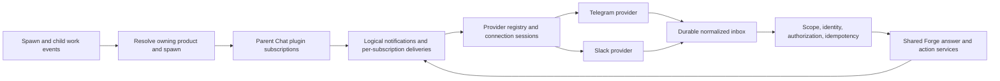

# Forge workstream chat plugins — design

**Status:** proposed; documentation only, 2026-09-09. Implementation is tracked in
[the implementation plan](chat-plugin-implementation-plan.md). Existing code was
examined at `70103c83`. This design supersedes the single-provider and global-target
assumptions in the earlier chat plans for the next revision.

---

> ## 🔍 REVIEW — all 9 comments fixed (round 1, 2026-09-09)
>
> Inline comments are tagged `REVIEW-D-nn` and placed in the section they attack.
> Every code claim cites `path:line` verified at review time. Tick a box when the
> document is updated (or record an explicit "won't fix" with reasoning inline).
> Search the tag to jump to a comment.
>
> **Resolution status:** fixed/checked review items mean the documents were revised.
> Implementation tasks outside these review blocks remain unchecked; no code changes
> or live tests are claimed by this review pass. Original comment text is retained.
>
> | Tag | Severity | Section | Summary | Status |
> |---|---|---|---|---|
> | `REVIEW-D-01` | 🔴 Blocking | §9 | Authorization primitives the design mandates do not exist in Forge | Fixed |
> | `REVIEW-D-02` | 🔴 Blocking | §1 | Unscoped alerts (host sign-in, queue strain) have no home after cutover | Fixed |
> | `REVIEW-D-03` | 🟠 Major | §7 | Telegram's 64-byte `callback_data` cap not acknowledged by the token model | Fixed |
> | `REVIEW-D-04` | 🟠 Major | §6 | "Event filter" is load-bearing but the event taxonomy is never defined | Fixed |
> | `REVIEW-D-05` | 🟠 Major | §6 | Lease/heartbeat vocabulary implies an HA topology Forge does not have (SQLite, single process) | Fixed |
> | `REVIEW-D-06` | 🟠 Major | §6 | Control-DB config vs. product-DB spawns: orphaned subscriptions on spawn deletion | Fixed |
> | `REVIEW-D-07` | 🟠 Major | §9 | No outbound content policy and no retention/purge policy for chat data | Fixed |
> | `REVIEW-D-08` | 🟡 Minor | §5 | UI folder contradicts the document's own scope correction | Fixed |
> | `REVIEW-D-09` | 🟡 Minor | §5 | Startup-fatal plugin validation can brick Forge boot | Fixed |

---

## 1. Outcome and scope

A Forge operator can enable **Chat / Remote control** directly on each top-level
workstream row on `/workstreams`, select a provider, and pick its channel. The five
visible rows in the supplied example — **BEYOND-AST**, **3D-RENDER**, **MCP**,
**AGENT MEMORY**, and **PR INGESTER** — each have independent chat settings.
One row can use Telegram, another Slack, and another remain off. A row may also add
multiple provider/channel destinations; answering in one updates its other copies.

### Scope clarification from the Workstreams screen

In this design, **workstream** in the operator experience means a top-level row in
the screenshot. The current implementation calls that row a **story spawn**:
[`SwarmIndexView`](../../src/forge/Forge.UI/src/swarm/SwarmIndexView.tsx) renders
[`SwarmStoryRow`](../../src/forge/Forge.UI/src/swarm/SwarmStoryRow.tsx) with a
`StorySpawn` DTO backed by `StorySpawnRow`. The smaller graph nodes and counts such
as “32 workstreams” identify its **child workstreams** (`WorkstreamRow`).

Configuration and subscription ownership use **`(ProductId, SpawnId)`**. A child
`WorkstreamId` identifies the specific task an alert/action targets; it is not the
owner of the Chat enable switch. `StoryId` is used by the existing detail URL;
resolve it to the current spawn within the selected product. Never key settings by
the row index, display title, or an assumed globally unique story ID.

The row's chat covers its planning/decomposition, existing and future child
workstreams, and completion. The initial remote-control surface includes status,
parent pause/resume, answers to open questions, and existing targeted stalled-work
actions. `open-questions` and `workstream-stalled` use row subscriptions when their
parent is verified. The current `queue-strain` (crew-wide) and `human-interaction`
(host-account) producers have no owning spawn; both use a **permanent Host alerts
subscription** in this revision. Standalone/unresolved work alerts also appear in
Host alerts with their scope unresolved, rather than being broadcast to all rows.
Additional providers and free-form agent conversation remain follow-ups. Ordinary
chat text must not become an agent prompt implicitly.

<a id="host-alerts"></a>
### Host alerts are a supported destination

Settings → Integrations → Chat includes **Host alerts**, with one or more selected
connections/channels and the two host event kinds enabled by default. Its stable
scope is `(ScopeKind=host, HostId)`; `HostId` is persisted in host configuration.
It is independent of product selection and row Chat switches. Host alerts begin in
notification-only mode; explicit acknowledgement/snooze requires `host.alert.manage`.
Sign-in Retry is shown only when a real host retry operation exists; it does not
claim to complete interactive sign-in remotely. A row-scoped operator does not gain
host authority by receiving a message. A host destination may expose cross-product
crew/account metadata, so only the host administrator selects its recipients.

Import the legacy global target into this first-class host subscription at cutover.
Retiring the legacy engine does not retire Host alerts. A fresh installation with
no host destination shows **Host alerts need a destination** and unrouted counts;
it retains its normal web/local alerts. Product-specific host alert filters can be
added later without inventing an owning spawn for the current producers.

Here, a plugin is a Forge extension registered in the application. Providers ship
as separate .NET projects with a versioned contract. Installing a new provider
requires an application deployment; enabling an installed plugin or changing a
connection does not require restarting Forge or its agents. Loading arbitrary DLLs
or building a plugin marketplace is outside this revision.

> <a id="review-d-02"></a>
> ### 🔴 REVIEW-D-02 — Blocking: unscoped alerts have no home in the new model [FIXED]
>
> **Status: FIXED in documentation (2026-09-09).** Added permanent Host alerts subscriptions for crew-wide queue strain and host-account interactions, including fresh-install setup and cutover behavior. They remain supported after the legacy engine is retired. See [Host alerts](#host-alerts) and [event catalog](#event-catalog).
>
> This section says queue-strain and host-interaction alerts are "supported when
> their owning spawn is known", and that unscoped alerts "retain an explicitly
> configured legacy destination **during migration**". §10 then has the operator
> retire that route, and a global subscription UI is deferred to follow-ups.
>
> Checked against the producers, neither alert can *ever* resolve a spawn — and
> today neither even carries a product:
> - `Services/CrewQueueWorker.cs:3810-3817` — `QueueStrainAlert` is constructed with
>   `ProductId: string.Empty`, scoped to a crew. Crews serve work items across many
>   spawns, so there is no owning spawn to resolve.
> - `Auth/AdoAuthService.cs:254-266` — `HumanInteractionAlert` is constructed with
>   `ProductId: string.Empty` and keyed by a host account (`ado-signin:{acct}`).
>   It is structurally host-scoped, not product- or spawn-scoped.
>
> Net effect: the alert that matters most operationally — *"Forge is blocked on an
> interactive sign-in, come unblock it"* — is the one the design has no destination
> for once the compatibility route is retired. A row-scoped-only model silently
> regresses the current bridge.
>
> - [x] State plainly which of the four existing alert kinds
>       (`Services/Chat/IChatNotifier.cs:26-40`) are in scope for row subscriptions.
> - [x] Give host/product-scoped alerts a **first-class, non-deprecating**
>       destination in this revision (a host-level subscription), or explicitly
>       accept the regression and say so in §1 and §10.
> - [x] If they stay on the compatibility route, remove "during migration" —
>       it is not a migration-only route if nothing replaces it.

## 2. Problems in the existing implementation

| Observed behavior | Evidence | Required change |
|---|---|---|
| One global Telegram configuration and one `IChatTransport` singleton | [Program.cs](../../src/forge/Forge.Api/Program.cs), [transport registration](../../src/Common.Chat/ChatServiceCollectionExtensions.cs) | Provider registry and independent named connections |
| Setup writes project `appsettings.Development.json`; launcher exports only project `appsettings.json` while starting from the repo root | [setup script](../../scripts/setup-telegram-bridge.ps1), [launcher](../../scripts/run-forge-ui.ps1) | Persist connection settings through one application service; scripts use the same API |
| Settings currently checked into `appsettings.json` enable one configured group, although older documentation says disabled by default | [appsettings.json](../../src/forge/Forge.Api/appsettings.json) | Immediate standalone defaults fix (plan Stage 0A); separate later import of existing local settings during migration |
| One recipient/message/status per outbox row; one mapping per spawn; one inbound cursor | [notifier](../../src/forge/Forge.Api/Services/Chat/ChatNotifier.cs), [channel store](../../src/forge/Forge.Api/Services/Chat/ForgeChatChannelStore.cs), [cursor store](../../src/forge/Forge.Api/Services/Chat/ForgeChatCursorStore.cs) | Separate logical events, deliveries, workstream subscriptions, and connection state |
| Setup and health have no Forge UI; `/link` points to a nonexistent Chat settings screen | [chat endpoints](../../src/forge/Forge.Api/Endpoints/ChatBridgeEndpoints.cs), [dispatcher](../../src/forge/Forge.Api/Services/Chat/ChatInboundDispatcher.cs) | Guided connection setup, identity linking, and visible delivery health |
| `/mute` changes a subscriber flag that delivery ignores; command replies omit the topic ID; unmatched text is ignored | [dispatcher](../../src/forge/Forge.Api/Services/Chat/ChatInboundDispatcher.cs), [notifier](../../src/forge/Forge.Api/Services/Chat/ChatNotifier.cs) | Define pause semantics, preserve reply location, and explain unsupported input |
| Answering one question marks the whole notification answered and removes its buttons | [AnswerAndEditAsync](../../src/forge/Forge.Api/Services/Chat/ChatInboundDispatcher.cs) | Track question-level resolution and keep remaining questions actionable |
| Telegram polling is built into the shared inbound loop | [ChatInboundPump.cs](../../src/Common.Chat/ChatInboundPump.cs) | Providers own reception; shared code consumes normalized durable inbound events |

The existing domain action services and product database scoping remain useful.
Provider adapters must call the same domain operations as the web UI, through an
authorization and idempotency boundary shared by every chat provider.

## 3. Concepts and enablement

| Concept | Example | Responsibility |
|---|---|---|
| Workstream plugin | `chat` on BEYOND-AST | Feature enabled for one top-level row, persisted by product/spawn |
| Child workstream | One of BEYOND-AST's 32 graph nodes | Domain target inside the row's scope; uses its parent's chat settings |
| Provider plugin | `telegram`, `slack` | Protocol, credentials schema, rendering, and supported capabilities |
| Connection | `telegram-ops`, `slack-engineering` | One bot identity or Slack workspace installation; credentials and health |
| Destination | Telegram group or DM; Slack public/private channel | A validated external conversation reachable by a connection |
| Subscription | BEYOND-AST → Slack `#forge-ops` | Parent scope, event filters, remote-control or notification-only mode, pause state |
| Conversation binding | A topic or thread for Workstream A | Stable mapping between a subscription and its external thread |
| Operator identity | Slack workspace/user → Forge user | Who may answer or act, separate from where notifications are sent |

Provider IDs, connection IDs, and external IDs are strings. Telegram numbers must
not determine the shared model; Slack message timestamps must remain opaque strings.

Effective delivery requires the host chat switch, connection, workstream plugin,
and subscription to be enabled, and the event to match that subscription's filter.
Interactive actions additionally require an interactive subscription and a linked
operator with the current product/spawn and target-child permissions. The UI shows which gate
is preventing delivery or interaction.

New top-level rows default to Chat off. Operators may explicitly copy destinations
from another row. One saved parent configuration covers all its current and future
child workstreams; creating or reconciling graph nodes needs no extra setup or
subscription copies. Child-specific enablement/overrides are outside this revision.
Renaming, reordering, filtering, refreshing, or switching phases preserves settings
by spawn ID. Deleting a spawn retires its bindings and controls; a newly created
spawn requires explicit activation even if it reuses a story title or ID. Where
existing spawn IDs can be reused, retain an activation generation and reject old
action tokens so a recreated run cannot acquire the previous run's permissions.

Disabling Chat stops new deliveries and new domain actions for the entire row,
including its children. It does not pause the Forge work itself.
Already claimed sends may finish; the UI reports them. Pending unsent deliveries are
cancelled, not silently replayed on re-enable. Previously sent actionable messages
are retired by best-effort edits while the connection remains available. Disabling
a connection affects all its subscriptions and shows those affected workstreams.
An unavailable provider must never block workstream execution.

## 4. Operator experience

### Connection setup

**Settings → Integrations → Chat → Add connection** offers Telegram and Slack.

1. Enter a display name and provider credentials using the provider's guided steps.
2. Verify the bot/workspace identity and store credentials in the host secret store.
3. Select an accessible destination by name; show access and permission problems
   beside that destination, with an action to recheck.
4. Link the current Forge operator and perform a visible send-and-reply check.
5. Show independent results for credentials, destination, outbound delivery,
   inbound reception, operator identity, and permission to act. Saving partially
   completed setup is allowed, but it remains **Needs setup**, not **Connected**.

Tests send only when the operator selects **Send test**. A successful send alone
does not prove replies or workstream actions work. Setup can resume at the failing
step without reinstalling Telegram, repeating completed steps, or restarting agents.

### Workstream setup

Every **`SwarmStoryRow` on `/workstreams`** exposes a visible **Chat** control next
to its existing row actions. When off it reads **Chat off**; when enabled it shows
provider/channel and health, or a compact destination count. The control remains
available on completed rows, including all five shown in the screenshot. Activating
chat on a completed row exposes its status; it does not resume or rerun work.

Selecting the control opens a drawer titled **Remote control · {row title}** while
keeping the list in place. Keyboard/click handling does not trigger row navigation
or a graph-node selection. The same drawer is reachable from that row's detail
header; selecting a child node is never a prerequisite.

1. Turn on **Enable chat remote control** for the named row.
2. Choose **Provider**: Telegram or Slack.
3. Use an existing connection, or **Connect account/bot** inline. Show a connection
   picker only when the provider has multiple connections; preserve this row's draft
   and return here after connection setup.
4. Choose **Channel** by its human-readable name. Show only destinations accessible
   through that connection, with permission/setup errors beside the selection.
5. Select **Save and enable**. Validate and persist the row's configuration, provision
   its topic/thread, and post an introduction identifying the row and control scope.

The toggle is a draft until saved; closing/cancelling the drawer makes no change.
Default mode is **Remote control** (notifications, answers and authorized actions).
**Notifications only** is an explicit alternative. Missing setup can be saved as
a draft but never appears as ready remote control. After the first destination,
**Add provider/channel** repeats the picker to support multiple destinations.
Each destination shows mode, event filters, pause state, external conversation link
and health. Duplicate subscriptions to the same destination/policy are rejected.

Default conversation policy is one Telegram topic or Slack thread **per top-level
row per destination**. All its child workstreams share that conversation and identify
their target in each message. Enabling BEYOND-AST creates one conversation, not 32
conversations for its graph nodes. Selecting an existing provider channel chooses
the containing group/channel; Forge creates or reuses the row's topic/thread there.
Two rows may select the same channel and still receive distinct conversations.
Explicit flat-channel delivery remains supported with exact reply/action correlation.

Example after configuration (illustrative choices, not current live settings):

| Top-level row | Remote control | Provider / channel |
|---|---|---|
| BEYOND-AST | On | Telegram / Forge Ops |
| 3D-RENDER | On | Slack / #render |
| MCP | Off | No destination required |
| AGENT MEMORY | On | Telegram / Forge Ops, Slack / #memory |
| PR INGESTER | Off | Saved destination can remain disabled |

Status values distinguish **Off**, **Needs setup**, **Connecting**, **Ready**,
**Degraded**, and **Paused**. Display the last successful send/receive, pending and
failed delivery counts, and the next recovery step. Connection failures are scoped
to the affected connection; one failed Slack workspace does not mark Telegram down.

### Ongoing interaction

- Messages identify the top-level row, target child or planning artifact, and
  question/action. Preserve the originating
  thread for confirmations, help, status, and errors.
- Answer one question at a time, including a custom-answer path. When multiple
  questions are open, present a selector instead of choosing the newest question.
- Acknowledge a button promptly, then show the domain operation's result. Remaining
  questions keep their controls. Resolve or supersede copies across all destinations.
- Status summarizes the selected top-level row and its children. Unrecognized input inside a bound
  conversation explains available actions; unrelated channel chatter is ignored.
- **Pause destination** pauses that shared subscription and requires workstream
  configuration permission. It is not described as a private mute for one person.
  Personal notification preferences cannot suppress posts for everyone in a group.
- Retry, restart, and snooze labels must match implemented actions. Restart uses an
  expiring confirmation tied to the actor and workstream. Snooze has a persisted
  wake-up time; an acknowledgement alone must not promise a later reminder.

Remote-control commands/buttons have explicit target semantics:

| Control | Target and expected behavior |
|---|---|
| Status | Bound parent spawn; show phase, child progress, pending questions and stalls |
| Pause / Resume work | Bound parent spawn through the existing spawn pause/resume behavior; separate from disabling Chat or pausing a destination |
| Answer | Exact question on a verified planning artifact or child work item within the parent |
| Retry / Accept / Cancel / Restart | Exact child workstream or supported artifact identified by the alert/selector; show its name before acting |

When several children are actionable, present a selector; never interpret a bare
“restart” as restarting the entire row or every child. Actions unavailable in the
current domain state show a reason. Free-form agent conversation remains deferred;
remote control uses these explicit commands/actions and question replies.

## 5. Architecture and provider contract



Proposed project layout:

```text
src/Common.Chat/                         # contracts, capabilities, registry abstractions
src/Common.Chat.Telegram/                # Telegram protocol and renderer
src/Common.Chat.Slack/                   # Slack Web API, Socket Mode, Block Kit renderer
src/forge/Forge.Api/Plugins/              # minimal workstream plugin catalog/contracts
src/forge/Forge.Api/Services/Chat/         # chat plugin, sessions, routing, inbox/outbox, stores
src/forge/Forge.UI/src/integrations/chat/ # connection setup and reusable destination picker
src/forge/Forge.UI/src/swarm/plugins/    # top-level row remote-control drawer
```

> <a id="review-d-08"></a>
> ### 🟡 REVIEW-D-08 — Minor: UI folder contradicts this document's own scope correction [FIXED]
>
> **Status: FIXED in documentation (2026-09-09).** Moved the proposed top-level row drawer to src/forge/Forge.UI/src/swarm/plugins/ and aligned implementation-plan ownership. The parent spawn remains the configuration scope.
>
> §1 establishes that the owner is the **top-level row / story spawn**, rendered by
> `src/forge/Forge.UI/src/swarm/SwarmStoryRow.tsx`. `Forge.UI/src/workstreams/`
> already exists and holds the *child* `WorkstreamRow` UI — putting the row-owned
> Chat panel there re-introduces exactly the confusion §1 corrects. The
> implementation plan §2 already names `src/swarm/{SwarmIndexView,SwarmStoryRow,
> SwarmStoryView}.tsx`, so the two documents disagree.
>
> - [x] Change to `src/forge/Forge.UI/src/swarm/plugins/` (or similar under `swarm/`)
>       and align with the implementation plan.

| Proposed contract | Responsibility |
|---|---|
| `IWorkstreamPlugin` / descriptor | Stable plugin ID, explicit `story-spawn` scope kind, contract/settings versions and validation; Chat is the first implementation |
| `IChatProviderPlugin` | Provider descriptor, credential requirements, capabilities, validation/discovery, and creation of a connection session |
| `IChatProviderRegistry` | Resolve a provider by ID; duplicate IDs are fatal to that registry build; incompatible versions mark the provider unavailable without failing Forge boot |
| `IChatConnectionSession` | Send/edit and ensure/retire conversations for one connection; attach to a provider-owned receiver using its reception key |
| `IChatInboundSink` | Persist normalized inbound events; provider acknowledges transport receipt after durable acceptance |
| `IChatSecretStore` | Read/write credential references without returning secret values in ordinary settings responses |
| `IChatSubscriptionResolver` | Resolve an event's parent product/spawn and its enabled destinations, retaining child/artifact target context |
| `IChatActionDispatcher` | Verify parent membership of the target, resolve delivery/question, authenticate linked operator, authorize and deduplicate the domain action |

> <a id="review-d-09"></a>
> ### 🟡 REVIEW-D-09 — Minor: startup-fatal plugin validation can brick Forge boot [FIXED]
>
> **Status: FIXED in documentation (2026-09-09).** Separated fatal chat-registry ambiguity from unavailable provider/settings versions. Neither case fails Forge boot; unsupported settings retain paused configuration for repair. See [plugin validation](#plugin-validation).
>
> `IChatProviderRegistry` is specified to "reject duplicate IDs and incompatible
> contract versions **at startup**". As written, a stale or mis-versioned provider
> assembly stops Forge from starting — taking the agent loops, queue worker and web
> UI down with it, for a feature that §1 says must "never block workstream execution".
>
> - [x] Distinguish *fatal* (genuinely ambiguous duplicate provider ID, which makes
>       routing undecidable) from *degraded* (unsupported contract/settings version →
>       register the provider as unavailable, surface the reason in Settings, leave
>       existing subscriptions paused rather than deleted).
> - [x] State the same rule for `IWorkstreamPlugin` settings-version validation.

Descriptors advertise inbound mode and capabilities such as text replies, buttons,
edits, topics, threads, destination discovery, and conversation retirement. They
include relevant content limits. The UI presents supported options; providers do
not pretend Slack threads can be closed like Telegram forum topics. Forge renders
semantic messages with question/action references; provider renderers own escaping,
pagination, text limits, fallback text, and keyboards/Block Kit. Existing serialized
Telegram actions are converted by the migration adapter, not forwarded to Slack.

<a id="plugin-validation"></a>
Duplicate provider/plugin IDs are a fatal registry-definition error: never select
one arbitrarily. CI/build validation fails; at runtime the chat subsystem stays
unavailable with a diagnostic while Forge's UI and agent loops still boot. An
unsupported provider contract marks only that provider unavailable. Unsupported
connection or `IWorkstreamPlugin` settings versions pause only the affected
connection/subscriptions and retain their data for repair. Unavailability never
deletes configuration. These are distinct fatal-to-registry and degraded-instance
outcomes, not an unhandled exception during application startup.

Each connection has a supervised session. Settings revisions reconcile only the
affected session. In-process keyed locks own receivers: Telegram by bot identity,
Slack by app identity, shared across its workspace connections. Persist operation
ownership/recovery records, not distributed leases. Route each envelope to its
workspace before dispatch. Duplicate connections for the same installation are
rejected. Telegram owns long polling; Slack owns its WebSocket lifecycle. Plugins
access credentials by reference and have no Forge entity or EF dependency.

## 6. Routing, persistence, and delivery

All new chat coordination tables live in the control database, alongside existing
chat tables. Product/spawn and target-child references are validated against the correct
product database; cross-database foreign keys are not assumed.

| Proposed entity/table | Key data and constraints |
|---|---|
| `spawn_plugins` | Unique `(ProductId, SpawnId, PluginId)`; enabled, settings version, revision, activation generation, optional copy origin; this is the top-level workstream plugin state |
| `chat_connections` | ID, provider, external installation identity, display name, enabled, settings, secret references, revision; duplicate active bot/installation rejected |
| `chat_connection_products` | Unique `(ConnectionId, ProductId)` access grant; only granted products may select or inspect the connection |
| `chat_destinations` | Unique `(ConnectionId, ExternalTenantId, ChannelId)`; name, kind, access validation, validation time |
| `chat_subscriptions` | Discriminated scope: `spawn` with product/spawn/plugin, or `host` with HostId; required canonical ScopeKey, destination, conversation policy, interactive flag, catalog version and explicit event-kind list, paused; unique active ScopeKey/destination/policy; check constraints prohibit mixed/incomplete scope fields |
| `chat_conversation_bindings` | Subscription/revision, external tenant/channel/thread, root message, provisioning ownership/recovery state, retired time; address scoped by connection |
| `chat_notifications` | Logical event with `ScopeKind`, HostId or verified product/spawn; optional child/artifact/work-item anchors; kind, payload/catalog revisions, dedupe key, route state/reason, expiry |
| `chat_deliveries` | Unique `(NotificationId, SubscriptionId)`; immutable destination/binding snapshot, send state, attempts, next attempt, operation owner/recovery deadline, last error |
| `chat_delivery_messages` | Delivery plus part/question key, external message ID, rendered revision and edit state; supports split messages and independent question controls |
| `chat_inbox` | Connection/provider delivery key, normalized envelope, received time, processing owner/recovery state, attempts and result; unique connection/delivery key |
| `chat_connection_state` | Connection cursor, settings revision, last send/receive and health; replaces singleton Telegram state |
| `chat_receiver_state` | Unique provider/reception key; process ownership/recovery record, coalesced health checkpoint; Slack app-level secret reference shared by its workspace connections |
| `chat_operator_links` / `chat_link_challenges` | Provider/tenant/user → Forge user, link/revocation times; hashed, expiring, single-use connection-specific challenges |
| `chat_action_tokens` | Opaque reference to delivery, question/action, expected revision, actor-bound confirmation when needed, expiry; consumed/rejected state |
| `chat_migration_state` | Import identity/version, source checksum, ownership handoff/checkpoint, rollback readiness and unresolved mappings; no secret values |

<a id="event-catalog"></a>
### Event catalog and filters (version 1)

| Stable kind ID | Producer/meaning | Subscription scope | New subscription default |
|---|---|---|---|
| `open-questions` | Questions on a planning artifact or child work item | Verified spawn; unresolved/standalone ownership uses host attention | On for spawn; off for host unless selected |
| `workstream-stalled` | A child workstream needs operator action | Verified spawn; unresolved/standalone ownership uses host attention | On for spawn; off for host unless selected |
| `queue-strain` | Current crew-wide queue pressure, no product/spawn owner | Host only | On for host; not offered on rows |
| `human-interaction` | Current host-account sign-in/manual step | Host only | On for host; not offered on rows |

These are the four existing notifier kinds. Status requests, test messages, setup
introductions and action-result edits are explicit operations, not filterable event
kinds. Persist `CatalogVersion=1` and the explicit selected kind IDs; new kinds are
opt-in for existing subscriptions. IDs never change meaning. Additive kinds advance
the catalog version; incompatible payload changes advance the event payload version
and require a converter. Unknown kinds/unsupported payloads are stored as unroutable
with a visible reason, never silently rendered or opted into an old filter.

When no active subscription matches, persist one deduplicated logical notification
with `RouteState=unrouted` and reason `disabled`, `filtered`, `no-destination`,
`unresolved-scope` or `unsupported-kind`. Create zero deliveries. Show counts and
reasons on the owning row or Host alerts; disabled/filtered counts are informational,
missing destinations and unresolved scope need attention. Retain unrouted payloads
under the retention policy below. Enabling a destination does not replay them;
**Send pending alerts** is an explicit action that revalidates current domain state.

For each subscription/conversation, order actionable sends by domain revision and
enqueue order. A failed earlier actionable delivery blocks later actionable ones
until retry succeeds or that delivery expires, is superseded, or is explicitly
skipped; surface the blockage. Independent subscriptions continue. Resolution edits
and retirement can bypass that send queue to remove stale controls. Older retries
must not resurrect a superseded question or overwrite a newer rendered revision.

<a id="spawn-retirement"></a>
### Spawn deletion and batched summaries

`ChatScopeLifecycleService` owns retirement in the control DB. Explicit spawn
deletion calls it after the product-side deletion commits. Wire the same call into
the seed/reconcile scrub completion using `ForgeSeed.ScrubMockedSpawnsAsync`'s
`StorySpawnIdsDeleted` report (never on dry-run), and into product deletion. Retire
subscriptions, cancel unsent deliveries, invalidate action tokens and schedule
best-effort remote control removal. A cleanup failure must not resurrect the spawn.

`ChatScopeReconciler` runs on startup and every five minutes. Group active scopes
by product, open each available product DB once, and query spawn existence and run
generation in batches. Missing spawns become **Orphaned — parent deleted**, retained
in Host alerts/settings history; no send or action proceeds. Unavailable product
DBs become **Degraded — ownership unverified** and pause work without treating them
as deleted. Recheck before dispatch/provisioning closes the reconciliation window.
Reused IDs require a new activation generation as in §3.

For list summaries, take the requested spawn IDs from the existing product list
query, fetch subscription/health aggregates in one control-DB batch (chunk at the
SQLite parameter limit), and join in memory by product/spawn. Do not open a product
DB or run a control-DB query per row. The detail view uses the same aggregate service.

> <a id="review-d-04"></a>
> ### 🟠 REVIEW-D-04 — Major: "event filter" is load-bearing but never defined [FIXED]
>
> **Status: FIXED in documentation (2026-09-09).** Defined all four version-1 kinds, spawn/host scope, explicit defaults, opt-in future kinds, visible zero-match events, and ordered retry/supersession semantics. See [event catalog](#event-catalog).
>
> §3, §4, §6 and §9 all depend on a per-subscription **event filter**
> (`chat_subscriptions … event filter`), and the UI is required to render it — but
> no event taxonomy appears anywhere in this document. Today the producer surface
> is exactly four kinds (`Services/Chat/IChatNotifier.cs:26-40`): open-questions,
> workstream-stalled, queue-strain, human-interaction. Without an enumerated,
> versioned list the filter column is unimplementable and untestable.
>
> - [x] Publish the event-kind catalog (stable string IDs), its version policy, and
>       which kinds are row-scoped vs. host-scoped (see REVIEW-D-02).
> - [x] Define the **default** filter for a newly enabled row.
> - [x] Define behavior when a logical event matches **zero** subscriptions: dropped,
>       or persisted as unrouted with a visible count? §6 creates "one delivery per
>       matching subscription" and is silent on the empty case — this is also how an
>       operator discovers misconfiguration, so it should not be a silent no-op.
> - [x] Define forward compatibility: a subscription saved before a new event kind
>       exists — opt-in or opt-out by default?

> <a id="review-d-06"></a>
> ### 🟠 REVIEW-D-06 — Major: control-DB config referencing product-DB spawns will orphan [FIXED]
>
> **Status: FIXED in documentation (2026-09-09).** Named the lifecycle owner, covered explicit deletion and ForgeSeed scrub/prune, added periodic orphan reconciliation, and specified batched cross-DB summary joins. See [spawn retirement](#spawn-retirement).
>
> All chat coordination tables are control-DB
> (`Persistence/Split/DbBoundary.cs:112-115` shows the four existing chat tables as
> `DbKind.Control`, `PartitionStrategy.Global`), while `story_spawns` is a *product*
> table (`Persistence/PhaseMigrationCatalog.cs:184`). §3 asserts "Deleting a spawn
> retires its bindings and controls", but nothing in this design owns that
> transition, and spawn rows are deleted by paths that know nothing about chat —
> e.g. the reconcile prune at `Persistence/ForgeSeed.cs:1581` /
> `StorySpawnIdsDeleted` at `ForgeSeed.cs:1600`. Orphaned subscriptions and
> conversation bindings are therefore guaranteed, not exceptional.
>
> - [x] Name the owner of spawn-deletion retirement, and cover the seed/reconcile
>       prune path explicitly, not only the lifecycle services.
> - [x] Because there is no cross-DB FK, specify a periodic reconciliation that
>       detects subscriptions whose `(ProductId, SpawnId)` no longer resolves, and
>       what the UI shows for them (orphaned vs. degraded).
> - [x] Specify how `chatSummary` is joined for the spawn list without an N+1
>       cross-database read per row — §9 rules out per-row *provider* calls but not
>       per-row *cross-DB* calls, which is the real cost here.

Do not infer operator identity from the destination ID, username, or email match.
Do not use a bare external message ID to find a notification: the lookup includes
connection, external tenant, channel, and message/thread. Conversation route keys
use `spawn/{productId}/{spawnId}`, qualified by subscription and activation
generation. Target child/work-item/artifact IDs are separate action context. A raw
thread message is an answer only when the parent and question are unambiguous. For Slack, all replies
share the root `thread_ts`, so question selection is required when a thread contains
multiple unanswered questions.

For child events, resolve `WorkstreamRow.StorySpawnId` in the correct product DB
and verify the parent exists. For planning/decomposition artifacts, resolve their
persisted spawn ownership even when no child `WorkstreamRow` exists yet. An event
already carrying `SpawnId` must still pass ownership validation. Standalone child
workstreams without a spawn have no top-level-row subscription; preserve only an
explicit legacy route or surface them as unscoped. Never infer a parent from the
display name or “latest active spawn.” Inbound dispatch rechecks that the child or
artifact still belongs to the bound parent before acting.

A logical event creates one delivery per matching subscription in a control-DB
transaction. Changing subscriptions does not redirect an already queued delivery;
cancel it and create a new one only through an explicit resend operation. Retry
each destination independently with backoff and provider retry hints. Distinguish
temporary failures, permission/configuration failures, expired and cancelled rows.
Use fair scheduling across connections and channels; expose manual retry after a
permanent failure is repaired. A send timeout after provider acceptance is an
unknown outcome, not proof of failure; reconcile where supported and make possible
duplicate external messages visible.

<a id="single-instance-recovery"></a>
### Single-instance operation and SQLite budget

V1 runs one Forge ASP.NET process against local SQLite control/product files.
Multi-host writers and HA are unsupported; a host-level named mutex keyed by the
canonical control-DB path prevents a second instance from opening the same chat
runtime. In-process keyed locks and
bounded queues provide mutual exclusion. Any remaining “lease” field in this
proposal means a persisted `OwnerProcessInstanceId`, operation state and recovery
deadline, not a distributed-lock guarantee.

Send/provision operations have a 30-second provider timeout and a 60-second recovery
window. A live owner is never stolen solely because its deadline passed. After
process restart, unresolved sends/provisioning become uncertain and reconcile
before retry. Receiver ownership is reclaimed when the previous process is known
dead; restart resumes from the last durably accepted cursor. No per-operation
heartbeat is required. Remote API calls never hold a SQLite write transaction.

Operational budget (initial targets, to be measured in Stage 2):

| Activity | Budget |
|---|---|
| Outbound ready-queue scan | Every 5 seconds; reads only when idle; wake early on enqueue |
| Telegram poll / Slack socket | Existing 25-second long poll / event driven; empty polls cause no DB writes |
| Receiver health | Memory updates; dirty health checkpoints coalesced in one transaction every 60 seconds |
| Inbox acceptance | Batch received envelopes plus cursor in one short transaction; dedupe creates no duplicate content rows |
| Dispatch/delivery completion | Batch up to 20 ready state changes or 250 ms of work; never delay transport ack waiting for domain work |
| Spawn reconciliation / purge | Every 5 minutes / hourly; bounded batches, no idle writes |

With two idle connections, target at most one health transaction/minute. A planning
load of 12 notifications/minute to two destinations plus 6 inbound answers/minute
requires approximately 12 enqueue + 24 claim + 24 completion + 6 inbox + 6 dispatch
+ 12 result-edit checkpoints + 1 health = **85 control-DB transactions/minute**
before batching, plus separate product mutations. This is a sizing estimate, not a
benchmark. Target short transactions under 50 ms at p95 and report queue delay/
`SQLITE_BUSY`; if sustained contention appears, reduce checkpoint frequency/batch
more and prioritize inbox acceptance and domain receipts over diagnostic writes.

Use a chat-specific DB retry budget rather than blocking for the global 30-second
timeout. Inbox durable acceptance gets at most 2 seconds total; if persistence is
unavailable, do not acknowledge the Slack envelope or advance Telegram's cursor.
Let provider retry/reconnect recover it and surface reception as degraded. Retry
other transient DB writes with bounded jitter/backoff. A write failure **before**
send prevents the send. If send succeeds but storing its result fails, retain the
provider result in memory and retry only that checkpoint; after a crash mark its
persisted in-flight operation uncertain, not unsent. Permanent storage errors pause
the affected work and surface an error; they do not consume provider retry attempts.

Claim conversation provisioning before calling the provider. A database unique
index after creation alone does not prevent duplicate external topics. Recover
abandoned operations and record uncertain outcomes for reconciliation; do not claim
exactly-once creation when the external API cannot guarantee it.

> <a id="review-d-05"></a>
> ### 🟠 REVIEW-D-05 — Major: lease/heartbeat vocabulary implies a topology Forge does not have [FIXED]
>
> **Status: FIXED in documentation (2026-09-09).** Limited v1 to one local process, replaced distributed-lease assumptions with in-process ownership and recovery records, and added interval/write-rate targets plus pre/post-send storage-failure behavior. See [SQLite operation budget](#single-instance-recovery).
>
> This section and §5 specify receiver **ownership leases** with heartbeats
> (`chat_receiver_state`), delivery leases, provisioning leases, and "fair scheduling
> across connections and channels". That is the vocabulary of a multi-instance,
> horizontally scaled service. Forge is a single ASP.NET process whose control store
> is SQLite (`src/forge/Forge.Api/Program.cs:278` —
> `opt.UseSqlite($"Data Source={dbPath};Default Timeout=30")`).
>
> Two consequences the design should resolve rather than leave implicit:
> 1. **Semantics.** If the deployment is single-instance, these are *crash-recovery
>    markers*, not distributed mutual exclusion. Saying "lease" invites an
>    implementation that pays for coordination it will never need, and invites a
>    reviewer to assume a safety property that isn't there.
> 2. **Write contention.** Per-destination `chat_deliveries`, `chat_delivery_messages`,
>    `chat_inbox` rows, cursor updates and heartbeats are all *writes* into a
>    single-writer SQLite file that already carries the task queue, spawn
>    orchestration and PR/build sync workload. A 30-second command timeout plus
>    heartbeat traffic is a plausible source of `SQLITE_BUSY` under load.
>
> - [x] State the deployment assumption explicitly (single instance today?), and if
>       so reframe leases as crash-recovery/ownership records with a stated
>       recovery window — or justify the HA design with the topology that needs it.
> - [x] Give a heartbeat/poll interval budget and an estimated steady-state control-DB
>       write rate for the chat subsystem, so the SQLite cost is reviewable.
> - [x] Say what happens when a control-DB write fails transiently mid-send —
>       currently only the *provider* failure taxonomy is specified.

Persist inbound envelopes before advancing Telegram's cursor or acknowledging a
Slack envelope. Domain handling runs from the inbox with retry. Receipt dedupe is
separate from logical action dedupe: two people can click equivalent buttons on
different providers. Enforce expected question/workstream revisions and a durable
action receipt in the product database at the domain mutation boundary. First valid
answer wins for that revision; later input receives an already-resolved response.
Non-transactional effects such as restart require a recorded operation identity and
reconciliation after a crash; never blindly repeat an uncertain destructive action.

The product-side `chat_action_receipts` table records action identity, target and
expected revision, actor, processing state and outcome. It belongs in the product
migration boundary; the control DB retains references, not a competing domain result.

After a domain result, reconcile all delivery copies, including actions performed
in the web UI. Check `OpenQuestionAnswerResult.UnansweredCount`; one answered
question does not close an entire multi-question notification. Because product
mutation and control-DB delivery updates are separate transactions, persist the
domain outcome/receipt with the mutation and reconcile missed updates after restart.

## 7. Telegram provider

<a id="action-payload-limits"></a>
### Bounded action keys and legacy correlation

Every new action token is a server-side lookup key: `a1_` plus 22 unpadded base64url
characters from 128 random bits, **25 ASCII bytes total**. The full delivery,
question, revision, actor-bound confirmation and expiry live only in
`chat_action_tokens`. No domain context is encoded in the key. Store its hash for
lookup. Normal tokens expire with the notification (maximum 24 hours); restart
confirmations expire after 30 seconds and are actor-bound/single-use.

Provider capability descriptors declare these limits and validate the actual
serialized payload before send:

| Field | Limit | Validation |
|---|---|---|
| Telegram `callback_data` | 1–64 bytes | UTF-8 byte count, not string character count |
| Slack `action_id`, `block_id` | 255 characters each | Bounded generated identifiers, independent of domain IDs |
| Slack button `value` | 2000 characters | Short action lookup key only |

These limits come from [Telegram inline buttons](https://core.telegram.org/bots/api#inlinekeyboardbutton),
[Slack buttons](https://docs.slack.dev/reference/block-kit/block-elements/button-element/)
and [Slack actions blocks](https://docs.slack.dev/reference/block-kit/blocks/actions-block/).
Oversize/unsupported payloads fail the delivery visibly with
`render-payload-limit`, identifying the field and permitted size; do not call the
provider or leave an unsent row without a reason. Test long Unicode labels/context
separately from the ASCII action keys.

During import, each old `(Platform, ChatId, ChatMessageId)` becomes a
connection/tenant/channel-qualified `chat_delivery_messages` legacy part linked to
the original logical notification and its verified domain anchors. Keep that part
even when new messages split by question. Legacy `act|retry` contains no target:
resolve its **original reply/callback message ID** through this alias, then verify
parent, target, current revision and permission. Unknown/ambiguous/retired aliases
are rejected with a repair hint; never guess a target from the current thread.

Retain existing bot credentials and forum support, but support independent bot
connections and destinations. Default workstream conversations use forum topics;
DM and explicitly selected flat-chat delivery remain supported.

Setup validates the bot, discovers the chosen chat through the provider's existing
receiver, and verifies forum/admin/topic permissions. It must not start a competing
`getUpdates` consumer. Offer a connection link that carries a short-lived linking
challenge; Telegram supports account-link parameters through deep links. [Telegram
deep links](https://core.telegram.org/bots/features#deep-linking)

The current instructions unnecessarily require disabling privacy for a bot already
made an administrator. Admin bots receive group messages; private replies can also
work with privacy enabled. Show the requirement appropriate to the chosen mode.
Check for a configured webhook before using long polling and explain the conflict;
do not silently remove a webhook owned by another application. [Telegram bot FAQ](https://core.telegram.org/bots/faq)

Retain callback query IDs and issue `answerCallbackQuery` promptly; Telegram clients
otherwise keep displaying a progress indicator. Preserve topic IDs in all replies,
normalize commands addressed as `/command@botname`, and implement `/start` linking
and onboarding. [Telegram callback queries](https://core.telegram.org/bots/api#callbackquery)

Move DPAPI access behind the common secret-store abstraction, preserving the
existing blob as a migration input. Remove the desktop installation and provider
sign-in detour from the normal setup path; use the already signed-in Forge identity.

> <a id="review-d-03"></a>
> ### 🟠 REVIEW-D-03 — Major: Telegram's 64-byte `callback_data` cap breaks the token model as described [FIXED]
>
> **Status: FIXED in documentation (2026-09-09).** Specified 25-byte lookup keys, server-side context, Telegram/Slack payload limits, visible render failures and original-message aliases for targetless legacy callbacks. See [payload limits and correlation](#action-payload-limits).
>
> §6 describes `chat_action_tokens` as an "opaque reference to delivery,
> question/action, expected revision, actor-bound confirmation when needed, expiry",
> and §8 says "Buttons contain opaque action references". Neither section mentions
> that Telegram's `callback_data` is capped at **64 bytes**, and this repository has
> already been burned by it — see the comment the current code carries at
> `Services/WorkstreamLivenessMonitor.cs:478-483`:
>
> > "Callback data carries ONLY the action — the workstream id is resolved from the
> > correlated notification on tap. Embedding the id blows past Telegram's 64-byte
> > `callback_data` cap for long ws ids (`BUTTON_DATA_INVALID`), which silently
> > wedged the alert as unsent."
>
> Two risks follow. First, if a token encodes any of that context it will not fit,
> and the failure mode is a *silently unsent* alert. Second, this design multiplies
> per-message state (per-question message rows, multi-part splits, multi-destination
> copies) — exactly the pressure that pushes people to encode context in the button.
>
> - [x] State that the action token is a short **server-side lookup key** with a
>       bounded length, and that delivery/question/revision/actor/expiry are stored
>       in `chat_action_tokens`, never encoded in the button payload.
> - [x] Add provider payload limits to the capability descriptor (§5 already promises
>       "relevant content limits"): Telegram `callback_data` 1–64 **bytes**; Slack
>       `action_id`/`block_id` 255 chars, `value` 2000 chars.
> - [x] Require validation at render time with a hard failure that is *visible*
>       (delivery marked failed with a reason), never a silent unsent row.
> - [x] §10 promises to "preserve aliases for old reply messages and callback
>       formats" — note that the legacy format (`act|retry`) carries **no target**
>       and resolves via the correlated notification. Say how that correlation
>       survives the move to per-question `chat_delivery_messages` rows.

## 8. Slack provider

### Connection and permissions

Initial Slack support targets an internal workspace app using **Socket Mode**.
It works with local Forge without a public request URL. A connection stores the
workspace bot token (`xoxb-…`) and app-level token (`xapp-…`) as separate secret
references. The app token needs `connections:write`; the bot token performs Web API
operations. [Socket Mode](https://docs.slack.dev/apis/events-api/using-socket-mode/),
[app-token scope](https://docs.slack.dev/reference/scopes/connections.write/)

Provide a versioned app-manifest template and a setup guide. The operator creates
and installs the app in the chosen workspace, enables Socket Mode/interactivity,
provides the two credentials, invites the bot to selected channels, and validates
them in Forge. Workspace policies may require an administrator to approve the app;
setup retains progress while that happens. Hosted OAuth distribution and a public
Slack Marketplace listing are separate work; Socket Mode currently does not support
Marketplace listing. [Socket Mode distribution](https://docs.slack.dev/apis/events-api/using-socket-mode/)

| Initial capability | Bot scopes / subscriptions |
|---|---|
| Send messages, root thread message, and updates to bot-authored messages | `chat:write` |
| Public-channel picker | `channels:read`; paginate `conversations.list` and validate membership |
| Ordinary replies in joined public channels | `channels:history`; `message.channels` event |
| Private-channel support | `groups:read`, `groups:history`; `message.groups` event; bot invited to the private channel |

Scopes are requested for the selected capabilities. Private channels are part of
the initial adapter, with a clearly identified manifest option. Initial linking
uses a challenge message/button in a selected channel, so direct-message, user
profile, slash-command, and public-channel auto-join permissions are not required.
Channel discovery follows the installation's actual visibility. [Channel listing](https://docs.slack.dev/reference/methods/conversations.list/),
[public message events](https://docs.slack.dev/reference/events/message.channels/),
[private message events](https://docs.slack.dev/reference/events/message.groups/),
[message posting](https://docs.slack.dev/reference/methods/chat.postMessage/)

### Conversations, reception, and rendering

- Post a root message in an existing channel for each workstream subscription;
  retain its `ts` and post subsequent messages using `thread_ts`. Do not create a
  Slack channel per workstream. Update the root on completion; Slack thread
  retirement is a Forge binding state, not a fictional close-thread API. [Slack
  thread posting](https://docs.slack.dev/reference/methods/chat.postMessage/)
- Render questions and actions with Block Kit and useful plain-text fallback.
  Retain each message's `ts` separately from its root. Buttons contain opaque action
  references, not executable commands or raw domain IDs. Message updates use
  `chat.update`. [Message updates](https://docs.slack.dev/reference/methods/chat.update/)
- Receive events and interactive envelopes over Socket Mode. Persist them and
  acknowledge the envelope promptly; handle reconnect/refresh and redelivery
  independently of domain processing. Interaction handling must respect Slack's
  three-second acknowledgement window. [Socket envelopes](https://docs.slack.dev/apis/events-api/using-socket-mode/),
  [interaction acknowledgement](https://docs.slack.dev/interactivity/handling-user-interaction/)
- Share one supervised receiver per Slack app across its configured workspace
  installations. Slack may distribute payloads across any open connection for the
  app; separate sockets must not assume workspace affinity. [Socket connection
  distribution](https://docs.slack.dev/apis/events-api/using-socket-mode/#using-multiple-connections)
- Dedupe Events API traffic by connection and `event_id`; dedupe interactive
  redelivery by envelope ID and also apply logical action receipts. Validate
  workspace/app identity. Ignore bot/self messages and message-edit/delete subtypes
  as new answers. Dispatch ordinary user text only inside subscribed conversations
  with an unambiguous question or an explicit selection.
- Receive replies from events, not repeated thread-history scans. Channel thread
  history access has token/scope constraints; normal operation must not require a
  user token or `conversations.replies` polling. [Thread history API](https://docs.slack.dev/reference/methods/conversations.replies/)
- Honor HTTP 429 `Retry-After` and use per-workspace/method and channel pacing.
  Report removed membership, revoked credentials, and archived channels as distinct
  repairable problems. [Slack rate limits](https://docs.slack.dev/apis/web-api/rate-limits/)

The receiver verifies its app ID from the socket handshake and routes by the
envelope's workspace identity to the configured bot installation. Unknown workspace
events are acknowledged and recorded as unroutable diagnostics without executing
actions. Disabling one workspace connection does not stop a shared receiver still
used by another. Initial setup supports workspace installations; organization-wide
enterprise installation and Slack Connect cross-organization actions are deferred.

Use `HttpClient` and `ClientWebSocket` inside the Slack project, consistent with
the repository's existing lightweight HTTP adapters. Protocol lifecycle tests are
required; the shared library must not acquire a Slack SDK dependency.

## 9. Identity, configuration, and APIs

<a id="auth-boundary"></a>
### Required authentication and capability prerequisite

**V1 decision: implement authenticated operator sessions and explicit capabilities
before enabling remote control.** The current `ForgeUser.RequireWriter` checks
only header presence and `RequireRole` matches unverified strings, including an
empty-users pass-through. These are not an authentication boundary. The new chat
configuration/link APIs and all equivalent web action endpoints must stop trusting
`X-Forge-User`; retain it only as non-authoritative legacy display metadata.

The supported deployment is a trusted user's local host with the API bound to
loopback. The host administrator and processes running as that OS user are trusted;
other Telegram/Slack members, another web origin and a spoofed API header are not.
Membership in a configured channel permits seeing its delivered content, never
mutating Forge. A compromised linked account is limited to that Forge user's
current capabilities and selected interactive destinations. A compromised host or
bot/app credential is outside this protection and requires credential/link
revocation. Public/LAN API hosting is not part of v1's local pairing flow.

Implement a host-local **Pair browser** command as the initial identity source.
The trusted host administrator explicitly enrolls stable `UserRow.Id` identities
and host-admin IDs in an OS-protected local identity store. The command selects an
enrolled user and issues a 256-bit single-use pairing challenge, valid for two
minutes. HTTP cannot mint challenges or nominate a new administrator. Browser
redemption on the expected loopback origin exchanges it for a protected,
HttpOnly/SameSite session cookie with an eight-hour maximum lifetime; the challenge
is neither a URL query parameter nor a log entry. Use ASP.NET Core authentication,
anti-forgery protection on cookie-authenticated writes, strict Host/Origin checks
and an explicit local UI origin allowlist. Session revocation is checked on every
sensitive request; after a server restart require pairing again. No users or no
enrollment means **Needs operator enrollment**, with mutations denied. This is
proof of trusted host-issued pairing, not a claim of enterprise SSO verification.
Framework building blocks: [cookie authentication](https://learn.microsoft.com/en-us/aspnet/core/security/authentication/cookie?view=aspnetcore-8.0)
and [policy authorization](https://learn.microsoft.com/en-us/aspnet/core/security/authorization/policies?view=aspnetcore-8.0).

`ForgeActorResolver` accepts only an authenticated browser principal or a verified
provider/tenant/user link and returns a stable Forge user ID. A new
`ForgeCapabilityAuthorizer` is the **single decision point**, called inside the
shared application action boundary by both HTTP endpoints and chat dispatch. It
reads current `UserRow` / `UserProductRoleRow` records by stable IDs, not names or
headers, and validates target product/spawn/child membership. V1 deliberately uses
fixed role-to-capability mappings rather than a general grant editor:

| Capability | Who receives it | Enforced operation |
|---|---|---|
| `chat.connection.manage`, `host.alert.manage` | Enrolled host administrator | Credentials, connections/product access grants, host destinations and host acknowledgements |
| `chat.subscription.manage` | Product owner of the resolved product | Enable/configure/pause that row's destinations |
| `chat.link.self` | Authenticated enrolled user | Link/revoke that same stable user; cannot nominate another user |
| `spawn.read` | Enrolled user with a current role in the product | Status, linked row summaries and message details |
| `question.answer` | Product owner of the target product | Answer/dismiss the selected child/artifact question |
| `spawn.pause`, `spawn.resume` | Product owner of the target product | Parent execution controls |
| `workstream.retry`, `workstream.accept`, `workstream.cancel`, `workstream.restart` | Product owner of the target product | Exact child action, plus confirmation for restart |
| `artifact.retry`, `artifact.accept`, `artifact.cancel`, `artifact.restart` | Product owner of the target product | Exact supported planning/artifact action |
| `identity.manage` | Enrolled host administrator | User/role mutation and enrollment-related web operations |

A host-admin identity does not implicitly gain product mutation authority; it must
also have the product role. Require an explicit `UserProductRoleRow` for the target;
`UserRow.Role` does not supply a global product-owner fallback. No matching user/role,
disabled enrollment, unknown capability,
unresolved target or `productId=all` on a mutation is a denial. Aggregate status
expands only explicitly authorized products. Protect all user/role and connection-
grant mutation paths against header-only writes so they cannot bypass this policy.

The existing web endpoints for every chat-supported action (including aliases and
the old link-token endpoint) must call the same authenticated boundary before any
side effect. Chat never synthesizes a trusted header to call an endpoint. Until
this prerequisite and its web/chat parity tests pass, the plugin engine refuses
interactive mode and offers notification-only operation. This fallback is an
explicit release gate, not the final remote-control scope. Existing legacy remote
actions are disabled under the Stage 0 defaults/posture work until migrated safely.

<a id="outbound-retention"></a>
### Outbound content and data retention

`ChatContentPolicy` runs before outbox content persistence and again before every
provider render, test send, retry or edit. Default to **Metadata only**: generated
status/kind, approved row/child labels and a Forge link; omit agent-authored question
text, free-text stall reasons, logs, source excerpts and absolute paths. Operators
may choose **Redacted questions and summaries** per product/host subscription to
send bounded question text and short explanations. The product policy is the
maximum; a subscription can be more restrictive. Host alerts use a separate
host-admin policy with account names masked by default.

The redaction pass removes known credential values, token/authorization patterns,
private keys, credential-bearing URLs, and absolute filesystem paths. Treat agent
text as untrusted content; pattern matching cannot prove arbitrary customer/source
data safe. Do not include raw transcripts, build logs, attachments, or source files.
Render escaped text with mention expansion disabled where supported. Show a
redacted preview and the selected product/host policy during configuration. If
redaction fails, fall back to generated metadata or fail visibly; never send the
original text. Metadata-only alerts use status/open-in-Forge controls, not answer
choices whose question was withheld. A localhost link is labelled **Open on Forge
host**; do not imply remote browser access or publish the API to make it work.

Store normalized inbound text only as needed for processing, excluding provider
credentials and response URLs. Validate user answer text against content policy
before acceptance: if it requires destructive redaction, request a safe replacement
rather than silently changing the answer or storing the rejected content. Protect
accepted text with the inbox retention below; outbound copies always pass redaction.
`ChatRetentionService` sweeps
hourly in batches of 100 rows, respecting active references and the DB write budget:

| Data | Default lifecycle |
|---|---|
| Notification title/body, delivery rendered parts and errors | Unrouted content: 7 days; terminal content: 30 days, then scrub. Unresolved content hard cap: 90 days; expire controls and require a fresh event |
| Inbox normalized text/envelope | Processed: 7 days; failed/dead-letter: 30 days; expire unprocessed data at 30 days with a visible count. Keep content-free receipt key/result 90 days |
| Delivery/message correlation and action receipts | Content-free IDs/outcome for 90 days after terminal; unresolved external operations retained for repair with content scrubbed |
| Action tokens and link challenges | Expire as specified; purge token/challenge hashes within 24 hours after expiry. A missing expired token is always rejected |
| Subscriptions, bindings and spawn-plugin rows | Tombstone on retirement; retain configuration/correlation without content for 90 days, then purge once dependencies are gone |
| Connections, product grants and operator links | Retain while active; revoke immediately on removal. Purge retired metadata after 90 days and unreferenced secrets after session shutdown |
| Connection/receiver health and recovery state | Only latest checkpoint while active; retire/purge after 90 days, excluding unresolved operations |
| Migration state and legacy aliases | Keep through the supported rollback window (at least 90 days); remove only after compatibility retirement and no active correlations |

Purge in dependency order and keep unresolved action receipts until reconciled;
never break dedupe for a live token to satisfy a timer. Product/host administrators
can shorten content retention or request content purge immediately; show remaining
content-free operational records and any unresolved operation preventing deletion.
Policies cover backups through the host backup-retention process as well. Retiring
a subscription tombstones local routing and disables controls; it **does not
unsend** messages or delete Slack/Telegram copies. Providers retain delivered
content independently, and remote deletion is not promised by this revision.

> <a id="review-d-01"></a>
> ### 🔴 REVIEW-D-01 — Blocking: the authorization primitives this section mandates do not exist [FIXED]
>
> **Status: FIXED in documentation (2026-09-09).** Selected authenticated host-paired sessions and a fixed capability model, with no header authority or empty-user pass-through. Added the shared HTTP/chat enforcement boundary, trust assumptions and mandatory Stage 0B parity gate; notification-only is a release fallback, not the final scope. See [identity prerequisite](#auth-boundary).
>
> This section (and §3) is written against a permission model Forge does not have.
> The design requires: *"Authorize every inbound domain action using the linked
> Forge user's current permissions on the resolved product/spawn and the specific
> child/artifact target"*, *"Connection mutation requires a product-owner/admin
> capability"*, and *"Linking begins in the signed-in Forge UI"*.
>
> What is actually in the repository:
> - `Auth/ForgeUser.cs:17-35` — `RequireWriter` only checks that an `X-Forge-User`
>   header is **present and non-empty**. Its own summary calls it a "Phase-3
>   placeholder for the auth that lands in Phase 5"; the 401 body literally reads
>   "Phase-5 introduces real auth." The value is unverified and trivially spoofable.
> - `Auth/RequireRole.cs:103-120` — resolves the role by string-matching the header
>   against `Email`/`Login`/`DisplayName`/`Id`, and **returns `null` (= open)** when
>   no user rows exist yet.
> - `Persistence/ProductScope.cs:17-19` — `productId=all` "bypasses scoping
>   entirely (Phase 10 will gate this behind the Product Owner role; **today every
>   signed-in caller may use it**)".
> - There is no `AddAuthentication`/`AddAuthorization`/`RequireAuthorization` and no
>   `ClaimsPrincipal` anywhere in `Forge.Api`. `UserProductRoleRow` exists, but there
>   is no capability model and no consistent enforcement point.
>
> This matters more for chat than for the web UI. The current trust boundary is
> "whoever can reach localhost". Chat deliberately opens a **remote, internet-facing
> ingress** that turns a Telegram/Slack identity into a Forge domain mutation
> (restart, cancel, pause, answer). The design's language implies that ingress is
> gated by permissions that are not implemented, which is exactly the kind of
> assumption that ships as an unauthenticated remote-control surface.
>
> - [x] State the trust boundary and threat model for the chat ingress explicitly.
>       Who can reach the API? What does a compromised/added group member get?
> - [x] Enumerate the capabilities this feature needs (e.g. `chat.connection.manage`,
>       `chat.subscription.manage`, `spawn.pause`, `workstream.restart`) and name the
>       single place each is enforced.
> - [x] Decide and record whether `X-Forge-User` remains the identity source. If it
>       does, say that operator linking binds a chat identity to an *unverified*
>       header value, and that chat actions therefore cannot be more trustworthy
>       than that header.
> - [x] Add the prerequisite to the implementation plan (see REVIEW-P-02). Today no
>       stage builds this, yet §4/§9 and the plan's validation matrix ("Revoked
>       operator or lost product permission → new actions rejected") assume it.
> - [x] Fallback if the above is out of scope: restrict this revision to
>       **notification-only** plus a single explicitly configured operator, and
>       remove the per-target permission language rather than implying enforcement.

Linking begins in the signed-in Forge UI. Issue a random, single-use challenge with
a ten-minute expiry, connection and Forge-user scope, and a hashed stored value.
An external response produces a candidate provider user; the same Forge user
confirms it in the UI before activation. Re-linking updates an existing identity
record instead of inserting a duplicate unique key. Explicit revocation immediately
prevents new actions. Existing Telegram allowlists are migration inputs, not an
alternative that silently creates an operator without a Forge identity.

Authorize every inbound domain action using the linked Forge user's current
permissions on the resolved product/spawn and the specific child/artifact target.
Parent pause/resume requires the same permissions as the corresponding web action.
Notification-only subscriptions
cannot accept answers. Bound conversations may show a linking/permission hint;
unrelated chats are not turned into a setup broadcast surface. Confirmations and
action tokens are checked against their original connection, destination, domain
revision, and expiry.

Persist connection/subscription settings in the control DB, with secrets stored
separately by reference. Host configuration contains the master switch, engine
selection for migration, and secret-store configuration. UI changes advance a
revision and reconcile live sessions. External environment-backed secrets can be
referenced explicitly and appear as externally managed; rotating such a value may
require the host process to be refreshed if its environment does not reload.
Provide a host secret-store implementation for Windows DPAPI and preserve a seam
for other hosts; fail with a clear setup state if the selected store is unavailable.

Proposed API surface (all new; paths subject to normal endpoint conventions):

| Operation | Proposed endpoint |
|---|---|
| Installed workstream/provider plugins and capabilities | `GET /api/plugins`, `GET /api/chat/providers` |
| Create/read/update connection, explicit credential replacement | `/api/chat/connections`, `/api/chat/connections/{id}`; write-only credentials operation |
| Validate/discover/test a connection destination | `/api/chat/connections/{id}/validate`, `/destinations`, `/test` |
| Begin/inspect/confirm/revoke identity linking | `/api/chat/connections/{id}/link-challenges`, `/api/chat/operator-links` |
| Read/update top-level row plugin state | `GET` / `PUT /api/products/{productId}/story-spawns/{spawnId}/plugins/chat` |
| Add/edit/remove row destinations | Same product/spawn prefix plus `/plugins/chat/subscriptions` |
| Row-level chat summaries | Include `chatSummary` in the spawn list/detail DTO or provide a product-scoped batch summary endpoint |
| Health, delivery history, explicit retry | `/api/chat/connections/{id}/health`, `/api/chat/deliveries`, `/api/chat/deliveries/{id}/retry` |

Connection mutation requires `chat.connection.manage` (host administrator).
Connections carry
explicit product access grants; selecting a connection and receiving its metadata
requires access to that product and connection. Workstream configuration uses its
product-scoped management permissions. Every endpoint validates parent ownership
and child membership instead of trusting client-provided IDs. Responses redact secrets and
provider URLs containing credentials; diagnostics describe actionable errors.

> <a id="review-d-07"></a>
> ### 🟠 REVIEW-D-07 — Major: no outbound content policy, no retention policy [FIXED]
>
> **Status: FIXED in documentation (2026-09-09).** Added metadata-only defaults, outbound content policy/redaction before persistence/render, safe links, per-table retention/purge and independent provider retention. See [content and retention](#outbound-retention).
>
> Redaction is specified only for **logs, API responses and setup diagnostics**.
> Nothing is said about the message bodies actually leaving the host for a
> third-party SaaS. Those bodies are not thin pointers — the current stalled-work
> alert ships up to 1500 characters of free-text stall reason
> (`Services/WorkstreamLivenessMonitor.cs:494`) plus stage names, and open-question
> alerts carry agent-authored `Title`/`Body`
> (`Services/Chat/IChatNotifier.cs:50-58`). Agent-authored text can contain source
> excerpts, file paths, repo names, tokens echoed in a build error, or customer data.
>
> Retention is also unaddressed: `chat_notifications`, `chat_deliveries`,
> `chat_delivery_messages` and `chat_inbox` accumulate rendered content and inbound
> envelopes in the control DB with no stated purge; the design adds an expiry field
> for *routing*, not for data lifecycle.
>
> - [x] State what is allowed to leave the host, and add an outbound redaction pass
>       (secret patterns, absolute paths, tokens) before any provider render.
> - [x] Offer a "metadata only + link back to Forge" mode for sensitive products —
>       this also mitigates provider content limits.
> - [x] Define retention/purge for each new table holding message content or inbound
>       envelopes, and whether retiring a subscription deletes or tombstones history.
> - [x] Note that Slack/Telegram retain delivered content independently of Forge:
>       "retiring" a binding does not unsend anything. Say so, so operators are not
>       misled by the retirement language in §3.

`chatSummary` includes enabled/mode, connection/provider names, channel labels,
destination count, health and revision. Read it from persisted state; rendering the
Workstreams list must not open provider connections or run a validation request per
row. Product/spawn-scoped updates refresh the row and detail header together.

## 10. Compatibility and delivery boundary

Keep the current Telegram bridge operational until migration is selected. Import
its local configuration, secret reference, cursor, existing sent-message correlations,
and spawn topic bindings into a named legacy connection. Its global host destination
becomes the permanent Host alerts subscription; cutover never removes that route.
Preview the affected
workstreams and destinations before activating workstream subscriptions. Do not
silently subscribe new workstreams to the old global group.

Existing spawn topics map naturally to the corrected top-level row scope. Import
one parent subscription/binding for the verified product/spawn/destination and reuse
its topic; do not expand it into separate subscriptions/topics for every child.
Exact reply/action correlation continues to resolve the target child or artifact;
ambiguous free text requires a selector. Unresolvable legacy anchors are shown for
repair and are not guessed. Existing unscoped notifications use an explicit
Host alerts route until their ownership is repaired or they expire. Only old wire
formats and old-engine state are compatibility data; the host destination remains
supported after those adapters are retired.

The legacy and plugin engines must never send or poll concurrently for the same
connection. Cutover is checkpointed and idempotent; preserve old tables throughout
the first release. Rollback resumes from transferred cursors and message mappings,
pauses plugin-only subscriptions, and never resets delivery state for already sent
messages. Detailed cutover and rollback gates are in the implementation plan.
