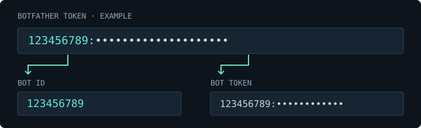

# Telegram setup

Use **Settings → Chat → Add a connection → Telegram**, or the Chat button on a
top-level Workstreams row. Existing bots appear under **Saved connections**; select
one to manage its channels, or use **Repair / edit**. For a legacy Forge bot, use
[migration](chat-plugin-migration.md) instead of registering a second receiver.

This guide describes the implemented plugin UI. See the [release gate](chat-plugin-release-gate.md)
for the distinction between automated checks, the deployed host and pending live tests.

## 1. Connect a bot

Select **Connect with Telegram**. If this host already has a manager, Telegram
opens the new-bot approval screen. Review its name and username, approve, return
to Forge, choose the permitted products and select **Save connection**. Forge
retrieves the new bot's identity and credentials. Approval creates a bot; it does
not yet choose a destination or enable a workstream.

If Forge displays **Enable Telegram connections**, register the host's manager once:

1. Use **Open BotFather** to open the verified `@BotFather`. Choose **Create a New
   Bot**, or send `/newbot`, and choose a dedicated manager name and bot username.
2. In Telegram Desktop, use **Open App** in BotFather's profile or **Open** beside
   the message box. In the Mini App's **My bots**, select that manager, open its
   settings and enable **Bot Management Mode**. `/setprivacy` controls group-message
   visibility and does not enable this switch. The manager must be reserved for
   this host, with no webhook or other poller.
3. Paste the manager's full API token into Forge's protected **Manager bot token**
   field. Select **Verify and continue**. Forge verifies the manager, stores its
   credential encrypted and opens the managed-bot approval screen.

Telegram requires the initial owner-controlled manager registration. Later bots
use its approval link and token retrieval. The current Forge browser cannot perform
the initial BotFather clicks or obtain the initial credential by itself.
[Telegram managed-bot documentation](https://core.telegram.org/bots/features#managed-bots).

For a bot you already own, expand **Advanced · use existing credentials → Set up
manually**. Enter a connection name, the numeric bot ID and full bot token, choose
product access, enable it and save. The bot ID is the numeric prefix before the
token's colon; it is different from your personal Telegram user ID. An incomplete
connection can be saved with **Enable connection** unchecked.



## 2. Select a group

1. Add the **connection bot** to the intended group. Use a forum supergroup with
   **Topics** enabled for one conversation per parent story.
2. Make that bot an administrator with **Manage Topics**. It must be able to post
   in the group. The manager bot is only for provisioning; adding it instead does
   not grant the connection bot access.
3. Select the saved connection in Forge, then **Discover or add channel**. Discovery
   lists groups already observed by this host's receiver or previously validated;
   it cannot enumerate every Telegram group. Send a message in the selected group
   after enabling the connection, then refresh discovery, or enter its numeric chat
   ID. Forum group IDs normally start with `-100`.
4. Select **Save channel** and check the access result. Validation sends no message.
   A forum destination uses the `topic` conversation policy in the row setup.
5. When ready, deliberately select **Send test message**, then reply `check` to
   that exact message within ten minutes. Check that both send and reply succeed.

Administrator bots receive group messages independently of privacy mode. A
non-admin bot with privacy mode enabled receives a more limited set, including
commands and replies addressed to it. Changing privacy mode is not a substitute
for the topic-management permission.
[Telegram message visibility](https://core.telegram.org/bots/faq#what-messages-will-my-bot-get).

## 3. Link your account and enable a parent

In **Your chat identity → Link or re-link my account**, select the connection and
confirm your own account. Forge reuses an unambiguous verified personal numeric ID.
For a first identity, the current form still needs that ID; usernames and bot IDs
are rejected. `/link` without an argument, sent to the connection bot, returns
linking instructions and the sender/bot IDs. Select **Link my Telegram account**
in Forge and press **Start** in Telegram's bot conversation. Use the visible
**Open Telegram confirmation** link if the window is blocked. Forge polls the
result; expired proofs need a new request. Telegram login codes are not Forge link codes.

On the chosen **top-level Workstreams row**, select **Chat → Enable chat remote
control → Telegram → Channel → Save and enable**. All current and future children
use that parent's destination. Completed rows remain completed. Saving queues an
introduction, so choose an intended destination before saving. Cancelling the row
draft does not activate it; connections explicitly saved earlier remain available.

Notifications work without a personal link. Interactive actions require the linked
account's current Forge product permissions. Metadata-only content directs answers
to Forge; question text/choices require `redacted` content plus the host's explicit
product-content allowance. In the parent topic, `/status`, `/questions`,
`/answer <message ID> <answer>`, `/pause` and `/resume` use the same scoped action
checks as the UI. Use `/unlink` or Forge's revoke action to remove personal links.

## 4. Rotate credentials

1. In **Repair / edit**, disable the affected connection and save. This stops chat
   routing/reception after its current operation drains; it does not pause agents.
2. Obtain a replacement token for the **same bot** through its owner in BotFather.
   For managed bots, Telegram also exposes `replaceManagedBotToken`; Forge does
   not currently offer that operation as a rotation button. Rotating the host
   manager is separate from rotating a connection bot.
3. Enter the replacement in **Bot token** and save. Forge writes a new protected
   reference and advances the connection revision. Keep the installation/bot ID.
4. Re-enable the connection, validate its saved destinations, and inspect health
   until the new revision is applied. On an approved test destination, repeat the
   send/reply check. Explicitly retry only known failed deliveries.

See [credential storage and rotation API](chat-plugin-api-examples.md#replace-a-credential)
and [troubleshooting](chat-plugin-troubleshooting.md). Credentials held in the
`environment` store require changing the host process environment and an approved
restart; normal protected-store revisions apply live. Never run a separate
`getUpdates` consumer to debug the active bot.

## Connection API example

The authenticated `PUT /api/chat/connections/telegram-ops` body below creates a
disabled draft referencing a credential already in the protected store. IDs are
examples. Use the returned revision for all subsequent writes.

```json
{
  "expectedRevision": 0,
  "providerId": "telegram",
  "installationId": "12345",
  "displayName": "Telegram operations",
  "enabled": false,
  "settingsVersion": 1,
  "settings": { "longPollSeconds": 25 },
  "secretReferences": { "bot-token": { "store": "dpapi", "key": "existing-protected-reference" } },
  "productIds": ["PRODUCT_ID"]
}
```

Use the [shared API examples](chat-plugin-api-examples.md) for authentication,
destination creation, atomic parent setup, previews and explicit checks. The
[`setup-telegram-bridge.ps1`](../../scripts/setup-telegram-bridge.ps1) helper uses
those same paired APIs; it does not edit tracked configuration files.