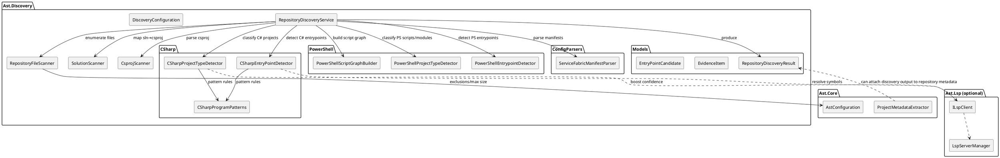

# Code Intelligence Implementation Plan

> Last Updated: 2026-01-29

This document contains the phased implementation plan for the code intelligence system.

**Related Documents:**
- [Requirements](./code_intelligence_requirements.md) - What to build
- [Architecture](./CODE_INTELLIGENCE_ARCHITECTURE.md) - How it's designed

---

## Table of Contents

1. [Implementation Phases](#implementation-phases)
2. [Project Type Detection](#1-project-type-detection-implementable-design)
3. [Deliverables](#2-deliverables-exact-files-to-create)
4. [Implementation Steps](#3-implementation-steps-23-day-increments)
5. [Validation](#4-validation-unit--integration-tests)
6. [PlantUML Component Diagram](#5-plantuml-component-diagram-phase-1)

---

## Implementation Phases

### Phase 1: Entry Point Detection & Project Analysis (Week 1-2)

**Priority: HIGH**

#### Phase Goal
Produce **repository-level "what runs?" metadata** (per C# project and per PowerShell script/module) that is reliable enough to seed later phases (API discovery, graph enrichment, indexing).

**Primary outputs (Phase 1):**
- `RepositoryDiscoveryResult` containing:
  - Detected projects (C# `*.csproj` + PowerShell modules/scripts)
  - Project type classification with confidence + evidence
  - Concrete entry points (file + symbol) with confidence + evidence
  - For PowerShell: orchestrator script candidates + dependency graph

**Key constraint:** Do not require LSP to succeed; use it only as an *optional confidence booster*.

---

## 1) Project Type Detection (Implementable Design)

### 1.1 C# Project Type Detection

**Inputs:** `*.sln`, `*.csproj`, `Directory.Build.props`, `Directory.Build.targets`, and source files.
**Outputs:** `CSharpProjectClassification` with `ProjectKind`, `Confidence`, and `Evidence[]`.

#### 1.1.1 Classification Model
Use a **scored ruleset** (evidence-based) so the system can:
- explain *why* it classified something,
- tolerate partial repos,
- reduce false positives.

```csharp
public enum CSharpProjectKind
{
    ConsoleApp,
    WebApiAspNetCore,
    WorkerService,
    WindowsService,
    ServiceFabricService,
    AzureFunctions,
    ClassLibrary,
    TestProject,
    Unknown
}

public enum EvidenceKind
{
    CsprojProperty,
    CsprojSdk,
    CsprojPackageReference,
    SolutionTopology,
    SourcePattern,
    ConfigFile,
    NamingConvention,
    LspSignal
}

public record EvidenceItem(
    EvidenceKind Kind,
    string SourcePath,
    string Summary,
    float Weight);

public record CSharpProjectClassification(
    string ProjectPath,
    CSharpProjectKind Kind,
    float Confidence,
    IReadOnlyList<EvidenceItem> Evidence);
```

**Confidence computation:**
- Sum weights for each kind, apply a softmax (or cap at 1.0), then normalize.
- Keep top-2 candidates for debugging ("why not X?").

#### 1.1.2 Rule Sources (in priority order)

##### A) `*.csproj` SDK and properties
- **Web APIs (ASP.NET Core)**:
  - `Project Sdk="Microsoft.NET.Sdk.Web"` ⇒ +0.70
  - `PackageReference` contains `Microsoft.AspNetCore.App` / `Microsoft.AspNetCore.*` ⇒ +0.40
  - `FrameworkReference Include="Microsoft.AspNetCore.App"` ⇒ +0.50

- **Azure Functions**:
  - `Project Sdk="Microsoft.NET.Sdk.Functions"` ⇒ +0.90
  - `PackageReference` contains `Microsoft.Azure.Functions.*` or `Microsoft.Azure.WebJobs.*` ⇒ +0.60
  - `AzureFunctionsVersion` property exists ⇒ +0.50

- **Test projects**:
  - `<IsTestProject>true</IsTestProject>` ⇒ +0.90
  - `PackageReference` contains `MSTest.TestFramework`, `xunit`, `NUnit`, `Microsoft.NET.Test.Sdk` ⇒ +0.70
  - project name matches `*Test*`, `*UnitTests*`, `*IntegrationTests*` ⇒ +0.20

- **Executable vs library**:
  - `<OutputType>Exe</OutputType>` ⇒ executable family +0.40
  - no `OutputType` and no obvious entry ⇒ likely ClassLibrary +0.30

##### B) Source patterns (Roslyn syntax; no compilation required)
Scan only files within the project’s directory (respect exclusions) and collect evidence.

- **Console app**:
  - `static void Main(` / `static Task Main(` ⇒ +0.80
  - top-level statements present (C# 9+) ⇒ +0.70

- **ASP.NET Core Web API (minimal hosting)**:
  - `WebApplication.CreateBuilder(` ⇒ +0.80
  - `app.MapGet|MapPost|MapControllers` ⇒ +0.60
  - `builder.Services.AddControllers(` ⇒ +0.50

- **Worker service**:
  - class derives `BackgroundService` OR implements `IHostedService` ⇒ +0.70
  - `Host.CreateDefaultBuilder(` and `AddHostedService` usage ⇒ +0.60

- **Windows service**:
  - `UseWindowsService()` call ⇒ +0.80
  - derives `ServiceBase` (System.ServiceProcess) ⇒ +0.70

- **Service Fabric service**:
  - derives `StatelessService` / `StatefulService` ⇒ +0.90
  - calls `ServiceRuntime.RegisterServiceAsync` ⇒ +0.80
  - csproj references `Microsoft.ServiceFabric.*` ⇒ +0.70

##### C) Configuration files (repo-level, but mapped back to projects)
- Service Fabric:
  - `ApplicationManifest.xml`, `ServiceManifest.xml`, `Settings.xml`
  - Evidence that an assembly name / service type points to a project output name ⇒ +0.80

##### D) Solution topology (optional)
- If an executable project references a library project, the library is not an entrypoint, but may host controllers/services.
- If multiple exes exist, treat repo as multi-app.

#### 1.1.3 Edge Cases (must handle)
- Multiple `Main` methods (test hosts, samples, benchmarks): de-rank candidates if project is `TestProject` or path contains `Samples`, `Example`, `Benchmark`.
- `Main` exists but is never used because project is class library: follow csproj `OutputType`.
- Multi-targeting + conditional references (`Condition="'$(TargetFramework)'=='net8.0'"`): parse all and take union.
- Generated code / tooling: ignore `obj\`, `bin\`, `*.g.cs`, `*.Designer.cs`.

---

### 1.2 PowerShell Project Type Detection

**Inputs:** `*.ps1`, `*.psm1`, `*.psd1`, optional CI files (GitHub Actions/Azure DevOps), README.
**Outputs:** `PowerShellProjectClassification` + entrypoint candidates.

#### 1.2.1 PowerShell Kinds
```csharp
public enum PowerShellProjectKind
{
    OrchestratorScript,
    Module,
    DscConfiguration,
    PesterTests,
    UtilityScript,
    Unknown
}

public record PowerShellProjectClassification(
    string Path,
    PowerShellProjectKind Kind,
    float Confidence,
    IReadOnlyList<EvidenceItem> Evidence,
    IReadOnlyList<string> Imports,
    IReadOnlyList<string> DotSourcedScripts);
```

#### 1.2.2 Detection Rules

##### A) Module entry points
- `*.psd1` present ⇒ Module +0.70
  - Parse `RootModule` / `ModuleToProcess` / `NestedModules` to identify the **module entry** (`*.psm1`) ⇒ +0.90
- `*.psm1` without matching psd1 ⇒ Module (manifest-less) +0.50

##### B) DSC configurations
- PS AST contains `ConfigurationDefinitionAst` (`configuration Foo {}`) ⇒ +0.95
- Contains `Import-DscResource` / `Node` blocks ⇒ +0.60

##### C) Pester test files
- File name matches `*.Tests.ps1` ⇒ +0.95
- PS AST includes `Describe` and `It` blocks and/or `Import-Module Pester` ⇒ +0.80

##### D) Orchestrator "main script"
Compute a **script dependency graph** using PowerShell AST:
- `DotSource` edges (`. .\other.ps1`)
- `Import-Module` edges
- `Invoke-Expression` / `&` invocation where target is a path literal
- `Start-Job`, `Invoke-Command` scriptblocks referencing functions ⇒ signal orchestration

Then rank scripts using:
- Out-degree (calls many scripts/modules) ⇒ +0.40
- Has `param()` and top-level imperative code (not only function defs) ⇒ +0.30
- Referenced by CI pipeline command line (`pwsh -File <script>`) ⇒ +0.70
- Referenced from README (`.\build.ps1`, `.\deploy.ps1`) ⇒ +0.50

**Output:** 1..N orchestrator candidates with confidence, not a single "winner".

#### 1.2.3 Edge Cases
- Scripts that are both orchestration and tests: prefer `PesterTests` if `Describe/It` dominates.
- Modules that export DSC resources: classify primary as Module, but add Evidence for DSC.
- Bootstrapping scripts that only install dependencies: still orchestrators, but label as `UtilityScript` if it doesn’t dot-source/call others.

---

## 2) Deliverables (Exact Files to Create)

### 2.1 New Project: `src\ast\Ast.Discovery\`

**Purpose:** Provide a deterministic, testable “repo discovery” layer that produces project classifications + entrypoints without requiring Neo4j/Qdrant.

Create the following files:

```
src\ast\Ast.Discovery\
├── Ast.Discovery.csproj                     # net8.0 library; references Ast.Core (+ optional Ast.Lsp)
├── ServiceCollectionExtensions.cs           # DI registration helpers
├── Configuration\
│   ├── DiscoveryConfiguration.cs            # feature flags + thresholds
│   └── DiscoveryConfigurationValidator.cs   # optional: validate thresholds, patterns
├── Models\
│   ├── EvidenceItem.cs                      # EvidenceKind + Weight + Source
│   ├── RepositoryDiscoveryResult.cs         # top-level result object
│   ├── CSharpProjectClassification.cs       # enum + classification output
│   ├── PowerShellProjectClassification.cs   # enum + classification output
│   └── EntryPointCandidate.cs               # file+symbol entrypoint model
├── Scanning\
│   ├── RepositoryFileScanner.cs             # enumerates files respecting AstConfiguration exclusions
│   ├── SolutionScanner.cs                   # reads *.sln to map projects (best-effort)
│   └── CsprojScanner.cs                     # finds csproj, reads XML into normalized model
├── CSharp\
│   ├── CSharpProjectTypeDetector.cs         # csproj + source evidence → classification
│   ├── CSharpEntryPointDetector.cs          # Main/top-level + hosting patterns → entrypoints
│   └── CSharpProgramPatterns.cs             # regex/syntax patterns (single responsibility)
├── PowerShell\
│   ├── PowerShellProjectTypeDetector.cs     # module/test/DSC/orchestrator classification
│   ├── PowerShellEntrypointDetector.cs      # entry scripts + module entry files
│   └── PowerShellScriptGraphBuilder.cs      # dot-source/import/invoke edges
├── ConfigParsers\
│   └── ServiceFabricManifestParser.cs       # ApplicationManifest.xml/ServiceManifest.xml/Settings.xml mapping
└── RepositoryDiscoveryService.cs            # orchestrates scanning + per-language detectors
```

### 2.2 New Test Project: `src\ast\Ast.Discovery.UnitTests\`

**Purpose:** Fast unit tests for rules and edge cases (no real repos).

Files:
```
src\ast\Ast.Discovery.UnitTests\
├── Ast.Discovery.UnitTests.csproj
├── RepositoryFileScannerTests.cs
├── CsprojScannerTests.cs
├── CSharpProjectTypeDetectorTests.cs
├── CSharpEntryPointDetectorTests.cs
├── PowerShellProjectTypeDetectorTests.cs
├── PowerShellScriptGraphBuilderTests.cs
└── ServiceFabricManifestParserTests.cs
```

### 2.3 Integration Test Extension
Reuse `src\ast\Ast.IntegrationTests\` (or create `Ast.Discovery.IntegrationTests` if preferred later) to run discovery against:
- This repo (multiple C# exes + libraries)
- A sample PowerShell module repo (already used by existing integration tests)

---

## 3) Implementation Steps (2–3 Day Increments)

### Days 1–2: Skeleton + scanners
- Create `Ast.Discovery` csproj + references (`Ast.Core`, optionally `Ast.Lsp`).
- Implement `DiscoveryConfiguration` + defaults.
- Implement `RepositoryFileScanner` with exclusions (reuse `AstConfiguration.ExcludedDirectories`).
- Implement `CsprojScanner` (XML parse, normalize: SDK, OutputType, properties, PackageReferences, ProjectReferences).
- Unit tests for scanner correctness and exclusions.

### Days 3–4: C# project type detection
- Implement `CSharpProjectTypeDetector` using csproj evidence.
- Add source-pattern evidence scanning (Main/top-level, WebApplication.CreateBuilder, Host.CreateDefaultBuilder, UseWindowsService, Service Fabric base types).
- Implement confidence ranking + top-2 explanation.
- Unit tests covering each project kind + ambiguous cases.

### Days 5–6: C# entrypoint detection
- Implement `CSharpEntryPointDetector`:
  - Find `Main` methods + signature variants.
  - Detect top-level statements as “entrypoint file”.
  - For Web projects: identify `Program.cs` hosting pipeline file and mark as entrypoint.
  - For Service Fabric: identify `RegisterServiceAsync` call sites and service types.
- Add de-ranking rules (tests/samples/benchmarks).
- Unit tests for multiple entrypoints + confidence behavior.

### Days 7–8: PowerShell classification + orchestrator graph
- Implement `PowerShellScriptGraphBuilder` using PowerShell AST:
  - Dot-sourcing edges, Import-Module edges, “& .\script.ps1” edges.
- Implement `PowerShellProjectTypeDetector`:
  - psd1/psm1 module entry.
  - Pester tests by filename + AST.
  - DSC config by `ConfigurationDefinitionAst`.
  - Orchestrator ranking by graph + heuristics.
- Unit tests for graph edges + classification.

### Days 9–10: Config-driven hosting (Service Fabric) + orchestration service
- Implement `ServiceFabricManifestParser` (XDocument-based):
  - Extract code packages, service types, and assembly names.
  - Provide mapping hints to csproj outputs.
- Implement `RepositoryDiscoveryService`:
  - Run scanners.
  - Run per-language detectors.
  - Aggregate into `RepositoryDiscoveryResult`.
- Integration tests on this repo + existing sample repos.

---

## 4) Validation (Unit + Integration Tests)

### 4.1 Unit Tests (minimum 5 per class)

#### `RepositoryFileScanner`
1. Excludes `bin\`, `obj\`, `.git\`, `node_modules\`.
2. Includes `*.cs`, `*.ps1`, `*.psm1`, `*.psd1` by default.
3. Handles case-insensitive exclusions on Windows paths.
4. Skips files larger than `AstConfiguration.MaxFileSizeBytes`.
5. Produces stable, relative paths (rooted at repo).

#### `CsprojScanner`
1. Reads `Sdk` correctly (`Microsoft.NET.Sdk`, `Microsoft.NET.Sdk.Web`, `Microsoft.NET.Sdk.Functions`).
2. Extracts `OutputType`, `TargetFramework`, `TargetFrameworks`.
3. Extracts `PackageReference` include/version.
4. Extracts `ProjectReference` and normalizes path separators.
5. Handles conditional `ItemGroup`/`PropertyGroup` by unioning values.

#### `CSharpProjectTypeDetector`
1. Classifies Web projects by SDK.Web even without Program.cs.
2. Classifies Azure Functions by SDK.Functions and/or package refs.
3. Classifies tests via `IsTestProject` and MSTest/xUnit/NUnit packages.
4. Classifies executable vs library via `OutputType` when no Main present.
5. Resolves ambiguous cases (e.g., `OutputType=Exe` but only test patterns) by confidence + evidence ordering.

#### `CSharpEntryPointDetector`
1. Detects `static void Main(string[] args)`.
2. Detects `static Task Main()` and `static async Task Main(string[] args)`.
3. Detects top-level statements and returns file-level entrypoint.
4. Detects minimal hosting `WebApplication.CreateBuilder` as Web API entrypoint even when no Main.
5. De-ranks entrypoints in `*UnitTests*`, `*IntegrationTests*`, `Samples`, `Example`, `Benchmark` paths.

#### `PowerShellScriptGraphBuilder`
1. Adds edge for dot-sourcing: `. .\common.ps1`.
2. Adds edge for `Import-Module SomeModule` and captures module name.
3. Adds edge for call-operator invocation: `& .\build.ps1`.
4. Does not create false edges for strings that only *mention* paths.
5. Works with Windows paths and quoted strings.

#### `PowerShellProjectTypeDetector`
1. Detects module project from `*.psd1` and resolves `RootModule`.
2. Detects Pester tests from `*.Tests.ps1` and/or `Describe/It` AST.
3. Detects DSC configuration via `configuration Foo {}`.
4. Detects orchestrator script by high out-degree + top-level statements.
5. Produces multiple orchestrator candidates when graph is disconnected.

#### `ServiceFabricManifestParser`
1. Parses `ApplicationManifest.xml` for service types and code packages.
2. Parses `ServiceManifest.xml` for `CodePackage` and entry assembly hints.
3. Parses `Settings.xml` for service assembly/type settings.
4. Handles namespaces and missing optional nodes without crashing.
5. Produces evidence items that can be attached to `CSharpProjectClassification`.

### 4.2 Integration Tests (real repo scenarios)

**C# (this repo):**
- Detect multiple console apps (`src\Unzip\Program.cs`, `src\EtlIterator\Program.cs`, examples/benchmarks) as **ConsoleApp**.
- Detect unit test projects as **TestProject**.
- Confirm that library projects with no entrypoint are **ClassLibrary**.

**PowerShell (this repo):**
- Classify `src\ExecutionEngine\Samples\scripts\fetch-data.ps1` as `UtilityScript` or low-confidence `OrchestratorScript` depending on imports.
- Ensure `src\ExecutionEngine.UnitTests\TestData\Scripts\process.ps1` is de-ranked (test data).

**External sample repos (already in `Ast.IntegrationTests`):**
- Run discovery on the same sample repos used for parsing tests and validate:
  - at least 1 orchestrator candidate for script-heavy repo,
  - module entrypoint detected for module repo.

**Correctness validation approach:**
- Add "golden" expected JSON snippets (project kind + entrypoint file paths) and assert stable outputs.
- Validate confidence thresholds: must exceed configured minimum for primary classification; otherwise return `Unknown`.

---

## 5) PlantUML Component Diagram (Phase 1)



### Phase 2: API Endpoint Discovery (Week 3-4)

**Priority: HIGH**

| Task | Effort | Dependencies |
|------|--------|--------------|
| Create `ApiEndpointDiscoveryService` | 2 days | Phase 1 |
| Implement attribute route discovery | 2 days | None |
| Implement minimal API discovery | 2 days | None |
| Add custom route provider analysis | 3 days | None |
| ARM-style route analysis | 2 days | Above |
| Unit tests | 2 days | Above |

**Deliverables:**
- [ ] Full API endpoint discovery
- [ ] Support for attribute routes, minimal APIs, custom providers
- [ ] ARM-style URL pattern recognition
- [ ] 40+ unit tests

### Phase 3: Graph Integration (Week 5)

**Priority: MEDIUM**

| Task | Effort | Dependencies |
|------|--------|--------------|
| Add discovery results to HypergraphNode metadata | 1 day | Phase 1, 2 |
| Create specialized hyperedge types | 1 day | Above |
| Neo4j schema updates | 1 day | Above |
| Query service enhancements | 2 days | Above |

**Deliverables:**
- [ ] Entry points and endpoints stored in graph
- [ ] New edge types: `EntryPointOf`, `ServesEndpoint`, `RoutesTo`
- [ ] Enhanced query capabilities

### Phase 4: CLI Integration (Week 6)

**Priority: MEDIUM**

| Task | Effort | Dependencies |
|------|--------|--------------|
| Add `discover` command to CLI | 2 days | Phase 1, 2 |
| Add endpoint listing command | 1 day | Phase 2 |
| JSON/table output formats | 1 day | Above |
| Documentation | 1 day | Above |

**Deliverables:**
- [ ] `ast-cli discover entrypoints <repo>` command
- [ ] `ast-cli discover endpoints <repo>` command
- [ ] Structured output for tooling integration

---

## References

- [Code Intelligence Requirements](./code_intelligence_requirements.md)
- [Code Intelligence Architecture](./CODE_INTELLIGENCE_ARCHITECTURE.md)
- [AST Implementation Plan](./AST_IMPLEMENTATION_PLAN.md)
- [LSP Migration Plan](./LSP_MIGRATION_PLAN.md)