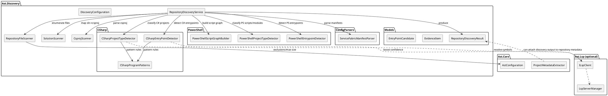

# Code Intelligence Enhancement Implementation Plan

> Last Updated: 2026-01-24

This document outlines enhancements to the AST HyperGraph Reasoning system for improved repo-level code intelligence, based on analysis of OpenCode's successful discovery patterns where LSP failed.

---

## Table of Contents

1. [Executive Summary](#executive-summary)
2. [Problem Statement](#problem-statement)
3. [OpenCode's Success Patterns](#opencodes-success-patterns)
4. [Enhancement Areas](#enhancement-areas)
   - [Entry Point Detection](#1-entry-point-detection)
   - [API Endpoint Discovery](#2-api-endpoint-discovery)
   - [Configuration-Based Discovery](#3-configuration-based-discovery)
   - [Cross-Reference Analysis](#4-cross-reference-analysis)
5. [Implementation Phases](#implementation-phases)
6. [Technical Specifications](#technical-specifications)
7. [Integration with Existing Infrastructure](#integration-with-existing-infrastructure)
8. [Success Criteria](#success-criteria)

---

## Executive Summary

### Current Gap

LSP-based code intelligence fails for certain architectural patterns:
- **Service Fabric hosting**: External host with reflection-based assembly loading
- **Dynamic routing**: Custom route providers, ARM-style URL generation
- **Plugin architectures**: MEF, runtime assembly loading
- **Configuration-driven behavior**: Settings.xml, manifest files

### Proposed Solution

Implement a **multi-strategy code intelligence system** that combines:
1. LSP (when available and accurate)
2. Pattern-based heuristics
3. Configuration file analysis
4. Hypergraph relationship traversal
5. Embedding-based semantic discovery

---

## Problem Statement

### Why LSP Fails for Service Fabric

**Traditional Entry Point (LSP works):**
```
Main() → Service.Start() → Controller
 └── Compile-time call chain → LSP can trace
```

**Service Fabric Pattern (LSP fails):**
```
External Host (ServiceFabricHost.exe)
        │
        ▼
Settings.xml → "ServiceAssembly=MyService.dll"
        │
        ▼ (Reflection at runtime)
UpdateService<T> → Initialize() → StartAsync()
        │
        ▼
IWebApiService<T>.Register() → Controllers
```

**Root Cause**: No compile-time linkage between host and service assembly. The connection exists only in configuration files and through reflection-based interfaces.

### Impact on Code Understanding

| Capability | LSP Result | Actual Behavior |
|------------|------------|-----------------|
| Find entry point | ❌ No Main() found | `UpdateService<T>.StartAsync()` |
| Trace service lifecycle | ❌ Can't follow reflection | Initialize → StartAsync → Register → StopAsync |
| Discover API routes | ❌ Static analysis misses dynamic routes | ARM-style URLs via custom provider |
| Find callers | ❌ Cross-assembly refs hidden | Service Fabric runtime invocation |

---

## OpenCode's Success Patterns

Analysis of OpenCode session log (`/mnt/e/work/hci/update/docs/opencode/service.md`) reveals four key strategies:

### 1. Pattern-Based Discovery

OpenCode searches for known hosting patterns:
```
Search patterns:
- "StatefulService" / "StatelessService"
- "IWebApiService" / "ServiceFabricHost"
- "IIntegrationTestService" / "Initialize"
- Assembly loading patterns (Activator.CreateInstance, Assembly.Load)
```

### 2. Configuration File Analysis

OpenCode parses Service Fabric manifests:
```
Files analyzed:
- ServiceManifest.xml → <ServiceTypes>, <CodePackage>
- Settings.xml → ServiceAssembly, ServiceType entries
- ApplicationManifest.xml → Service instances
- *.csproj → PackageReference for framework detection
```

### 3. Inheritance Tracing

OpenCode follows interface hierarchies:
```
IWebApiService<T>
    └── UpdateService<TDependency>
            └── Implements: Initialize(), StartAsync(), Register(), StopAsync()
                    └── Register() → OwinConfiguration → Controllers
```

### 4. Explicit Filtering

OpenCode excludes false positives:
```
Exclusions:
- Test assemblies (*Tests.dll, *Test.dll)
- Mock implementations (MockService*, FakeService*)
- Abstract base classes
- Interfaces without concrete implementations
```

---

## Enhancement Areas

### 1. Entry Point Detection

#### Current State
- LSP `textDocument/documentSymbol` finds static `Main()` methods
- Fails for framework-hosted, reflection-loaded, or configuration-driven entry points

#### Proposed Enhancement

**New Component: `EntryPointDiscoveryService`**

```csharp
namespace Ast.Discovery;

public class EntryPointDiscoveryService
{
    private readonly ILspClient _lspClient;
    private readonly IGraphStore _graphStore;
    private readonly EntryPointHeuristics _heuristics;
    private readonly ConfigurationParser _configParser;

    public async Task<EntryPointAnalysis> DiscoverEntryPointsAsync(
        string repositoryPath,
        CancellationToken ct = default)
    {
        var analysis = new EntryPointAnalysis();

        // Strategy 1: Conventional LSP discovery
        var lspResults = await TryLspDiscoveryAsync(repositoryPath, ct);
        analysis.AddResults(lspResults, DiscoveryStrategy.LSP);

        // Strategy 2: Configuration-based discovery
        var configResults = await DiscoverFromConfigurationAsync(repositoryPath, ct);
        analysis.AddResults(configResults, DiscoveryStrategy.Configuration);

        // Strategy 3: Pattern heuristics
        var patternResults = await DiscoverFromPatternsAsync(repositoryPath, ct);
        analysis.AddResults(patternResults, DiscoveryStrategy.Pattern);

        // Strategy 4: Test file inference
        var testResults = await InferFromTestsAsync(repositoryPath, ct);
        analysis.AddResults(testResults, DiscoveryStrategy.TestInference);

        // Rank and deduplicate
        return analysis.Consolidate();
    }
}

public record EntryPointCandidate
{
    public required string FilePath { get; init; }
    public required int LineNumber { get; init; }
    public required string ClassName { get; init; }
    public required string MethodName { get; init; }
    public required EntryPointType Type { get; init; }
    public required DiscoveryStrategy Strategy { get; init; }
    public required float Confidence { get; init; }
    public string? FrameworkHint { get; init; }
    public IReadOnlyList<string> LifecycleMethods { get; init; } = [];
}

public enum EntryPointType
{
    ConsoleMain,           // static void Main()
    WebApiStartup,         // Startup.Configure()
    ServiceFabricService,  // StatelessService/StatefulService
    WorkerService,         // BackgroundService/IHostedService
    AzureFunction,         // [FunctionName] attribute
    AspNetCoreMinimal,     // WebApplication.CreateBuilder()
    PluginEntry,           // IPlugin, MEF exports
    TestHost               // Test service host
}

public enum DiscoveryStrategy
{
    LSP,
    Configuration,
    Pattern,
    TestInference,
    GraphTraversal,
    Embedding
}
```

**Pattern Heuristics Implementation:**

```csharp
namespace Ast.Discovery;

public class EntryPointHeuristics
{
    // Service Fabric patterns
    private static readonly PatternRule[] ServiceFabricRules =
    [
        new("StatelessService", "CreateServiceInstanceListeners", EntryPointType.ServiceFabricService, 0.95f),
        new("StatefulService", "CreateServiceReplicaListeners", EntryPointType.ServiceFabricService, 0.95f),
        new("IWebApiService", "Register", EntryPointType.ServiceFabricService, 0.90f),
        new("ICommunicationListener", "OpenAsync", EntryPointType.ServiceFabricService, 0.85f),
    ];

    // ASP.NET Core patterns
    private static readonly PatternRule[] AspNetCoreRules =
    [
        new("IHostBuilder", "Build", EntryPointType.WebApiStartup, 0.90f),
        new("WebApplication", "CreateBuilder", EntryPointType.AspNetCoreMinimal, 0.95f),
        new("IApplicationBuilder", "UseEndpoints", EntryPointType.WebApiStartup, 0.85f),
        new("Startup", "Configure", EntryPointType.WebApiStartup, 0.80f),
    ];

    // Worker/Background service patterns
    private static readonly PatternRule[] WorkerRules =
    [
        new("BackgroundService", "ExecuteAsync", EntryPointType.WorkerService, 0.90f),
        new("IHostedService", "StartAsync", EntryPointType.WorkerService, 0.85f),
    ];

    // Azure Functions patterns
    private static readonly PatternRule[] AzureFunctionRules =
    [
        new("[FunctionName", null, EntryPointType.AzureFunction, 0.95f),
        new("IFunctionsHostBuilder", "Configure", EntryPointType.AzureFunction, 0.90f),
    ];

    public IEnumerable<EntryPointCandidate> Analyze(HypergraphNode node)
    {
        var allRules = ServiceFabricRules
            .Concat(AspNetCoreRules)
            .Concat(WorkerRules)
            .Concat(AzureFunctionRules);

        foreach (var rule in allRules)
        {
            if (MatchesRule(node, rule))
            {
                yield return CreateCandidate(node, rule);
            }
        }
    }

    private bool MatchesRule(HypergraphNode node, PatternRule rule)
    {
        // Check inheritance/implementation
        if (node.Metadata.TryGetValue("BaseTypes", out var baseTypes))
        {
            if (baseTypes.Contains(rule.BaseTypeOrAttribute))
                return true;
        }

        // Check method names
        if (rule.MethodName != null && node.Name == rule.MethodName)
        {
            var parentClass = GetParentClass(node);
            if (parentClass?.Metadata.TryGetValue("BaseTypes", out var parentBases) == true)
            {
                if (parentBases.Contains(rule.BaseTypeOrAttribute))
                    return true;
            }
        }

        // Check attributes
        if (node.Metadata.TryGetValue("Attributes", out var attrs))
        {
            if (attrs.Contains(rule.BaseTypeOrAttribute))
                return true;
        }

        return false;
    }
}

public record PatternRule(
    string BaseTypeOrAttribute,
    string? MethodName,
    EntryPointType Type,
    float Confidence);
```

---

### 2. API Endpoint Discovery

#### Current State
- CSharpHyperedgeExtractor captures `[Route]` and `[HttpGet/Post/etc]` attributes
- Limited support for custom routing, ARM-style patterns, or dynamic route registration

#### Proposed Enhancement

**New Component: `ApiEndpointDiscoveryService`**

```csharp
namespace Ast.Discovery;

public class ApiEndpointDiscoveryService
{
    public async Task<ApiEndpointAnalysis> DiscoverEndpointsAsync(
        string repositoryPath,
        CancellationToken ct = default)
    {
        var analysis = new ApiEndpointAnalysis();

        // Strategy 1: Attribute-based routes
        var attributeRoutes = await DiscoverAttributeRoutesAsync(repositoryPath, ct);
        analysis.AddRoutes(attributeRoutes, RouteDiscoveryStrategy.Attribute);

        // Strategy 2: Convention-based routes
        var conventionRoutes = await DiscoverConventionRoutesAsync(repositoryPath, ct);
        analysis.AddRoutes(conventionRoutes, RouteDiscoveryStrategy.Convention);

        // Strategy 3: Custom route providers
        var customRoutes = await DiscoverCustomRouteProvidersAsync(repositoryPath, ct);
        analysis.AddRoutes(customRoutes, RouteDiscoveryStrategy.CustomProvider);

        // Strategy 4: Minimal API endpoints
        var minimalRoutes = await DiscoverMinimalApiEndpointsAsync(repositoryPath, ct);
        analysis.AddRoutes(minimalRoutes, RouteDiscoveryStrategy.MinimalApi);

        // Strategy 5: Dynamic/ARM-style routes
        var dynamicRoutes = await DiscoverDynamicRoutesAsync(repositoryPath, ct);
        analysis.AddRoutes(dynamicRoutes, RouteDiscoveryStrategy.Dynamic);

        return analysis.Consolidate();
    }
}

public record ApiEndpoint
{
    public required string FilePath { get; init; }
    public required int LineNumber { get; init; }
    public required string ControllerName { get; init; }
    public required string ActionName { get; init; }
    public required string HttpMethod { get; init; }
    public required string RouteTemplate { get; init; }
    public string? ResolvedRoute { get; init; }
    public required RouteDiscoveryStrategy Strategy { get; init; }
    public required float Confidence { get; init; }
    public IReadOnlyList<ApiParameter> Parameters { get; init; } = [];
    public string? ReturnType { get; init; }
    public IReadOnlyList<string> Filters { get; init; } = [];
    public IReadOnlyList<string> Produces { get; init; } = [];
    public IReadOnlyList<string> Consumes { get; init; } = [];
}

public record ApiParameter(
    string Name,
    string Type,
    ParameterSource Source,  // Route, Query, Body, Header, Form
    bool IsRequired,
    string? DefaultValue);

public enum RouteDiscoveryStrategy
{
    Attribute,       // [Route], [HttpGet], etc.
    Convention,      // MapControllerRoute conventions
    CustomProvider,  // IDirectRouteProvider implementations
    MinimalApi,      // app.MapGet(), app.MapPost(), etc.
    Dynamic,         // Runtime-generated routes (ARM, OData)
    Configuration    // Routes defined in config files
}
```

**Attribute Route Discovery:**

```csharp
namespace Ast.Discovery;

public class AttributeRouteDiscoverer
{
    private readonly HypergraphData _hypergraph;

    public IEnumerable<ApiEndpoint> DiscoverRoutes()
    {
        // Find all controller classes
        var controllers = _hypergraph.Nodes
            .Where(n => n.NodeType == NodeType.Class)
            .Where(IsController);

        foreach (var controller in controllers)
        {
            var controllerRoute = ExtractControllerRoute(controller);

            // Find action methods
            var actions = GetMethodsInClass(controller)
                .Where(HasHttpMethodAttribute);

            foreach (var action in actions)
            {
                var endpoint = BuildEndpoint(controller, action, controllerRoute);
                yield return endpoint;
            }
        }
    }

    private bool IsController(HypergraphNode node)
    {
        // Check naming convention
        if (node.Name.EndsWith("Controller"))
            return true;

        // Check base class
        if (node.Metadata.TryGetValue("BaseTypes", out var bases))
        {
            if (bases.Contains("Controller") ||
                bases.Contains("ControllerBase") ||
                bases.Contains("ApiController"))
                return true;
        }

        // Check attributes
        if (node.Metadata.TryGetValue("Attributes", out var attrs))
        {
            if (attrs.Contains("[ApiController]") ||
                attrs.Contains("[Controller]"))
                return true;
        }

        return false;
    }

    private string? ExtractControllerRoute(HypergraphNode controller)
    {
        if (!controller.Metadata.TryGetValue("Attributes", out var attrs))
            return null;

        // [Route("api/[controller]")]
        var routeMatch = Regex.Match(attrs, @"\[Route(?:Prefix)?\s*\(\s*""([^""]+)""\s*\)\]");
        if (routeMatch.Success)
        {
            var template = routeMatch.Groups[1].Value;
            // Replace [controller] token
            template = template.Replace("[controller]",
                controller.Name.Replace("Controller", ""),
                StringComparison.OrdinalIgnoreCase);
            return template;
        }

        return null;
    }

    private ApiEndpoint BuildEndpoint(
        HypergraphNode controller,
        HypergraphNode action,
        string? controllerRoute)
    {
        var httpMethod = ExtractHttpMethod(action);
        var actionRoute = ExtractActionRoute(action);
        var fullRoute = CombineRoutes(controllerRoute, actionRoute);

        return new ApiEndpoint
        {
            FilePath = action.FilePath,
            LineNumber = action.LineStart,
            ControllerName = controller.Name,
            ActionName = action.Name,
            HttpMethod = httpMethod,
            RouteTemplate = fullRoute,
            ResolvedRoute = ResolveRouteTokens(fullRoute, action),
            Strategy = RouteDiscoveryStrategy.Attribute,
            Confidence = 0.95f,
            Parameters = ExtractParameters(action),
            ReturnType = action.Metadata.GetValueOrDefault("ReturnType"),
            Filters = ExtractFilters(action),
            Produces = ExtractProducesTypes(action),
            Consumes = ExtractConsumesTypes(action)
        };
    }

    private string ExtractHttpMethod(HypergraphNode action)
    {
        if (!action.Metadata.TryGetValue("Attributes", out var attrs))
            return "GET"; // Default

        if (attrs.Contains("[HttpGet")) return "GET";
        if (attrs.Contains("[HttpPost")) return "POST";
        if (attrs.Contains("[HttpPut")) return "PUT";
        if (attrs.Contains("[HttpDelete")) return "DELETE";
        if (attrs.Contains("[HttpPatch")) return "PATCH";
        if (attrs.Contains("[HttpHead")) return "HEAD";
        if (attrs.Contains("[HttpOptions")) return "OPTIONS";

        return "GET";
    }

    private IReadOnlyList<ApiParameter> ExtractParameters(HypergraphNode action)
    {
        var parameters = new List<ApiParameter>();

        if (!action.Metadata.TryGetValue("Parameters", out var paramStr))
            return parameters;

        // Parse parameter list: "string id, [FromBody] CreateRequest request, CancellationToken ct"
        var paramParts = SplitParameters(paramStr);

        foreach (var param in paramParts)
        {
            var source = DetermineParameterSource(param);
            var (type, name) = ParseTypeAndName(param);
            var isRequired = !param.Contains("?") && !param.Contains("= ");
            var defaultValue = ExtractDefaultValue(param);

            parameters.Add(new ApiParameter(name, type, source, isRequired, defaultValue));
        }

        return parameters;
    }

    private ParameterSource DetermineParameterSource(string param)
    {
        if (param.Contains("[FromBody]")) return ParameterSource.Body;
        if (param.Contains("[FromQuery]")) return ParameterSource.Query;
        if (param.Contains("[FromRoute]")) return ParameterSource.Route;
        if (param.Contains("[FromHeader]")) return ParameterSource.Header;
        if (param.Contains("[FromForm]")) return ParameterSource.Form;
        if (param.Contains("[FromServices]")) return ParameterSource.Services;

        // Infer from type for complex types
        var type = ParseTypeAndName(param).Type;
        if (IsComplexType(type))
            return ParameterSource.Body;

        return ParameterSource.Query; // Default for simple types
    }
}

public enum ParameterSource
{
    Route,
    Query,
    Body,
    Header,
    Form,
    Services
}
```

**Custom Route Provider Discovery:**

This handles patterns like `ResourceProviderDirectRouteProvider` for ARM-style URLs:

```csharp
namespace Ast.Discovery;

public class CustomRouteProviderDiscoverer
{
    private readonly HypergraphData _hypergraph;

    public IEnumerable<CustomRouteProviderInfo> DiscoverProviders()
    {
        // Find IDirectRouteProvider implementations
        var providers = _hypergraph.Nodes
            .Where(n => n.NodeType == NodeType.Class)
            .Where(ImplementsDirectRouteProvider);

        foreach (var provider in providers)
        {
            yield return AnalyzeProvider(provider);
        }
    }

    private bool ImplementsDirectRouteProvider(HypergraphNode node)
    {
        if (!node.Metadata.TryGetValue("BaseTypes", out var bases))
            return false;

        return bases.Contains("IDirectRouteProvider") ||
               bases.Contains("IDirectRouteFactory") ||
               bases.Contains("DirectRouteProviderBase");
    }

    private CustomRouteProviderInfo AnalyzeProvider(HypergraphNode provider)
    {
        var info = new CustomRouteProviderInfo
        {
            ClassName = provider.Name,
            FilePath = provider.FilePath,
            LineNumber = provider.LineStart
        };

        // Find GetDirectRoutes method
        var getRoutesMethod = FindMethod(provider, "GetDirectRoutes");
        if (getRoutesMethod != null)
        {
            info.RoutePatterns = ExtractRoutePatterns(getRoutesMethod);
        }

        // Find route attributes used
        info.CustomAttributes = FindCustomRouteAttributes(provider);

        // Determine route type
        info.RouteType = InferRouteType(provider, info.RoutePatterns);

        return info;
    }

    private RouteType InferRouteType(
        HypergraphNode provider,
        IReadOnlyList<string> patterns)
    {
        var code = provider.SourceCode ?? "";

        // ARM-style detection
        if (code.Contains("subscriptions") &&
            code.Contains("resourceGroups") &&
            code.Contains("providers"))
            return RouteType.AzureResourceManager;

        // OData detection
        if (code.Contains("ODataRoute") ||
            code.Contains("EnableQuery"))
            return RouteType.OData;

        // GraphQL detection
        if (code.Contains("GraphQL") ||
            code.Contains("Query(") ||
            code.Contains("Mutation("))
            return RouteType.GraphQL;

        return RouteType.Custom;
    }
}

public record CustomRouteProviderInfo
{
    public required string ClassName { get; init; }
    public required string FilePath { get; init; }
    public required int LineNumber { get; init; }
    public IReadOnlyList<string> RoutePatterns { get; set; } = [];
    public IReadOnlyList<string> CustomAttributes { get; set; } = [];
    public RouteType RouteType { get; set; }
}

public enum RouteType
{
    Standard,
    AzureResourceManager,  // /subscriptions/{subId}/resourceGroups/{rg}/providers/...
    OData,                 // OData conventions
    GraphQL,               // GraphQL schema-driven
    Custom                 // Other custom patterns
}
```

**ARM-Style Route Analysis:**

```csharp
namespace Ast.Discovery;

public class ArmRouteAnalyzer
{
    // Pattern for ARM resource URLs
    private static readonly Regex ArmPattern = new(
        @"/subscriptions/\{[^}]+\}/resourceGroups/\{[^}]+\}/providers/([^/]+)/([^/]+)",
        RegexOptions.IgnoreCase | RegexOptions.Compiled);

    public ArmRouteInfo? AnalyzeRoute(string routeTemplate)
    {
        var match = ArmPattern.Match(routeTemplate);
        if (!match.Success)
            return null;

        return new ArmRouteInfo
        {
            ProviderNamespace = match.Groups[1].Value,
            ResourceType = match.Groups[2].Value,
            FullTemplate = routeTemplate,
            SegmentCount = routeTemplate.Count(c => c == '/'),
            HasNestedResource = routeTemplate.Count(s => s == '/') > 8,
            OperationType = InferOperationType(routeTemplate)
        };
    }

    private ArmOperationType InferOperationType(string template)
    {
        if (template.EndsWith("/listKeys", StringComparison.OrdinalIgnoreCase))
            return ArmOperationType.Action;
        if (template.Contains("{") && template.Split('/').Length % 2 == 0)
            return ArmOperationType.Resource;
        return ArmOperationType.Collection;
    }
}

public record ArmRouteInfo
{
    public required string ProviderNamespace { get; init; }
    public required string ResourceType { get; init; }
    public required string FullTemplate { get; init; }
    public int SegmentCount { get; init; }
    public bool HasNestedResource { get; init; }
    public ArmOperationType OperationType { get; init; }
}

public enum ArmOperationType
{
    Collection,  // GET /resources
    Resource,    // GET /resources/{id}
    Action       // POST /resources/{id}/action
}
```

**Minimal API Discovery:**

```csharp
namespace Ast.Discovery;

public class MinimalApiDiscoverer
{
    private readonly HypergraphData _hypergraph;

    public IEnumerable<ApiEndpoint> DiscoverEndpoints()
    {
        // Find app.Map* calls
        var mapCalls = _hypergraph.Edges
            .Where(e => e.Type == HyperedgeType.MethodInvocation)
            .Where(e => IsMapMethod(e));

        foreach (var call in mapCalls)
        {
            var endpoint = ParseMapCall(call);
            if (endpoint != null)
                yield return endpoint;
        }
    }

    private bool IsMapMethod(Hyperedge edge)
    {
        var callee = edge.GetNodeByRole("callee");
        if (callee == null) return false;

        var name = callee.Name;
        return name.StartsWith("Map") && (
            name == "MapGet" ||
            name == "MapPost" ||
            name == "MapPut" ||
            name == "MapDelete" ||
            name == "MapPatch" ||
            name == "MapMethods" ||
            name == "Map"
        );
    }

    private ApiEndpoint? ParseMapCall(Hyperedge edge)
    {
        var callee = edge.GetNodeByRole("callee");
        if (callee == null) return null;

        var httpMethod = callee.Name switch
        {
            "MapGet" => "GET",
            "MapPost" => "POST",
            "MapPut" => "PUT",
            "MapDelete" => "DELETE",
            "MapPatch" => "PATCH",
            _ => "ANY"
        };

        // Extract route from first argument
        var routeArg = edge.GetNodeByRole("arg_0");
        var route = routeArg?.SourceCode?.Trim('"') ?? "";

        // Extract handler from second argument
        var handlerArg = edge.GetNodeByRole("arg_1");
        var handlerInfo = AnalyzeHandler(handlerArg);

        return new ApiEndpoint
        {
            FilePath = edge.FilePath,
            LineNumber = edge.LineStart ?? 0,
            ControllerName = "MinimalApi",
            ActionName = handlerInfo?.Name ?? "Anonymous",
            HttpMethod = httpMethod,
            RouteTemplate = route,
            Strategy = RouteDiscoveryStrategy.MinimalApi,
            Confidence = 0.90f,
            Parameters = handlerInfo?.Parameters ?? [],
            ReturnType = handlerInfo?.ReturnType
        };
    }
}
```

---

### 3. Configuration-Based Discovery

#### Service Fabric Configuration Parser

```csharp
namespace Ast.Discovery;

public class ServiceFabricConfigParser
{
    public ServiceFabricManifestInfo? ParseServiceManifest(string manifestPath)
    {
        if (!File.Exists(manifestPath))
            return null;

        var doc = XDocument.Load(manifestPath);
        var ns = doc.Root?.GetDefaultNamespace() ?? XNamespace.None;

        return new ServiceFabricManifestInfo
        {
            ManifestPath = manifestPath,
            ServiceTypes = doc.Descendants(ns + "StatelessServiceType")
                .Concat(doc.Descendants(ns + "StatefulServiceType"))
                .Select(e => new ServiceTypeInfo
                {
                    Name = e.Attribute("ServiceTypeName")?.Value ?? "",
                    IsStateful = e.Name.LocalName == "StatefulServiceType"
                })
                .ToList(),
            CodePackages = doc.Descendants(ns + "CodePackage")
                .Select(e => new CodePackageInfo
                {
                    Name = e.Attribute("Name")?.Value ?? "",
                    Version = e.Attribute("Version")?.Value ?? "",
                    EntryPoint = e.Descendants(ns + "ExeHost")
                        .Select(h => h.Element(ns + "Program")?.Value)
                        .FirstOrDefault()
                })
                .ToList()
        };
    }

    public SettingsInfo? ParseSettings(string settingsPath)
    {
        if (!File.Exists(settingsPath))
            return null;

        var doc = XDocument.Load(settingsPath);
        var ns = doc.Root?.GetDefaultNamespace() ?? XNamespace.None;

        var sections = doc.Descendants(ns + "Section")
            .ToDictionary(
                s => s.Attribute("Name")?.Value ?? "",
                s => s.Descendants(ns + "Parameter")
                    .ToDictionary(
                        p => p.Attribute("Name")?.Value ?? "",
                        p => p.Attribute("Value")?.Value ?? ""));

        return new SettingsInfo
        {
            SettingsPath = settingsPath,
            Sections = sections
        };
    }

    public IEnumerable<EntryPointCandidate> InferEntryPoints(
        ServiceFabricManifestInfo manifest,
        SettingsInfo? settings)
    {
        foreach (var serviceType in manifest.ServiceTypes)
        {
            // Look for ServiceAssembly setting
            var assemblyName = settings?.Sections
                .GetValueOrDefault("Service")?
                .GetValueOrDefault("ServiceAssembly");

            yield return new EntryPointCandidate
            {
                FilePath = manifest.ManifestPath,
                LineNumber = 0,
                ClassName = serviceType.Name,
                MethodName = "CreateServiceInstanceListeners",
                Type = EntryPointType.ServiceFabricService,
                Strategy = DiscoveryStrategy.Configuration,
                Confidence = 0.85f,
                FrameworkHint = "ServiceFabric",
                LifecycleMethods =
                [
                    "CreateServiceInstanceListeners",
                    "RunAsync",
                    "OnOpenAsync",
                    "OnCloseAsync"
                ]
            };
        }
    }
}

public record ServiceFabricManifestInfo
{
    public required string ManifestPath { get; init; }
    public IReadOnlyList<ServiceTypeInfo> ServiceTypes { get; init; } = [];
    public IReadOnlyList<CodePackageInfo> CodePackages { get; init; } = [];
}

public record ServiceTypeInfo
{
    public required string Name { get; init; }
    public bool IsStateful { get; init; }
}

public record CodePackageInfo
{
    public required string Name { get; init; }
    public required string Version { get; init; }
    public string? EntryPoint { get; init; }
}

public record SettingsInfo
{
    public required string SettingsPath { get; init; }
    public IReadOnlyDictionary<string, IReadOnlyDictionary<string, string>> Sections { get; init; }
        = new Dictionary<string, IReadOnlyDictionary<string, string>>();
}
```

#### Kubernetes/Docker Configuration Parser

```csharp
namespace Ast.Discovery;

public class ContainerConfigParser
{
    public ContainerEntryPointInfo? ParseDockerfile(string dockerfilePath)
    {
        if (!File.Exists(dockerfilePath))
            return null;

        var lines = File.ReadAllLines(dockerfilePath);
        var entrypoint = lines
            .FirstOrDefault(l => l.TrimStart().StartsWith("ENTRYPOINT", StringComparison.OrdinalIgnoreCase));
        var cmd = lines
            .FirstOrDefault(l => l.TrimStart().StartsWith("CMD", StringComparison.OrdinalIgnoreCase));

        return new ContainerEntryPointInfo
        {
            FilePath = dockerfilePath,
            EntryPoint = ParseDockerInstruction(entrypoint),
            Command = ParseDockerInstruction(cmd)
        };
    }

    public KubernetesDeploymentInfo? ParseDeployment(string yamlPath)
    {
        if (!File.Exists(yamlPath))
            return null;

        // Parse YAML (using YamlDotNet or similar)
        var yaml = File.ReadAllText(yamlPath);
        // ... parse containers, commands, args, ports

        return new KubernetesDeploymentInfo
        {
            FilePath = yamlPath,
            // ... parsed info
        };
    }
}
```

---

### 4. Cross-Reference Analysis

#### Graph-Based Discovery

```csharp
namespace Ast.Discovery;

public class GraphBasedDiscoverer
{
    private readonly IGraphStore _graphStore;

    public async Task<IReadOnlyList<EntryPointCandidate>> DiscoverFromGraphAsync(
        string repositoryPath,
        CancellationToken ct = default)
    {
        var candidates = new List<EntryPointCandidate>();

        // Find nodes with no incoming calls (potential entry points)
        var rootNodes = await FindRootNodesAsync(ct);

        foreach (var node in rootNodes)
        {
            // Filter out obvious non-entry points
            if (IsLikelyEntryPoint(node))
            {
                candidates.Add(CreateCandidate(node));
            }
        }

        return candidates;
    }

    private async Task<IReadOnlyList<HypergraphNode>> FindRootNodesAsync(
        CancellationToken ct)
    {
        // Cypher query: Find classes with no incoming method calls
        var query = @"
            MATCH (n:CodeNode {type: 'Class'})
            WHERE NOT EXISTS {
                MATCH (caller:CodeNode)-[:PARTICIPATES_IN]->(:Hyperedge {type: 'MethodInvocation'})
                      -[:PARTICIPATES_IN]->(n)
            }
            AND n.name ENDS WITH 'Service' OR n.name ENDS WITH 'Host' OR n.name ENDS WITH 'Startup'
            RETURN n
        ";

        return await _graphStore.ExecuteQueryAsync<HypergraphNode>(query, ct);
    }

    private bool IsLikelyEntryPoint(HypergraphNode node)
    {
        // Has lifecycle methods
        var methods = GetMethodsInClass(node);
        var hasLifecycle = methods.Any(m =>
            m.Name is "Main" or "StartAsync" or "RunAsync" or
                      "Configure" or "Initialize" or "CreateHostBuilder");

        // Not a test class
        var isTest = node.Name.Contains("Test") ||
                     node.FilePath.Contains("Test");

        // Not abstract
        var isAbstract = node.Metadata.GetValueOrDefault("Modifiers")?.Contains("abstract") ?? false;

        return hasLifecycle && !isTest && !isAbstract;
    }
}
```

#### Embedding-Based Discovery

```csharp
namespace Ast.Discovery;

public class EmbeddingBasedDiscoverer
{
    private readonly IVectorStore _vectorStore;
    private readonly IEmbeddingGenerator _embedder;

    public async Task<IReadOnlyList<EntryPointCandidate>> DiscoverSimilarToKnownPatternsAsync(
        CancellationToken ct = default)
    {
        // Known entry point patterns to search for
        var patterns = new[]
        {
            "public static void Main(string[] args) { CreateHostBuilder(args).Build().Run(); }",
            "public class Startup { public void Configure(IApplicationBuilder app) { } }",
            "protected override async Task RunAsync(CancellationToken cancellationToken)",
            "public override IEnumerable<ServiceInstanceListener> CreateServiceInstanceListeners()"
        };

        var candidates = new List<EntryPointCandidate>();

        foreach (var pattern in patterns)
        {
            var embedding = await _embedder.GenerateEmbeddingAsync(pattern, ct);
            var similar = await _vectorStore.SearchSimilarNodesAsync(
                embedding,
                topK: 5,
                filter: new NodeFilter { Type = NodeType.Method },
                ct: ct);

            foreach (var result in similar.Where(r => r.Score > 0.85f))
            {
                candidates.Add(new EntryPointCandidate
                {
                    FilePath = result.Node.FilePath,
                    LineNumber = result.Node.LineStart,
                    ClassName = result.Node.Scope ?? "Unknown",
                    MethodName = result.Node.Name,
                    Type = InferEntryPointType(pattern),
                    Strategy = DiscoveryStrategy.Embedding,
                    Confidence = result.Score
                });
            }
        }

        return candidates.DistinctBy(c => $"{c.FilePath}:{c.LineNumber}").ToList();
    }
}
```

---

## Implementation Phases

### Phase 1: Entry Point Detection & Project Analysis (Week 1-2)

**Priority: HIGH**

#### Phase Goal
Produce **repository-level "what runs?" metadata** (per C# project and per PowerShell script/module) that is reliable enough to seed later phases (API discovery, graph enrichment, indexing).

**Primary outputs (Phase 1):**
- `RepositoryDiscoveryResult` containing:
  - Detected projects (C# `*.csproj` + PowerShell modules/scripts)
  - Project type classification with confidence + evidence
  - Concrete entry points (file + symbol) with confidence + evidence
  - For PowerShell: orchestrator script candidates + dependency graph

**Key constraint:** Do not require LSP to succeed; use it only as an *optional confidence booster*.

---

## 1) Project Type Detection (Implementable Design)

### 1.1 C# Project Type Detection

**Inputs:** `*.sln`, `*.csproj`, `Directory.Build.props`, `Directory.Build.targets`, and source files.
**Outputs:** `CSharpProjectClassification` with `ProjectKind`, `Confidence`, and `Evidence[]`.

#### 1.1.1 Classification Model
Use a **scored ruleset** (evidence-based) so the system can:
- explain *why* it classified something,
- tolerate partial repos,
- reduce false positives.

```csharp
public enum CSharpProjectKind
{
    ConsoleApp,
    WebApiAspNetCore,
    WorkerService,
    WindowsService,
    ServiceFabricService,
    AzureFunctions,
    ClassLibrary,
    TestProject,
    Unknown
}

public enum EvidenceKind
{
    CsprojProperty,
    CsprojSdk,
    CsprojPackageReference,
    SolutionTopology,
    SourcePattern,
    ConfigFile,
    NamingConvention,
    LspSignal
}

public record EvidenceItem(
    EvidenceKind Kind,
    string SourcePath,
    string Summary,
    float Weight);

public record CSharpProjectClassification(
    string ProjectPath,
    CSharpProjectKind Kind,
    float Confidence,
    IReadOnlyList<EvidenceItem> Evidence);
```

**Confidence computation:**
- Sum weights for each kind, apply a softmax (or cap at 1.0), then normalize.
- Keep top-2 candidates for debugging ("why not X?").

#### 1.1.2 Rule Sources (in priority order)

##### A) `*.csproj` SDK and properties
- **Web APIs (ASP.NET Core)**:
  - `Project Sdk="Microsoft.NET.Sdk.Web"` ⇒ +0.70
  - `PackageReference` contains `Microsoft.AspNetCore.App` / `Microsoft.AspNetCore.*` ⇒ +0.40
  - `FrameworkReference Include="Microsoft.AspNetCore.App"` ⇒ +0.50

- **Azure Functions**:
  - `Project Sdk="Microsoft.NET.Sdk.Functions"` ⇒ +0.90
  - `PackageReference` contains `Microsoft.Azure.Functions.*` or `Microsoft.Azure.WebJobs.*` ⇒ +0.60
  - `AzureFunctionsVersion` property exists ⇒ +0.50

- **Test projects**:
  - `<IsTestProject>true</IsTestProject>` ⇒ +0.90
  - `PackageReference` contains `MSTest.TestFramework`, `xunit`, `NUnit`, `Microsoft.NET.Test.Sdk` ⇒ +0.70
  - project name matches `*Test*`, `*UnitTests*`, `*IntegrationTests*` ⇒ +0.20

- **Executable vs library**:
  - `<OutputType>Exe</OutputType>` ⇒ executable family +0.40
  - no `OutputType` and no obvious entry ⇒ likely ClassLibrary +0.30

##### B) Source patterns (Roslyn syntax; no compilation required)
Scan only files within the project’s directory (respect exclusions) and collect evidence.

- **Console app**:
  - `static void Main(` / `static Task Main(` ⇒ +0.80
  - top-level statements present (C# 9+) ⇒ +0.70

- **ASP.NET Core Web API (minimal hosting)**:
  - `WebApplication.CreateBuilder(` ⇒ +0.80
  - `app.MapGet|MapPost|MapControllers` ⇒ +0.60
  - `builder.Services.AddControllers(` ⇒ +0.50

- **Worker service**:
  - class derives `BackgroundService` OR implements `IHostedService` ⇒ +0.70
  - `Host.CreateDefaultBuilder(` and `AddHostedService` usage ⇒ +0.60

- **Windows service**:
  - `UseWindowsService()` call ⇒ +0.80
  - derives `ServiceBase` (System.ServiceProcess) ⇒ +0.70

- **Service Fabric service**:
  - derives `StatelessService` / `StatefulService` ⇒ +0.90
  - calls `ServiceRuntime.RegisterServiceAsync` ⇒ +0.80
  - csproj references `Microsoft.ServiceFabric.*` ⇒ +0.70

##### C) Configuration files (repo-level, but mapped back to projects)
- Service Fabric:
  - `ApplicationManifest.xml`, `ServiceManifest.xml`, `Settings.xml`
  - Evidence that an assembly name / service type points to a project output name ⇒ +0.80

##### D) Solution topology (optional)
- If an executable project references a library project, the library is not an entrypoint, but may host controllers/services.
- If multiple exes exist, treat repo as multi-app.

#### 1.1.3 Edge Cases (must handle)
- Multiple `Main` methods (test hosts, samples, benchmarks): de-rank candidates if project is `TestProject` or path contains `Samples`, `Example`, `Benchmark`.
- `Main` exists but is never used because project is class library: follow csproj `OutputType`.
- Multi-targeting + conditional references (`Condition="'$(TargetFramework)'=='net8.0'"`): parse all and take union.
- Generated code / tooling: ignore `obj\`, `bin\`, `*.g.cs`, `*.Designer.cs`.

---

### 1.2 PowerShell Project Type Detection

**Inputs:** `*.ps1`, `*.psm1`, `*.psd1`, optional CI files (GitHub Actions/Azure DevOps), README.
**Outputs:** `PowerShellProjectClassification` + entrypoint candidates.

#### 1.2.1 PowerShell Kinds
```csharp
public enum PowerShellProjectKind
{
    OrchestratorScript,
    Module,
    DscConfiguration,
    PesterTests,
    UtilityScript,
    Unknown
}

public record PowerShellProjectClassification(
    string Path,
    PowerShellProjectKind Kind,
    float Confidence,
    IReadOnlyList<EvidenceItem> Evidence,
    IReadOnlyList<string> Imports,
    IReadOnlyList<string> DotSourcedScripts);
```

#### 1.2.2 Detection Rules

##### A) Module entry points
- `*.psd1` present ⇒ Module +0.70
  - Parse `RootModule` / `ModuleToProcess` / `NestedModules` to identify the **module entry** (`*.psm1`) ⇒ +0.90
- `*.psm1` without matching psd1 ⇒ Module (manifest-less) +0.50

##### B) DSC configurations
- PS AST contains `ConfigurationDefinitionAst` (`configuration Foo {}`) ⇒ +0.95
- Contains `Import-DscResource` / `Node` blocks ⇒ +0.60

##### C) Pester test files
- File name matches `*.Tests.ps1` ⇒ +0.95
- PS AST includes `Describe` and `It` blocks and/or `Import-Module Pester` ⇒ +0.80

##### D) Orchestrator "main script"
Compute a **script dependency graph** using PowerShell AST:
- `DotSource` edges (`. .\other.ps1`)
- `Import-Module` edges
- `Invoke-Expression` / `&` invocation where target is a path literal
- `Start-Job`, `Invoke-Command` scriptblocks referencing functions ⇒ signal orchestration

Then rank scripts using:
- Out-degree (calls many scripts/modules) ⇒ +0.40
- Has `param()` and top-level imperative code (not only function defs) ⇒ +0.30
- Referenced by CI pipeline command line (`pwsh -File <script>`) ⇒ +0.70
- Referenced from README (`.\build.ps1`, `.\deploy.ps1`) ⇒ +0.50

**Output:** 1..N orchestrator candidates with confidence, not a single "winner".

#### 1.2.3 Edge Cases
- Scripts that are both orchestration and tests: prefer `PesterTests` if `Describe/It` dominates.
- Modules that export DSC resources: classify primary as Module, but add Evidence for DSC.
- Bootstrapping scripts that only install dependencies: still orchestrators, but label as `UtilityScript` if it doesn’t dot-source/call others.

---

## 2) Deliverables (Exact Files to Create)

### 2.1 New Project: `src\ast\Ast.Discovery\`

**Purpose:** Provide a deterministic, testable “repo discovery” layer that produces project classifications + entrypoints without requiring Neo4j/Qdrant.

Create the following files:

```
src\ast\Ast.Discovery\
├── Ast.Discovery.csproj                     # net8.0 library; references Ast.Core (+ optional Ast.Lsp)
├── ServiceCollectionExtensions.cs           # DI registration helpers
├── Configuration\
│   ├── DiscoveryConfiguration.cs            # feature flags + thresholds
│   └── DiscoveryConfigurationValidator.cs   # optional: validate thresholds, patterns
├── Models\
│   ├── EvidenceItem.cs                      # EvidenceKind + Weight + Source
│   ├── RepositoryDiscoveryResult.cs         # top-level result object
│   ├── CSharpProjectClassification.cs       # enum + classification output
│   ├── PowerShellProjectClassification.cs   # enum + classification output
│   └── EntryPointCandidate.cs               # file+symbol entrypoint model
├── Scanning\
│   ├── RepositoryFileScanner.cs             # enumerates files respecting AstConfiguration exclusions
│   ├── SolutionScanner.cs                   # reads *.sln to map projects (best-effort)
│   └── CsprojScanner.cs                     # finds csproj, reads XML into normalized model
├── CSharp\
│   ├── CSharpProjectTypeDetector.cs         # csproj + source evidence → classification
│   ├── CSharpEntryPointDetector.cs          # Main/top-level + hosting patterns → entrypoints
│   └── CSharpProgramPatterns.cs             # regex/syntax patterns (single responsibility)
├── PowerShell\
│   ├── PowerShellProjectTypeDetector.cs     # module/test/DSC/orchestrator classification
│   ├── PowerShellEntrypointDetector.cs      # entry scripts + module entry files
│   └── PowerShellScriptGraphBuilder.cs      # dot-source/import/invoke edges
├── ConfigParsers\
│   └── ServiceFabricManifestParser.cs       # ApplicationManifest.xml/ServiceManifest.xml/Settings.xml mapping
└── RepositoryDiscoveryService.cs            # orchestrates scanning + per-language detectors
```

### 2.2 New Test Project: `src\ast\Ast.Discovery.UnitTests\`

**Purpose:** Fast unit tests for rules and edge cases (no real repos).

Files:
```
src\ast\Ast.Discovery.UnitTests\
├── Ast.Discovery.UnitTests.csproj
├── RepositoryFileScannerTests.cs
├── CsprojScannerTests.cs
├── CSharpProjectTypeDetectorTests.cs
├── CSharpEntryPointDetectorTests.cs
├── PowerShellProjectTypeDetectorTests.cs
├── PowerShellScriptGraphBuilderTests.cs
└── ServiceFabricManifestParserTests.cs
```

### 2.3 Integration Test Extension
Reuse `src\ast\Ast.IntegrationTests\` (or create `Ast.Discovery.IntegrationTests` if preferred later) to run discovery against:
- This repo (multiple C# exes + libraries)
- A sample PowerShell module repo (already used by existing integration tests)

---

## 3) Implementation Steps (2–3 Day Increments)

### Days 1–2: Skeleton + scanners
- Create `Ast.Discovery` csproj + references (`Ast.Core`, optionally `Ast.Lsp`).
- Implement `DiscoveryConfiguration` + defaults.
- Implement `RepositoryFileScanner` with exclusions (reuse `AstConfiguration.ExcludedDirectories`).
- Implement `CsprojScanner` (XML parse, normalize: SDK, OutputType, properties, PackageReferences, ProjectReferences).
- Unit tests for scanner correctness and exclusions.

### Days 3–4: C# project type detection
- Implement `CSharpProjectTypeDetector` using csproj evidence.
- Add source-pattern evidence scanning (Main/top-level, WebApplication.CreateBuilder, Host.CreateDefaultBuilder, UseWindowsService, Service Fabric base types).
- Implement confidence ranking + top-2 explanation.
- Unit tests covering each project kind + ambiguous cases.

### Days 5–6: C# entrypoint detection
- Implement `CSharpEntryPointDetector`:
  - Find `Main` methods + signature variants.
  - Detect top-level statements as “entrypoint file”.
  - For Web projects: identify `Program.cs` hosting pipeline file and mark as entrypoint.
  - For Service Fabric: identify `RegisterServiceAsync` call sites and service types.
- Add de-ranking rules (tests/samples/benchmarks).
- Unit tests for multiple entrypoints + confidence behavior.

### Days 7–8: PowerShell classification + orchestrator graph
- Implement `PowerShellScriptGraphBuilder` using PowerShell AST:
  - Dot-sourcing edges, Import-Module edges, “& .\script.ps1” edges.
- Implement `PowerShellProjectTypeDetector`:
  - psd1/psm1 module entry.
  - Pester tests by filename + AST.
  - DSC config by `ConfigurationDefinitionAst`.
  - Orchestrator ranking by graph + heuristics.
- Unit tests for graph edges + classification.

### Days 9–10: Config-driven hosting (Service Fabric) + orchestration service
- Implement `ServiceFabricManifestParser` (XDocument-based):
  - Extract code packages, service types, and assembly names.
  - Provide mapping hints to csproj outputs.
- Implement `RepositoryDiscoveryService`:
  - Run scanners.
  - Run per-language detectors.
  - Aggregate into `RepositoryDiscoveryResult`.
- Integration tests on this repo + existing sample repos.

---

## 4) Validation (Unit + Integration Tests)

### 4.1 Unit Tests (minimum 5 per class)

#### `RepositoryFileScanner`
1. Excludes `bin\`, `obj\`, `.git\`, `node_modules\`.
2. Includes `*.cs`, `*.ps1`, `*.psm1`, `*.psd1` by default.
3. Handles case-insensitive exclusions on Windows paths.
4. Skips files larger than `AstConfiguration.MaxFileSizeBytes`.
5. Produces stable, relative paths (rooted at repo).

#### `CsprojScanner`
1. Reads `Sdk` correctly (`Microsoft.NET.Sdk`, `Microsoft.NET.Sdk.Web`, `Microsoft.NET.Sdk.Functions`).
2. Extracts `OutputType`, `TargetFramework`, `TargetFrameworks`.
3. Extracts `PackageReference` include/version.
4. Extracts `ProjectReference` and normalizes path separators.
5. Handles conditional `ItemGroup`/`PropertyGroup` by unioning values.

#### `CSharpProjectTypeDetector`
1. Classifies Web projects by SDK.Web even without Program.cs.
2. Classifies Azure Functions by SDK.Functions and/or package refs.
3. Classifies tests via `IsTestProject` and MSTest/xUnit/NUnit packages.
4. Classifies executable vs library via `OutputType` when no Main present.
5. Resolves ambiguous cases (e.g., `OutputType=Exe` but only test patterns) by confidence + evidence ordering.

#### `CSharpEntryPointDetector`
1. Detects `static void Main(string[] args)`.
2. Detects `static Task Main()` and `static async Task Main(string[] args)`.
3. Detects top-level statements and returns file-level entrypoint.
4. Detects minimal hosting `WebApplication.CreateBuilder` as Web API entrypoint even when no Main.
5. De-ranks entrypoints in `*UnitTests*`, `*IntegrationTests*`, `Samples`, `Example`, `Benchmark` paths.

#### `PowerShellScriptGraphBuilder`
1. Adds edge for dot-sourcing: `. .\common.ps1`.
2. Adds edge for `Import-Module SomeModule` and captures module name.
3. Adds edge for call-operator invocation: `& .\build.ps1`.
4. Does not create false edges for strings that only *mention* paths.
5. Works with Windows paths and quoted strings.

#### `PowerShellProjectTypeDetector`
1. Detects module project from `*.psd1` and resolves `RootModule`.
2. Detects Pester tests from `*.Tests.ps1` and/or `Describe/It` AST.
3. Detects DSC configuration via `configuration Foo {}`.
4. Detects orchestrator script by high out-degree + top-level statements.
5. Produces multiple orchestrator candidates when graph is disconnected.

#### `ServiceFabricManifestParser`
1. Parses `ApplicationManifest.xml` for service types and code packages.
2. Parses `ServiceManifest.xml` for `CodePackage` and entry assembly hints.
3. Parses `Settings.xml` for service assembly/type settings.
4. Handles namespaces and missing optional nodes without crashing.
5. Produces evidence items that can be attached to `CSharpProjectClassification`.

### 4.2 Integration Tests (real repo scenarios)

**C# (this repo):**
- Detect multiple console apps (`src\Unzip\Program.cs`, `src\EtlIterator\Program.cs`, examples/benchmarks) as **ConsoleApp**.
- Detect unit test projects as **TestProject**.
- Confirm that library projects with no entrypoint are **ClassLibrary**.

**PowerShell (this repo):**
- Classify `src\ExecutionEngine\Samples\scripts\fetch-data.ps1` as `UtilityScript` or low-confidence `OrchestratorScript` depending on imports.
- Ensure `src\ExecutionEngine.UnitTests\TestData\Scripts\process.ps1` is de-ranked (test data).

**External sample repos (already in `Ast.IntegrationTests`):**
- Run discovery on the same sample repos used for parsing tests and validate:
  - at least 1 orchestrator candidate for script-heavy repo,
  - module entrypoint detected for module repo.

**Correctness validation approach:**
- Add "golden" expected JSON snippets (project kind + entrypoint file paths) and assert stable outputs.
- Validate confidence thresholds: must exceed configured minimum for primary classification; otherwise return `Unknown`.

---

## 5) PlantUML Component Diagram (Phase 1)



### Phase 2: API Endpoint Discovery (Week 3-4)

**Priority: HIGH**

| Task | Effort | Dependencies |
|------|--------|--------------|
| Create `ApiEndpointDiscoveryService` | 2 days | Phase 1 |
| Implement attribute route discovery | 2 days | None |
| Implement minimal API discovery | 2 days | None |
| Add custom route provider analysis | 3 days | None |
| ARM-style route analysis | 2 days | Above |
| Unit tests | 2 days | Above |

**Deliverables:**
- [ ] Full API endpoint discovery
- [ ] Support for attribute routes, minimal APIs, custom providers
- [ ] ARM-style URL pattern recognition
- [ ] 40+ unit tests

### Phase 3: Graph Integration (Week 5)

**Priority: MEDIUM**

| Task | Effort | Dependencies |
|------|--------|--------------|
| Add discovery results to HypergraphNode metadata | 1 day | Phase 1, 2 |
| Create specialized hyperedge types | 1 day | Above |
| Neo4j schema updates | 1 day | Above |
| Query service enhancements | 2 days | Above |

**Deliverables:**
- [ ] Entry points and endpoints stored in graph
- [ ] New edge types: `EntryPointOf`, `ServesEndpoint`, `RoutesTo`
- [ ] Enhanced query capabilities

### Phase 4: CLI Integration (Week 6)

**Priority: MEDIUM**

| Task | Effort | Dependencies |
|------|--------|--------------|
| Add `discover` command to CLI | 2 days | Phase 1, 2 |
| Add endpoint listing command | 1 day | Phase 2 |
| JSON/table output formats | 1 day | Above |
| Documentation | 1 day | Above |

**Deliverables:**
- [ ] `ast-cli discover entrypoints <repo>` command
- [ ] `ast-cli discover endpoints <repo>` command
- [ ] Structured output for tooling integration

---

## Technical Specifications

### New Project: Ast.Discovery

```
src/ast/Ast.Discovery/
├── Ast.Discovery.csproj
├── EntryPointDiscoveryService.cs
├── ApiEndpointDiscoveryService.cs
├── Heuristics/
│   ├── EntryPointHeuristics.cs
│   ├── PatternRules.cs
│   └── FrameworkDetector.cs
├── Parsers/
│   ├── ServiceFabricConfigParser.cs
│   ├── KubernetesConfigParser.cs
│   └── DockerfileParser.cs
├── Routes/
│   ├── AttributeRouteDiscoverer.cs
│   ├── MinimalApiDiscoverer.cs
│   ├── CustomRouteProviderDiscoverer.cs
│   └── ArmRouteAnalyzer.cs
├── Graph/
│   ├── GraphBasedDiscoverer.cs
│   └── EmbeddingBasedDiscoverer.cs
├── Models/
│   ├── EntryPointCandidate.cs
│   ├── ApiEndpoint.cs
│   └── DiscoveryAnalysis.cs
└── ServiceCollectionExtensions.cs
```

### Dependencies

```xml
<Project Sdk="Microsoft.NET.Sdk">
  <PropertyGroup>
    <TargetFramework>net8.0</TargetFramework>
  </PropertyGroup>

  <ItemGroup>
    <ProjectReference Include="..\Ast.Core\Ast.Core.csproj" />
    <ProjectReference Include="..\Ast.GraphDb\Ast.GraphDb.csproj" />
    <ProjectReference Include="..\Ast.VectorDb\Ast.VectorDb.csproj" />
    <ProjectReference Include="..\Ast.Embedding\Ast.Embedding.csproj" />
    <ProjectReference Include="..\Ast.Lsp\Ast.Lsp.csproj" />
  </ItemGroup>

  <ItemGroup>
    <PackageReference Include="YamlDotNet" Version="15.1.0" />
  </ItemGroup>
</Project>
```

### Configuration

```csharp
public class DiscoveryConfiguration
{
    public bool UseGraphTraversal { get; set; } = true;
    public bool UseEmbeddingSearch { get; set; } = true;
    public bool ParseConfigurationFiles { get; set; } = true;
    public float MinimumConfidenceThreshold { get; set; } = 0.70f;

    public EntryPointOptions EntryPoints { get; set; } = new();
    public EndpointOptions Endpoints { get; set; } = new();
}

public class EntryPointOptions
{
    public string[] ExcludePatterns { get; set; } = ["*Test*", "*Mock*", "*Fake*"];
    public string[] FrameworkHints { get; set; } = ["ServiceFabric", "AspNetCore", "AzureFunctions"];
}

public class EndpointOptions
{
    public bool IncludeInternalRoutes { get; set; } = false;
    public bool ResolveRouteTokens { get; set; } = true;
    public string[] ExcludeControllers { get; set; } = ["Health", "Diagnostics"];
}
```

---

## Integration with Existing Infrastructure

### HypergraphNode Extensions

Add new metadata fields to support discovery results:

```csharp
// Extend HypergraphNode metadata
public static class HypergraphNodeExtensions
{
    public static bool IsEntryPoint(this HypergraphNode node)
        => node.Metadata.ContainsKey("IsEntryPoint") &&
           node.Metadata["IsEntryPoint"] == "true";

    public static EntryPointType? GetEntryPointType(this HypergraphNode node)
    {
        if (node.Metadata.TryGetValue("EntryPointType", out var type))
            return Enum.Parse<EntryPointType>(type);
        return null;
    }

    public static IReadOnlyList<string> GetServedEndpoints(this HypergraphNode node)
    {
        if (node.Metadata.TryGetValue("ServedEndpoints", out var endpoints))
            return endpoints.Split(',');
        return [];
    }
}
```

### New Hyperedge Types

```csharp
// Add to HyperedgeType enum
public enum HyperedgeType
{
    // ... existing types ...

    // Discovery-related edges
    EntryPointOf,       // Service → Application
    ServesEndpoint,     // Controller → Endpoint
    RoutesTo,           // Route → Controller.Action
    ConfiguresRouting,  // RouteProvider → Routes
    HostedBy,           // Service → Host (Service Fabric, k8s, etc.)
}
```

### Query Enhancements

```csharp
// Add to ICodeQuery interface
public interface ICodeQuery
{
    // ... existing methods ...

    INodeQuery EntryPoints();
    INodeQuery Endpoints();
    INodeQuery ForRoute(string routePattern);
    INodeQuery InController(string controllerName);
}

// Usage example
var results = await query
    .Endpoints()
    .OfHttpMethod("POST")
    .InController("Update*")
    .WithParameter("subscriptionId")
    .ExecuteAsync();
```

---

## Success Criteria

### Functional Requirements

| Requirement | Metric | Target |
|-------------|--------|--------|
| Entry point detection accuracy | Precision | > 90% |
| API endpoint discovery | Recall | > 95% |
| False positive rate | Entry points | < 10% |
| Configuration parsing | File types supported | 5+ |
| Framework support | Frameworks recognized | 8+ |

### Supported Frameworks

- [ ] ASP.NET Core (Web API, MVC, Minimal APIs)
- [ ] Service Fabric (Stateless, Stateful)
- [ ] Azure Functions
- [ ] Worker Services / BackgroundService
- [ ] gRPC Services
- [ ] SignalR Hubs
- [ ] OData Endpoints
- [ ] ARM Resource Provider APIs

### Performance Requirements

| Operation | Target |
|-----------|--------|
| Entry point discovery (medium repo) | < 5 seconds |
| Full endpoint discovery | < 10 seconds |
| Incremental update (single file) | < 500ms |

---

## References

- [OpenCode Session Log Analysis](/mnt/e/work/hci/update/docs/opencode/service.md)
- [AST Implementation Plan](./AST_IMPLEMENTATION_PLAN.md)
- [LSP Migration Plan](./LSP_MIGRATION_PLAN.md)
- [Embedding Model Approach](./embedding_model_approach.md)
- [Code Understanding Comparison](./code_understanding_comparison.md)
