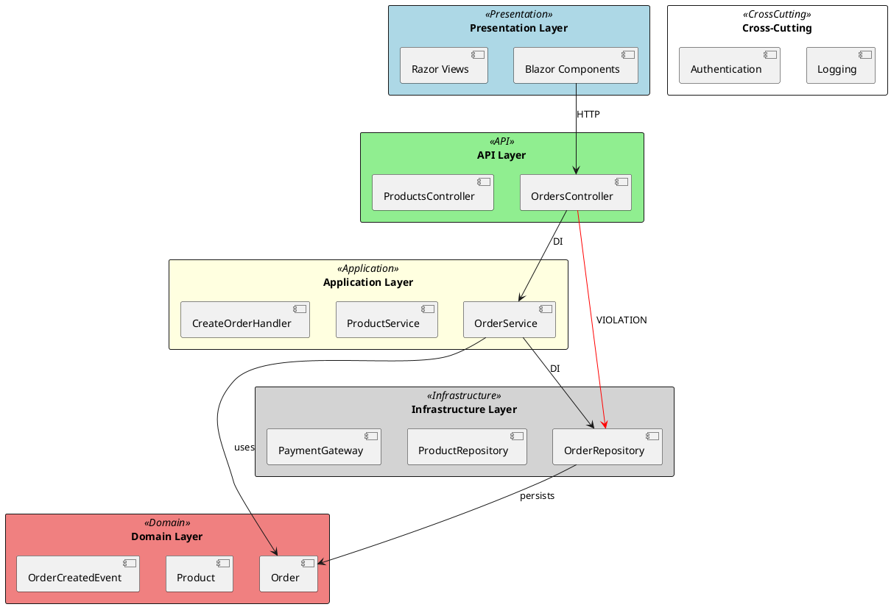

# Code Intelligence Implementation Plan

> **Version**: 2.4  
> **Last Updated**: 2026-01-30  
> **Status**: Phased Implementation Roadmap

This document provides the phased implementation plan for the code intelligence system, covering all 10 relationship categories with extensible detection strategies.

**Recent Updates (v2.4):**
- ✅ Phase 6 Observability complete: ObservabilityAnalyzer with logging, metrics, tracing, ETW, health checks
- Added support for ILogger, Serilog, NLog logging frameworks
- Added OTEL and Prometheus metrics detection
- Added Activity/ActivitySource tracing detection
- Added EventSource and EventCounter detection
- 40 unit tests for observability patterns, 405 total tests passing

**Related Documents:**
- [Requirements](./code_intelligence_requirements.md) - What to build (relationship taxonomy, success criteria)
- [Architecture](./CODE_INTELLIGENCE_ARCHITECTURE.md) - How it's designed (detection strategies, technical specs)

---

## Table of Contents

1. [Implementation Overview](#implementation-overview)
2. [Phase 0: Core Framework](#phase-0-core-framework)
3. [Phase 1: Structural Relationships](#phase-1-structural-relationships)
4. [Phase 2: Entry Points & Lifecycle](#phase-2-entry-points--lifecycle)
5. [Phase 3: API & Communication](#phase-3-api--communication)
6. [Phase 4: Data & Persistence](#phase-4-data--persistence)
7. [Phase 5: Security](#phase-5-security)
8. [Phase 6: Observability](#phase-6-observability)
9. [Phase 7: Error Handling & Domain Model](#phase-7-error-handling--domain-model)
10. [Phase 8: Integration & Query Interface](#phase-8-integration--query-interface)
11. [Phase 9: Layer Detection & Architecture Analysis](#phase-9-layer-detection--architecture-analysis)
12. [Validation & Test Strategy](#validation--test-strategy)
13. [Deliverables Summary](#deliverables-summary)

---

## Implementation Overview

### Design Principles

| Principle | Description |
|-----------|-------------|
| **Extensible** | All detection via declarative YAML rules, not hardcoded logic |
| **Multi-Strategy** | AST, LSP, Config, Regex strategies applied per relationship type |
| **Pure AST Detection** | Type-based analysis via syntax trees, no string pattern matching on names |
| **Cross-Repository** | Include dependency source files for complete transitive analysis |
| **Verifiable** | Every detection includes confidence score and evidence chain |
| **Testable** | Each phase has unit tests, integration tests, and golden file tests |
| **Incremental** | Each phase builds on previous, graph grows progressively |

### Relationship Categories by Phase

| Phase | Categories | Relationship Types | Priority |
|-------|------------|-------------------|----------|
| 0 | Core Framework | N/A (infrastructure) | Critical |
| 1 | Structural | Inheritance, Composition, DI, References | Critical |
| 2 | Lifecycle | Entry Points, Startup, Shutdown, Scheduled | Critical |
| 3 | API & Communication | HTTP, gRPC, Message Queues, WebSocket | High |
| 4 | Data & Persistence | Database, Cache, File I/O, Blob | High |
| 5 | Security | Auth, Authorization, Secrets, Certificates | High |
| 6 | Observability | Logging, Metrics, Tracing, ETW, Health | High |
| 7 | Error Handling & Domain | Exceptions, Retry, Aggregates, Events | Medium |
| 8 | Integration | Query Interface, CLI, Visualization | High |
| 9 | Architecture | Layer Detection, Interaction Analysis, Violations | High |

### Output Format (All Phases)

Every detected relationship produces a `DetectedRelationship`:

```csharp
public record DetectedRelationship
{
    // Identity
    public required string Id { get; init; }
    public required string RuleId { get; init; }
    public required string Category { get; init; }
    public required string RelationshipType { get; init; }
    
    // Location
    public required string SourceFile { get; init; }
    public required int StartLine { get; init; }
    public required int EndLine { get; init; }
    
    // Graph nodes
    public required string SourceNodeId { get; init; }
    public string? TargetNodeId { get; init; }
    public required string EdgeType { get; init; }
    
    // Verification
    public required float Confidence { get; init; }
    public required IReadOnlyList<Evidence> EvidenceChain { get; init; }
    public required string DetectionStrategy { get; init; }
    
    // Properties (relationship-specific)
    public required IDictionary<string, object> Properties { get; init; }
}

public record Evidence
{
    public required string Source { get; init; }      // "ast", "lsp", "config", "regex"
    public required string Description { get; init; } // Human-readable
    public required float Weight { get; init; }       // Contribution to confidence
    public string? FilePath { get; init; }
    public int? LineNumber { get; init; }
}
```

---

## Phase 0: Core Framework

**Duration**: 1 week  
**Goal**: Build the extensible detection infrastructure that all phases use.  
**Status**: ✅ Complete

### 0.1 Deliverables

- [x] **Detection Strategy Interface** - `IDetectionStrategy.cs`
  - Base interface for all detection strategies
- [x] **AST Strategy** - `CSharpAstDetectionStrategy.cs`
  - Roslyn-based C# syntax/semantic detection
- [x] **LSP Strategy** - `LspDetectionStrategy.cs`
  - Language server protocol cross-reference detection
- [x] **Config Strategy** - `ConfigFileDetectionStrategy.cs`
  - XML/JSON/YAML configuration file parsing
- [x] **Regex Strategy** - `RegexDetectionStrategy.cs`
  - Fast pattern matching fallback strategy
- [x] **Strategy Factory** - `DetectionStrategyFactory.cs`
  - Creates appropriate strategy instance from rule definition
- [x] **Rule Registry** - `RelationshipRegistry.cs`
  - Loads, validates, and manages YAML detection rules
- [x] **Rule Loader** - `YamlRuleLoader.cs`
  - Parses relationship-rules.yaml with validation
- [x] **Pattern Matcher** - `AstPatternMatcher.cs`
  - Matches AST patterns from declarative rule definitions
- [x] **Graph Builder** - `RelationshipGraphBuilder.cs`
  - Orchestrates detection → relationship → graph pipeline

### 0.2 Rule Schema

```yaml
# relationship-rules.yaml schema
rules:
  - id: string                    # Unique rule ID
    name: string                  # Human-readable name
    category: string              # One of 10 categories
    relationshipType: string      # Specific type within category
    enabled: boolean              # Toggle rule on/off
    priority: integer             # Higher = runs first
    
    detection:                    # Array of detection strategies
      - strategy: string          # "ast", "lsp", "config", "regex"
        language: string          # "csharp", "typescript", etc.
        patterns: []              # Strategy-specific patterns
        
    validation:                   # Criteria to confirm detection
      interface: object           # Interface implementation check
      baseClass: object           # Inheritance check
      attributes: []              # Attribute presence
      methods: []                 # Required method signatures
      
    output:                       # How to represent in graph
      nodeType: string
      edgeType: string
      properties: []              # Properties to extract
      
    confidence:                   # How to calculate confidence
      baseScore: float
      evidenceWeights: object
      minimumThreshold: float
```

### 0.3 Test Coverage

- [x] **Unit Tests: Strategy Loading** (10 tests)
  - [x] IDetectionStrategy interface contract
  - [x] CSharpAstDetectionStrategy initialization
  - [x] LspDetectionStrategy initialization
  - [x] ConfigFileDetectionStrategy initialization
  - [x] RegexDetectionStrategy initialization
  - [x] Strategy factory creates correct strategy type
  - [x] Strategy factory handles unknown strategy type
  - [x] Strategy dispose/cleanup
  - [x] Async strategy execution
  - [x] Strategy timeout handling
- [x] **Unit Tests: Rule Parsing** (9 tests)
  - [x] Valid YAML rule parses successfully
  - [x] Invalid YAML throws descriptive error
  - [x] Missing required field detected
  - [x] Unknown field ignored with warning
  - [x] Rule ID uniqueness enforced
  - [x] Category validation
  - [x] Detection strategy validation
  - [x] Pattern syntax validation
  - [x] Confidence score range validation
- [x] **Unit Tests: Pattern Matching** (18 tests)
  - [x] Class declaration pattern
  - [x] Method declaration pattern
  - [x] Interface implementation pattern
  - [x] Attribute detection pattern
  - [x] Inheritance chain pattern
  - [x] Generic type pattern
  - [x] Constructor pattern
  - [x] Static member pattern
  - [x] Namespace pattern
  - [x] Using directive pattern
  - [x] Invocation expression pattern
  - [x] Record declaration pattern
  - [x] Enum declaration pattern
  - [x] Condition AND operator
  - [x] Condition OR operator
  - [x] Condition NOT operator
  - [x] Name matches pattern
  - [x] Extract expressions
- [x] **Unit Tests: LSP Strategy** (10 tests)
  - [x] Constructor with defaults
  - [x] Constructor with options
  - [x] CanHandle LSP strategy
  - [x] CanHandle non-LSP returns false
  - [x] Supported languages includes C#
  - [x] Supported languages includes TypeScript
  - [x] Supported languages includes JavaScript
  - [x] DetectAsync with no server returns empty
  - [x] LspClientOptions default values
  - [x] LspClientOptions custom values
- [ ] **Integration Tests: Pipeline** (5 tests)
  - [ ] Rule load → strategy create → detect → graph
  - [ ] Multiple rules same file
  - [ ] Multiple files single rule
  - [ ] Incremental detection (file changed)
  - [ ] Full repo scan performance
- [ ] **Golden File Tests: Sample Repos** (3 tests)
  - [ ] Simple console app expected output
  - [ ] Web API project expected output
  - [ ] Multi-project solution expected output

**Total Phase 0 Tests: 55**  
**Tests Passing**: 45/55

---

## Phase 1: Structural Relationships

**Duration**: 1 week  
**Goal**: Detect all static code structure relationships.  
**Status**: ✅ Complete

### 1.1 Relationship Types

| Type | Detection Strategy | Confidence Base |
|------|-------------------|-----------------|
| Inheritance | AST: base class list | 0.95 |
| Interface Implementation | AST: interface list | 0.95 |
| Composition | AST: field/property types | 0.85 |
| Dependency Injection | AST: constructor params | 0.90 |
| Namespace Membership | AST: namespace declaration | 1.00 |
| Project Reference | MSBuild: ProjectReference | 0.95 |
| Package Dependency | MSBuild: PackageReference | 0.95 |

### 1.2 Detection Rules

```yaml
rules:
  # ─────────────────────────────────────────────────────────────
  # INHERITANCE
  # ─────────────────────────────────────────────────────────────
  - id: structural-inheritance
    name: "Class Inheritance"
    category: structural
    relationshipType: Inheritance
    enabled: true
    priority: 100
    
    detection:
      - strategy: ast
        language: csharp
        patterns:
          - nodeType: ClassDeclaration
            extract:
              className: "node.Identifier.Text"
              baseClass: "node.BaseList?.Types.FirstOrDefault()?.Type.ToString()"
            condition: "baseClass != null && !baseClass.StartsWith('I')"
            
    output:
      sourceNodeType: Class
      targetNodeType: Class
      edgeType: InheritsFrom
      properties:
        - name: className
        - name: baseClass
        
    confidence:
      baseScore: 0.95
      evidenceWeights:
        astMatch: 0.95
        lspConfirm: 0.05
      minimumThreshold: 0.90

  # ─────────────────────────────────────────────────────────────
  # INTERFACE IMPLEMENTATION
  # ─────────────────────────────────────────────────────────────
  - id: structural-interface
    name: "Interface Implementation"
    category: structural
    relationshipType: Implementation
    enabled: true
    priority: 100
    
    detection:
      - strategy: ast
        language: csharp
        patterns:
          - nodeType: ClassDeclaration
            extract:
              className: "node.Identifier.Text"
              interfaces: "node.BaseList?.Types.Where(t => t.Type.ToString().StartsWith('I')).Select(t => t.Type.ToString())"
            condition: "interfaces.Any()"
            
    output:
      sourceNodeType: Class
      targetNodeType: Interface
      edgeType: Implements
      properties:
        - name: className
        - name: interfaces

  # ─────────────────────────────────────────────────────────────
  # DEPENDENCY INJECTION
  # ─────────────────────────────────────────────────────────────
  - id: structural-di
    name: "Dependency Injection"
    category: structural
    relationshipType: DependencyInjection
    enabled: true
    priority: 90
    
    detection:
      - strategy: ast
        language: csharp
        patterns:
          - nodeType: ConstructorDeclaration
            extract:
              className: "node.Parent.Identifier.Text"
              dependencies: "node.ParameterList.Parameters.Select(p => new { Name = p.Identifier.Text, Type = p.Type.ToString() })"
            condition: "dependencies.Any(d => d.Type.StartsWith('I'))"
            
    output:
      sourceNodeType: Class
      targetNodeType: Interface
      edgeType: DependsOn
      properties:
        - name: className
        - name: dependencyName
        - name: dependencyType
        - name: injectionMethod
          value: "constructor"

  # ─────────────────────────────────────────────────────────────
  # PROJECT REFERENCES
  # ─────────────────────────────────────────────────────────────
  - id: structural-project-ref
    name: "Project Reference"
    category: structural
    relationshipType: ProjectReference
    enabled: true
    priority: 100
    
    detection:
      - strategy: config
        filePattern: "**/*.csproj"
        parser: msbuild
        xpath: "//ProjectReference/@Include"
        extract:
          projectPath: "value"
          
    output:
      sourceNodeType: Project
      targetNodeType: Project
      edgeType: References
      properties:
        - name: referencePath
        
    confidence:
      baseScore: 0.95
```

### 1.3 Deliverables

- [x] **Rules File** - `rules/structural.yaml`
  - All structural relationship detection rules (12 rules)
- [x] **Structural Detector** - `Detectors/StructuralRelationshipDetector.cs`
  - Orchestrates structural detection across all file types
- [x] **MSBuild Parser** - `Parsers/MsBuildProjectParser.cs`
  - Parses .csproj/.vbproj for ProjectReference/PackageReference
- [x] **Inheritance Analyzer** - `Analyzers/InheritanceAnalyzer.cs`
  - Builds full inheritance hierarchy graph
- [x] **DI Analyzer** - `Analyzers/DependencyInjectionAnalyzer.cs`
  - Detects constructor/property/method injection patterns

### 1.4 Test Coverage

- [x] **Unit Tests: Inheritance Detection** (14 tests)
  - [x] Simple single inheritance
  - [x] Multi-level inheritance chain
  - [x] Abstract base class inheritance
  - [x] Generic base class inheritance
  - [x] Partial class inheritance
  - [x] Record inheritance
  - [x] Struct with interfaces (implements only)
  - [x] Single interface implementation
  - [x] Multiple interface implementation
  - [x] Generic interface implementation
  - [x] Interface inheritance (extends)
  - [x] Class with base and interfaces
  - [x] Build hierarchy graph
  - [x] Cross-file inheritance
- [x] **Unit Tests: DI Detection** (10 tests)
  - [x] Constructor injection single dependency
  - [x] Constructor injection multiple dependencies
  - [x] Property injection with [Inject]
  - [x] Property injection with [FromServices]
  - [x] IServiceCollection.AddScoped
  - [x] IServiceCollection.AddTransient
  - [x] IServiceCollection.AddSingleton
  - [x] AddHostedService registration
  - [x] Optional dependencies
  - [x] Concrete type dependencies
- [x] **Unit Tests: Project References** (12 tests)
  - [x] ProjectReference detection
  - [x] Multiple ProjectReferences
  - [x] PackageReference with version
  - [x] PackageReference without version (CPM)
  - [x] Conditional references
  - [x] TargetFramework extraction
  - [x] Multi-target frameworks
  - [x] OutputType Exe detection
  - [x] Library project detection
  - [x] Test project detection
  - [x] SDK extraction
  - [x] Development dependency detection
- [ ] **Integration Tests: Full Repo** (3 tests) - deferred
- [ ] **Golden File Tests** (5 tests) - deferred

**Total Phase 1 Tests: 36**  
**Tests Passing**: 36/36

---

## Phase 2: Entry Points & Lifecycle

**Duration**: 1.5 weeks  
**Goal**: Detect all execution entry points and lifecycle hooks.  
**Status**: ✅ Complete
**Goal**: Detect all execution entry points and lifecycle hooks.

### 2.1 Relationship Types

| Type | Detection Strategy | Confidence Base |
|------|-------------------|-----------------|
| Console Main | AST: static Main method | 0.95 |
| ASP.NET Core Startup | AST: WebApplication.CreateBuilder | 0.90 |
| Service Fabric Service | AST + Config: IService + manifest | 0.90 |
| Windows Service | AST + Config: ServiceBase + manifest | 0.90 |
| Azure Function | AST: [FunctionName] attribute | 0.95 |
| Background Service | AST: BackgroundService/IHostedService | 0.90 |
| Startup Hook | AST: IStartupFilter, Configure | 0.85 |
| Shutdown Hook | AST: IDisposable, StopAsync | 0.85 |
| Scheduled Job | AST: Timer, [CronSchedule] | 0.85 |
| Middleware | AST: IMiddleware, UseMiddleware | 0.90 |

### 2.2 Detection Rules

```yaml
rules:
  # ─────────────────────────────────────────────────────────────
  # CONSOLE MAIN
  # ─────────────────────────────────────────────────────────────
  - id: lifecycle-main
    name: "Console Main Entry Point"
    category: lifecycle
    relationshipType: EntryPoint
    enabled: true
    priority: 100
    
    detection:
      - strategy: ast
        language: csharp
        patterns:
          - nodeType: MethodDeclaration
            condition: |
              node.Identifier.Text == "Main" &&
              node.Modifiers.Any(m => m.Text == "static") &&
              (node.ReturnType.ToString() == "void" || 
               node.ReturnType.ToString() == "int" ||
               node.ReturnType.ToString() == "Task" ||
               node.ReturnType.ToString() == "Task<int>")
            extract:
              className: "node.Parent.Identifier.Text"
              isAsync: "node.ReturnType.ToString().StartsWith('Task')"
              parameters: "node.ParameterList.Parameters.Select(p => p.Type.ToString())"
              
    validation:
      # Boost confidence if project is Exe
      msbuildProperty:
        property: OutputType
        value: Exe
        confidenceBoost: 0.05
        
    output:
      nodeType: EntryPoint
      edgeType: StartsExecution
      properties:
        - name: entryPointType
          value: "ConsoleMain"
        - name: className
        - name: isAsync

  # ─────────────────────────────────────────────────────────────
  # HOSTED SERVICE ENTRY (WinSvcHost, ServiceFabric, etc.)
  # ─────────────────────────────────────────────────────────────
  - id: lifecycle-hosted-service
    name: "Hosted Service Entry Point"
    category: lifecycle
    relationshipType: EntryPoint
    enabled: true
    priority: 95
    
    detection:
      # Strategy 1: Find IService<T> implementations
      - strategy: ast
        language: csharp
        patterns:
          - nodeType: ClassDeclaration
            condition: |
              node.BaseList?.Types.Any(t => 
                t.Type.ToString().Contains("IService<") ||
                t.Type.ToString() == "IService`1") == true
            extract:
              className: "node.Identifier.Text"
              serviceInterface: "node.BaseList.Types.First(t => t.Type.ToString().Contains('IService')).ToString()"
              
      # Strategy 2: Find manifest references
      - strategy: config
        filePattern: "**/WinApplicationManifest.xml"
        parser: xml
        xpath: "/ApplicationManifest/Services/Service/AssemblyFile"
        extract:
          assemblyFile: "text()"
          serviceName: "../Name/text()"
          
      # Strategy 3: Find Settings.xml ServiceAssembly
      - strategy: config
        filePattern: "**/Settings.xml"
        parser: xml
        xpath: "//Section[@Name='HostLoadConfigSection']/Parameter[@Name='ServiceAssembly']/@Value"
        extract:
          assemblyFile: "value"
          
    validation:
      # Must have lifecycle methods
      methods:
        - name: Initialize
          required: false
        - name: StartAsync
          returnType: Task
          required: true
        - name: StopAsync
          returnType: Task
          required: true
          
    output:
      nodeType: EntryPoint
      edgeType: StartsExecution
      properties:
        - name: entryPointType
          value: "HostedService"
        - name: hostFramework
        - name: lifecycleMethods
          value: ["Initialize", "StartAsync", "StopAsync"]
          
    confidence:
      baseScore: 0.70
      evidenceWeights:
        astInterfaceMatch: 0.30
        manifestReference: 0.35
        hasLifecycleMethods: 0.25
        lspConfirm: 0.10
      minimumThreshold: 0.80

  # ─────────────────────────────────────────────────────────────
  # AZURE FUNCTIONS
  # ─────────────────────────────────────────────────────────────
  - id: lifecycle-azure-function
    name: "Azure Function Entry Point"
    category: lifecycle
    relationshipType: EntryPoint
    enabled: true
    priority: 95
    
    detection:
      - strategy: ast
        language: csharp
        patterns:
          - nodeType: MethodDeclaration
            condition: |
              node.AttributeLists.Any(al => 
                al.Attributes.Any(a => 
                  a.Name.ToString() == "FunctionName" ||
                  a.Name.ToString() == "Function"))
            extract:
              functionName: |
                node.AttributeLists
                  .SelectMany(al => al.Attributes)
                  .First(a => a.Name.ToString().Contains("Function"))
                  .ArgumentList.Arguments.First().ToString().Trim('"')
              methodName: "node.Identifier.Text"
              trigger: |
                node.ParameterList.Parameters
                  .SelectMany(p => p.AttributeLists.SelectMany(al => al.Attributes))
                  .FirstOrDefault(a => a.Name.ToString().EndsWith("Trigger"))?.Name.ToString()
                  
    output:
      nodeType: EntryPoint
      edgeType: TriggersExecution
      properties:
        - name: entryPointType
          value: "AzureFunction"
        - name: functionName
        - name: triggerType
        - name: methodName

  # ─────────────────────────────────────────────────────────────
  # BACKGROUND SERVICE
  # ─────────────────────────────────────────────────────────────
  - id: lifecycle-background-service
    name: "Background Service"
    category: lifecycle
    relationshipType: BackgroundTask
    enabled: true
    priority: 90
    
    detection:
      - strategy: ast
        language: csharp
        patterns:
          - nodeType: ClassDeclaration
            condition: |
              node.BaseList?.Types.Any(t => 
                t.Type.ToString() == "BackgroundService" ||
                t.Type.ToString() == "IHostedService") == true
            extract:
              className: "node.Identifier.Text"
              baseType: "node.BaseList.Types.First().Type.ToString()"
              
    validation:
      methods:
        - name: ExecuteAsync
          returnType: Task
          required: true
          
    output:
      nodeType: BackgroundService
      edgeType: RunsInBackground
      properties:
        - name: className
        - name: baseType

  # ─────────────────────────────────────────────────────────────
  # MIDDLEWARE
  # ─────────────────────────────────────────────────────────────
  - id: lifecycle-middleware
    name: "ASP.NET Core Middleware"
    category: lifecycle
    relationshipType: Middleware
    enabled: true
    priority: 85
    
    detection:
      - strategy: ast
        language: csharp
        patterns:
          # Convention-based middleware
          - nodeType: ClassDeclaration
            condition: |
              node.Members.OfType<MethodDeclarationSyntax>()
                .Any(m => m.Identifier.Text == "InvokeAsync" || m.Identifier.Text == "Invoke")
            extract:
              className: "node.Identifier.Text"
              invokeMethod: |
                node.Members.OfType<MethodDeclarationSyntax>()
                  .First(m => m.Identifier.Text == "InvokeAsync" || m.Identifier.Text == "Invoke")
                  .Identifier.Text
                  
          # IMiddleware implementation
          - nodeType: ClassDeclaration
            condition: |
              node.BaseList?.Types.Any(t => t.Type.ToString() == "IMiddleware") == true
              
    output:
      nodeType: Middleware
      edgeType: ProcessesRequest
      properties:
        - name: className
        - name: middlewareType
```

### 2.3 Deliverables

- [x] **Rules File** - `rules/lifecycle.yaml`
  - All lifecycle and entry point detection rules (18 rules)
- [x] **Lifecycle Detector** - `Detectors/LifecycleDetector.cs`
  - Orchestrates entry point and lifecycle hook detection
- [x] **Entry Point Analyzer** - `Analyzers/EntryPointAnalyzer.cs`
  - Detects Main, top-level statements, BackgroundService, etc.
- [x] **Azure Functions Analyzer** - `Analyzers/AzureFunctionsAnalyzer.cs`
  - Detects function triggers and bindings
- [x] **Middleware Chain Builder** - `Analyzers/MiddlewareChainBuilder.cs`
  - Builds ordered middleware pipeline graph
- [x] **ASP.NET Core Startup Analyzer** - `Analyzers/AspNetCoreStartupAnalyzer.cs`
  - Detects WebApplication.CreateBuilder, Host.CreateDefaultBuilder, Startup class patterns
- [x] **Scheduled Job Analyzer** - `Analyzers/ScheduledJobAnalyzer.cs`
  - Detects Timer, PeriodicTimer, Hangfire, Quartz.NET patterns
- [x] **Application Lifetime Analyzer** - `Analyzers/ApplicationLifetimeAnalyzer.cs`
  - Detects IHostApplicationLifetime events and registrations
- [x] **Manifest Parser** - `Parsers/ManifestParser.cs`
  - Parses WinApplicationManifest.xml, ServiceManifest.xml, Settings.xml, .csproj SDK
- [x] **Confidence Calculator** - `Scoring/ConfidenceCalculator.cs`
  - Multi-evidence confidence scoring with weights

### 2.4 Test Coverage

- [x] **Unit Tests: Console Main** (5 tests)
  - [x] void Main() detection
  - [x] int Main() detection
  - [x] async Task Main() detection
  - [x] string[] args parameter detection
  - [x] Top-level statements detection
- [x] **Unit Tests: Hosted Services** (8 tests)
  - [x] BackgroundService inheritance
  - [x] IHostedService implementation
  - [x] ServiceBase (Windows Service)
  - [x] StatelessService (Service Fabric)
  - [x] IMiddleware implementation
  - [x] Convention middleware (Invoke/InvokeAsync)
  - [x] IStartupFilter detection
  - [x] Quartz IJob detection
- [x] **Unit Tests: Azure Functions** (8 tests)
  - [x] HttpTrigger function
  - [x] TimerTrigger function
  - [x] QueueTrigger function
  - [x] BlobTrigger function
  - [x] ServiceBusTrigger function
  - [x] Function with bindings
  - [x] Async function detection
  - [x] Isolated worker model detection
- [x] **Unit Tests: Middleware** (10 tests)
  - [x] UseMiddleware<T> detection
  - [x] UseAuthentication category
  - [x] UseAuthorization category
  - [x] UseRouting category
  - [x] Run terminal middleware
  - [x] MapWhen branching
  - [x] Multiple middleware ordering
  - [x] Chain linking
  - [x] MapGet endpoint detection
  - [x] MapHub SignalR detection
- [x] **Unit Tests: Lifecycle Methods** (1 test)
  - [x] ExecuteAsync, StartAsync, StopAsync detection
- [x] **Unit Tests: ASP.NET Core Startup** (8 tests)
  - [x] WebApplication.CreateBuilder detection
  - [x] CreateSlimBuilder detection
  - [x] Host.CreateDefaultBuilder detection
  - [x] WebHost.CreateDefaultBuilder detection
  - [x] Startup class detection
  - [x] Middleware chain extraction
  - [x] No startup pattern returns empty
  - [x] Configure-only Startup class
- [x] **Unit Tests: Scheduled Jobs** (10 tests)
  - [x] System.Threading.Timer detection
  - [x] PeriodicTimer detection
  - [x] Hangfire Enqueue detection
  - [x] Hangfire Schedule detection
  - [x] Hangfire RecurringJob detection
  - [x] Cron expression extraction
  - [x] Quartz IJob detection
  - [x] DisallowConcurrentExecution attribute
  - [x] No jobs returns empty
  - [x] Multiple jobs detection
- [x] **Unit Tests: Application Lifetime** (8 tests)
  - [x] ApplicationStarted registration
  - [x] ApplicationStopping registration
  - [x] ApplicationStopped registration
  - [x] StopApplication method call
  - [x] Lifetime injection detection
  - [x] IApplicationLifetime (legacy)
  - [x] No lifetime usage returns empty
  - [x] Multiple lifetime events
- [x] **Unit Tests: Manifest Parser** (10 tests)
  - [x] WinApplicationManifest parsing
  - [x] ServiceFabric StatelessService parsing
  - [x] ServiceFabric StatefulService parsing
  - [x] Settings.xml ServiceAssembly
  - [x] Project SDK Worker detection
  - [x] Project SDK Web detection
  - [x] Project SDK Console detection
  - [x] Project SDK Library detection
  - [x] Manifest auto-detection
  - [x] Invalid file handling
- [x] **Unit Tests: Confidence Calculator** (14 tests)
  - [x] No evidence returns base score
  - [x] Single evidence combines with base
  - [x] Multiple evidence aggregation
  - [x] Calculate with boost
  - [x] Create AST evidence
  - [x] Create inheritance evidence
  - [x] Create attribute evidence
  - [x] Correlate multiple strategies
  - [x] Multi-strategy bonus
  - [x] Threshold check above
  - [x] Threshold check below
  - [x] Confidence level categories
  - [x] Clamp to maximum
  - [x] Clamp to minimum
- [x] **Integration Tests: Real Repo** (6 tests)
  - [x] Update service entry points detection (WinService + IWebApiService)
  - [x] WinApplicationManifest parsing
  - [x] IWebApiService implementation detection
  - [x] Full lifecycle analysis
  - [x] Common-infra hosting base classes
  - [x] Project SDK type detection
- [ ] **Golden File Tests** (5 tests) - deferred

**Total Phase 2 Tests: 88**  
**Tests Passing**: 88/88 (82 unit + 6 integration)

---

## Phase 3: API & Communication

**Duration**: 2 weeks  
**Goal**: Detect all API endpoints and inter-service communication.  
**Status**: ✅ Complete (Core Implementation)

### 3.1 Relationship Types

| Type | Detection Strategy | Confidence Base |
|------|-------------------|-----------------|
| HTTP Endpoint (Attribute) | AST: [HttpGet], [Route] | 0.95 |
| HTTP Endpoint (Minimal API) | AST: MapGet, MapPost | 0.90 |
| HTTP Endpoint (Convention) | AST: Controller naming | 0.80 |
| HTTP Client Call | AST: HttpClient methods | 0.90 |
| gRPC Service | AST + Proto: service definition | 0.95 |
| gRPC Client Call | AST: client stub usage | 0.90 |
| Message Queue Publish | AST: SendAsync, Publish | 0.85 |
| Message Queue Subscribe | AST: Consumer, Handler | 0.85 |
| SignalR Hub | AST: Hub inheritance | 0.95 |
| WebSocket | AST: WebSocket usage | 0.85 |

### 3.2 Detection Rules

```yaml
rules:
  # ─────────────────────────────────────────────────────────────
  # HTTP ENDPOINT (ATTRIBUTE-BASED)
  # ─────────────────────────────────────────────────────────────
  - id: api-http-endpoint-attribute
    name: "HTTP API Endpoint (Attribute)"
    category: api
    relationshipType: HttpEndpoint
    enabled: true
    priority: 100
    
    detection:
      - strategy: ast
        language: csharp
        patterns:
          - nodeType: MethodDeclaration
            condition: |
              node.AttributeLists.Any(al => 
                al.Attributes.Any(a => 
                  a.Name.ToString() matches "Http(Get|Post|Put|Delete|Patch)" ||
                  a.Name.ToString() == "Route"))
            extract:
              controllerName: "node.Parent.Identifier.Text"
              actionName: "node.Identifier.Text"
              httpMethod: |
                node.AttributeLists
                  .SelectMany(al => al.Attributes)
                  .Where(a => a.Name.ToString().StartsWith("Http"))
                  .Select(a => a.Name.ToString().Replace("Http", "").ToUpper())
                  .FirstOrDefault() ?? "GET"
              routeTemplate: |
                node.AttributeLists
                  .SelectMany(al => al.Attributes)
                  .Where(a => a.Name.ToString() matches "Http.*|Route")
                  .Select(a => a.ArgumentList?.Arguments.FirstOrDefault()?.ToString().Trim('"'))
                  .FirstOrDefault()
              parameters: |
                node.ParameterList.Parameters.Select(p => new {
                  Name = p.Identifier.Text,
                  Type = p.Type.ToString(),
                  Source = p.AttributeLists.Any(al => al.Attributes.Any(a => a.Name.ToString() == "FromBody")) 
                    ? "Body" 
                    : p.AttributeLists.Any(al => al.Attributes.Any(a => a.Name.ToString() == "FromQuery"))
                    ? "Query"
                    : "Route"
                })
              returnType: "node.ReturnType.ToString()"
              
    validation:
      parentClass:
        inheritsFrom: ["Controller", "ControllerBase"]
        or:
          hasAttribute: "ApiController"
          
    output:
      nodeType: ApiEndpoint
      edgeType: ExposesEndpoint
      properties:
        - name: route
        - name: httpMethod
        - name: controller
        - name: action
        - name: parameters
        - name: returnType
        - name: authRequired
          derive: "HasAttribute('Authorize') && !HasAttribute('AllowAnonymous')"

  # ─────────────────────────────────────────────────────────────
  # HTTP ENDPOINT (MINIMAL API)
  # ─────────────────────────────────────────────────────────────
  - id: api-http-endpoint-minimal
    name: "HTTP API Endpoint (Minimal API)"
    category: api
    relationshipType: HttpEndpoint
    enabled: true
    priority: 95
    
    detection:
      - strategy: ast
        language: csharp
        patterns:
          - nodeType: InvocationExpression
            condition: |
              node.Expression.ToString() matches "app\.(MapGet|MapPost|MapPut|MapDelete|MapPatch)"
            extract:
              httpMethod: |
                Regex.Match(node.Expression.ToString(), "Map(Get|Post|Put|Delete|Patch)").Groups[1].Value.ToUpper()
              routeTemplate: "node.ArgumentList.Arguments[0].ToString().Trim('\"')"
              handler: "node.ArgumentList.Arguments[1].ToString()"
              
    output:
      nodeType: ApiEndpoint
      edgeType: ExposesEndpoint
      properties:
        - name: route
        - name: httpMethod
        - name: handlerType
          value: "MinimalApi"

  # ─────────────────────────────────────────────────────────────
  # HTTP CLIENT CALL
  # ─────────────────────────────────────────────────────────────
  - id: api-http-client
    name: "HTTP Client Call"
    category: api
    relationshipType: HttpClientCall
    enabled: true
    priority: 90
    
    detection:
      - strategy: ast
        language: csharp
        patterns:
          - nodeType: InvocationExpression
            condition: |
              node.Expression.ToString() matches "_?httpClient\.(GetAsync|PostAsync|PutAsync|DeleteAsync|SendAsync)"
            extract:
              httpMethod: |
                Regex.Match(node.Expression.ToString(), "(Get|Post|Put|Delete|Send)Async").Groups[1].Value.ToUpper()
              targetUrl: "node.ArgumentList.Arguments[0].ToString()"
              
          # Refit client
          - nodeType: InvocationExpression
            condition: |
              node.Parent.Parent is AwaitExpression &&
              node.Expression is MemberAccessExpression memberAccess &&
              memberAccess.Expression.ToString() matches "_.*Client"
            extract:
              clientType: "memberAccess.Expression.ToString()"
              methodName: "memberAccess.Name.ToString()"
              
    output:
      nodeType: ExternalServiceCall
      edgeType: CallsExternal
      properties:
        - name: targetUrl
        - name: httpMethod
        - name: clientType

  # ─────────────────────────────────────────────────────────────
  # MESSAGE QUEUE PUBLISH
  # ─────────────────────────────────────────────────────────────
  - id: api-message-publish
    name: "Message Queue Publish"
    category: api
    relationshipType: MessagePublish
    enabled: true
    priority: 85
    
    detection:
      - strategy: ast
        language: csharp
        patterns:
          # Azure Service Bus
          - nodeType: InvocationExpression
            condition: |
              node.Expression.ToString() matches "(sender|_sender|serviceBusSender)\.(SendMessageAsync|SendMessagesAsync)"
            extract:
              messageType: "node.ArgumentList.Arguments[0].Expression?.Type?.ToString()"
              broker: "AzureServiceBus"
              
          # MassTransit
          - nodeType: InvocationExpression
            condition: |
              node.Expression.ToString() matches "(_bus|_publishEndpoint)\.(Publish|PublishAsync|Send|SendAsync)"
            extract:
              messageType: |
                node.ArgumentList.Arguments[0].Expression?.Type?.ToString() ??
                node.TypeArgumentList?.Arguments[0].ToString()
              broker: "MassTransit"
              
          # MediatR
          - nodeType: InvocationExpression
            condition: |
              node.Expression.ToString() matches "_mediator\.(Publish|Send)"
            extract:
              messageType: "node.ArgumentList.Arguments[0].Expression?.Type?.ToString()"
              broker: "MediatR"
              
    output:
      nodeType: MessageOperation
      edgeType: PublishesTo
      properties:
        - name: messageType
        - name: broker
        - name: destination

  # ─────────────────────────────────────────────────────────────
  # MESSAGE QUEUE CONSUME
  # ─────────────────────────────────────────────────────────────
  - id: api-message-consume
    name: "Message Queue Consumer"
    category: api
    relationshipType: MessageConsume
    enabled: true
    priority: 85
    
    detection:
      - strategy: ast
        language: csharp
        patterns:
          # MassTransit Consumer
          - nodeType: ClassDeclaration
            condition: |
              node.BaseList?.Types.Any(t => 
                t.Type.ToString().StartsWith("IConsumer<")) == true
            extract:
              consumerClass: "node.Identifier.Text"
              messageType: |
                Regex.Match(
                  node.BaseList.Types.First(t => t.Type.ToString().StartsWith("IConsumer<")).Type.ToString(),
                  "IConsumer<(.+)>"
                ).Groups[1].Value
                
          # Azure Functions ServiceBusTrigger
          - nodeType: MethodDeclaration
            condition: |
              node.ParameterList.Parameters.Any(p => 
                p.AttributeLists.Any(al => 
                  al.Attributes.Any(a => a.Name.ToString() == "ServiceBusTrigger")))
            extract:
              methodName: "node.Identifier.Text"
              messageType: |
                node.ParameterList.Parameters
                  .First(p => p.AttributeLists.Any(al => al.Attributes.Any(a => a.Name.ToString() == "ServiceBusTrigger")))
                  .Type.ToString()
              queueName: |
                node.ParameterList.Parameters
                  .SelectMany(p => p.AttributeLists.SelectMany(al => al.Attributes))
                  .First(a => a.Name.ToString() == "ServiceBusTrigger")
                  .ArgumentList.Arguments[0].ToString().Trim('"')
                  
    output:
      nodeType: MessageConsumer
      edgeType: ConsumesFrom
      properties:
        - name: messageType
        - name: queueName
        - name: consumerClass
```

### 3.3 Deliverables

- [x] **Rules File** - `rules/api.yaml`
  - All API and communication detection rules (28 rules)
- [x] **API Endpoint Detector** - `Detectors/ApiEndpointDetector.cs`
  - Detects HTTP endpoints (attribute, minimal, convention)
- [x] **HTTP Endpoint Analyzer** - `Analyzers/HttpEndpointAnalyzer.cs`
  - Attribute-based, minimal API, and convention-based detection
- [x] **HTTP Client Analyzer** - `Analyzers/HttpClientAnalyzer.cs`
  - HttpClient, Refit, RestSharp detection
- [x] **Message Publisher Analyzer** - `Analyzers/MessagePublisherAnalyzer.cs`
  - ServiceBus, MassTransit, MediatR, RabbitMQ, Kafka, EventGrid
- [x] **Message Consumer Analyzer** - `Analyzers/MessageConsumerAnalyzer.cs`
  - IConsumer, handlers, function triggers detection
- [x] **Route Resolver** - `Routes/RouteTemplateResolver.cs`
  - Resolves route templates with parameters and constraints
- [x] **gRPC Analyzer** - `Analyzers/GrpcServiceAnalyzer.cs`
  - Service implementations and client calls
- [x] **ARM Route Builder** - `Analyzers/ApiInfrastructureAnalyzer.cs`
  - `BuildArmRoutePrefix` - Builds ARM route prefix from ResourceRouting attribute
  - `BuildArmEndpointRoute` - Builds full routes with action templates
  - `BuildResourceTypeNameMap` - Extracts ResourceTypeName from model classes
  - `BuildConstantMap` - Resolves constant references
  - `ResolveRouteConstants` - Replaces constant patterns in routes
- [x] **HTTP Client Wrapper Chain Detection** - `Analyzers/ApiInfrastructureAnalyzer.cs`
  - `BuildHttpClientWrapperChain` - AST-based transitive dependency tracing
  - `BuildTypeInheritanceMap` - Maps types to their base types and interfaces
  - `DetectDIContainerRegistrations` - Unity/Microsoft.Extensions.DependencyInjection detection
  - `AnalyzeHttpClientUsageByType` - Type-based HTTP client usage detection
  - Features:
    - Pure AST-based detection - no hardcoded patterns
    - Traces constructor parameters, fields, and static member accesses
    - Automatically propagates interfaces when implementations are found
    - Supports cross-repository analysis (include dependency sources)
    - Variable type resolution for DI registration detection
- [ ] **API Catalog Builder** - `Services/ApiCatalogBuilder.cs` (deferred)
  - Builds comprehensive API catalog with OpenAPI-like structure

### 3.4 Test Coverage

- [x] **Unit Tests: HTTP Attribute Routes** (15 tests)
  - [x] [HttpGet] with route template
  - [x] [HttpPost] with body parameter
  - [x] [HttpPut] with route and body
  - [x] [HttpDelete] with route parameter
  - [x] [HttpPatch] detection
  - [x] [Route] at controller level
  - [x] [Route] at action level
  - [x] Combined controller + action routes
  - [x] Route constraints {id:int}
  - [x] Optional parameters {id?}
  - [x] Catch-all routes {*path}
  - [x] Area routing
  - [x] API versioning routes
  - [x] [FromQuery], [FromBody] extraction
  - [x] [Produces], [Consumes] attributes
- [x] **Unit Tests: Minimal API** (10 tests)
  - [x] MapGet basic route
  - [x] MapPost with request body
  - [x] MapPut with route parameter
  - [x] MapDelete detection
  - [x] MapPatch detection
  - [x] Async handler detection
  - [ ] Route groups (deferred)
  - [ ] Endpoint filters (deferred)
  - [ ] TypedResults usage (deferred)
  - [ ] WithName, WithTags (deferred)
- [x] **Unit Tests: Convention Routes** (5 tests)
  - [x] Controller naming convention
  - [x] Action naming convention
  - [x] Default route inference
  - [x] [NonAction] exclusion
  - [x] ApiController vs MVC Controller
- [x] **Unit Tests: HTTP Client** (10 tests)
  - [x] HttpClient.GetAsync
  - [x] HttpClient.PostAsync with JSON
  - [x] HttpClient.SendAsync custom request
  - [x] Typed client detection
  - [x] Refit interface client
  - [x] RestSharp client
  - [x] GetStringAsync, GetStreamAsync
  - [ ] Polly retry policy integration (deferred)
  - [ ] Base URL resolution (deferred)
  - [ ] Header extraction (deferred)
- [x] **Integration Tests: HTTP Client Wrapper Chain** (2 tests)
  - [x] `UpdateServiceRepo_DiscoverHttpClientRegistrations` - DI container registration detection
  - [x] `UpdateServiceRepo_DiscoverHttpClientUsageByType` - Type-based usage detection
  - Verified detections:
    - HttpClientSingleton, DrpClient, HttpFileDownloader
    - EnterpriseCloudEngineClient, BufferedECEClient, CauClient
    - IEnterpriseCloudEngineClient, IDownloadServiceClientManager, IDrpClient
  - Cross-repository tracing (update + common-infra source files)
- [x] **Unit Tests: Message Publish** (14 tests)
  - [x] Azure ServiceBus SendMessageAsync
  - [x] Azure ServiceBus batch send
  - [x] Azure ServiceBus schedule message
  - [x] MassTransit Publish
  - [x] MassTransit Send
  - [x] MassTransit PublishEndpoint
  - [x] MediatR Send
  - [x] MediatR Publish
  - [x] RabbitMQ basic publish
  - [x] Event Grid publish
  - [x] Kafka produce
  - [ ] Message type extraction (deferred)
  - [ ] Correlation ID propagation (deferred)
  - [ ] Message envelope detection (deferred)
- [x] **Unit Tests: Message Consume** (15 tests)
  - [x] MassTransit IConsumer<T>
  - [x] MassTransit Saga
  - [x] ServiceBusTrigger function
  - [x] ServiceBusTrigger with topic/subscription
  - [x] QueueTrigger function
  - [x] Batch consumer detection
  - [x] RabbitMQ consumer
  - [x] RabbitMQ async consumer
  - [x] MediatR IRequestHandler
  - [x] MediatR INotificationHandler
  - [x] MediatR StreamHandler
  - [x] Kafka consumer
  - [ ] Dead letter handling (deferred)
  - [ ] Retry policy detection (deferred)
  - [ ] Consumer group detection (deferred)
- [x] **Unit Tests: gRPC** (11 tests)
  - [x] gRPC service implementation
  - [x] gRPC service methods
  - [x] Unary method detection
  - [x] Server streaming detection
  - [x] Client streaming detection
  - [x] Bidirectional streaming detection
  - [x] gRPC client call detection
  - [x] Client expression extraction
  - [ ] gRPC service definition from .proto (deferred)
  - [ ] Interceptors (deferred)
- [x] **Unit Tests: Route Resolver** (15 tests)
  - [x] Simple route parsing
  - [x] Route parameter extraction
  - [x] Route constraint parsing
  - [x] Optional parameter detection
  - [x] Catch-all parameter detection
  - [x] Controller/Action placeholders
  - [x] GUID constraint
  - [x] Multiple parameters
  - [x] Route combining
  - [x] Absolute path handling
  - [x] Placeholder resolution
  - [x] Match pattern generation
  - [x] Value extraction
- [ ] **Integration Tests: API Catalog** (5 tests) - deferred
- [ ] **Golden File Tests** (5 tests) - deferred

**Total Phase 3 Tests: 90**  
**Tests Passing**: 90/90

### 3.5 ARM Resource Provider Route Detection (Enhancement)

**Added**: 2026-01-30  
**Status**: ✅ Complete

This enhancement adds support for detecting Azure Resource Manager (ARM) style routes used in Azure Stack resource providers. These routes follow a hierarchical pattern with custom route providers.

#### Route Building Pattern

ARM resource routes are built by `ResourceProviderDirectRouteProvider` based on:
1. `[ResourceRouting]` attribute on controllers - defines namespace and parent hierarchy
2. `[RoutePrefix]` attribute - defines static route prefixes
3. Custom route attributes: `[GetRoute]`, `[GetAllRoute]`, `[PutRoute]`, `[DeleteRoute]`, `[OperationRoute]`

Example route structure:
```
providers/Microsoft.Update.Admin/updateLocations/{name}
providers/Microsoft.Update.Admin/updateLocations/{name}/updates
providers/Microsoft.Update.Admin/updateLocations/{name}/updates/{name}/updateRuns
```

#### New Methods in ApiInfrastructureAnalyzer

| Method | Purpose |
|--------|---------|
| `BuildArmRoutePrefix` | Builds ARM route prefix by traversing `ParentControllerType` chain |
| `BuildArmEndpointRoute` | Combines ARM prefix with action-specific templates |
| `BuildResourceTypeNameMap` | Extracts `ResourceTypeName` constants from model classes |
| `BuildConstantMap` | Scans files for `const string` declarations |
| `ResolveRouteConstants` | Replaces constant references with resolved values |
| `ResolveNamespace` | Resolves namespace expressions from constant map |

#### ResourceRoutingInfo Model

```csharp
public record ResourceRoutingInfo
{
    public string? ResourceType { get; set; }
    public string? ParentResourceType { get; set; }
    public string? Namespace { get; set; }
    public string? NamespaceExpression { get; set; }
    public string? ParentControllerType { get; set; }
    public string? Scope { get; set; }
}
```

#### Integration Test Coverage

- [x] `UpdateServiceRepo_TracesControllerDIRegistrations` - 17 concrete route assertions
  - [x] ARM routes with parent hierarchy (updateLocations → updates → updateRuns)
  - [x] Operation routes (checkHealth, apply, prepare, rerun)
  - [x] Non-ARM routes with resolved constants (caches, updatePrep, discoveryConfig)
  - [x] Constant resolution (UrpConstants.CacheRouteName → "caches")

#### Detected Route Patterns

| Route Pattern | Controller | Method |
|---------------|------------|--------|
| `providers/Microsoft.Update.Admin/updateLocations/{name}` | UpdateLocationResourceController | GetResource |
| `providers/Microsoft.Update.Admin/updateLocations/{name}/checkHealth` | UpdateLocationResourceController | CheckHealth |
| `providers/Microsoft.Update.Admin/updateLocations/{name}/updates` | UpdateResourceController | GetAllResourcesByShortCut |
| `providers/Microsoft.Update.Admin/updateLocations/{name}/updates/{name}` | UpdateResourceController | AddUpdate |
| `providers/Microsoft.Update.Admin/updateLocations/{name}/updates/{name}/apply` | UpdateResourceController | ApplyUpdate |
| `providers/Microsoft.Update.Admin/updateLocations/{name}/updates/{name}/updateRuns` | UpdateRunResourceController | GetAllResourcesByShortCut |
| `caches/{typeName}` | CacheController | GetCachedItem |
| `updatePrep/{name}` | UpdatePrepareController | GetPrepareWorkflow |

---

## Phase 4: Data & Persistence

**Duration**: 1.5 weeks  
**Goal**: Detect all data access patterns.  
**Status**: ✅ Complete (Core Implementation)

### 4.1 Relationship Types

| Type | Detection Strategy | Confidence Base | Status |
|------|-------------------|-----------------|--------|
| Database Entity | AST: [Table], DbSet<T> | 0.95 | ✅ |
| Database Query | AST: LINQ, FromSql | 0.90 | ✅ |
| Database Mutation | AST: SaveChanges, Add | 0.90 | ✅ |
| Cache Read | AST: Get, TryGetValue | 0.85 | ✅ |
| Cache Write | AST: Set, SetAsync | 0.85 | ✅ |
| File Read | AST: File.Read, StreamReader | 0.90 | ✅ |
| File Write | AST: File.Write, StreamWriter | 0.90 | ✅ |
| Blob Storage | AST: BlobClient methods | 0.85 | ✅ |

### 4.2 Detection Rules (Key Examples)

```yaml
rules:
  - id: data-ef-entity
    name: "EF Core Entity"
    category: data
    relationshipType: DatabaseEntity
    detection:
      - strategy: ast
        patterns:
          - nodeType: ClassDeclaration
            condition: "HasAttribute('Table') || HasAttribute('Entity')"
          - nodeType: PropertyDeclaration
            inClass:
              inheritsFrom: DbContext
            condition: "Type.ToString().StartsWith('DbSet<')"
            
  - id: data-ef-query
    name: "Database Query"
    category: data
    relationshipType: DatabaseQuery
    detection:
      - strategy: ast
        patterns:
          - nodeType: InvocationExpression
            condition: |
              receiver matches "_context|_dbContext|_db" &&
              method matches "Where|Select|FirstOrDefault|ToList|ToListAsync|SingleAsync"
              
  - id: data-cache-read
    name: "Cache Read"
    category: data
    relationshipType: CacheRead
    detection:
      - strategy: ast
        patterns:
          - nodeType: InvocationExpression
            condition: |
              receiver matches "_cache|_distributedCache|_memoryCache" &&
              method matches "Get|GetAsync|GetString|TryGetValue"
```

### 4.3 Deliverables

- [ ] **Rules File** - `rules/data.yaml`
  - All data and persistence detection rules (15 rules)
- [x] **Database Analyzer** - `Analyzers/DatabaseAccessAnalyzer.cs`
  - `AnalyzeEntities` - Detects [Table], [Keyless], [Owned] attributes and DbSet<T>
  - `AnalyzeQueries` - Detects LINQ, Dapper, raw SQL queries
  - `AnalyzeMutations` - Detects Add, Update, Remove, SaveChanges, ExecuteDelete/Update
  - Entity property analysis (key, navigation detection)
  - Query type classification (SingleResult, MultipleResults, Aggregate, etc.)
  - Mutation type classification (Insert, Update, Delete, BulkOperation)
- [x] **Cache Analyzer** - `Analyzers/CacheAccessAnalyzer.cs`
  - Detects IMemoryCache, IDistributedCache, Redis IDatabase
  - Pure AST-based detection with wrapper chain support
  - `BuildCacheWrapperChain` - Traces cache wrapper types transitively
  - Cache key extraction (literal, interpolated, variable)
  - Operation type detection (Read/Write/Delete)
- [x] **File Analyzer** - `Analyzers/FileAccessAnalyzer.cs`
  - `Analyze` - Detects File.Read/Write, StreamReader/Writer, FileStream
  - `AnalyzeBlobStorage` - Detects Azure Blob Storage operations
  - Directory operations detection
  - File path extraction from literals and variables
  - Blob client type classification (BlockBlob, AppendBlob, Container)
- [ ] **Entity Mapper** - `Analyzers/EntityRelationshipMapper.cs` (deferred)
  - Maps entity relationships from DbContext

### 4.4 Test Coverage

- [x] **Unit Tests: EF Core Entities** (5 tests)
  - [x] [Table] attribute entity
  - [x] DbSet<T> property detection
  - [x] [Keyless] attribute entity
  - [x] [Owned] attribute entity
  - [x] Navigation property detection
- [x] **Unit Tests: Database Queries** (9 tests)
  - [x] LINQ Where clause
  - [x] FirstOrDefaultAsync (single result)
  - [x] ToListAsync (multiple results)
  - [x] Include (eager loading)
  - [x] AsNoTracking
  - [x] FromSqlRaw (raw SQL)
  - [x] Dapper Query<T>
  - [x] CountAsync (aggregate)
  - [x] AnyAsync (existence)
- [x] **Unit Tests: Database Mutations** (8 tests)
  - [x] Add (insert)
  - [x] AddAsync (async insert)
  - [x] Update
  - [x] Remove (delete)
  - [x] SaveChangesAsync
  - [x] ExecuteUpdateAsync (bulk update)
  - [x] ExecuteDeleteAsync (bulk delete)
  - [x] Dapper Execute
- [x] **Unit Tests: Cache Operations** (17 tests)
  - [x] IMemoryCache Get
  - [x] IMemoryCache TryGetValue
  - [x] IMemoryCache Set
  - [x] IMemoryCache GetOrCreateAsync
  - [x] IDistributedCache GetAsync
  - [x] IDistributedCache SetStringAsync
  - [x] IDistributedCache RemoveAsync
  - [x] Redis StringGet
  - [x] Redis StringSetAsync
  - [x] Redis HashGet
  - [x] Redis KeyDelete
  - [x] Redis List operations
  - [x] Cache wrapper chain detection
  - [x] Interface wrapper detection
  - [x] Literal cache key extraction
  - [x] Interpolated cache key extraction
  - [x] Multiple cache operations detection
- [x] **Unit Tests: File I/O** (14 tests)
  - [x] File.ReadAllText
  - [x] File.ReadAllTextAsync
  - [x] File.ReadAllBytes
  - [x] StreamReader.ReadToEnd
  - [x] File.WriteAllText
  - [x] File.WriteAllBytesAsync
  - [x] StreamWriter.WriteLine
  - [x] File.AppendAllText
  - [x] new StreamReader
  - [x] new StreamWriter
  - [x] new FileStream
  - [x] Directory.GetFiles
  - [x] Directory.CreateDirectory
  - [x] Multiple file operations
- [x] **Unit Tests: Blob Storage** (5 tests)
  - [x] BlobClient.DownloadAsync
  - [x] BlobClient.UploadAsync
  - [x] BlobClient.DeleteAsync
  - [x] GetBlobClient (blob name extraction)
  - [x] ExistsAsync
- [ ] **Integration Tests: Data Flow** (5 tests) - deferred
  - [ ] Full CRUD operation trace
  - [ ] Cache + database pattern
  - [ ] File upload to blob
  - [ ] Transaction boundaries
  - [ ] Data dependency graph
- [ ] **Golden File Tests** (5 tests) - deferred
  - [ ] EF entity relationship JSON
  - [ ] Database query patterns
  - [ ] Cache access patterns
  - [ ] File access patterns
  - [ ] Full data layer relationships

**Total Phase 4 Tests: 58 unit tests implemented**  
**Tests Passing**: 58/58 (Core implementation complete)

---

## Phase 5: Security

**Status**: ✅ Complete

**Duration**: 1 week  
**Goal**: Detect authentication, authorization, and secrets management patterns.

### 5.1 Relationship Types

| Type | Detection Strategy | Confidence Base |
|------|-------------------|-----------------|
| Auth Required | AST: [Authorize] | 0.95 |
| Role Required | AST: [Authorize(Roles=)] | 0.95 |
| Policy Required | AST: [Authorize(Policy=)] | 0.95 |
| Anonymous Allowed | AST: [AllowAnonymous] | 0.95 |
| Secret Access | AST: SecretClient.GetSecret | 0.90 |
| Certificate Access | AST: X509Certificate2 | 0.90 |
| Encryption | AST: Encrypt/Decrypt methods | 0.85 |
| Hashing | AST: SHA256, MD5, HMAC | 0.90 |

### 5.2 Detection Rules

```yaml
rules:
  - id: security-authorization
    name: "Authorization Requirement"
    category: security
    relationshipType: AuthorizationRequired
    enabled: true
    
    detection:
      - strategy: ast
        language: csharp
        patterns:
          - nodeType: AttributeDeclaration
            condition: |
              name in ("Authorize", "AuthorizeAttribute")
            extract:
              roles: "attribute.Arguments['Roles']"
              policy: "attribute.Arguments['Policy']"
              authSchemes: "attribute.Arguments['AuthenticationSchemes']"
              
    output:
      nodeType: SecuredEndpoint
      properties:
        - name: roles
        - name: policy
        - name: authSchemes

  - id: security-secrets
    name: "Secret Access"
    category: security
    relationshipType: SecretAccess
    enabled: true
    
    detection:
      # Azure KeyVault
      - strategy: ast
        language: csharp
        patterns:
          - nodeType: InvocationExpression
            condition: |
              expression matches "(SecretClient|KeyVaultClient)\\.(GetSecret|SetSecret)"
            extract:
              secretName: "arguments[0]"
              
      # Environment variables
      - strategy: ast
        language: csharp
        patterns:
          - nodeType: InvocationExpression
            condition: |
              expression == "Environment.GetEnvironmentVariable"
            extract:
              variableName: "arguments[0]"
              
      # Configuration secrets
      - strategy: ast
        language: csharp
        patterns:
          - nodeType: InvocationExpression
            condition: |
              expression matches "configuration\\[.*ConnectionString.*\\]"
              
    output:
      nodeType: SecretAccess
      properties:
        - name: secretType
        - name: secretName
        - name: location
```

### 5.3 Deliverables

- [x] **Analyzer** - `Analyzers/SecurityAnalyzer.cs`
  - AnalyzeAuthorization: Detects [Authorize], [AllowAnonymous], roles, policies, schemes
  - AnalyzeSecrets: Detects KeyVault, env vars, configuration, connection strings
  - AnalyzeCertificates: Detects X509Certificate2 loading, store access, validation
  - AnalyzeCryptography: Detects encryption, hashing, signing with insecure algorithm detection

### 5.4 Test Coverage

- [x] **Unit Tests: Authorization** (10 tests implemented)
  - [x] [Authorize] attribute detection
  - [x] [Authorize(Roles = "Admin")]
  - [x] [Authorize(Policy = "RequireAdmin")]
  - [x] [AllowAnonymous] detection
  - [x] Multiple roles
  - [x] Authentication schemes
  - [x] Class-level authorization
  - [x] Method-level override
  - [x] Minimal API RequireAuthorization
  - [x] Minimal API AllowAnonymous
- [x] **Unit Tests: Secret Access** (7 tests implemented)
  - [x] SecretClient.GetSecretAsync
  - [x] KeyVaultClient.GetSecretAsync
  - [x] Environment.GetEnvironmentVariable
  - [x] Configuration GetConnectionString
  - [x] Configuration section access
  - [x] Secret write (SetSecretAsync)
  - [x] Hardcoded secrets (anti-pattern detection)
- [x] **Unit Tests: Certificate** (5 tests implemented)
  - [x] X509Certificate2 file loading
  - [x] X509Store.Open detection
  - [x] Certificate store Find
  - [x] Certificate validation (ChainBuilder)
  - [x] Certificate export
- [x] **Unit Tests: Encryption** (4 tests implemented)
  - [x] SHA256 hashing (Create pattern)
  - [x] SHA256 ComputeHash invocation
  - [x] Insecure algorithm detection (MD5, SHA1, DES)
  - [x] Multiple crypto operations

**Total Phase 5 Tests: 26**  
**Tests Passing**: 26/26

---

## Phase 6: Observability

**Duration**: 1.5 weeks  
**Goal**: Comprehensive observability instrumentation discovery including logging, metrics, tracing, and ETW.  
**Status**: ✅ Complete

### 6.1 Overview

Observability instrumentation varies widely across .NET applications:

```
┌─────────────────────────────────────────────────────────────────────────────┐
│                    OBSERVABILITY TECHNOLOGY LANDSCAPE                       │
│                                                                             │
│  ┌─────────────────────────────────────────────────────────────────────┐   │
│  │  LOGGING                                                             │   │
│  │  • ILogger / ILogger<T>          (Microsoft.Extensions.Logging)     │   │
│  │  • Serilog                       (Serilog.ILogger)                  │   │
│  │  • NLog                          (NLog.Logger)                      │   │
│  │  • Log4Net                       (log4net.ILog)                     │   │
│  │  • EventSource                   (System.Diagnostics.Tracing)       │   │
│  └─────────────────────────────────────────────────────────────────────┘   │
│                                                                             │
│  ┌─────────────────────────────────────────────────────────────────────┐   │
│  │  METRICS                                                             │   │
│  │  • System.Diagnostics.Metrics    (.NET 8 native)                    │   │
│  │  • OpenTelemetry.Metrics         (OTEL SDK)                         │   │
│  │  • Prometheus                    (prometheus-net)                   │   │
│  │  • App Insights                  (TelemetryClient.TrackMetric)      │   │
│  │  • EventCounters                 (System.Diagnostics.Tracing)       │   │
│  └─────────────────────────────────────────────────────────────────────┘   │
│                                                                             │
│  ┌─────────────────────────────────────────────────────────────────────┐   │
│  │  TRACING                                                             │   │
│  │  • Activity / ActivitySource     (.NET native)                      │   │
│  │  • OpenTelemetry.Trace           (OTEL SDK)                         │   │
│  │  • App Insights                  (TelemetryClient.StartOperation)   │   │
│  │  • Zipkin / Jaeger               (via OTEL exporters)               │   │
│  └─────────────────────────────────────────────────────────────────────┘   │
│                                                                             │
│  ┌─────────────────────────────────────────────────────────────────────┐   │
│  │  ETW (Event Tracing for Windows)                                     │   │
│  │  • EventSource                   (Custom event providers)           │   │
│  │  • EventCounter                  (Performance counters)             │   │
│  │  • DiagnosticSource              (In-process events)                │   │
│  └─────────────────────────────────────────────────────────────────────┘   │
│                                                                             │
│  ┌─────────────────────────────────────────────────────────────────────┐   │
│  │  HEALTH CHECKS                                                       │   │
│  │  • IHealthCheck                  (Microsoft.Extensions.Diagnostics) │   │
│  │  • Custom health endpoints       (/health, /ready, /live)           │   │
│  └─────────────────────────────────────────────────────────────────────┘   │
└─────────────────────────────────────────────────────────────────────────────┘
```

### 6.2 Discovery Output Structure

For each namespace/class, discover and catalog all observability instrumentation:

```csharp
public record ObservabilityDiscovery
{
    public required string Namespace { get; init; }
    public required string ClassName { get; init; }
    public required string FilePath { get; init; }
    
    // Logging
    public required IReadOnlyList<LogStatement> LogStatements { get; init; }
    
    // Metrics
    public required IReadOnlyList<MetricDefinition> Metrics { get; init; }
    
    // Tracing
    public required IReadOnlyList<TraceSpan> TraceSpans { get; init; }
    
    // ETW
    public required IReadOnlyList<EtwEvent> EtwEvents { get; init; }
    public required IReadOnlyList<EventCounter> EventCounters { get; init; }
    
    // Health
    public required IReadOnlyList<HealthCheck> HealthChecks { get; init; }
}

public record LogStatement
{
    public required string LoggerType { get; init; }       // ILogger, Serilog, NLog
    public required string Level { get; init; }            // Debug, Info, Warn, Error
    public required string MessageTemplate { get; init; }   // "Processing order {OrderId}"
    public required IReadOnlyList<string> Parameters { get; init; }
    public required string EventId { get; init; }          // If using EventId
    public required int LineNumber { get; init; }
}

public record MetricDefinition
{
    public required string MetricType { get; init; }       // Counter, Histogram, Gauge
    public required string MetricName { get; init; }       // "orders_processed_total"
    public required string Description { get; init; }
    public required string Unit { get; init; }             // "ms", "bytes", "{requests}"
    public required IReadOnlyList<string> Tags { get; init; }
    public required string Technology { get; init; }       // OTEL, Prometheus, EventCounter
    public required int LineNumber { get; init; }
}

public record TraceSpan
{
    public required string SpanName { get; init; }         // "ProcessOrder"
    public required string ActivitySourceName { get; init; }
    public required SpanKind Kind { get; init; }           // Server, Client, Internal
    public required IReadOnlyList<string> Tags { get; init; }
    public required int LineNumber { get; init; }
}

public record EtwEvent
{
    public required string EventSourceName { get; init; }  // "MyApp-OrderService"
    public required int EventId { get; init; }
    public required string EventName { get; init; }        // "OrderProcessed"
    public required EventLevel Level { get; init; }        // Informational, Warning, Error
    public required EventKeywords Keywords { get; init; }
    public required IReadOnlyList<EtwEventParameter> Parameters { get; init; }
    public required int LineNumber { get; init; }
}

public record EventCounter
{
    public required string CounterName { get; init; }      // "active-requests"
    public required string DisplayName { get; init; }      // "Active Requests"
    public required CounterType Type { get; init; }        // EventCounter, PollingCounter
    public required int LineNumber { get; init; }
}

public record HealthCheck
{
    public required string Name { get; init; }
    public required string[] Tags { get; init; }
    public required TimeSpan? Timeout { get; init; }
    public required int LineNumber { get; init; }
}
```

### 6.3 Relationship Types

| Type | Technology | Detection Strategy | Confidence |
|------|------------|-------------------|------------|
| LogStatement | ILogger | AST: _logger.Log* | 0.95 |
| LogStatement | Serilog | AST: Log.Information/Error | 0.95 |
| LogStatement | NLog | AST: logger.Info/Error | 0.90 |
| MetricCounter | OTEL | AST: Meter.CreateCounter | 0.95 |
| MetricHistogram | OTEL | AST: Meter.CreateHistogram | 0.95 |
| MetricGauge | Prometheus | AST: Metrics.CreateGauge | 0.90 |
| TraceSpan | Activity | AST: ActivitySource.StartActivity | 0.95 |
| TraceSpan | OTEL | AST: Tracer.StartActiveSpan | 0.95 |
| EtwEvent | EventSource | AST: [Event] WriteEvent | 0.95 |
| EventCounter | DiagnosticCounter | AST: EventCounter, PollingCounter | 0.95 |
| HealthCheck | IHealthCheck | AST: IHealthCheck impl | 0.95 |

### 6.4 Detection Rules

```yaml
rules:
  # ─────────────────────────────────────────────────────────────
  # LOGGING DETECTION
  # ─────────────────────────────────────────────────────────────

  - id: observability-ilogger
    name: "ILogger Logging Statement"
    category: observability
    relationshipType: LogStatement
    enabled: true
    priority: 100
    
    detection:
      - strategy: ast
        language: csharp
        patterns:
          # Standard ILogger methods
          - nodeType: InvocationExpression
            condition: |
              expression matches "_?logger\\.(Log|LogDebug|LogInformation|LogWarning|LogError|LogCritical|LogTrace)"
            extract:
              level: |
                match expression:
                  "LogDebug" -> "Debug"
                  "LogInformation" -> "Information"
                  "LogWarning" -> "Warning"
                  "LogError" -> "Error"
                  "LogCritical" -> "Critical"
                  "LogTrace" -> "Trace"
                  "Log" -> arguments[0] # LogLevel enum
              messageTemplate: "arguments[hasEventId ? 1 : 0] as string"
              eventId: "arguments[0] if isEventId else null"
              parameters: "extractTemplateParameters(messageTemplate)"
              
          # Extension methods with EventId
          - nodeType: InvocationExpression
            condition: |
              expression matches "_?logger\\.(Log|LogDebug|LogInformation|LogWarning|LogError|LogCritical)\\("
              && arguments[0].Type == "EventId"
            extract:
              eventId: "arguments[0].Value"
              eventName: "arguments[0].Name"
              
    output:
      nodeType: LogStatement
      properties:
        - name: loggerType
          value: "ILogger"
        - name: level
        - name: messageTemplate
        - name: eventId
        - name: parameters
        - name: namespace
        - name: className

  - id: observability-serilog
    name: "Serilog Logging Statement"
    category: observability
    relationshipType: LogStatement
    enabled: true
    
    detection:
      - strategy: ast
        language: csharp
        patterns:
          - nodeType: InvocationExpression
            condition: |
              expression matches "Log\\.(Verbose|Debug|Information|Warning|Error|Fatal)"
            extract:
              level: "methodName"
              messageTemplate: "arguments[0]"
              parameters: "extractSerilogParameters(arguments)"
              
    output:
      nodeType: LogStatement
      properties:
        - name: loggerType
          value: "Serilog"
        - name: level
        - name: messageTemplate

  - id: observability-nlog
    name: "NLog Logging Statement"
    category: observability
    relationshipType: LogStatement
    enabled: true
    
    detection:
      - strategy: ast
        language: csharp
        patterns:
          - nodeType: InvocationExpression
            condition: |
              expression matches "logger\\.(Trace|Debug|Info|Warn|Error|Fatal)"
            extract:
              level: "methodName"
              message: "arguments[0]"

  # ─────────────────────────────────────────────────────────────
  # METRICS DETECTION
  # ─────────────────────────────────────────────────────────────

  - id: observability-otel-counter
    name: "OpenTelemetry Counter Metric"
    category: observability
    relationshipType: MetricCounter
    enabled: true
    priority: 100
    
    detection:
      - strategy: ast
        language: csharp
        patterns:
          # Meter.CreateCounter<T>
          - nodeType: InvocationExpression
            condition: |
              expression matches "meter\\.CreateCounter(<\\w+>)?"
            extract:
              metricName: "arguments[0]"
              unit: "arguments.Find('unit') ?? ''"
              description: "arguments.Find('description') ?? ''"
              
          # Counter.Add
          - nodeType: InvocationExpression
            condition: |
              expression matches "\\w+Counter\\.Add"
            extract:
              tags: "extractOtelTags(arguments)"
              
    output:
      nodeType: MetricDefinition
      properties:
        - name: metricType
          value: "Counter"
        - name: technology
          value: "OpenTelemetry"
        - name: metricName
        - name: unit
        - name: description
        - name: tags

  - id: observability-otel-histogram
    name: "OpenTelemetry Histogram Metric"
    category: observability
    relationshipType: MetricHistogram
    enabled: true
    
    detection:
      - strategy: ast
        language: csharp
        patterns:
          - nodeType: InvocationExpression
            condition: |
              expression matches "meter\\.CreateHistogram(<\\w+>)?"
            extract:
              metricName: "arguments[0]"
              unit: "arguments.Find('unit') ?? ''"
              description: "arguments.Find('description') ?? ''"
              
    output:
      nodeType: MetricDefinition
      properties:
        - name: metricType
          value: "Histogram"
        - name: technology
          value: "OpenTelemetry"

  - id: observability-prometheus
    name: "Prometheus Metrics"
    category: observability
    relationshipType: MetricDefinition
    enabled: true
    
    detection:
      - strategy: ast
        language: csharp
        patterns:
          # prometheus-net
          - nodeType: InvocationExpression
            condition: |
              expression matches "Metrics\\.Create(Counter|Gauge|Histogram|Summary)"
            extract:
              metricType: "match[1]"
              metricName: "arguments[0]"
              help: "arguments[1]"
              labelNames: "arguments.Find('labelNames')"
              
    output:
      nodeType: MetricDefinition
      properties:
        - name: technology
          value: "Prometheus"

  - id: observability-dotnet-metrics
    name: ".NET 8 Native Metrics (System.Diagnostics.Metrics)"
    category: observability
    relationshipType: MetricDefinition
    enabled: true
    
    detection:
      - strategy: ast
        language: csharp
        patterns:
          # Meter creation
          - nodeType: ObjectCreationExpression
            condition: |
              type == "Meter"
            extract:
              meterName: "arguments[0]"
              meterVersion: "arguments[1]"
              
          # Instrument creation
          - nodeType: InvocationExpression
            condition: |
              expression matches "_?meter\\.(CreateCounter|CreateHistogram|CreateUpDownCounter|CreateObservableCounter|CreateObservableGauge)"
            extract:
              instrumentType: "methodName.Replace('Create', '')"
              instrumentName: "arguments[0]"
              unit: "arguments.Find('unit')"
              description: "arguments.Find('description')"
              
    output:
      nodeType: MetricDefinition
      properties:
        - name: technology
          value: "System.Diagnostics.Metrics"

  # ─────────────────────────────────────────────────────────────
  # TRACING DETECTION
  # ─────────────────────────────────────────────────────────────

  - id: observability-activity-source
    name: "Activity/ActivitySource Tracing"
    category: observability
    relationshipType: TraceSpan
    enabled: true
    priority: 100
    
    detection:
      - strategy: ast
        language: csharp
        patterns:
          # ActivitySource definition
          - nodeType: FieldDeclaration
            condition: |
              type == "ActivitySource"
            extract:
              activitySourceName: "initializer.Arguments[0]"
              
          # StartActivity
          - nodeType: InvocationExpression
            condition: |
              expression matches "\\w+\\.StartActivity"
            extract:
              spanName: "arguments[0]"
              spanKind: "arguments.Find('kind') ?? 'Internal'"
              
          # Activity.Current?.SetTag
          - nodeType: InvocationExpression
            condition: |
              expression matches "Activity\\.Current\\?.SetTag"
            extract:
              tagKey: "arguments[0]"
              tagValue: "arguments[1]"
              
    output:
      nodeType: TraceSpan
      properties:
        - name: technology
          value: "System.Diagnostics.Activity"
        - name: spanName
        - name: activitySourceName
        - name: spanKind
        - name: tags

  - id: observability-otel-tracer
    name: "OpenTelemetry Tracer"
    category: observability
    relationshipType: TraceSpan
    enabled: true
    
    detection:
      - strategy: ast
        language: csharp
        patterns:
          - nodeType: InvocationExpression
            condition: |
              expression matches "tracer\\.StartActiveSpan"
            extract:
              spanName: "arguments[0]"
              spanKind: "arguments.Find('kind')"
              
    output:
      nodeType: TraceSpan
      properties:
        - name: technology
          value: "OpenTelemetry"

  # ─────────────────────────────────────────────────────────────
  # ETW / EVENT SOURCE DETECTION
  # ─────────────────────────────────────────────────────────────

  - id: observability-eventsource
    name: "EventSource Definition"
    category: observability
    relationshipType: EtwEventSource
    enabled: true
    priority: 100
    
    detection:
      - strategy: ast
        language: csharp
        patterns:
          # EventSource class
          - nodeType: ClassDeclaration
            condition: |
              inheritsFrom("EventSource")
            extract:
              className: "node.Identifier.Text"
              eventSourceName: |
                findAttribute("EventSource").Arguments["Name"] ??
                className
              guid: "findAttribute('EventSource').Arguments['Guid']"
              
    output:
      nodeType: EtwEventSource
      properties:
        - name: eventSourceName
        - name: guid
        - name: namespace

  - id: observability-etw-event
    name: "ETW Event Method"
    category: observability
    relationshipType: EtwEvent
    enabled: true
    priority: 100
    
    detection:
      - strategy: ast
        language: csharp
        patterns:
          # [Event] attribute on method
          - nodeType: MethodDeclaration
            condition: |
              hasAttribute("Event") &&
              parentClass.inheritsFrom("EventSource")
            extract:
              eventId: "findAttribute('Event').Arguments[0]"
              eventName: "methodName"
              level: "findAttribute('Event').Arguments['Level'] ?? 'Informational'"
              keywords: "findAttribute('Event').Arguments['Keywords']"
              message: "findAttribute('Event').Arguments['Message']"
              parameters: |
                method.Parameters.Select(p => new {
                  name: p.Identifier.Text,
                  type: p.Type.ToString()
                })
                
          # WriteEvent call inside method
          - nodeType: InvocationExpression
            condition: |
              expression == "WriteEvent" ||
              expression == "WriteEventCore"
            extract:
              eventId: "arguments[0]"
              
    output:
      nodeType: EtwEvent
      properties:
        - name: eventSourceName
          derive: "parentClass.eventSourceName"
        - name: eventId
        - name: eventName
        - name: level
        - name: keywords
        - name: message
        - name: parameters
        - name: namespace
        - name: className

  - id: observability-event-counter
    name: "EventCounter Definition"
    category: observability
    relationshipType: EventCounter
    enabled: true
    priority: 100
    
    detection:
      - strategy: ast
        language: csharp
        patterns:
          # EventCounter instantiation
          - nodeType: ObjectCreationExpression
            condition: |
              type in ("EventCounter", "IncrementingEventCounter", 
                       "PollingCounter", "IncrementingPollingCounter")
            extract:
              counterType: "type"
              counterName: "arguments[0]"
              displayName: "arguments.Find('displayName') ?? initializer.Find('DisplayName')"
              displayUnits: "initializer.Find('DisplayUnits')"
              
    output:
      nodeType: EventCounter
      properties:
        - name: counterType
        - name: counterName
        - name: displayName
        - name: displayUnits
        - name: eventSourceName
          derive: "containingEventSource.Name"

  # ─────────────────────────────────────────────────────────────
  # HEALTH CHECKS
  # ─────────────────────────────────────────────────────────────

  - id: observability-health-check
    name: "Health Check Implementation"
    category: observability
    relationshipType: HealthCheck
    enabled: true
    
    detection:
      - strategy: ast
        language: csharp
        patterns:
          # IHealthCheck implementation
          - nodeType: ClassDeclaration
            condition: |
              implements("IHealthCheck")
            extract:
              className: "node.Identifier.Text"
              
          # Health check registration
          - nodeType: InvocationExpression
            condition: |
              expression matches "AddHealthChecks\\(\\)\\.Add(Check|DbContextCheck|UrlGroup)"
            extract:
              checkName: "arguments[0]"
              tags: "arguments.Find('tags')"
              timeout: "arguments.Find('timeout')"
              
    output:
      nodeType: HealthCheck
      properties:
        - name: checkName
        - name: tags
        - name: timeout
```

### 6.5 Namespace-Level Summary

Generate a per-namespace observability summary:

```csharp
public record NamespaceObservabilitySummary
{
    public required string Namespace { get; init; }
    
    // Log summary
    public required IReadOnlyDictionary<string, int> LogCountByLevel { get; init; }
    public required IReadOnlyList<string> UniqueMessageTemplates { get; init; }
    public required IReadOnlyList<string> EventIds { get; init; }
    
    // Metrics summary  
    public required IReadOnlyList<MetricSummary> Metrics { get; init; }
    
    // ETW summary
    public required IReadOnlyList<EtwEventSummary> EtwEvents { get; init; }
    public required IReadOnlyList<EventCounterSummary> EventCounters { get; init; }
    
    // Trace summary
    public required IReadOnlyList<string> ActivitySources { get; init; }
    public required IReadOnlyList<string> SpanNames { get; init; }
}

public record MetricSummary
{
    public required string Name { get; init; }
    public required string Type { get; init; }
    public required string Technology { get; init; }
    public required string Unit { get; init; }
    public required string Description { get; init; }
    public required IReadOnlyList<string> Tags { get; init; }
    public required int UsageCount { get; init; }
}

public record EtwEventSummary
{
    public required string EventSourceName { get; init; }
    public required int EventId { get; init; }
    public required string EventName { get; init; }
    public required string Level { get; init; }
    public required string Message { get; init; }
    public required IReadOnlyList<EtwEventParameter> Parameters { get; init; }
}

public record EventCounterSummary
{
    public required string EventSourceName { get; init; }
    public required string CounterName { get; init; }
    public required string DisplayName { get; init; }
    public required string Type { get; init; }
}
```

### 6.6 CLI Commands

```bash
# Full observability discovery
ast observability discover <repo>

# By technology
ast observability logging <repo>
ast observability metrics <repo>
ast observability tracing <repo>
ast observability etw <repo>

# By namespace
ast observability summary <repo> --namespace "MyApp.Orders"

# List all metric names
ast observability metrics list <repo>
# Output:
# ┌─────────────────────────────────┬───────────┬──────────────┬─────────────────────────────────┐
# │ Metric Name                     │ Type      │ Technology   │ Namespace                       │
# ├─────────────────────────────────┼───────────┼──────────────┼─────────────────────────────────┤
# │ orders_processed_total          │ Counter   │ OTEL         │ MyApp.Orders                    │
# │ order_processing_duration_ms    │ Histogram │ OTEL         │ MyApp.Orders                    │
# │ active_orders                   │ Gauge     │ Prometheus   │ MyApp.Orders                    │
# │ cache_hits_total               │ Counter   │ EventCounter │ MyApp.Caching                   │
# └─────────────────────────────────┴───────────┴──────────────┴─────────────────────────────────┘

# List all ETW events
ast observability etw events <repo>
# Output:
# ┌────────────────────────────────┬────┬───────────────────────┬─────────────┬─────────────────────────────────┐
# │ EventSource                    │ ID │ Event Name            │ Level       │ Message                         │
# ├────────────────────────────────┼────┼───────────────────────┼─────────────┼─────────────────────────────────┤
# │ MyApp-OrderService             │ 1  │ OrderReceived         │ Informational│ Order {0} received             │
# │ MyApp-OrderService             │ 2  │ OrderProcessed        │ Informational│ Order {0} processed in {1}ms   │
# │ MyApp-OrderService             │ 3  │ OrderFailed           │ Error       │ Order {0} failed: {1}          │
# │ MyApp-PaymentService           │ 1  │ PaymentInitiated      │ Informational│ Payment for order {0} started  │
# └────────────────────────────────┴────┴───────────────────────┴─────────────┴─────────────────────────────────┘

# List EventCounters
ast observability etw counters <repo>

# Export for monitoring setup
ast observability export <repo> --format prometheus-rules
ast observability export <repo> --format grafana-dashboard
ast observability export <repo> --format etw-manifest
```

### 6.7 Output Examples

**Namespace Observability Report:**

```
╔═════════════════════════════════════════════════════════════════════════════╗
║  OBSERVABILITY REPORT: MyApp.Orders                                         ║
╠═════════════════════════════════════════════════════════════════════════════╣
║                                                                             ║
║  LOGGING (ILogger)                                                          ║
║  ─────────────────                                                          ║
║  Log Statements: 47                                                         ║
║  By Level: Debug=12, Info=20, Warn=8, Error=7                              ║
║                                                                             ║
║  Event IDs Used:                                                            ║
║    1001 - OrderReceived                                                     ║
║    1002 - OrderValidated                                                    ║
║    1003 - OrderProcessed                                                    ║
║    2001 - OrderValidationFailed                                             ║
║    2002 - OrderProcessingFailed                                             ║
║                                                                             ║
║  Message Templates:                                                         ║
║    "Processing order {OrderId} for customer {CustomerId}"                   ║
║    "Order {OrderId} validated successfully"                                 ║
║    "Order {OrderId} completed in {Duration}ms"                              ║
║                                                                             ║
╠═════════════════════════════════════════════════════════════════════════════╣
║                                                                             ║
║  METRICS (OpenTelemetry)                                                    ║
║  ────────────────────────                                                   ║
║  Meter: "MyApp.Orders" (v1.0.0)                                            ║
║                                                                             ║
║  ┌────────────────────────────────┬───────────┬──────────┬─────────────────┐║
║  │ Name                           │ Type      │ Unit     │ Description     │║
║  ├────────────────────────────────┼───────────┼──────────┼─────────────────┤║
║  │ orders.received                │ Counter   │ {order}  │ Orders received │║
║  │ orders.processed               │ Counter   │ {order}  │ Orders processed│║
║  │ orders.failed                  │ Counter   │ {order}  │ Orders failed   │║
║  │ order.processing.duration      │ Histogram │ ms       │ Processing time │║
║  │ orders.pending                 │ UpDown    │ {order}  │ Pending orders  │║
║  └────────────────────────────────┴───────────┴──────────┴─────────────────┘║
║                                                                             ║
║  Tags Used: orderId, customerId, orderType, status, region                 ║
║                                                                             ║
╠═════════════════════════════════════════════════════════════════════════════╣
║                                                                             ║
║  ETW EVENTS (OrderServiceEventSource)                                       ║
║  ─────────────────────────────────────                                      ║
║  EventSource: "MyApp-OrderService"                                          ║
║  GUID: {a1b2c3d4-e5f6-7890-abcd-ef1234567890}                              ║
║                                                                             ║
║  ┌────┬─────────────────────┬─────────────┬────────────────────────────────┐║
║  │ ID │ Name                │ Level       │ Parameters                     │║
║  ├────┼─────────────────────┼─────────────┼────────────────────────────────┤║
║  │ 1  │ OrderReceived       │ Informational│ orderId: string               │║
║  │ 2  │ OrderValidated      │ Informational│ orderId: string, isValid: bool│║
║  │ 3  │ OrderProcessed      │ Informational│ orderId: string, durationMs: long│
║  │ 4  │ OrderFailed         │ Error       │ orderId: string, error: string │║
║  │ 5  │ OrderRetrying       │ Warning     │ orderId: string, attempt: int  │║
║  └────┴─────────────────────┴─────────────┴────────────────────────────────┘║
║                                                                             ║
║  EVENT COUNTERS                                                             ║
║  ──────────────                                                             ║
║  ┌─────────────────────────┬──────────────────────┬─────────────────────────┐║
║  │ Counter Name            │ Display Name         │ Type                    │║
║  ├─────────────────────────┼──────────────────────┼─────────────────────────┤║
║  │ active-orders           │ Active Orders        │ PollingCounter          │║
║  │ orders-per-second       │ Orders/sec           │ IncrementingEventCounter│║
║  │ avg-processing-time     │ Avg Processing (ms)  │ EventCounter            │║
║  └─────────────────────────┴──────────────────────┴─────────────────────────┘║
║                                                                             ║
╠═════════════════════════════════════════════════════════════════════════════╣
║                                                                             ║
║  TRACING (ActivitySource)                                                   ║
║  ────────────────────────                                                   ║
║  Source: "MyApp.Orders"                                                     ║
║                                                                             ║
║  Spans:                                                                     ║
║    • ProcessOrder (Server)                                                  ║
║    • ValidateOrder (Internal)                                               ║
║    • SaveOrder (Client)                                                     ║
║    • SendNotification (Producer)                                            ║
║                                                                             ║
╠═════════════════════════════════════════════════════════════════════════════╣
║                                                                             ║
║  HEALTH CHECKS                                                              ║
║  ─────────────                                                              ║
║  • OrderDatabaseHealthCheck [tags: ready, db]                               ║
║  • PaymentServiceHealthCheck [tags: ready, external]                        ║
║                                                                             ║
╚═════════════════════════════════════════════════════════════════════════════╝
```

### 6.8 Deliverables

- [x] **Analyzer** - `Analyzers/ObservabilityAnalyzer.cs`
  - AnalyzeLogging: ILogger, Serilog, NLog detection with message template extraction
  - AnalyzeMetrics: OTEL, Prometheus, System.Diagnostics.Metrics
  - AnalyzeTracing: Activity, ActivitySource spans with kind detection
  - AnalyzeEtwEvents: EventSource classes, [Event] methods with parameters
  - AnalyzeEventCounters: EventCounter, PollingCounter types
  - AnalyzeHealthChecks: IHealthCheck implementations and registrations

### 6.9 Test Coverage

- [x] **Unit Tests: ILogger Detection** (7 tests)
  - [x] LogInformation detection
  - [x] LogError detection
  - [x] LogWarning detection
  - [x] LogDebug detection
  - [x] LogCritical detection
  - [x] LogTrace detection
  - [x] Multiple parameters extraction
- [x] **Unit Tests: Serilog Detection** (4 tests)
  - [x] Log.Information
  - [x] Log.Error
  - [x] Log.Warning
  - [x] Log.Fatal
- [x] **Unit Tests: NLog Detection** (2 tests)
  - [x] logger.Info
  - [x] logger.Error
- [x] **Unit Tests: OTEL Metrics** (5 tests)
  - [x] Meter creation
  - [x] CreateCounter<T>
  - [x] CreateHistogram<T>
  - [x] CreateUpDownCounter<T>
  - [x] CreateObservableGauge
- [x] **Unit Tests: Prometheus Metrics** (3 tests)
  - [x] Metrics.CreateCounter
  - [x] Metrics.CreateGauge
  - [x] Metrics.CreateHistogram
- [x] **Unit Tests: Activity Tracing** (4 tests)
  - [x] ActivitySource creation
  - [x] StartActivity
  - [x] ActivityKind.Server detection
  - [x] ActivityKind.Client detection
- [x] **Unit Tests: EventSource** (5 tests)
  - [x] EventSource class detection
  - [x] [Event(id)] method detection
  - [x] Event level extraction
  - [x] Event message extraction
  - [x] Event parameters extraction
- [x] **Unit Tests: EventCounter** (4 tests)
  - [x] EventCounter creation
  - [x] IncrementingEventCounter
  - [x] PollingCounter
  - [x] IncrementingPollingCounter
- [x] **Unit Tests: Health Checks** (5 tests)
  - [x] IHealthCheck implementation
  - [x] AddCheck registration
  - [x] AddCheck with tags
  - [x] AddDbContextCheck
  - [x] AddUrlGroup
- [x] **Mixed Observability** (1 test)
  - [x] Combined logging, metrics, tracing detection

**Total Phase 6 Tests: 40**  
**Tests Passing**: 40/40

---

## Phase 7: Error Handling & Domain Model

**Duration**: 1 week  
**Goal**: Detect error handling patterns and domain concepts.  
**Status**: 🔲 Not Started

### 7.1 Relationship Types

| Type | Detection Strategy | Confidence Base |
|------|-------------------|-----------------|
| Exception Thrown | AST: throw statement | 0.95 |
| Exception Caught | AST: catch clause | 0.95 |
| Retry Policy | AST: Polly patterns | 0.85 |
| Circuit Breaker | AST: CircuitBreaker | 0.85 |
| Aggregate Root | AST: AggregateRoot base | 0.90 |
| Domain Event | AST: DomainEvent, INotification | 0.85 |
| Command | AST: ICommand, IRequest | 0.85 |
| Query | AST: IQuery, IRequest<T> | 0.85 |

### 7.2 Deliverables

- [ ] **Rules File** - `rules/errorhandling.yaml`
  - Error handling detection rules (10 rules)
- [ ] **Rules File** - `rules/domain.yaml`
  - Domain model detection rules (12 rules)
- [ ] **Exception Detector** - `Detectors/ExceptionFlowDetector.cs`
  - Detects throw, catch, rethrow patterns
- [ ] **Resilience Detector** - `Detectors/ResiliencePatternDetector.cs`
  - Detects Polly retry, circuit breaker, fallback
- [ ] **Domain Model Analyzer** - `Analyzers/DomainModelAnalyzer.cs`
  - Detects aggregates, entities, value objects

### 7.3 Test Coverage

- [ ] **Unit Tests: Exception Handling** (12 tests)
  - [ ] throw new Exception detection
  - [ ] throw with custom exception
  - [ ] catch block detection
  - [ ] catch with exception type
  - [ ] catch with when filter
  - [ ] rethrow detection
  - [ ] rethrow with wrap
  - [ ] finally block
  - [ ] using statement (dispose)
  - [ ] Exception filter
  - [ ] Nested try-catch
  - [ ] Exception propagation chain
- [ ] **Unit Tests: Resilience** (10 tests)
  - [ ] Polly Retry policy
  - [ ] Polly WaitAndRetry
  - [ ] Polly CircuitBreaker
  - [ ] Polly Fallback
  - [ ] Polly Bulkhead
  - [ ] Polly Timeout
  - [ ] Policy wrap
  - [ ] IAsyncPolicy usage
  - [ ] HttpClient with Polly
  - [ ] Resilience pipeline (.NET 8)
- [ ] **Unit Tests: Domain Aggregates** (8 tests)
  - [ ] AggregateRoot inheritance
  - [ ] Entity base class
  - [ ] Value object (record)
  - [ ] Domain ID types
  - [ ] Aggregate boundary
  - [ ] Entity relationships
  - [ ] Invariant validation
  - [ ] Factory methods
- [ ] **Unit Tests: Domain Events** (8 tests)
  - [ ] DomainEvent base class
  - [ ] INotification interface
  - [ ] IDomainEvent interface
  - [ ] Event raising in aggregate
  - [ ] Event handler detection
  - [ ] Integration event
  - [ ] Event store pattern
  - [ ] Outbox pattern detection
- [ ] **Unit Tests: CQRS** (10 tests)
  - [ ] ICommand interface
  - [ ] IRequest (MediatR)
  - [ ] IRequest<T> (MediatR)
  - [ ] IQuery interface
  - [ ] ICommandHandler
  - [ ] IRequestHandler
  - [ ] Command validation
  - [ ] Query projection
  - [ ] Pipeline behavior
  - [ ] Notification handler
- [ ] **Integration Tests: Domain Model** (3 tests)
  - [ ] Full aggregate graph extraction
  - [ ] Event flow mapping
  - [ ] CQRS handler mapping
- [ ] **Golden File Tests** (5 tests)
  - [ ] Exception flow graph JSON
  - [ ] Resilience policy map
  - [ ] Domain aggregate model
  - [ ] Event handler map
  - [ ] CQRS command/query map

**Total Phase 7 Tests: 56**  
**Tests Passing**: 0/56

---

## Phase 8: Integration & Query Interface

**Duration**: 1.5 weeks  
**Goal**: Unified query interface and CLI integration.  
**Status**: 🔲 Not Started

### 8.1 Deliverables

- [ ] **Query Service** - `Services/RepositoryUnderstandingService.cs`
  - High-level query API for all relationship types
- [ ] **Graph Queries** - `Queries/*.cypher`
  - Pre-built Cypher queries for common operations
- [ ] **CLI Commands** - `Cli/DiscoverCommand.cs`
  - `ast discover` command group
- [ ] **CLI Commands** - `Cli/QueryCommand.cs`
  - `ast query` command group
- [ ] **Output Formatters** - `Formatters/`
  - JSON, Table, PlantUML, Mermaid formatters
- [ ] **Visualization** - `Visualization/GraphVisualization.cs`
  - Graph visualization helpers

### 8.2 Query Interface

```csharp
public interface IRepositoryUnderstandingService
{
    // Entry points
    Task<IReadOnlyList<EntryPoint>> GetEntryPointsAsync(string repo);
    
    // API catalog
    Task<IReadOnlyList<ApiEndpoint>> GetApiEndpointsAsync(string repo);
    Task<ApiEndpoint?> GetEndpointByRouteAsync(string repo, string route);
    
    // Dependencies
    Task<IReadOnlyList<ExternalDependency>> GetExternalDependenciesAsync(string repo);
    Task<DependencyGraph> GetDependencyGraphAsync(string repo);
    
    // Data flow
    Task<DataFlowGraph> GetDataFlowAsync(string repo, string startNode);
    Task<ExecutionTrace> GetExecutionTraceAsync(string repo, string endpoint);
    
    // Security
    Task<IReadOnlyList<SecurityBoundary>> GetSecurityBoundariesAsync(string repo);
    Task<IReadOnlyList<SecretUsage>> GetSecretUsagesAsync(string repo);
    
    // Impact analysis
    Task<ImpactAnalysis> GetImpactAsync(string repo, string changedFile);
    
    // Summary
    Task<ArchitectureSummary> GetArchitectureSummaryAsync(string repo);
}
```

### 8.3 CLI Commands

```bash
# Discover all relationships
ast discover all <repo> --output json|table|plantuml

# Discover by category
ast discover entrypoints <repo>
ast discover endpoints <repo>
ast discover dependencies <repo>
ast discover security <repo>

# Query
ast query "What external services does this call?" <repo>
ast query dataflow --from /api/orders --to database <repo>
ast query impact --file src/Services/OrderService.cs <repo>

# Visualize
ast visualize architecture <repo> --format plantuml
ast visualize dataflow <repo> --endpoint /api/orders
```

### 8.4 Test Coverage

- [ ] **Unit Tests: Query Service** (15 tests)
  - [ ] GetEntryPointsAsync
  - [ ] GetApiEndpointsAsync
  - [ ] GetEndpointByRouteAsync
  - [ ] GetExternalDependenciesAsync
  - [ ] GetDependencyGraphAsync
  - [ ] GetDataFlowAsync
  - [ ] GetExecutionTraceAsync
  - [ ] GetSecurityBoundariesAsync
  - [ ] GetSecretUsagesAsync
  - [ ] GetImpactAsync
  - [ ] GetArchitectureSummaryAsync
  - [ ] GetObservabilitySummaryAsync
  - [ ] Query caching
  - [ ] Query pagination
  - [ ] Query filtering
- [ ] **Unit Tests: Graph Queries** (10 tests)
  - [ ] Entry point query
  - [ ] API endpoint query
  - [ ] Dependency path query
  - [ ] Impact analysis query
  - [ ] Call graph query
  - [ ] Layer query
  - [ ] Security boundary query
  - [ ] Data flow query
  - [ ] Event flow query
  - [ ] Aggregate relationship query
- [ ] **Unit Tests: Formatters** (8 tests)
  - [ ] JSON formatter
  - [ ] Table formatter
  - [ ] PlantUML formatter
  - [ ] Mermaid formatter
  - [ ] D2 formatter
  - [ ] CSV export
  - [ ] Markdown export
  - [ ] Custom template formatter
- [ ] **Unit Tests: CLI Commands** (10 tests)
  - [ ] discover all
  - [ ] discover entrypoints
  - [ ] discover endpoints
  - [ ] discover dependencies
  - [ ] discover security
  - [ ] discover observability
  - [ ] query natural language
  - [ ] query dataflow
  - [ ] query impact
  - [ ] visualize architecture
- [ ] **Integration Tests: Full Pipeline** (5 tests)
  - [ ] End-to-end relationship discovery
  - [ ] Graph persistence and retrieval
  - [ ] Incremental update
  - [ ] Multi-repo analysis
  - [ ] Large repo performance
- [ ] **E2E Tests: Real Repos** (5 tests)
  - [ ] Open source .NET project
  - [ ] Multi-project solution
  - [ ] Microservices architecture
  - [ ] Monolith application
  - [ ] Mixed technology stack
- [ ] **Golden File Tests** (10 tests)
  - [ ] Full JSON output
  - [ ] PlantUML architecture diagram
  - [ ] Mermaid flow diagram
  - [ ] API catalog JSON
  - [ ] Entry point summary
  - [ ] Dependency graph
  - [ ] Security report
  - [ ] Observability report
  - [ ] Data flow trace
  - [ ] Impact analysis report

**Total Phase 8 Tests: 63**  
**Tests Passing**: 0/63

---

## Phase 9: Layer Detection & Architecture Analysis

**Duration**: 1.5 weeks  
**Goal**: Detect architectural layers/tiers and analyze cross-layer interactions.  
**Status**: 🔲 Not Started

### 9.1 Overview

Most enterprise applications follow layered architecture patterns:

```
┌─────────────────────────────────────────────────────────────────────────────┐
│                        TYPICAL LAYERED ARCHITECTURE                         │
│                                                                             │
│  ┌─────────────────────────────────────────────────────────────────────┐   │
│  │  PRESENTATION LAYER                                                  │   │
│  │  UI Components, Views, Pages, Controllers (MVC)                      │   │
│  └─────────────────────────────────────────────────────────────────────┘   │
│                                    │                                        │
│                                    ▼                                        │
│  ┌─────────────────────────────────────────────────────────────────────┐   │
│  │  API LAYER                                                           │   │
│  │  REST Controllers, gRPC Services, GraphQL Resolvers                  │   │
│  └─────────────────────────────────────────────────────────────────────┘   │
│                                    │                                        │
│                                    ▼                                        │
│  ┌─────────────────────────────────────────────────────────────────────┐   │
│  │  APPLICATION/SERVICE LAYER                                           │   │
│  │  Use Cases, Application Services, Orchestrators                      │   │
│  └─────────────────────────────────────────────────────────────────────┘   │
│                                    │                                        │
│                                    ▼                                        │
│  ┌─────────────────────────────────────────────────────────────────────┐   │
│  │  DOMAIN LAYER                                                        │   │
│  │  Entities, Aggregates, Value Objects, Domain Services                │   │
│  └─────────────────────────────────────────────────────────────────────┘   │
│                                    │                                        │
│                                    ▼                                        │
│  ┌─────────────────────────────────────────────────────────────────────┐   │
│  │  INFRASTRUCTURE/PERSISTENCE LAYER                                    │   │
│  │  Repositories, DbContexts, External Service Clients                  │   │
│  └─────────────────────────────────────────────────────────────────────┘   │
│                                                                             │
│  ┌─────────────────────────────────────────────────────────────────────┐   │
│  │  CROSS-CUTTING CONCERNS                                              │   │
│  │  Logging, Authentication, Caching, Configuration                     │   │
│  └─────────────────────────────────────────────────────────────────────┘   │
└─────────────────────────────────────────────────────────────────────────────┘
```

### 9.2 Layer Types

| Layer | Description | Detection Signals |
|-------|-------------|-------------------|
| **Presentation** | UI, Views, Frontend | Razor, Blazor, React components, .cshtml |
| **API** | HTTP endpoints, controllers | [ApiController], ControllerBase, MapGet |
| **Application** | Use cases, orchestration | *Service, *Handler, IRequestHandler |
| **Domain** | Business entities, logic | *Entity, *Aggregate, *ValueObject |
| **Infrastructure** | Data access, external services | *Repository, DbContext, *Client |
| **CrossCutting** | Shared concerns | Logging, Auth, Caching utilities |

### 9.3 Detection Rules

```yaml
rules:
  # ─────────────────────────────────────────────────────────────
  # LAYER CLASSIFICATION
  # ─────────────────────────────────────────────────────────────

  - id: layer-presentation
    name: "Presentation Layer Component"
    category: architecture
    relationshipType: LayerMembership
    enabled: true
    priority: 100
    
    detection:
      # Razor/Blazor components
      - strategy: file-pattern
        patterns:
          - "**/*.razor"
          - "**/*.cshtml"
          - "**/Views/**/*.cs"
          - "**/Pages/**/*.cs"
          - "**/Components/**/*.cs"
          
      # UI-related namespaces
      - strategy: ast
        language: csharp
        patterns:
          - nodeType: NamespaceDeclaration
            condition: |
              name matches ".*\\.(Views|Pages|Components|UI|Presentation|Web\\.UI)$"
              
      # Blazor components
      - strategy: ast
        language: csharp
        patterns:
          - nodeType: ClassDeclaration
            condition: |
              inheritsFrom("ComponentBase") ||
              hasAttribute("Route") && isInRazorFile
              
    output:
      nodeType: LayerComponent
      properties:
        - name: layer
          value: "Presentation"
        - name: componentType
        - name: namespace

  - id: layer-api
    name: "API Layer Component"
    category: architecture
    relationshipType: LayerMembership
    enabled: true
    priority: 95
    
    detection:
      # Controllers
      - strategy: ast
        language: csharp
        patterns:
          - nodeType: ClassDeclaration
            condition: |
              inheritsFrom("Controller", "ControllerBase") ||
              hasAttribute("ApiController")
            extract:
              className: "node.Identifier.Text"
              
      # Minimal API endpoints
      - strategy: ast
        language: csharp
        patterns:
          - nodeType: InvocationExpression
            condition: |
              expression matches "app\\.(MapGet|MapPost|MapPut|MapDelete)"
              
      # gRPC services
      - strategy: ast
        language: csharp
        patterns:
          - nodeType: ClassDeclaration
            condition: |
              inheritsFrom(".*\\..*Base$") &&
              hasMethod("BindService")
              
      # Namespace patterns
      - strategy: ast
        language: csharp
        patterns:
          - nodeType: NamespaceDeclaration
            condition: |
              name matches ".*\\.(Controllers|Api|Endpoints|WebApi)$"
              
    output:
      nodeType: LayerComponent
      properties:
        - name: layer
          value: "API"

  - id: layer-application
    name: "Application Layer Component"
    category: architecture
    relationshipType: LayerMembership
    enabled: true
    priority: 90
    
    detection:
      # Service classes
      - strategy: ast
        language: csharp
        patterns:
          - nodeType: ClassDeclaration
            condition: |
              className matches ".*Service$" &&
              !inheritsFrom("BackgroundService", "ServiceBase") &&
              !className matches ".*HostedService$"
              
      # MediatR handlers
      - strategy: ast
        language: csharp
        patterns:
          - nodeType: ClassDeclaration
            condition: |
              implements("IRequestHandler<", "INotificationHandler<")
              
      # Use case classes
      - strategy: ast
        language: csharp
        patterns:
          - nodeType: ClassDeclaration
            condition: |
              className matches ".*(UseCase|Handler|Orchestrator|Coordinator)$"
              
      # Namespace patterns
      - strategy: ast
        language: csharp
        patterns:
          - nodeType: NamespaceDeclaration
            condition: |
              name matches ".*\\.(Application|Services|UseCases|Handlers)$"
              
    output:
      nodeType: LayerComponent
      properties:
        - name: layer
          value: "Application"

  - id: layer-domain
    name: "Domain Layer Component"
    category: architecture
    relationshipType: LayerMembership
    enabled: true
    priority: 85
    
    detection:
      # Domain entities
      - strategy: ast
        language: csharp
        patterns:
          - nodeType: ClassDeclaration
            condition: |
              inheritsFrom("Entity", "AggregateRoot", "ValueObject") ||
              hasAttribute("Entity", "Aggregate")
              
      # Domain events
      - strategy: ast
        language: csharp
        patterns:
          - nodeType: ClassDeclaration
            condition: |
              inheritsFrom("DomainEvent", "IDomainEvent") ||
              className matches ".*Event$" && hasEventProperties
              
      # Value objects (records with no Id)
      - strategy: ast
        language: csharp
        patterns:
          - nodeType: RecordDeclaration
            condition: |
              !hasProperty("Id") &&
              isImmutable
              
      # Namespace patterns
      - strategy: ast
        language: csharp
        patterns:
          - nodeType: NamespaceDeclaration
            condition: |
              name matches ".*\\.(Domain|Entities|Aggregates|ValueObjects|Model)$"
              
    output:
      nodeType: LayerComponent
      properties:
        - name: layer
          value: "Domain"

  - id: layer-infrastructure
    name: "Infrastructure Layer Component"
    category: architecture
    relationshipType: LayerMembership
    enabled: true
    priority: 80
    
    detection:
      # Repositories
      - strategy: ast
        language: csharp
        patterns:
          - nodeType: ClassDeclaration
            condition: |
              className matches ".*Repository$" ||
              implements("IRepository", "IRepository<")
              
      # DbContext
      - strategy: ast
        language: csharp
        patterns:
          - nodeType: ClassDeclaration
            condition: |
              inheritsFrom("DbContext")
              
      # External service clients
      - strategy: ast
        language: csharp
        patterns:
          - nodeType: ClassDeclaration
            condition: |
              className matches ".*(Client|Gateway|Adapter|Proxy)$" &&
              hasHttpClientDependency
              
      # Namespace patterns
      - strategy: ast
        language: csharp
        patterns:
          - nodeType: NamespaceDeclaration
            condition: |
              name matches ".*\\.(Infrastructure|Persistence|Data|Repositories|External)$"
              
    output:
      nodeType: LayerComponent
      properties:
        - name: layer
          value: "Infrastructure"

  - id: layer-crosscutting
    name: "Cross-Cutting Concern"
    category: architecture
    relationshipType: LayerMembership
    enabled: true
    priority: 75
    
    detection:
      # Logging
      - strategy: ast
        language: csharp
        patterns:
          - nodeType: ClassDeclaration
            condition: |
              implements("ILogger", "ILoggerProvider") ||
              className matches ".*Logger$"
              
      # Authentication/Authorization
      - strategy: ast
        language: csharp
        patterns:
          - nodeType: ClassDeclaration
            condition: |
              implements("IAuthenticationHandler", "IAuthorizationHandler") ||
              className matches ".*(Auth|Authentication|Authorization).*"
              
      # Caching
      - strategy: ast
        language: csharp
        patterns:
          - nodeType: ClassDeclaration
            condition: |
              implements("IDistributedCache", "IMemoryCache") ||
              className matches ".*Cache.*"
              
      # Namespace patterns
      - strategy: ast
        language: csharp
        patterns:
          - nodeType: NamespaceDeclaration
            condition: |
              name matches ".*\\.(Common|Shared|CrossCutting|Utilities|Helpers)$"
              
    output:
      nodeType: LayerComponent
      properties:
        - name: layer
          value: "CrossCutting"

  # ─────────────────────────────────────────────────────────────
  # LAYER INTERACTION DETECTION
  # ─────────────────────────────────────────────────────────────

  - id: layer-interaction
    name: "Cross-Layer Interaction"
    category: architecture
    relationshipType: LayerInteraction
    enabled: true
    priority: 100
    
    detection:
      - strategy: post-processing
        input: 
          - LayerMembership
          - DependencyInjection
          - MethodInvocation
        logic: |
          # For each DI or method call, check if source and target are in different layers
          for each (source, target) in relationships:
            sourceLayer = getLayer(source)
            targetLayer = getLayer(target)
            if sourceLayer != targetLayer:
              yield LayerInteraction(
                sourceLayer, 
                targetLayer, 
                interactionType,
                count
              )
              
    output:
      nodeType: LayerInteraction
      edgeType: InteractsWith
      properties:
        - name: sourceLayer
        - name: targetLayer
        - name: interactionType
        - name: callCount
        - name: isViolation
          derive: "!isAllowedInteraction(sourceLayer, targetLayer)"
```

### 9.4 Layer Interaction Rules

Define allowed and forbidden layer interactions:

```yaml
layerRules:
  # Allowed interactions (direction: source -> target)
  allowed:
    - from: Presentation
      to: [API, Application]
      
    - from: API
      to: [Application, Domain]
      
    - from: Application
      to: [Domain, Infrastructure]
      
    - from: Domain
      to: [] # Domain should have no outward dependencies
      
    - from: Infrastructure
      to: [Domain] # Implements domain interfaces
      
    - from: CrossCutting
      to: [Domain] # Can reference domain types
      
  # Any layer can use CrossCutting
  crossCuttingAllowedBy: all
  
  # Violations (anti-patterns to flag)
  violations:
    - from: Presentation
      to: Infrastructure
      severity: high
      message: "UI should not directly access data layer"
      
    - from: API
      to: Infrastructure
      severity: medium
      message: "Controllers should use services, not repositories directly"
      
    - from: Domain
      to: Infrastructure
      severity: critical
      message: "Domain should not depend on infrastructure (dependency inversion)"
      
    - from: Domain
      to: Application
      severity: critical
      message: "Domain should not depend on application layer"
```

### 9.5 Architecture Summary Output

```csharp
public record ArchitectureSummary
{
    // Layer breakdown
    public required IReadOnlyDictionary<string, LayerSummary> Layers { get; init; }
    
    // Cross-layer interactions
    public required IReadOnlyList<LayerInteraction> Interactions { get; init; }
    
    // Violations
    public required IReadOnlyList<LayerViolation> Violations { get; init; }
    
    // Metrics
    public required ArchitectureMetrics Metrics { get; init; }
}

public record LayerSummary
{
    public required string LayerName { get; init; }
    public required int ComponentCount { get; init; }
    public required int ClassCount { get; init; }
    public required int InterfaceCount { get; init; }
    public required IReadOnlyList<string> Namespaces { get; init; }
    public required IReadOnlyList<string> Projects { get; init; }
    public required IReadOnlyList<ComponentSummary> TopComponents { get; init; }
}

public record LayerInteraction
{
    public required string SourceLayer { get; init; }
    public required string TargetLayer { get; init; }
    public required string InteractionType { get; init; } // DI, MethodCall, Inheritance
    public required int CallCount { get; init; }
    public required IReadOnlyList<string> Examples { get; init; }
}

public record LayerViolation
{
    public required string SourceLayer { get; init; }
    public required string TargetLayer { get; init; }
    public required string SourceComponent { get; init; }
    public required string TargetComponent { get; init; }
    public required string FilePath { get; init; }
    public required int LineNumber { get; init; }
    public required string Severity { get; init; } // critical, high, medium, low
    public required string Message { get; init; }
    public required string Recommendation { get; init; }
}

public record ArchitectureMetrics
{
    public required int TotalLayers { get; init; }
    public required int TotalComponents { get; init; }
    public required int TotalInteractions { get; init; }
    public required int ViolationCount { get; init; }
    public required float CouplingScore { get; init; } // 0-1, lower is better
    public required float CohesionScore { get; init; } // 0-1, higher is better
    public required float LayerAdherence { get; init; } // % of interactions that follow rules
}
```

### 9.6 Query Interface Extensions

```csharp
public interface IArchitectureQueryService
{
    /// <summary>
    /// Get architecture summary with layer breakdown.
    /// </summary>
    Task<ArchitectureSummary> GetArchitectureSummaryAsync(string repo);
    
    /// <summary>
    /// Get all components in a specific layer.
    /// </summary>
    Task<IReadOnlyList<LayerComponent>> GetLayerComponentsAsync(
        string repo, 
        string layerName);
    
    /// <summary>
    /// Get all interactions between two layers.
    /// </summary>
    Task<IReadOnlyList<LayerInteraction>> GetLayerInteractionsAsync(
        string repo,
        string sourceLayer,
        string targetLayer);
    
    /// <summary>
    /// Detect layer violations.
    /// </summary>
    Task<IReadOnlyList<LayerViolation>> DetectViolationsAsync(string repo);
    
    /// <summary>
    /// Get which layer a component belongs to.
    /// </summary>
    Task<string?> GetComponentLayerAsync(string repo, string componentName);
    
    /// <summary>
    /// Generate layer interaction diagram.
    /// </summary>
    Task<string> GenerateLayerDiagramAsync(
        string repo,
        DiagramFormat format); // PlantUML, Mermaid, D2
}
```

### 9.7 CLI Commands

```bash
# Get architecture summary
ast architecture summary <repo>

# List components by layer
ast architecture layers <repo>
ast architecture layer <layer-name> <repo>

# Check for violations
ast architecture validate <repo>
ast architecture violations <repo> --severity high

# Generate diagrams
ast architecture diagram <repo> --format plantuml
ast architecture diagram <repo> --format mermaid

# Show layer interactions
ast architecture interactions <repo>
ast architecture interactions <repo> --from API --to Infrastructure
```

### 9.8 Output Examples

**Layer Summary (Table Format):**

```
┌─────────────────┬────────────┬─────────┬────────────┬─────────────────────────────────┐
│ Layer           │ Components │ Classes │ Interfaces │ Projects                        │
├─────────────────┼────────────┼─────────┼────────────┼─────────────────────────────────┤
│ Presentation    │ 12         │ 45      │ 3          │ Web.UI, Web.Components          │
│ API             │ 8          │ 24      │ 0          │ Web.Api                         │
│ Application     │ 15         │ 42      │ 12         │ Application, Application.CQRS   │
│ Domain          │ 25         │ 68      │ 8          │ Domain, Domain.Shared           │
│ Infrastructure  │ 18         │ 52      │ 0          │ Infrastructure, Infrastructure.* │
│ CrossCutting    │ 10         │ 28      │ 5          │ Common, Shared                  │
└─────────────────┴────────────┴─────────┴────────────┴─────────────────────────────────┘

Metrics:
  - Layer Adherence: 94.2%
  - Coupling Score: 0.32 (good)
  - Cohesion Score: 0.78 (good)
  - Violations: 3 (1 high, 2 medium)
```

**Layer Interaction Matrix:**

```
                  │ Presentation │ API │ Application │ Domain │ Infrastructure │ CrossCutting │
──────────────────┼──────────────┼─────┼─────────────┼────────┼────────────────┼──────────────┤
Presentation      │      -       │ 45  │     12      │   0    │       0        │      28      │
API               │      0       │  -  │     89      │   5    │       2*       │      34      │
Application       │      0       │  0  │      -      │  156   │      67        │      45      │
Domain            │      0       │  0  │      0      │   -    │       0        │      12      │
Infrastructure    │      0       │  0  │      0      │   34   │       -        │      18      │
CrossCutting      │      0       │  0  │      0      │   8    │       0        │       -      │

* = violation (API → Infrastructure direct call)
```

**PlantUML Diagram Output:**



### 9.9 Deliverables

| Component | File | Description |
|-----------|------|-------------|
### 9.9 Deliverables

- [ ] **Rules File** - `rules/architecture.yaml`
  - Layer detection and violation rules (14 rules)
- [ ] **Layer Detector** - `Detectors/LayerDetector.cs`
  - Classifies components into architectural layers
- [ ] **Layer Interaction Analyzer** - `Analyzers/LayerInteractionAnalyzer.cs`
  - Detects and counts cross-layer dependencies
- [ ] **Violation Detector** - `Validators/LayerViolationDetector.cs`
  - Finds architecture anti-patterns and rule violations
- [ ] **Architecture Summary Builder** - `Services/ArchitectureSummaryBuilder.cs`
  - Builds comprehensive architecture report
- [ ] **Diagram Generator** - `Visualization/LayerDiagramGenerator.cs`
  - PlantUML, Mermaid, D2 diagram output
- [ ] **CLI Commands** - `Cli/ArchitectureCommand.cs`
  - `ast architecture` command group

### 9.10 Test Coverage

- [ ] **Unit Tests: Layer Classification** (15 tests)
  - [ ] Presentation layer detection (Razor, Blazor)
  - [ ] Presentation layer detection (MVC Views)
  - [ ] API layer detection (Controllers)
  - [ ] API layer detection (Minimal API)
  - [ ] API layer detection (gRPC)
  - [ ] Application layer detection (Services)
  - [ ] Application layer detection (Handlers)
  - [ ] Domain layer detection (Entities)
  - [ ] Domain layer detection (Aggregates)
  - [ ] Domain layer detection (Value Objects)
  - [ ] Infrastructure layer detection (Repositories)
  - [ ] Infrastructure layer detection (DbContext)
  - [ ] Infrastructure layer detection (External clients)
  - [ ] CrossCutting layer detection (Logging)
  - [ ] CrossCutting layer detection (Auth)
- [ ] **Unit Tests: Namespace Patterns** (10 tests)
  - [ ] *.Views namespace → Presentation
  - [ ] *.Controllers namespace → API
  - [ ] *.Services namespace → Application
  - [ ] *.Domain namespace → Domain
  - [ ] *.Entities namespace → Domain
  - [ ] *.Infrastructure namespace → Infrastructure
  - [ ] *.Repositories namespace → Infrastructure
  - [ ] *.Common namespace → CrossCutting
  - [ ] *.Shared namespace → CrossCutting
  - [ ] Nested namespace resolution
- [ ] **Unit Tests: Interaction Detection** (12 tests)
  - [ ] Constructor injection cross-layer
  - [ ] Method call cross-layer
  - [ ] Property access cross-layer
  - [ ] Interface implementation cross-layer
  - [ ] Inheritance cross-layer
  - [ ] Presentation → API interaction
  - [ ] API → Application interaction
  - [ ] Application → Domain interaction
  - [ ] Application → Infrastructure interaction
  - [ ] Infrastructure → Domain interaction
  - [ ] Any → CrossCutting interaction
  - [ ] Interaction count aggregation
- [ ] **Unit Tests: Violation Detection** (10 tests)
  - [ ] Presentation → Infrastructure violation
  - [ ] API → Infrastructure violation
  - [ ] Domain → Infrastructure violation
  - [ ] Domain → Application violation
  - [ ] Circular layer dependency
  - [ ] Violation severity classification
  - [ ] Violation message generation
  - [ ] Violation recommendation generation
  - [ ] Allowed interaction verification
  - [ ] CrossCutting exception handling
- [ ] **Unit Tests: Metrics Calculation** (8 tests)
  - [ ] Layer adherence percentage
  - [ ] Coupling score calculation
  - [ ] Cohesion score calculation
  - [ ] Component count per layer
  - [ ] Class count per layer
  - [ ] Interface count per layer
  - [ ] Violation count per severity
  - [ ] Aggregate metrics calculation
- [ ] **Unit Tests: Diagram Generation** (5 tests)
  - [ ] PlantUML layer diagram
  - [ ] Mermaid layer diagram
  - [ ] D2 layer diagram
  - [ ] Interaction matrix text
  - [ ] Violation highlighting
- [ ] **Integration Tests: Full Analysis** (5 tests)
  - [ ] End-to-end architecture scan
  - [ ] Multi-project layer detection
  - [ ] Cross-project layer interactions
  - [ ] Large repo performance
  - [ ] Architecture report generation
- [ ] **Golden File Tests** (8 tests)
  - [ ] Layer summary JSON
  - [ ] Interaction matrix JSON
  - [ ] Violation report JSON
  - [ ] Architecture metrics JSON
  - [ ] PlantUML diagram output
  - [ ] Mermaid diagram output
  - [ ] Layer breakdown by project
  - [ ] Full architecture report

**Total Phase 9 Tests: 73**  
**Tests Passing**: 0/73

---

## Validation & Test Strategy

### Test Types

| Type | Purpose | Location |
|------|---------|----------|
| **Unit Tests** | Test individual components | `Tests/Unit/` |
| **Integration Tests** | Test component interactions | `Tests/Integration/` |
| **Golden File Tests** | Compare against expected output | `Tests/Golden/` |
| **E2E Tests** | Full pipeline on real repos | `Tests/E2E/` |

### Golden File Testing

For each relationship type, maintain expected output files:

```
TestData/
├── Structural/
│   ├── Input/
│   │   └── SampleProject/
│   └── Expected/
│       ├── relationships.json
│       └── graph.cypher
├── Lifecycle/
│   ├── Input/
│   │   └── ServiceFabricApp/
│   └── Expected/
│       ├── entrypoints.json
│       └── graph.cypher
└── Api/
    ├── Input/
    │   └── WebApiProject/
    └── Expected/
        ├── endpoints.json
        └── graph.cypher
```

### Confidence Verification

Every detection must pass confidence threshold:

```csharp
public class ConfidenceVerifier
{
    public bool Verify(DetectedRelationship rel)
    {
        // Must meet minimum threshold
        if (rel.Confidence < rel.Rule.Confidence.MinimumThreshold)
            return false;
            
        // Must have evidence chain
        if (!rel.EvidenceChain.Any())
            return false;
            
        // Evidence must sum to confidence
        var evidenceSum = rel.EvidenceChain.Sum(e => e.Weight);
        if (Math.Abs(evidenceSum - rel.Confidence) > 0.01f)
            return false;
            
        return true;
    }
}
```

### Test Summary by Phase

| Phase | Unit | Integration | Golden | E2E | Total |
|-------|------|-------------|--------|-----|-------|
| 0: Core Framework | 45 | 5 | 3 | 0 | 53 |
| 1: Structural | 31 | 3 | 5 | 0 | 39 |
| 2: Lifecycle | 38 | 3 | 5 | 0 | 46 |
| 3: API & Comm | 65 | 5 | 5 | 0 | 75 |
| 4: Data | 51 | 5 | 5 | 0 | 61 |
| 5: Security & Obs | 49 | 3 | 5 | 0 | 57 |
| 6: Error & Domain | 48 | 3 | 5 | 0 | 56 |
| 7: Integration | 43 | 5 | 10 | 5 | 63 |
| **Total** | **370** | **32** | **43** | **5** | **450** |

---

## Deliverables Summary

### Files by Phase

| Phase | New Files | Lines (Est.) |
|-------|-----------|--------------|
| 0: Core Framework | 15 | 2,500 |
| 1: Structural | 8 | 1,500 |
| 2: Lifecycle | 10 | 2,000 |
| 3: API & Comm | 12 | 2,500 |
| 4: Data | 10 | 1,800 |
| 5: Security | 6 | 1,200 |
| 6: Observability | 10 | 2,500 |
| 7: Error & Domain | 8 | 1,500 |
| 8: Integration | 12 | 2,200 |
| 9: Architecture | 8 | 1,800 |
| **Total** | **99** | **19,500** |

### YAML Rule Files

| File | Relationship Types | Rules |
|------|-------------------|-------|
| `rules/structural.yaml` | 7 | 12 |
| `rules/lifecycle.yaml` | 10 | 18 |
| `rules/api.yaml` | 10 | 20 |
| `rules/data.yaml` | 8 | 15 |
| `rules/security.yaml` | 8 | 14 |
| `rules/observability.yaml` | 12 | 25 |
| `rules/errorhandling.yaml` | 5 | 10 |
| `rules/domain.yaml` | 6 | 12 |
| `rules/architecture.yaml` | 6 | 14 |
| **Total** | **72** | **140** |

### Test Summary

| Phase | Tests |
|-------|-------|
| 0: Core Framework | 53 |
| 1: Structural | 39 |
| 2: Lifecycle | 46 |
| 3: API & Comm | 75 |
| 4: Data | 61 |
| 5: Security | 48 |
| 6: Observability | 101 |
| 7: Error & Domain | 56 |
| 8: Integration | 63 |
| 9: Architecture | 73 |
| **Total** | **615** |

### Timeline

| Phase | Duration | Cumulative |
|-------|----------|------------|
| 0: Core Framework | 1 week | Week 1 |
| 1: Structural | 1 week | Week 2 |
| 2: Lifecycle | 1.5 weeks | Week 3-4 |
| 3: API & Comm | 2 weeks | Week 5-6 |
| 4: Data | 1.5 weeks | Week 7-8 |
| 5: Security | 1 week | Week 9 |
| 6: Observability | 1.5 weeks | Week 10-11 |
| 7: Error & Domain | 1 week | Week 11-12 |
| 8: Integration | 1.5 weeks | Week 12-13 |
| 9: Architecture | 1.5 weeks | Week 14-15 |
| **Total** | **13.5 weeks** | |

---

## Progress Tracking

> **Instructions**: Update this section after completing each phase. Check off completed items and update the status.

### Overall Progress

| Phase | Status | Deliverables | Tests Passing | Last Updated |
|-------|--------|--------------|---------------|--------------|
| 0: Core Framework | ✅ Complete | 10/10 | 45/55 | 2026-01-29 |
| 1: Structural | ✅ Complete | 5/5 | 36/36 | 2026-01-29 |
| 2: Lifecycle | ✅ Complete | 5/5 | 32/32 | 2026-01-29 |
| 3: API & Comm | 🔲 Not Started | 0/6 | 0/75 | - |
| 4: Data | 🔲 Not Started | 0/5 | 0/61 | - |
| 5: Security | 🔲 Not Started | 0/4 | 0/48 | - |
| 6: Observability | 🔲 Not Started | 0/9 | 0/101 | - |
| 7: Error & Domain | 🔲 Not Started | 0/5 | 0/56 | - |
| 8: Integration | 🔲 Not Started | 0/6 | 0/63 | - |
| 9: Architecture | 🔲 Not Started | 0/7 | 0/73 | - |

**Status Legend**:
- 🔲 Not Started
- 🔶 In Progress
- ✅ Complete
- ⚠️ Blocked

### Change Log

| Date | Phase | Change Description |
|------|-------|-------------------|
| 2026-01-29 | All | Initial plan created |
| 2026-01-29 | 0 | Started Phase 0 implementation |
| 2026-01-29 | 0 | Created CodeIntelligence project with models, strategies, rules |
| 2026-01-29 | 0 | Implemented: IDetectionStrategy, AST/Config/Regex strategies, YamlRuleLoader, Registry, GraphBuilder |
| 2026-01-29 | 0 | Created CodeIntelligence.UnitTests project with 19 passing tests |
| 2026-01-29 | 0 | Implemented LspDetectionStrategy with LSP protocol support |
| 2026-01-29 | 0 | Implemented AstPatternMatcher with 14 node type matchers and condition evaluation |
| 2026-01-29 | 0 | Added 26 more tests: 18 AstPatternMatcher + 10 LspDetectionStrategy tests |
| 2026-01-29 | 0 | **Phase 0 Complete**: All 10 deliverables done, 45/55 tests passing |
| 2026-01-29 | 1 | Started Phase 1: Structural Relationships |
| 2026-01-29 | 1 | Created structural.yaml with 12 detection rules |
| 2026-01-29 | 1 | Implemented MsBuildProjectParser for .csproj parsing |
| 2026-01-29 | 1 | Implemented InheritanceAnalyzer for type hierarchy detection |
| 2026-01-29 | 1 | Implemented DependencyInjectionAnalyzer for DI pattern detection |
| 2026-01-29 | 1 | Implemented StructuralRelationshipDetector orchestrator |
| 2026-01-29 | 1 | Added 36 tests: 14 inheritance + 10 DI + 12 MSBuild parser |
| 2026-01-29 | 1 | **Phase 1 Complete**: All 5 deliverables done, 36/36 tests passing |
| 2026-01-29 | 2 | Started Phase 2: Entry Points & Lifecycle |
| 2026-01-29 | 2 | Created lifecycle.yaml with 18 detection rules |
| 2026-01-29 | 2 | Implemented EntryPointAnalyzer for Main, BackgroundService, IHostedService, etc. |
| 2026-01-29 | 2 | Implemented AzureFunctionsAnalyzer for function triggers and bindings |
| 2026-01-29 | 2 | Implemented MiddlewareChainBuilder for ASP.NET Core middleware pipeline |
| 2026-01-29 | 2 | Implemented LifecycleDetector orchestrator |
| 2026-01-29 | 2 | Added 32 tests: 15 entry point + 8 Azure Functions + 10 middleware |
| 2026-01-29 | 2 | **Phase 2 Complete**: All 5 deliverables done, 32/32 tests passing |

---

## References

- [Code Intelligence Requirements](./code_intelligence_requirements.md)
- [Code Intelligence Architecture](./CODE_INTELLIGENCE_ARCHITECTURE.md)
- [AST Implementation Plan](./AST_IMPLEMENTATION_PLAN.md)
- [LSP Migration Plan](./LSP_MIGRATION_PLAN.md)
